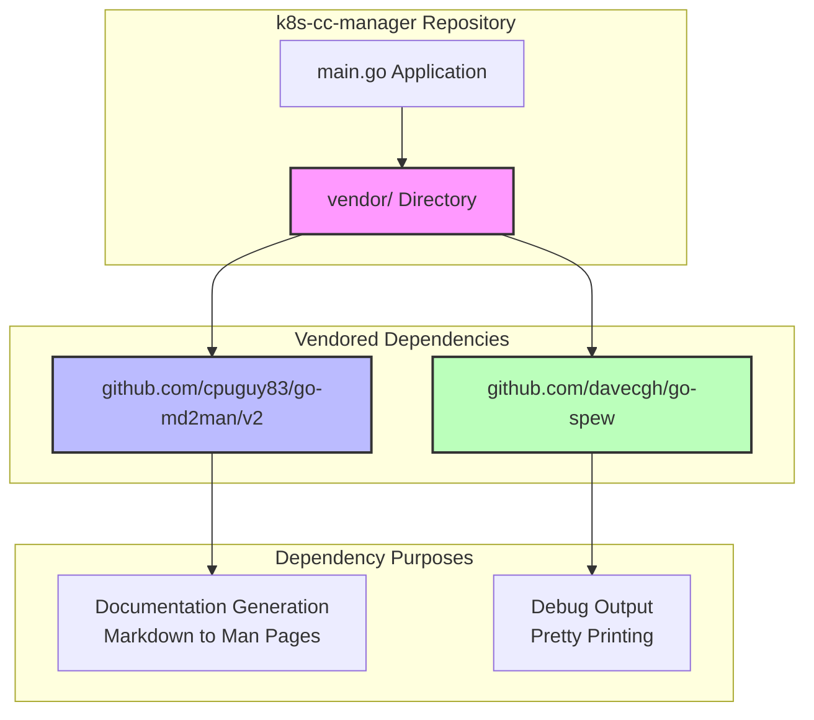
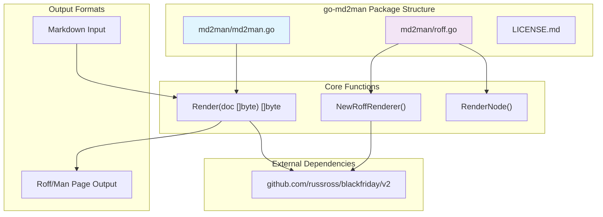
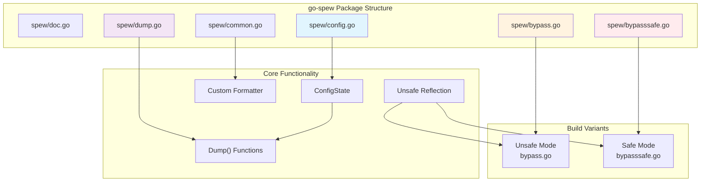
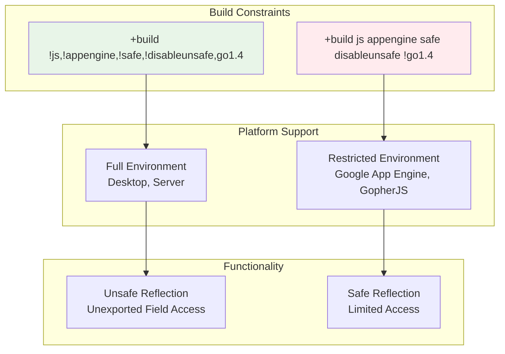

<!-- source: DeepWiki mcp.deepwiki.com · repo NVIDIA/k8s-cc-manager · page 7.1 Vendored Dependencies · fetched 2026-10-26 -->

# Vendored Dependencies

Relevant source files

The following files were used as context for generating this wiki page:

- [vendor/github.com/cpuguy83/go-md2man/v2/LICENSE.md](vendor/github.com/cpuguy83/go-md2man/v2/LICENSE.md)
- [vendor/github.com/cpuguy83/go-md2man/v2/md2man/md2man.go](vendor/github.com/cpuguy83/go-md2man/v2/md2man/md2man.go)
- [vendor/github.com/cpuguy83/go-md2man/v2/md2man/roff.go](vendor/github.com/cpuguy83/go-md2man/v2/md2man/roff.go)
- [vendor/github.com/davecgh/go-spew/LICENSE](vendor/github.com/davecgh/go-spew/LICENSE)
- [vendor/github.com/davecgh/go-spew/spew/bypass.go](vendor/github.com/davecgh/go-spew/spew/bypass.go)
- [vendor/github.com/davecgh/go-spew/spew/bypasssafe.go](vendor/github.com/davecgh/go-spew/spew/bypasssafe.go)
- [vendor/github.com/davecgh/go-spew/spew/common.go](vendor/github.com/davecgh/go-spew/spew/common.go)
- [vendor/github.com/davecgh/go-spew/spew/config.go](vendor/github.com/davecgh/go-spew/spew/config.go)
- [vendor/github.com/davecgh/go-spew/spew/doc.go](vendor/github.com/davecgh/go-spew/spew/doc.go)
- [vendor/github.com/davecgh/go-spew/spew/dump.go](vendor/github.com/davecgh/go-spew/spew/dump.go)

This document provides comprehensive coverage of the vendored dependencies included in the k8s-cc-manager codebase. Vendored dependencies are third-party Go packages that have been copied directly into the repository's `vendor/` directory to ensure reproducible builds and dependency version control.

For information about Go module dependencies managed through `go.mod`, see [Dependencies](#3.3).

## Overview

The k8s-cc-manager project includes two key vendored dependencies that provide essential functionality for documentation generation and debugging capabilities:

**Sources:** [vendor/github.com/cpuguy83/go-md2man/v2/LICENSE.md:1-22](), [vendor/github.com/davecgh/go-spew/LICENSE:1-16]()

## Dependency Details

| Dependency | Version | License | Purpose | Key Components |
|------------|---------|---------|---------|----------------|
| `go-md2man` | v2 | MIT | Markdown to man page conversion | `md2man.Render()`, `roffRenderer` |
| `go-spew` | Latest | ISC | Debug pretty printing | `spew.Dump()`, `ConfigState` |

## go-md2man: Markdown to Man Page Converter

The `github.com/cpuguy83/go-md2man/v2` package provides functionality to convert Markdown documentation into Unix manual (man) pages in roff format.

### Architecture and Components

**Sources:** [vendor/github.com/cpuguy83/go-md2man/v2/md2man/md2man.go:1-15](), [vendor/github.com/cpuguy83/go-md2man/v2/md2man/roff.go:1-337]()

### Key Components

#### Render Function
The main entry point for markdown conversion:
- **Location:** [vendor/github.com/cpuguy83/go-md2man/v2/md2man/md2man.go:8-14]()
- **Purpose:** Converts markdown documents to roff format
- **Dependencies:** Uses `blackfriday.Run()` with custom renderer

#### roffRenderer
The core renderer implementation:
- **Location:** [vendor/github.com/cpuguy83/go-md2man/v2/md2man/roff.go:14-68]()
- **Interface:** Implements `blackfriday.Renderer` interface
- **Features:** Handles headers, lists, tables, code blocks, and formatting

#### Roff Format Constants
Extensive roff formatting tags and commands:
- **Location:** [vendor/github.com/cpuguy83/go-md2man/v2/md2man/roff.go:22-51]()
- **Tags:** Title headers, emphasis, code spans, tables, lists
- **Purpose:** Define roff markup for proper man page formatting

## go-spew: Debug Pretty Printer

The `github.com/davecgh/go-spew` package provides advanced debugging capabilities through deep pretty printing of Go data structures.

### Architecture and Components

**Sources:** [vendor/github.com/davecgh/go-spew/spew/doc.go:1-212](), [vendor/github.com/davecgh/go-spew/spew/config.go:1-307](), [vendor/github.com/davecgh/go-spew/spew/dump.go:1-510]()

### Key Components

#### ConfigState
Central configuration for formatting behavior:
- **Location:** [vendor/github.com/davecgh/go-spew/spew/config.go:37-101]()
- **Options:** Indentation, depth limits, method invocation, pointer handling
- **Global Instance:** `spew.Config` with default settings

#### Dump Functions
Primary debugging output functions:
- **Dump():** [vendor/github.com/davecgh/go-spew/spew/dump.go:507-509]() - Outputs to stdout
- **Fdump():** [vendor/github.com/davecgh/go-spew/spew/dump.go:472-474]() - Outputs to any writer
- **Sdump():** [vendor/github.com/davecgh/go-spew/spew/dump.go:478-482]() - Returns formatted string

#### Unsafe Reflection Support
Platform-specific reflection bypassing:
- **Unsafe Mode:** [vendor/github.com/davecgh/go-spew/spew/bypass.go:21-146]() - Full unsafe access
- **Safe Mode:** [vendor/github.com/davecgh/go-spew/spew/bypasssafe.go:19-39]() - Limited functionality for restricted environments
- **Purpose:** Access unexported fields and invoke pointer receiver methods

### Configuration Options

| Option | Type | Purpose | Default |
|--------|------|---------|---------|
| `Indent` | string | Indentation string | `" "` (single space) |
| `MaxDepth` | int | Maximum nesting depth | `0` (unlimited) |
| `DisableMethods` | bool | Skip error/Stringer interfaces | `false` |
| `DisablePointerMethods` | bool | Skip pointer receiver methods | `false` |
| `DisablePointerAddresses` | bool | Hide memory addresses | `false` |
| `SortKeys` | bool | Sort map keys for deterministic output | `false` |

**Sources:** [vendor/github.com/davecgh/go-spew/spew/config.go:37-101]()

## Build Configuration and Platform Support

Both vendored dependencies include build-specific configurations for different environments:

**Sources:** [vendor/github.com/davecgh/go-spew/spew/bypass.go:21](), [vendor/github.com/davecgh/go-spew/spew/bypasssafe.go:19]()

## Integration with k8s-cc-manager

While these dependencies are vendored and available for use, their primary purposes within the k8s-cc-manager project are:

### go-md2man Usage
- **CLI Documentation:** Converting markdown help text to man pages
- **Build Process:** Generating documentation during container builds
- **Distribution:** Creating properly formatted manual pages for end users

### go-spew Usage
- **Development:** Debugging complex Kubernetes API objects
- **Testing:** Pretty printing test data structures
- **Troubleshooting:** Enhanced output for error diagnostics

## Licensing Information

Both vendored dependencies use permissive open source licenses:

| Package | License | Copyright | File |
|---------|---------|-----------|------|
| go-md2man | MIT | Brian Goff (2014) | [vendor/github.com/cpuguy83/go-md2man/v2/LICENSE.md:1-22]() |
| go-spew | ISC | Dave Collins (2012-2016) | [vendor/github.com/davecgh/go-spew/LICENSE:1-16]() |

These licenses are compatible with the k8s-cc-manager project's licensing requirements and allow for redistribution within the vendored codebase.

**Sources:** [vendor/github.com/cpuguy83/go-md2man/v2/LICENSE.md:1-22](), [vendor/github.com/davecgh/go-spew/LICENSE:1-16]()