# Page: Overview

# Overview

<details>
<summary>Relevant source files</summary>

The following files were used as context for generating this wiki page:

- [LICENSE](LICENSE)
- [README.md](README.md)
- [go.mod](go.mod)

</details>


## Purpose and Scope

The NVIDIA k8s-cc-manager is a Kubernetes component that manages NVIDIA GPU Confidential Computing (CC) mode within Kubernetes clusters. This system automatically enables and disables CC mode on supported NVIDIA GPUs based on Kubernetes node labels and orchestrates the necessary pod lifecycle operations to safely transition GPU states.

This document provides a high-level overview of the k8s-cc-manager system architecture, core components, and operational workflow. For detailed information about the core application implementation, see [Core Application](#3). For CI/CD pipeline details, see [CI/CD Pipelines](#5). For container system specifics, see [Container System](#4).

Sources: [README.md:1-3](), [go.mod:1-13]()

## System Architecture

The k8s-cc-manager operates as a containerized Kubernetes workload that bridges GPU hardware management with Kubernetes orchestration. The system consists of a Go application that watches Kubernetes API events and coordinates with shell scripts and Python tools to manage GPU states.

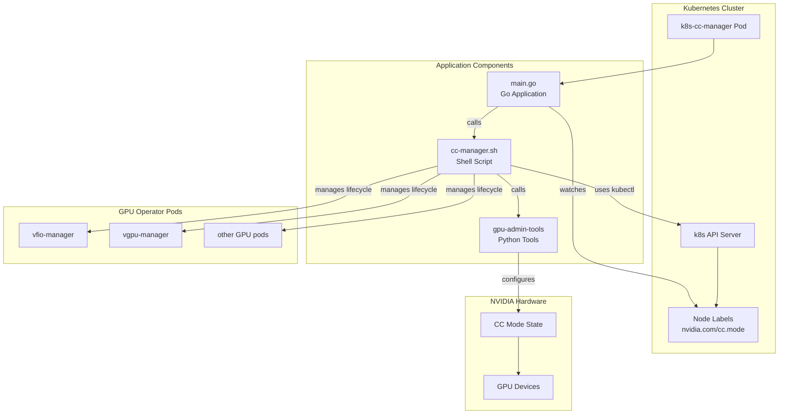

**System Architecture Overview**

This architecture shows how the `main.go` application integrates with Kubernetes APIs to watch node label changes and coordinate CC mode transitions through the `cc-manager.sh` script.

Sources: [README.md:1-3](), [go.mod:7-13]()

## Core Components and Code Mapping

The k8s-cc-manager system maps to specific code entities that handle different aspects of GPU CC mode management:

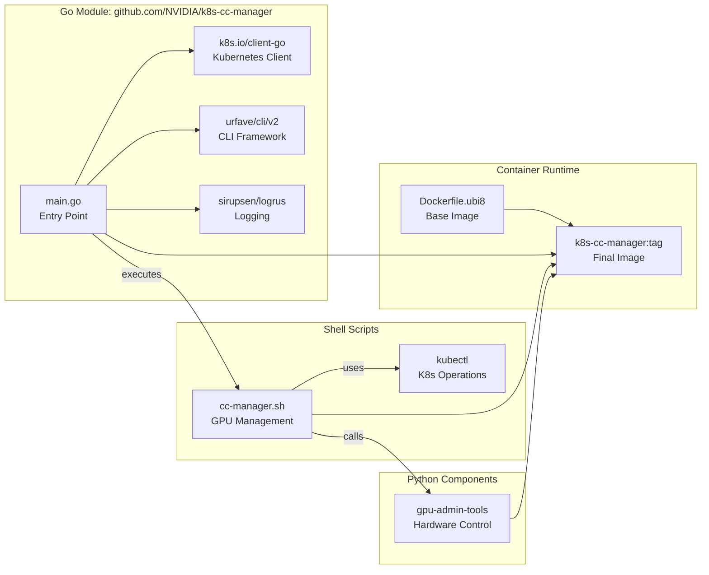

**Code Entity Mapping**

This diagram maps system components to their corresponding code entities, showing how the Go module dependencies integrate with scripts and container components.

Sources: [go.mod:1-13](), [go.mod:7-12]()

## Kubernetes Integration Architecture

The k8s-cc-manager integrates deeply with Kubernetes APIs and relies on specific node labeling conventions and pod management patterns:

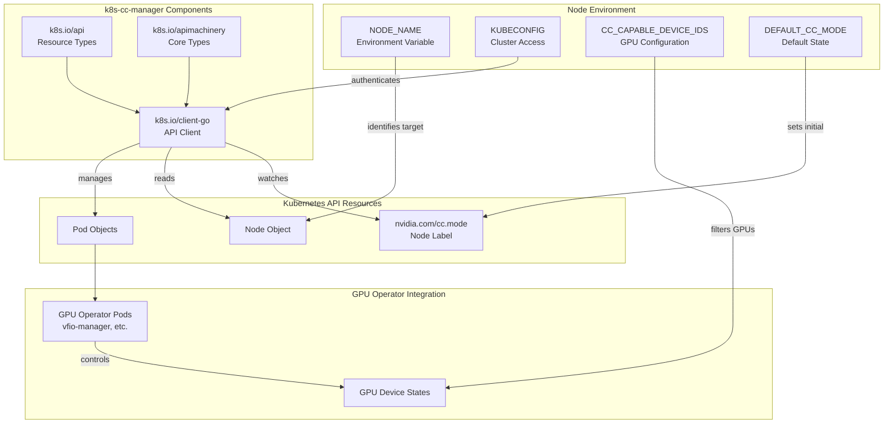

**Kubernetes Integration Architecture**

This diagram shows how the k8s-cc-manager uses Kubernetes client libraries to interact with cluster resources and coordinate with GPU Operator components.

Sources: [go.mod:10-12]()

## Runtime Workflow

The k8s-cc-manager follows a specific operational workflow that coordinates Kubernetes API operations with GPU hardware management:

| Phase | Component | Action | Code Entity |
|-------|-----------|--------|-------------|
| **Initialization** | `main.go` | Parse CLI arguments and setup logging | `urfave/cli/v2`, `sirupsen/logrus` |
| **Cluster Connection** | `main.go` | Establish Kubernetes client connection | `k8s.io/client-go` |
| **Label Watching** | `main.go` | Watch for node label changes | `k8s.io/api`, `nvidia.com/cc.mode` |
| **CC Mode Transition** | `cc-manager.sh` | Execute GPU state changes | `gpu-admin-tools` |
| **Pod Management** | `cc-manager.sh` | Coordinate GPU operator pod lifecycle | `kubectl` binary |
| **State Verification** | `main.go` | Verify successful CC mode transition | `k8s.io/client-go` |

**Runtime Workflow Table**

This table shows the sequential phases of operation and which code entities are responsible for each phase.

Sources: [go.mod:7-13](), [README.md:1-3]()

## System Context and Integration Points

The k8s-cc-manager operates within the broader NVIDIA GPU Operator ecosystem and relies on several integration points:

- **Kubernetes Node Labels**: Uses `nvidia.com/cc.mode` labels to trigger CC mode transitions
- **GPU Operator Pods**: Coordinates with existing GPU operator pods like `vfio-manager` and `vgpu-manager`
- **Environment Configuration**: Relies on environment variables like `NODE_NAME`, `CC_CAPABLE_DEVICE_IDS`, and `DEFAULT_CC_MODE`
- **Container Registry**: Distributed as container image `k8s-cc-manager:tag` through multiple registries
- **Hardware Integration**: Directly interfaces with NVIDIA GPU hardware through Python tools

The system is licensed under Apache License 2.0 and follows Kubernetes community standards for cluster component development.

Sources: [LICENSE:1-203](), [go.mod:1-56]()

---

# Page: Architecture

# Architecture

<details>
<summary>Relevant source files</summary>

The following files were used as context for generating this wiki page:

- [cmd/main.go](cmd/main.go)
- [scripts/cc-manager.sh](scripts/cc-manager.sh)

</details>


This document describes the high-level system architecture of the k8s-cc-manager, covering how the Go application, shell scripts, Kubernetes integration, and GPU management components work together to enable dynamic NVIDIA GPU Confidential Computing mode management in Kubernetes clusters.

For information about the specific implementation details of the core application components, see [Core Application](#3). For container build and deployment details, see [Container System](#4).

## System Overview

The k8s-cc-manager implements a Kubernetes controller pattern that watches for node label changes and orchestrates GPU Confidential Computing mode transitions. The system consists of three primary layers: a Go-based Kubernetes controller, a shell script orchestrator, and Python-based GPU management tools.

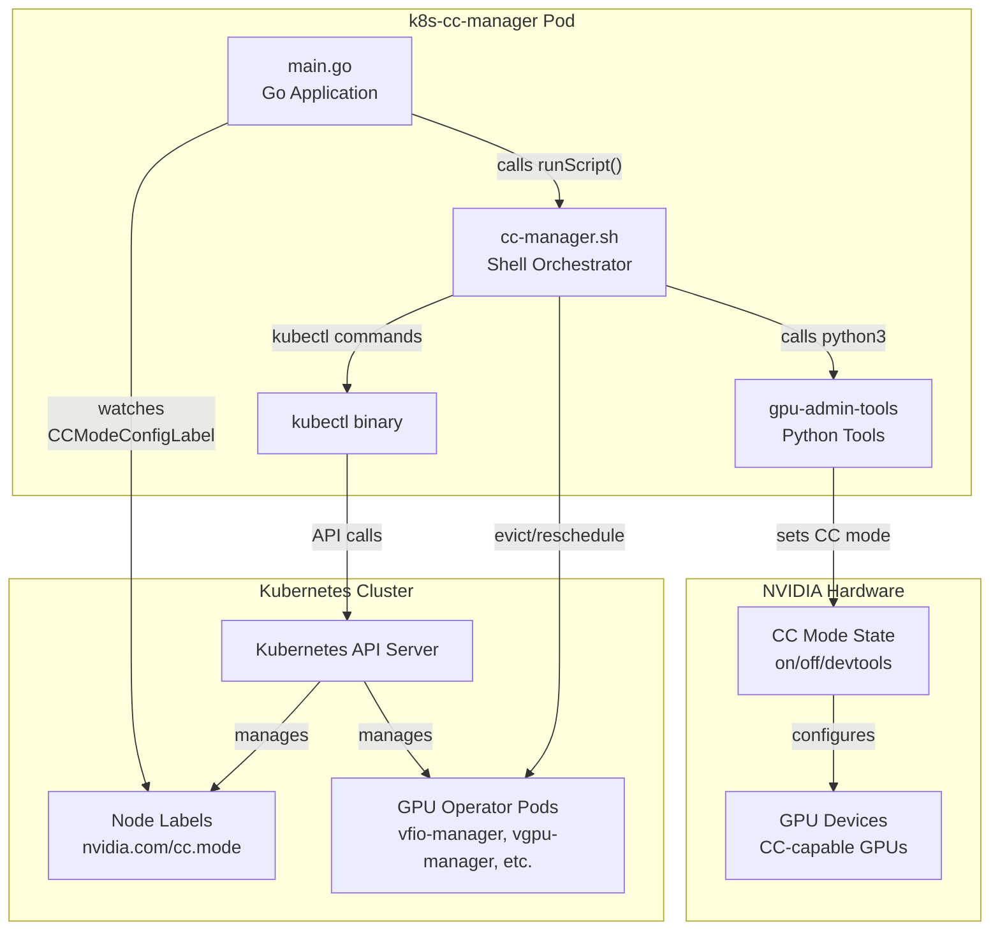

**System Architecture Overview**

Sources: [cmd/main.go:1-212](), [scripts/cc-manager.sh:1-537]()

## Core Controller Pattern

The Go application implements a standard Kubernetes controller pattern using the client-go library to watch for changes to specific node labels and react accordingly.

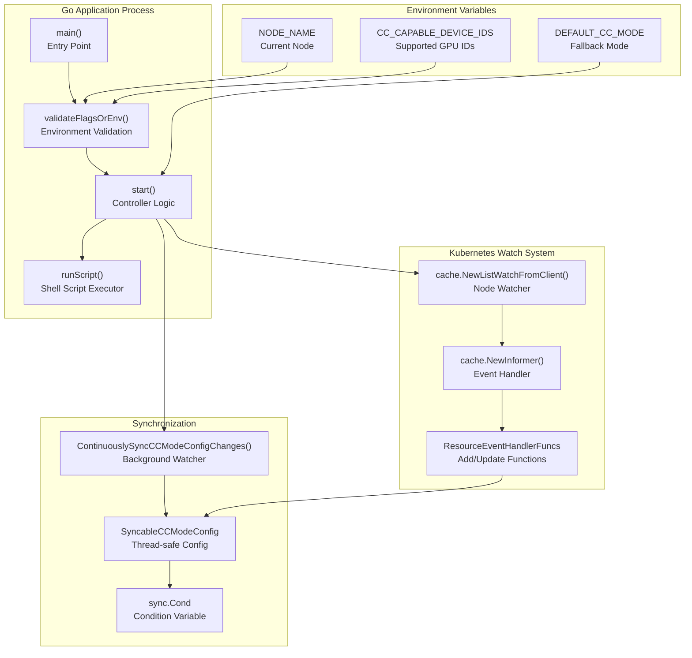

**Controller Pattern Implementation**

The system uses several key constants and data structures:
- `CCModeConfigLabel` constant (`"nvidia.com/cc.mode"`) for the watched node label
- `SyncableCCModeConfig` struct for thread-safe configuration synchronization
- `ResourceNodes` constant for the Kubernetes resource type being watched

Sources: [cmd/main.go:37-41](), [cmd/main.go:48-76](), [cmd/main.go:184-211]()

## GPU Management Workflow

The shell script orchestrates complex GPU mode transitions by coordinating with multiple GPU operator components and managing hardware state changes.

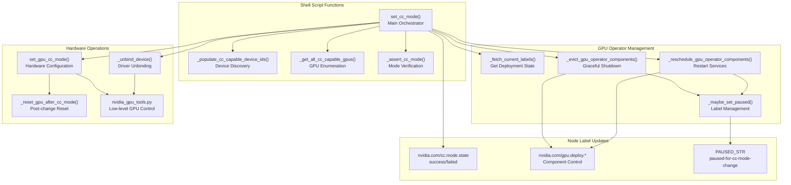

**GPU Management Orchestration**

The script manages five specific GPU operator components through node labels:
- `nvidia.com/gpu.deploy.vfio-manager`
- `nvidia.com/gpu.deploy.vgpu-manager` 
- `nvidia.com/gpu.deploy.sandbox-validator`
- `nvidia.com/gpu.deploy.sandbox-device-plugin`
- `nvidia.com/gpu.deploy.vgpu-device-manager`

Sources: [scripts/cc-manager.sh:336-382](), [scripts/cc-manager.sh:259-318](), [scripts/cc-manager.sh:320-334]()

## Component State Management

The system implements sophisticated state management to ensure safe GPU mode transitions without disrupting running workloads.

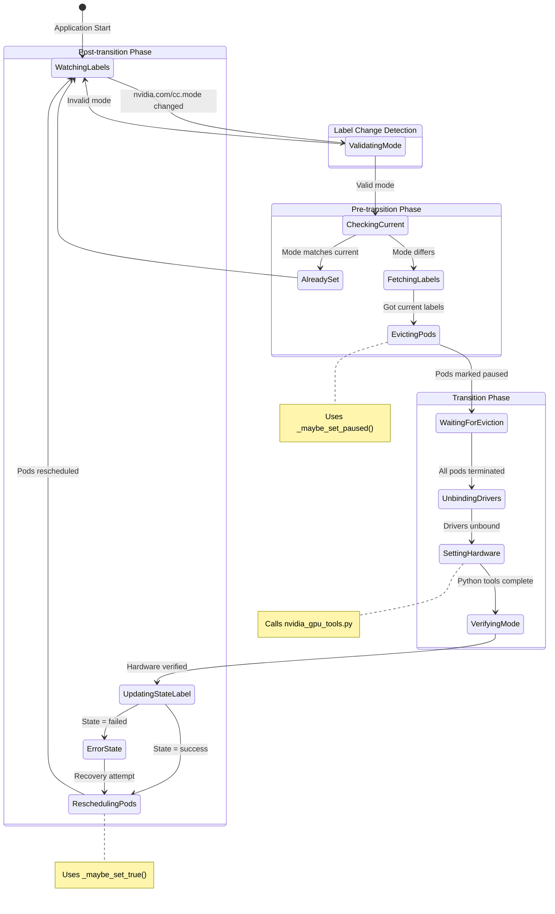

**State Transition Management**

The system uses specific state indicators:
- `nvidia.com/cc.mode.state` label with values `"success"` or `"failed"`
- `PAUSED_STR` constant (`"paused-for-cc-mode-change"`) for component coordination
- Timeout values (5 minutes) for pod eviction operations

Sources: [scripts/cc-manager.sh:170-208](), [scripts/cc-manager.sh:259-318](), [scripts/cc-manager.sh:336-382]()

## Kubernetes Integration Architecture

The application integrates deeply with Kubernetes APIs using the client-go library for both watching resources and managing node labels.

| Component | Purpose | Key APIs Used |
|-----------|---------|---------------|
| **Node Watcher** | Monitor label changes | `cache.NewListWatchFromClient()`, `fields.OneTermEqualSelector()` |
| **Event Handler** | Process label updates | `cache.ResourceEventHandlerFuncs{}` |
| **Label Manager** | Update node labels | `kubectl` CLI commands via shell execution |
| **Pod Coordinator** | Manage operator pods | `kubectl wait --for=delete pod` commands |

The system requires specific environment variables for proper Kubernetes integration:
- `NODE_NAME`: Identifies the current node for label operations
- `KUBECONFIG`: Optional kubeconfig file path for API access
- `CC_CAPABLE_DEVICE_IDS`: Comma-separated list of supported GPU device IDs

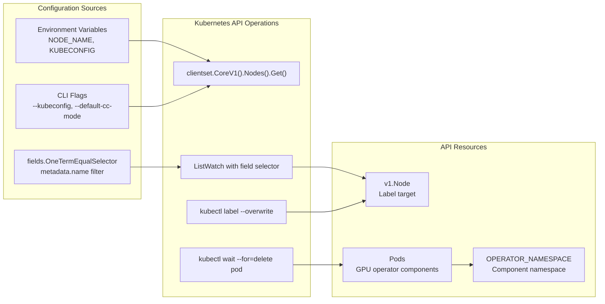

**Kubernetes API Integration**

Sources: [cmd/main.go:119-170](), [cmd/main.go:184-211](), [scripts/cc-manager.sh:217-257]()

---

# Page: Core Application

# Core Application

<details>
<summary>Relevant source files</summary>

The following files were used as context for generating this wiki page:

- [cmd/main.go](cmd/main.go)
- [scripts/cc-manager.sh](scripts/cc-manager.sh)

</details>


The core application consists of the main Go binary and shell script that together implement the NVIDIA GPU Confidential Computing mode management for Kubernetes nodes. This page documents the primary application components and their interactions.

For detailed information about the Go application implementation, see [Main Application (Go)](#3.1). For shell script functionality, see [GPU Management Script](#3.2). For dependency management, see [Dependencies](#3.3).

## Application Architecture

The core application follows a two-tier architecture where a Go application serves as the Kubernetes-native controller and a shell script handles the low-level GPU management operations.

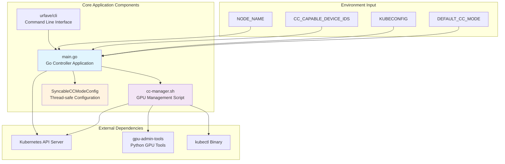

**Sources**: [cmd/main.go:1-212](), [scripts/cc-manager.sh:1-537]()

## Component Interaction Flow

The application operates through a well-defined interaction flow that ensures safe GPU CC mode transitions while maintaining Kubernetes integration.

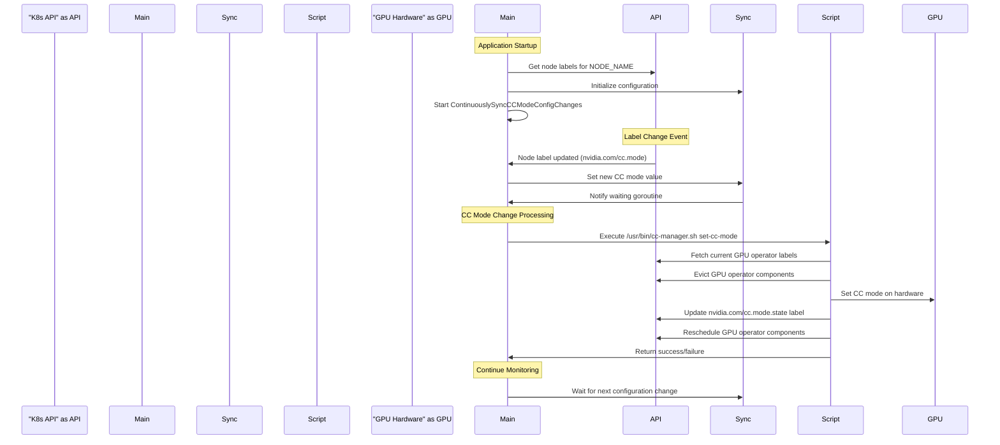

**Sources**: [cmd/main.go:119-170](), [cmd/main.go:184-211](), [scripts/cc-manager.sh:336-382]()

## Kubernetes Integration Points

The application integrates with Kubernetes through multiple API interaction patterns and label management strategies.

| Integration Point | Component | Purpose | Code Location |
|-------------------|-----------|---------|---------------|
| Node Label Watching | main.go | Monitor `nvidia.com/cc.mode` changes | [cmd/main.go:184-211]() |
| GPU Operator Labels | cc-manager.sh | Control component deployment | [scripts/cc-manager.sh:217-257]() |
| Pod Lifecycle Management | cc-manager.sh | Evict and reschedule pods | [scripts/cc-manager.sh:259-334]() |
| Status Reporting | cc-manager.sh | Update `nvidia.com/cc.mode.state` | [scripts/cc-manager.sh:359-376]() |

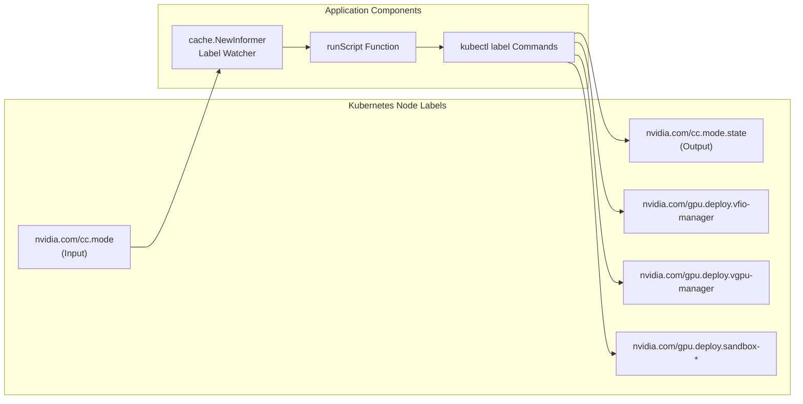

**Sources**: [cmd/main.go:37-41](), [cmd/main.go:194-206](), [scripts/cc-manager.sh:218-256]()

## Configuration Management

The application uses a thread-safe configuration management system to coordinate between the Kubernetes watcher and the CC mode execution logic.

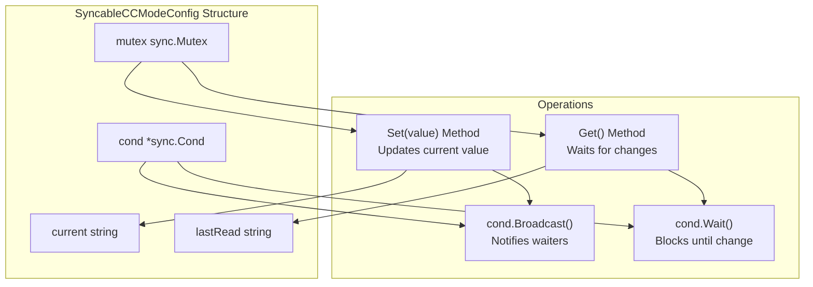

**Sources**: [cmd/main.go:48-76]()

## Error Handling and Recovery

The application implements comprehensive error handling with automatic recovery mechanisms for failed CC mode transitions.

| Error Scenario | Handler | Recovery Action | Code Location |
|----------------|---------|-----------------|---------------|
| Environment validation failure | `validateFlagsOrEnv` | Exit with error | [cmd/main.go:109-117]() |
| Kubernetes API errors | `start` function | Return formatted error | [cmd/main.go:120-134]() |
| Script execution failure | `runScript` | Log error and continue | [cmd/main.go:164-167]() |
| GPU operation failure | `_exit_failed` | Reschedule components and exit | [scripts/cc-manager.sh:210-215]() |
| Label update failure | Individual functions | Return error status | [scripts/cc-manager.sh:269-271]() |

The shell script includes a comprehensive cleanup mechanism that ensures GPU operator components are properly rescheduled even during failure scenarios:

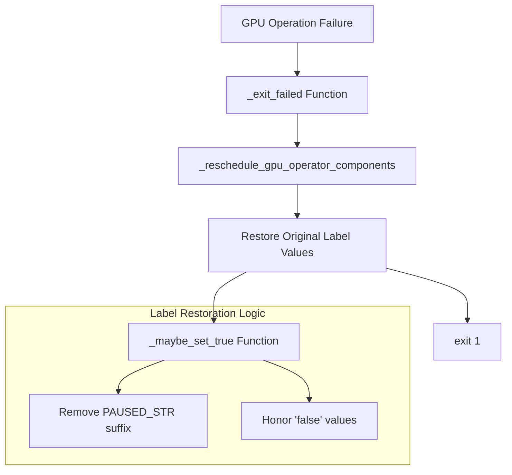

**Sources**: [scripts/cc-manager.sh:210-215](), [scripts/cc-manager.sh:320-334](), [scripts/cc-manager.sh:196-208]()

## Command Line Interface

The main application uses the `urfave/cli` framework to provide a structured command-line interface with environment variable support:

| Flag | Environment Variable | Purpose | Default |
|------|---------------------|---------|---------|
| `--kubeconfig` | `KUBECONFIG` | Path to kubeconfig file | "" |
| `--default-cc-mode` | `DEFAULT_CC_MODE` | Default CC mode when label absent | "" |

**Required Environment Variables:**
- `NODE_NAME`: Kubernetes node name for the current instance
- `CC_CAPABLE_DEVICE_IDS`: Comma-separated list of CC-capable GPU device IDs

**Sources**: [cmd/main.go:83-99](), [cmd/main.go:109-117]()

The shell script provides its own command interface supporting GPU management operations with device-specific or node-wide scope through the commands `set-cc-mode` and `get-cc-mode` with options for targeting all devices (`-a`) or specific device IDs (`-d`).

**Sources**: [scripts/cc-manager.sh:472-482](), [scripts/cc-manager.sh:489-513]()

---

# Page: Main Application (Go)

# Main Application (Go)

<details>
<summary>Relevant source files</summary>

The following files were used as context for generating this wiki page:

- [cmd/main.go](cmd/main.go)

</details>


This document covers the main Go application that serves as the core orchestrator for NVIDIA GPU Confidential Computing mode management in Kubernetes. The application watches for node label changes and coordinates with shell scripts to perform actual GPU configuration changes.

For information about the shell script that performs the actual GPU management operations, see [GPU Management Script](#3.2). For details about Go module dependencies, see [Dependencies](#3.3).

## Application Structure

The main Go application is implemented as a single binary that runs as a long-lived process within a Kubernetes pod. It uses the `urfave/cli` framework to provide a command-line interface and integrates deeply with the Kubernetes API server to monitor node configuration changes.

### CLI Application Framework

The application initializes using the `cli.NewApp()` constructor and defines two primary configuration flags:

| Flag | Environment Variable | Purpose |
|------|---------------------|---------|
| `--kubeconfig` | `KUBECONFIG` | Path to Kubernetes configuration file |
| `--default-cc-mode` | `DEFAULT_CC_MODE` | Default CC mode when node label is absent |

The application validates required environment variables `NODE_NAME` and `CC_CAPABLE_DEVICE_IDS` during startup through the `validateFlagsOrEnv` function.

**Application Flow Diagram**

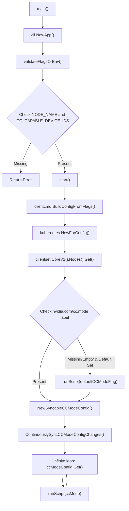

Sources: [cmd/main.go:78-107](), [cmd/main.go:109-117](), [cmd/main.go:119-170]()

## Configuration Management

The application manages CC mode configuration through a thread-safe structure called `SyncableCCModeConfig`. This structure implements a condition variable pattern to coordinate between the Kubernetes event watcher and the main application loop.

### SyncableCCModeConfig Structure

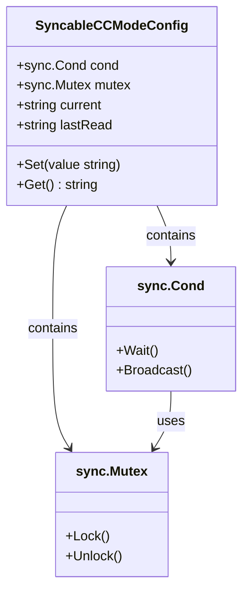

The `Set` method updates the current configuration value and broadcasts to waiting goroutines, while the `Get` method blocks until a new value is available that differs from the last read value.

**Configuration Constants**

| Constant | Value | Purpose |
|----------|-------|---------|
| `CCModeConfigLabel` | `"nvidia.com/cc.mode"` | Kubernetes node label for CC mode |
| `ResourceNodes` | `"nodes"` | Kubernetes resource type being watched |
| `DefaultHostNvidiaDir` | `"/usr/local/nvidia"` | Default NVIDIA driver directory |

Sources: [cmd/main.go:37-41](), [cmd/main.go:48-76]()

## Kubernetes Integration

The application integrates with Kubernetes through the `client-go` library, specifically using informers to watch for node label changes. It creates a specialized `ListWatch` that monitors only the current node.

### Node Watching Mechanism

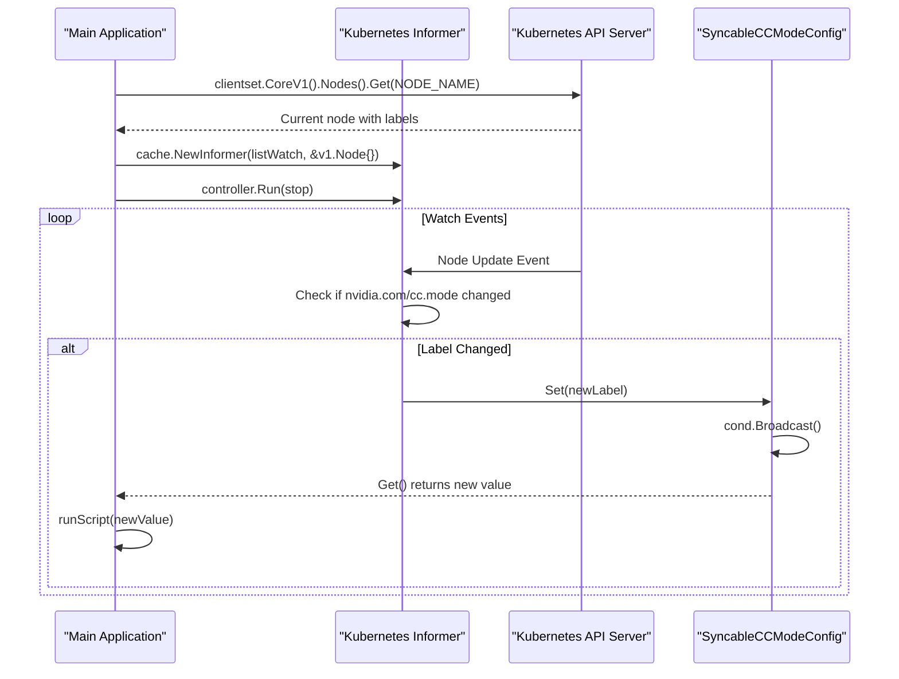

The `ContinuouslySyncCCModeConfigChanges` function creates an informer that specifically watches for the current node using a field selector:

```
fields.OneTermEqualSelector("metadata.name", os.Getenv("NODE_NAME"))
```

Sources: [cmd/main.go:184-211](), [cmd/main.go:130-148]()

## Script Execution

When a CC mode change is detected, the application executes the external shell script `/usr/bin/cc-manager.sh` through the `runScript` function. This function constructs command arguments and executes the script with proper stdio redirection.

### Script Invocation Pattern

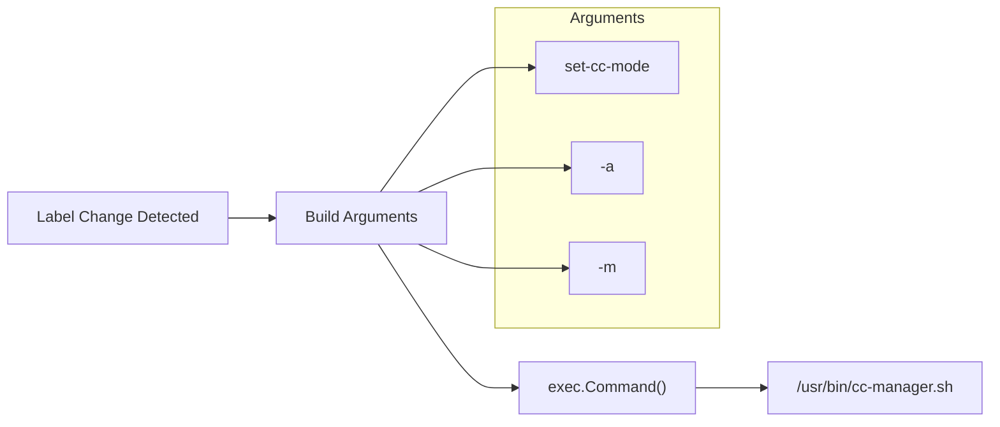

The script is invoked with these arguments:
- `set-cc-mode`: The operation mode
- `-a`: Apply changes flag
- `-m <ccMode>`: The target CC mode value

Error handling ensures that script failures are logged but do not terminate the main application loop, allowing for retry on subsequent label changes.

Sources: [cmd/main.go:172-182](), [cmd/main.go:163-168]()

## Synchronization Mechanism

The application uses a producer-consumer pattern where the Kubernetes informer acts as the producer of configuration changes, and the main application loop acts as the consumer. The `SyncableCCModeConfig` structure provides thread-safe coordination between these components.

### Thread Synchronization Flow

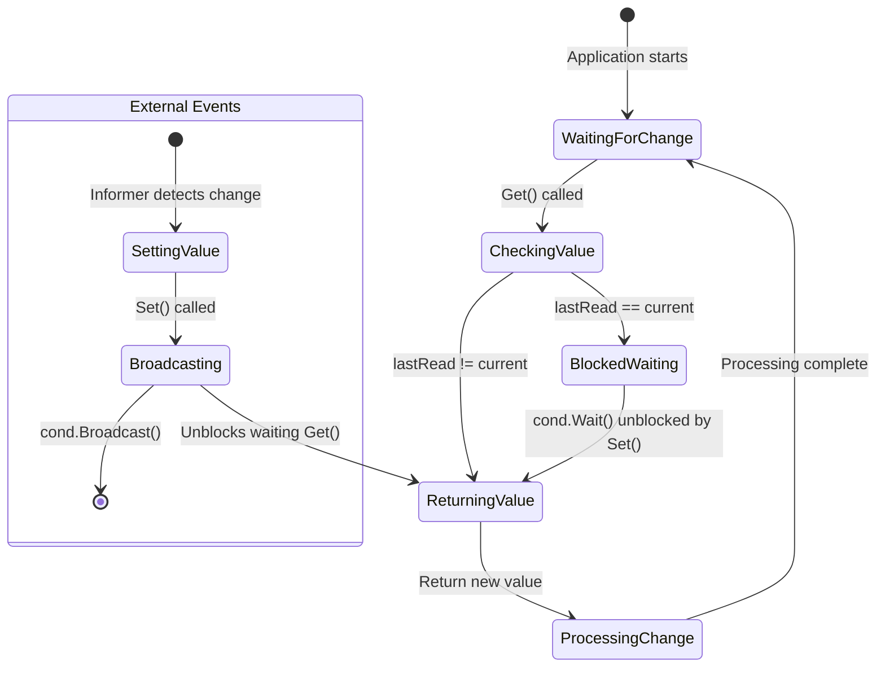

This design ensures that:
1. The main loop blocks until a genuine configuration change occurs
2. Multiple rapid changes are coalesced - only the latest value is processed
3. No configuration changes are lost during script execution
4. The application remains responsive to Kubernetes API events

Sources: [cmd/main.go:55-76](), [cmd/main.go:150-169](), [cmd/main.go:194-205]()

---

# Page: GPU Management Script

# GPU Management Script

<details>
<summary>Relevant source files</summary>

The following files were used as context for generating this wiki page:

- [scripts/cc-manager.sh](scripts/cc-manager.sh)

</details>


This document covers the `cc-manager.sh` script, which serves as the core orchestration component for managing NVIDIA GPU Confidential Computing (CC) mode on Kubernetes nodes. The script handles GPU discovery, CC mode transitions, and coordination with the GPU Operator's pod lifecycle to ensure safe mode changes.

For information about the main Go application that invokes this script, see [Main Application (Go)](#3.1). For details about the container system that packages this script, see [Container Images](#4.1).

## Purpose and Scope

The `cc-manager.sh` script provides the primary interface for:
- Setting and querying GPU Confidential Computing mode on CC-capable devices
- Managing GPU Operator component lifecycle during mode transitions
- Coordinating with Kubernetes node labels for state tracking
- Interfacing with NVIDIA GPU admin tools for low-level device operations

## Script Architecture

The script follows a modular design with distinct phases for GPU discovery, mode validation, pod eviction, and mode setting operations.

**Script Architecture Flow**

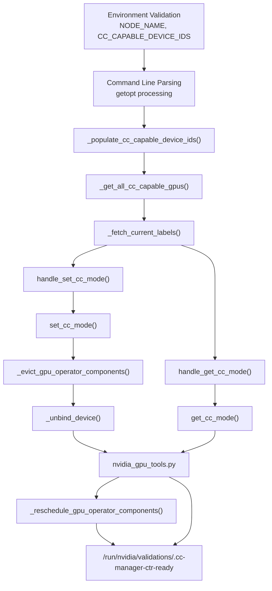

Sources: [scripts/cc-manager.sh:1-537]()

## Environment Variables and Configuration

The script requires specific environment variables and validates their presence during initialization.

| Variable | Purpose | Required | Default |
|----------|---------|----------|---------|
| `NODE_NAME` | Kubernetes node name for label operations | Yes | N/A |
| `CC_CAPABLE_DEVICE_IDS` | Comma-separated GPU device IDs supporting CC | Yes | N/A |
| `OPERATOR_NAMESPACE` | Namespace containing GPU Operator pods | No | Inferred |

**Environment Variable Processing**

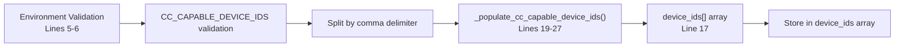

Sources: [scripts/cc-manager.sh:5-6](), [scripts/cc-manager.sh:19-27]()

## GPU Discovery and Management

The script implements a comprehensive GPU discovery mechanism that identifies CC-capable devices on the node.

**GPU Discovery Process**

```mermaid
graph TD
    SCAN["Scan /sys/bus/pci/devices/*<br/>Line 60"]
    VENDOR["Check vendor == 0x10de<br/>Lines 61-64"]
    CLASS["Check class 0x030000 or 0x030200<br/>Lines 65-68"]
    BDF["Extract PCI BDF<br/>Line 69"]
    
    DEVICE_ID["_get_device_id()<br/>Lines 78-87"]
    CC_CHECK["_is_cc_capable_gpu()<br/>Lines 102-109"]
    ARRAY_ADD["Add to gpus[] array<br/>Lines 71-75"]
    
    UNBIND["_unbind_device_from_driver()<br/>Lines 40-50"]
    RESET["_reset_gpu_after_cc_mode()<br/>Lines 29-38"]
    
    SCAN --> VENDOR
    VENDOR --> CLASS
    CLASS --> BDF
    BDF --> DEVICE_ID
    DEVICE_ID --> CC_CHECK
    CC_CHECK --> ARRAY_ADD
    
    ARRAY_ADD --> UNBIND
    UNBIND --> RESET
```

Sources: [scripts/cc-manager.sh:58-76](), [scripts/cc-manager.sh:78-87](), [scripts/cc-manager.sh:102-109]()

### GPU Array Management

The script maintains arrays for tracking discovered GPUs and their capabilities:

- `gpus[]`: Array of PCI Bus:Device.Function identifiers for CC-capable GPUs
- `device_ids[]`: Array of GPU device IDs that support Confidential Computing
- Array operations use `_array_contains()` helper function for membership testing

Sources: [scripts/cc-manager.sh:14-17](), [scripts/cc-manager.sh:89-100]()

## CC Mode Operations

The script supports three CC modes: `on`, `off`, and `devtools`. Mode operations involve coordination between multiple system components.

**CC Mode State Machine**

```mermaid
stateDiagram-v2
    [*] --> QueryMode: _assert_gpu_cc_mode()
    QueryMode --> CurrentMode: nvidia_gpu_tools.py --query-cc-mode
    CurrentMode --> SameMode: Mode matches target
    CurrentMode --> ChangeMode: Mode differs from target
    
    SameMode --> [*]: No action needed
    
    ChangeMode --> EvictPods: _evict_gpu_operator_components()
    EvictPods --> UnbindDevice: _unbind_device()
    UnbindDevice --> SetMode: nvidia_gpu_tools.py --set-cc-mode
    SetMode --> VerifyMode: _assert_gpu_cc_mode()
    VerifyMode --> ReschedulePods: _reschedule_gpu_operator_components()
    ReschedulePods --> UpdateLabel: nvidia.com/cc.mode.state=success
    UpdateLabel --> [*]
    
    SetMode --> FailureLabel: Mode change failed
    FailureLabel --> ExitFailed: nvidia.com/cc.mode.state=failed
    ExitFailed --> [*]
```

Sources: [scripts/cc-manager.sh:336-382](), [scripts/cc-manager.sh:384-405]()

### Mode Validation and Parsing

The script implements strict mode validation and parsing logic:

- `_is_valid_mode()`: Validates mode against allowed values (`on`, `off`, `devtools`)
- `_parse_mode()`: Extracts CC mode from Python tool output using regex patterns
- Mode assertions ensure consistency across all CC-capable GPUs on the node

Sources: [scripts/cc-manager.sh:111-123](), [scripts/cc-manager.sh:125-134](), [scripts/cc-manager.sh:136-168]()

## Kubernetes Integration

The script heavily integrates with Kubernetes APIs to manage GPU Operator component lifecycle and node labels.

**Kubernetes Label Management**

```mermaid
graph TD
    FETCH["_fetch_current_labels()<br/>Lines 217-257"]
    
    VFIO["nvidia.com/gpu.deploy.vfio-manager"]
    VGPU_MGR["nvidia.com/gpu.deploy.vgpu-manager"] 
    SANDBOX_VAL["nvidia.com/gpu.deploy.sandbox-validator"]
    SANDBOX_PLG["nvidia.com/gpu.deploy.sandbox-device-plugin"]
    VGPU_DEV["nvidia.com/gpu.deploy.vgpu-device-manager"]
    
    PAUSE["_maybe_set_paused()<br/>Lines 173-191"]
    RESTORE["_maybe_set_true()<br/>Lines 196-208"]
    
    KUBECTL_LABEL["kubectl label --overwrite"]
    
    FETCH --> VFIO
    FETCH --> VGPU_MGR
    FETCH --> SANDBOX_VAL
    FETCH --> SANDBOX_PLG
    FETCH --> VGPU_DEV
    
    VFIO --> PAUSE
    VGPU_MGR --> PAUSE
    SANDBOX_VAL --> PAUSE
    SANDBOX_PLG --> PAUSE
    VGPU_DEV --> PAUSE
    
    PAUSE --> KUBECTL_LABEL
    RESTORE --> KUBECTL_LABEL
```

Sources: [scripts/cc-manager.sh:217-257](), [scripts/cc-manager.sh:173-191](), [scripts/cc-manager.sh:196-208]()

### Pod Lifecycle Management

The script orchestrates GPU Operator pod eviction and scheduling through label manipulation:

**Pod Eviction Flow**

```mermaid
graph TD
    EVICT_START["_evict_gpu_operator_components()<br/>Line 259"]
    LABEL_PAUSE["Set labels to paused state<br/>Lines 261-267"]
    
    WAIT_VFIO["Wait for vfio-manager pods<br/>Lines 273-280"]
    WAIT_VGPU["Wait for vgpu-manager pods<br/>Lines 282-289"]
    WAIT_SANDBOX_VAL["Wait for sandbox-validator pods<br/>Lines 291-298"]
    WAIT_SANDBOX_PLG["Wait for sandbox-device-plugin pods<br/>Lines 300-307"]
    WAIT_VGPU_DEV["Wait for vgpu-device-manager pods<br/>Lines 309-316"]
    
    KUBECTL_WAIT["kubectl wait --for=delete pod<br/>--timeout=5m"]
    
    EVICT_START --> LABEL_PAUSE
    LABEL_PAUSE --> WAIT_VFIO
    LABEL_PAUSE --> WAIT_VGPU
    LABEL_PAUSE --> WAIT_SANDBOX_VAL
    LABEL_PAUSE --> WAIT_SANDBOX_PLG
    LABEL_PAUSE --> WAIT_VGPU_DEV
    
    WAIT_VFIO --> KUBECTL_WAIT
    WAIT_VGPU --> KUBECTL_WAIT
    WAIT_SANDBOX_VAL --> KUBECTL_WAIT
    WAIT_SANDBOX_PLG --> KUBECTL_WAIT
    WAIT_VGPU_DEV --> KUBECTL_WAIT
```

Sources: [scripts/cc-manager.sh:259-318](), [scripts/cc-manager.sh:320-334]()

### Label State Management

The script implements sophisticated label state management to preserve user-configured values:

| Original Value | Paused State | Restored State |
|----------------|--------------|----------------|
| `""` (empty) | `""` | `""` |
| `"false"` | `"false"` | `"false"` |
| `"true"` | `"paused-for-cc-mode-change"` | `"true"` |
| `"custom_value"` | `"custom_value_paused-for-cc-mode-change"` | `"custom_value"` |

Sources: [scripts/cc-manager.sh:173-191](), [scripts/cc-manager.sh:196-208]()

## Command-Line Interface

The script provides a command-line interface for manual CC mode management operations.

**CLI Command Structure**

```mermaid
graph TD
    CLI_START["Command line parsing<br/>Lines 488-513"]
    
    SET_CMD["set-cc-mode"]
    GET_CMD["get-cc-mode"]
    HELP_CMD["help"]
    
    SET_OPTS["-a|--all, -d|--device-id, -m|--mode"]
    GET_OPTS["-a|--all, -d|--device-id"]
    
    HANDLE_SET["handle_set_cc_mode()<br/>Lines 452-460"]
    HANDLE_GET["handle_get_cc_mode()<br/>Lines 462-470"]
    USAGE["usage()<br/>Lines 472-482"]
    
    CLI_START --> SET_CMD
    CLI_START --> GET_CMD
    CLI_START --> HELP_CMD
    
    SET_CMD --> SET_OPTS
    GET_CMD --> GET_OPTS
    HELP_CMD --> USAGE
    
    SET_OPTS --> HANDLE_SET
    GET_OPTS --> HANDLE_GET
    
    HANDLE_SET --> set_cc_mode
    HANDLE_SET --> set_gpu_cc_mode
    HANDLE_GET --> get_cc_mode
    HANDLE_GET --> get_gpu_cc_mode
```

Sources: [scripts/cc-manager.sh:488-513](), [scripts/cc-manager.sh:452-470](), [scripts/cc-manager.sh:472-482]()

### Command Examples

The script supports both individual GPU and all-device operations:

- Set CC mode for all devices: `set-cc-mode --all --mode on`
- Set CC mode for specific device: `set-cc-mode --device-id 0000:01:00.0 --mode off`
- Get CC mode for all devices: `get-cc-mode --all`
- Get CC mode for specific device: `get-cc-mode --device-id 0000:01:00.0`

Sources: [scripts/cc-manager.sh:474-481]()

## Error Handling and Validation

The script implements comprehensive error handling with automatic cleanup and state restoration.

**Error Handling Flow**

```mermaid
graph TD
    ERROR["Error condition detected"]
    EXIT_FAILED["_exit_failed()<br/>Lines 210-215"]
    RESCHEDULE["_reschedule_gpu_operator_components()"]
    EXIT["exit 1"]
    
    STATE_FAILED["nvidia.com/cc.mode.state=failed<br/>Lines 359-366"]
    LABEL_UPDATE["kubectl label --overwrite"]
    
    ERROR --> EXIT_FAILED
    ERROR --> STATE_FAILED
    
    EXIT_FAILED --> RESCHEDULE
    STATE_FAILED --> LABEL_UPDATE
    
    RESCHEDULE --> EXIT
    LABEL_UPDATE --> EXIT_FAILED
```

Sources: [scripts/cc-manager.sh:210-215](), [scripts/cc-manager.sh:359-366]()

### Readiness Indication

Upon successful completion, the script creates a readiness file to signal container readiness:

- Readiness file: `/run/nvidia/validations/.cc-manager-ctr-ready`
- Created only after successful operation completion
- Used by container orchestration systems for health checking

Sources: [scripts/cc-manager.sh:536]()

## Integration with Python Tools

The script interfaces with the `nvidia_gpu_tools.py` Python module for low-level GPU operations:

| Operation | Python Command | Purpose |
|-----------|----------------|---------|
| Query CC Mode | `--query-cc-mode --gpu-bdf=$gpu` | Read current CC mode |
| Set CC Mode | `--set-cc-mode=$mode --reset-after-cc-mode-switch --gpu-bdf=$gpu` | Change CC mode |
| Reset GPU | `--reset-after-cc-mode-switch --gpu-bdf=$gpu` | Post-transition reset |

Sources: [scripts/cc-manager.sh:152](), [scripts/cc-manager.sh:389](), [scripts/cc-manager.sh:31](), [scripts/cc-manager.sh:437]()

---

# Page: Dependencies

# Dependencies

<details>
<summary>Relevant source files</summary>

The following files were used as context for generating this wiki page:

- [go.mod](go.mod)
- [go.sum](go.sum)

</details>


This document covers the external Go module dependencies used by the k8s-cc-manager application. It details the direct and indirect dependencies declared in the Go module files, their purposes, and how they integrate with the overall system architecture.

For information about the main Go application that uses these dependencies, see [Main Application (Go)](#3.1). For details about container build dependencies, see [Build System](#4.2).

## Dependency Architecture Overview

The k8s-cc-manager application relies on a carefully curated set of Go modules to provide Kubernetes integration, command-line interface capabilities, and logging functionality. The dependency graph shows clear separation between core Kubernetes libraries, application frameworks, and supporting utilities.

```mermaid
graph TD
    subgraph "Application Layer"
        MAIN["main.go Application"]
    end
    
    subgraph "Direct Dependencies"
        LOGRUS["github.com/sirupsen/logrus@v1.9.3"]
        CLI["github.com/urfave/cli/v2@v2.27.1"]
        K8S_API["k8s.io/api@v0.29.3"]
        K8S_APIMACHINERY["k8s.io/apimachinery@v0.29.3"]
        K8S_CLIENT_GO["k8s.io/client-go@v0.29.3"]
    end
    
    subgraph "Key Indirect Dependencies"
        GO_MD2MAN["github.com/cpuguy83/go-md2man/v2@v2.0.2"]
        GO_SPEW["github.com/davecgh/go-spew@v1.1.1"]
        PFLAG["github.com/spf13/pflag@v1.0.5"]
        KLOG["k8s.io/klog/v2@v2.110.1"]
    end
    
    MAIN --> LOGRUS
    MAIN --> CLI
    MAIN --> K8S_API
    MAIN --> K8S_APIMACHINERY
    MAIN --> K8S_CLIENT_GO
    
    CLI --> GO_MD2MAN
    K8S_CLIENT_GO --> GO_SPEW
    K8S_CLIENT_GO --> PFLAG
    K8S_CLIENT_GO --> KLOG
```

**Sources:** [go.mod:1-57]()

## Core Kubernetes Dependencies

The application's primary integration with Kubernetes is achieved through three essential libraries that provide API types, core utilities, and client functionality.

### Kubernetes Client Libraries

| Dependency | Version | Purpose |
|------------|---------|---------|
| `k8s.io/client-go` | v0.29.3 | Primary Kubernetes client library for API server communication |
| `k8s.io/api` | v0.29.3 | Kubernetes API object definitions and types |
| `k8s.io/apimachinery` | v0.29.3 | Core Kubernetes API machinery and utilities |

```mermaid
graph LR
    subgraph "Kubernetes Integration"
        CLIENT_GO["k8s.io/client-go"]
        API["k8s.io/api"]
        APIMACHINERY["k8s.io/apimachinery"]
    end
    
    subgraph "Application Functions"
        NODE_WATCH["Node Label Watching"]
        POD_MANAGEMENT["Pod Lifecycle Management"]
        API_CALLS["Kubernetes API Calls"]
    end
    
    CLIENT_GO --> NODE_WATCH
    CLIENT_GO --> POD_MANAGEMENT
    CLIENT_GO --> API_CALLS
    API --> NODE_WATCH
    APIMACHINERY --> CLIENT_GO
```

The `k8s.io/client-go` library is the foundation for all Kubernetes operations, providing clientsets, informers, and watch capabilities that the main application uses to monitor node labels and manage GPU operator pods.

**Sources:** [go.mod:10-12]()

## Application Framework Dependencies

The command-line interface and logging functionality are provided by established Go libraries that offer robust, production-ready capabilities.

### CLI Framework

The `github.com/urfave/cli/v2` library at version v2.27.1 provides the command-line interface framework. This library handles argument parsing, subcommand routing, and help text generation for the main application.

```mermaid
graph TD
    CLI_LIB["github.com/urfave/cli/v2@v2.27.1"]
    
    subgraph "CLI Components"
        APP["cli.App"]
        COMMANDS["cli.Commands"]
        FLAGS["cli.Flags"]
        CONTEXT["cli.Context"]
    end
    
    subgraph "Supporting Libraries"
        MD2MAN["github.com/cpuguy83/go-md2man/v2@v2.0.2"]
        SMETRICS["github.com/xrash/smetrics@v0.0.0-20201216005158-039620a65673"]
    end
    
    CLI_LIB --> APP
    CLI_LIB --> COMMANDS
    CLI_LIB --> FLAGS
    CLI_LIB --> CONTEXT
    CLI_LIB --> MD2MAN
    CLI_LIB --> SMETRICS
```

### Logging Infrastructure

The `github.com/sirupsen/logrus` library at version v1.9.3 provides structured logging capabilities with support for different log levels, formatting options, and output destinations.

**Sources:** [go.mod:8-9]()

## Indirect Dependencies

The application inherits numerous indirect dependencies through its direct dependencies, particularly from the Kubernetes client libraries which have extensive dependency trees.

### Key Indirect Dependencies

| Category | Dependencies | Purpose |
|----------|--------------|---------|
| **Serialization** | `github.com/gogo/protobuf`, `google.golang.org/protobuf` | Protocol buffer support for Kubernetes APIs |
| **HTTP/Network** | `golang.org/x/net`, `golang.org/x/oauth2` | Network communication and OAuth2 authentication |
| **Utilities** | `github.com/google/uuid`, `github.com/imdario/mergo` | UUID generation and object merging |
| **Testing** | `github.com/davecgh/go-spew`, `github.com/google/go-cmp` | Pretty printing and comparison utilities |

```mermaid
graph TD
    subgraph "Kubernetes Dependencies"
        K8S_CLIENT["k8s.io/client-go"]
        K8S_UTILS["k8s.io/utils@v0.0.0-20230726121419-3b25d923346b"]
        KLOG["k8s.io/klog/v2@v2.110.1"]
    end
    
    subgraph "Serialization Layer"
        PROTOBUF["google.golang.org/protobuf@v1.33.0"]
        GOGO_PROTO["github.com/gogo/protobuf@v1.3.2"]
        JSON_ITER["github.com/json-iterator/go@v1.1.12"]
    end
    
    subgraph "Network Layer"
        GOLANG_NET["golang.org/x/net@v0.23.0"]
        OAUTH2["golang.org/x/oauth2@v0.10.0"]
        APPENGINE["google.golang.org/appengine@v1.6.7"]
    end
    
    K8S_CLIENT --> K8S_UTILS
    K8S_CLIENT --> KLOG
    K8S_CLIENT --> PROTOBUF
    K8S_CLIENT --> GOGO_PROTO
    K8S_CLIENT --> JSON_ITER
    K8S_CLIENT --> GOLANG_NET
    K8S_CLIENT --> OAUTH2
    OAUTH2 --> APPENGINE
```

**Sources:** [go.mod:15-56]()

## Version Management

All dependency versions are precisely specified using semantic versioning and are locked through the `go.sum` file which contains cryptographic checksums for reproducible builds.

### Go Toolchain Requirements

The module requires Go version 1.21 with toolchain go1.21.5, ensuring compatibility with modern Go features while maintaining stability.

```mermaid
graph LR
    subgraph "Version Control"
        GO_MOD["go.mod"]
        GO_SUM["go.sum"]
        TOOLCHAIN["go1.21.5"]
    end
    
    subgraph "Dependency Versions"
        DIRECT["Direct Dependencies<br/>5 packages"]
        INDIRECT["Indirect Dependencies<br/>41 packages"]
        CHECKSUMS["SHA-256 Checksums<br/>164 entries"]
    end
    
    GO_MOD --> DIRECT
    GO_MOD --> INDIRECT
    GO_MOD --> TOOLCHAIN
    GO_SUM --> CHECKSUMS
    CHECKSUMS --> DIRECT
    CHECKSUMS --> INDIRECT
```

The dependency management follows Go module best practices with all versions pinned to specific releases, ensuring reproducible builds across different environments and CI/CD systems.

**Sources:** [go.mod:3-5](), [go.sum:1-165]()

---

# Page: Container System

# Container System

<details>
<summary>Relevant source files</summary>

The following files were used as context for generating this wiki page:

- [deployments/container/Dockerfile.ubi8](deployments/container/Dockerfile.ubi8)
- [deployments/container/Makefile](deployments/container/Makefile)

</details>


The Container System encompasses the containerization infrastructure for the k8s-cc-manager application, including Docker image definitions, multi-architecture build processes, and registry distribution mechanisms. This system packages the Go application, shell scripts, and supporting tools into deployable container images that can run across different architectures and Kubernetes environments.

For detailed information about the specific container images and their contents, see [Container Images](#4.1). For build system mechanics and multi-architecture support, see [Build System](#4.2).

## Container Build Architecture

The container system uses a multi-stage build process to create optimized images that include all necessary components for GPU confidential computing management.

### Multi-Stage Build Process

```mermaid
graph TD
    subgraph "Build Stage"
        GOLANG_BASE["golang:${GOLANG_VERSION}"]
        SRC_COPY["Copy source code"]
        GO_BUILD["CGO_ENABLED=0 go build"]
        SCRIPT_COPY["Copy cc-manager.sh"]
        KUBECTL_DL["Download kubectl binary"]
        ARTIFACTS["/artifacts/\nk8s-cc-manager\ncc-manager.sh\nkubectl"]
    end
    
    subgraph "Runtime Stage"
        CUDA_BASE["nvidia/cuda:${CUDA_VERSION}-base-${BASE_DIST}"]
        PYTHON_INSTALL["Install python38, git, numpy"]
        GPU_TOOLS_CLONE["Clone gpu-admin-tools"]
        BINARY_COPY["Copy artifacts from build stage"]
        LABELS["Set container labels"]
        FINAL_IMAGE["k8s-cc-manager:${IMAGE_TAG}"]
    end
    
    GOLANG_BASE --> SRC_COPY
    SRC_COPY --> GO_BUILD
    SRC_COPY --> SCRIPT_COPY
    GO_BUILD --> ARTIFACTS
    SCRIPT_COPY --> ARTIFACTS
    KUBECTL_DL --> ARTIFACTS
    
    CUDA_BASE --> PYTHON_INSTALL
    PYTHON_INSTALL --> GPU_TOOLS_CLONE
    GPU_TOOLS_CLONE --> BINARY_COPY
    ARTIFACTS --> BINARY_COPY
    BINARY_COPY --> LABELS
    LABELS --> FINAL_IMAGE
```

Sources: [deployments/container/Dockerfile.ubi8:19-66]()

### Final Container Image Structure

The resulting container includes multiple components organized in the filesystem:

```mermaid
graph TB
    subgraph "Container Image: k8s-cc-manager"
        subgraph "/usr/bin/"
            K8S_CC_MANAGER["/usr/bin/k8s-cc-manager"]
            KUBECTL_BIN["/usr/bin/kubectl"]
            CC_MANAGER_SCRIPT["/usr/bin/cc-manager.sh"]
            GPU_ADMIN_TOOLS["/usr/bin/gpu-admin-tools/"]
        end
        
        subgraph "Python Environment"
            PYTHON38["python38"]
            NUMPY["numpy package"]
        end
        
        subgraph "Base System"
            UBI8_BASE["Red Hat UBI8"]
            CUDA_RUNTIME["NVIDIA CUDA runtime"]
            LICENSES["/licenses/NGC-DL-CONTAINER-LICENSE"]
        end
        
        ENTRYPOINT["ENTRYPOINT: k8s-cc-manager"]
    end
    
    K8S_CC_MANAGER --> CC_MANAGER_SCRIPT
    CC_MANAGER_SCRIPT --> KUBECTL_BIN
    CC_MANAGER_SCRIPT --> GPU_ADMIN_TOOLS
    GPU_ADMIN_TOOLS --> PYTHON38
    GPU_ADMIN_TOOLS --> NUMPY
```

Sources: [deployments/container/Dockerfile.ubi8:51-66]()

## Build System Architecture

The build system supports multiple architectures and distributions through a flexible Makefile-based approach.

### Build Target Structure

```mermaid
graph TD
    subgraph "Make Targets"
        DISTRIBUTIONS["DISTRIBUTIONS := ubi8"]
        BUILD_TARGETS["BUILD_TARGETS := build-ubi8"]
        PUSH_TARGETS["PUSH_TARGETS := push-ubi8"]
        DEFAULT_PUSH["DEFAULT_PUSH_TARGET := ubi8"]
    end
    
    subgraph "Build Configuration"
        VERSIONS_MK["versions.mk"]
        MULTI_ARCH_FLAG["BUILD_MULTI_ARCH_IMAGES"]
        NATIVE_MK["native-only.mk"]
        MULTI_ARCH_MK["multi-arch.mk"]
    end
    
    subgraph "Docker Build Process"
        BUILDKIT["DOCKER_BUILDKIT=1"]
        BUILDX["docker buildx build"]
        BUILD_ARGS["--build-arg BASE_DIST\n--build-arg CUDA_VERSION\n--build-arg GOLANG_VERSION\n--build-arg VERSION\n--build-arg CVE_UPDATES\n--build-arg GPU_ADMIN_TOOLS_VERSION"]
        DOCKERFILE_UBI8["Dockerfile.ubi8"]
    end
    
    DISTRIBUTIONS --> BUILD_TARGETS
    BUILD_TARGETS --> PUSH_TARGETS
    VERSIONS_MK --> BUILD_ARGS
    MULTI_ARCH_FLAG --> NATIVE_MK
    MULTI_ARCH_FLAG --> MULTI_ARCH_MK
    BUILD_TARGETS --> BUILDKIT
    BUILDKIT --> BUILDX
    BUILDX --> BUILD_ARGS
    BUILD_ARGS --> DOCKERFILE_UBI8
```

Sources: [deployments/container/Makefile:22-90]()

### Image Tagging and Registry Strategy

The build system implements a comprehensive tagging strategy for different environments and architectures:

| Variable | Purpose | Example Value |
|----------|---------|---------------|
| `IMAGE_NAME` | Base image name | `nvidia/k8s-cc-manager` |
| `IMAGE_VERSION` | Version from versions.mk | `v0.1.0` |
| `DIST` | Distribution suffix | `ubi8` |
| `IMAGE_TAG` | Full image tag | `v0.1.0-ubi8` |
| `OUT_IMAGE_NAME` | Output registry name | `nvidia/k8s-cc-manager` |

Sources: [deployments/container/Makefile:25-38]()

## Multi-Architecture Support

The container system supports building for multiple architectures using Docker Buildx:

```mermaid
graph LR
    subgraph "Architecture Detection"
        TARGETARCH["ARG TARGETARCH"]
        X86_64["x86_64 → amd64"]
        AARCH64["aarch64 → arm64"]
    end
    
    subgraph "Build Process"
        BUILDX_FLAG["BUILD_MULTI_ARCH_IMAGES=true"]
        DOCKER_BUILDX["docker buildx build"]
        PLATFORM_OPTIONS["DOCKER_BUILD_PLATFORM_OPTIONS"]
    end
    
    subgraph "Binary Downloads"
        KUBECTL_AMD64["kubectl linux/amd64"]
        KUBECTL_ARM64["kubectl linux/arm64"]
        OS_ARCH_CONVERT["OS_ARCH=${TARGETARCH/x86_64/amd64}"]
    end
    
    TARGETARCH --> X86_64
    TARGETARCH --> AARCH64
    BUILDX_FLAG --> DOCKER_BUILDX
    DOCKER_BUILDX --> PLATFORM_OPTIONS
    X86_64 --> OS_ARCH_CONVERT
    AARCH64 --> OS_ARCH_CONVERT
    OS_ARCH_CONVERT --> KUBECTL_AMD64
    OS_ARCH_CONVERT --> KUBECTL_ARM64
```

Sources: [deployments/container/Dockerfile.ubi8:23-34](), [deployments/container/Makefile:15-54]()

## Build Arguments and Customization

The Dockerfile accepts multiple build arguments for customization:

| Build Argument | Purpose | Used For |
|----------------|---------|----------|
| `CUDA_VERSION` | CUDA base image version | Runtime environment |
| `BASE_DIST` | Base distribution (ubi8) | OS selection |
| `GOLANG_VERSION` | Go compiler version | Build stage |
| `VERSION` | Application version | Image labeling |
| `GIT_COMMIT` | Git commit hash | Build metadata |
| `GPU_ADMIN_TOOLS_VERSION` | gpu-admin-tools branch/tag | Python tools |
| `CVE_UPDATES` | Security updates | Vulnerability patching |

Sources: [deployments/container/Dockerfile.ubi8:15-88]()

## Security and Compliance Features

The container includes security scanning integration and license compliance:

```mermaid
graph TD
    subgraph "Security Measures"
        CGO_DISABLED["CGO_ENABLED=0"]
        CVE_UPDATES_ARG["CVE_UPDATES build arg"]
        YUM_UPDATE["yum update -y ${CVE_UPDATES}"]
        CACHE_CLEANUP["rm -rf /var/cache/yum/*"]
    end
    
    subgraph "License Compliance"
        NGC_LICENSE["/NGC-DL-CONTAINER-LICENSE"]
        LICENSES_DIR["/licenses/"]
        CONTAINER_LABELS["Container metadata labels"]
    end
    
    subgraph "Image Metadata"
        DISPLAY_NAME["io.k8s.display-name"]
        VENDOR_LABEL["vendor=NVIDIA"]
        VERSION_LABEL["version=${VERSION}"]
        SUMMARY_LABEL["summary=Manages CC mode"]
    end
    
    CGO_DISABLED --> CVE_UPDATES_ARG
    CVE_UPDATES_ARG --> YUM_UPDATE
    YUM_UPDATE --> CACHE_CLEANUP
    NGC_LICENSE --> LICENSES_DIR
    LICENSES_DIR --> CONTAINER_LABELS
    CONTAINER_LABELS --> DISPLAY_NAME
    CONTAINER_LABELS --> VENDOR_LABEL
    CONTAINER_LABELS --> VERSION_LABEL
    CONTAINER_LABELS --> SUMMARY_LABEL
```

Sources: [deployments/container/Dockerfile.ubi8:30-64]()

The container system provides a complete packaging solution for the k8s-cc-manager application, supporting multiple architectures while maintaining security best practices and license compliance requirements for enterprise Kubernetes deployments.

---

# Page: Container Images

# Container Images

<details>
<summary>Relevant source files</summary>

The following files were used as context for generating this wiki page:

- [deployments/container/Dockerfile.ubi8](deployments/container/Dockerfile.ubi8)

</details>


This document covers the container image structure and build process for the k8s-cc-manager. It details the Dockerfile configuration, multi-stage build process, runtime dependencies, and the resulting container image that gets deployed to Kubernetes clusters.

For information about the container build system and multi-architecture builds, see [Build System](#4.2). For details about the CI/CD pipelines that build these images, see [CI/CD Pipelines](#5).

## Container Architecture Overview

The k8s-cc-manager container is built using a multi-stage approach that produces a minimal runtime image containing the Go application, shell scripts, and necessary dependencies for GPU Confidential Computing management.

```mermaid
graph TD
    subgraph "Build Stage"
        GOLANG["golang:${GOLANG_VERSION}"]
        GOSRC["Go Source Code"]
        GOBUILD["k8s-cc-manager binary"]
        SCRIPT["cc-manager.sh"]
        KUBECTL["kubectl binary"]
    end
    
    subgraph "Runtime Stage"
        CUDABASE["nvidia/cuda:${CUDA_VERSION}-base-${BASE_DIST}"]
        PYTHON["Python 3.8 + numpy"]
        GITTOOLS["git"]
        ADMINTOOLS["gpu-admin-tools"]
    end
    
    subgraph "Final Image"
        CCMGR["/usr/bin/k8s-cc-manager"]
        CCSCRIPT["/usr/bin/cc-manager.sh"]
        KUBECTLBIN["/usr/bin/kubectl"]
        GPUADMIN["/usr/bin/gpu-admin-tools"]
        LICENSES["/licenses/"]
    end
    
    GOLANG --> GOSRC
    GOSRC --> GOBUILD
    GOSRC --> SCRIPT
    GOBUILD --> CCMGR
    SCRIPT --> CCSCRIPT
    KUBECTL --> KUBECTLBIN
    
    CUDABASE --> PYTHON
    PYTHON --> GITTOOLS
    GITTOOLS --> ADMINTOOLS
    ADMINTOOLS --> GPUADMIN
    
    CCMGR --> FINAL["k8s-cc-manager:tag"]
    CCSCRIPT --> FINAL
    KUBECTLBIN --> FINAL
    GPUADMIN --> FINAL
    LICENSES --> FINAL
```

Sources: [deployments/container/Dockerfile.ubi8:1-67]()

## Multi-Stage Build Process

The container uses a multi-stage build to minimize the final image size while maintaining all necessary runtime dependencies.

### Build Stage

The build stage uses the official Go image to compile the application and prepare artifacts:

| Component | Source | Destination | Purpose |
|-----------|--------|-------------|---------|
| `k8s-cc-manager` binary | Go build from `./cmd` | `/artifacts/k8s-cc-manager` | Main application executable |
| `cc-manager.sh` script | `./scripts/cc-manager.sh` | `/artifacts/cc-manager.sh` | GPU management script |
| `kubectl` binary | Kubernetes releases | `/artifacts/kubectl` | Kubernetes CLI tool |

The build process includes:
- Cross-compilation support via `TARGETARCH` argument
- Architecture normalization for kubectl download (x86_64→amd64, aarch64→arm64)
- CGO disabled for static binary compilation

Sources: [deployments/container/Dockerfile.ubi8:19-34]()

### Runtime Stage

The runtime stage is based on the NVIDIA CUDA base image and includes:

```mermaid
graph LR
    CUDA["nvidia/cuda:${CUDA_VERSION}-base-${BASE_DIST}"]
    DNF["dnf install python38 git"]
    PIP["pip3 install numpy"]
    CLONE["git clone gpu-admin-tools"]
    
    CUDA --> DNF
    DNF --> PIP
    PIP --> CLONE
```

**Key Dependencies:**
- **Python 3.8**: Required for `gpu-admin-tools` execution
- **numpy**: Python scientific computing library
- **git**: For cloning `gpu-admin-tools` repository
- **gpu-admin-tools**: NVIDIA GPU administration utilities

Sources: [deployments/container/Dockerfile.ubi8:36-58]()

## Base Image and CUDA Integration

The container inherits from the official NVIDIA CUDA base image, providing:

- CUDA runtime libraries
- NVIDIA Container Toolkit compatibility
- GPU device access capabilities
- Enterprise support through Red Hat UBI (Universal Base Image)

The base image is parameterized through build arguments:
- `CUDA_VERSION`: Specifies CUDA runtime version
- `BASE_DIST`: Defines the base distribution (typically `ubi8`)

Sources: [deployments/container/Dockerfile.ubi8:15-16,36]()

## Runtime Components

The final container image contains several key components that work together:

```mermaid
graph TD
    ENTRYPOINT["k8s-cc-manager (entrypoint)"]
    SHELL["/usr/bin/cc-manager.sh"]
    KUBE["/usr/bin/kubectl"]
    TOOLS["/usr/bin/gpu-admin-tools"]
    
    ENTRYPOINT --> |"calls"| SHELL
    SHELL --> |"uses"| KUBE
    SHELL --> |"executes"| TOOLS
    
    subgraph "GPU Admin Tools"
        NVML["nvidia-ml-py"]
        SCRIPTS["Python scripts"]
        CONFIGS["GPU configuration"]
    end
    
    TOOLS --> NVML
    TOOLS --> SCRIPTS
    TOOLS --> CONFIGS
```

**Runtime Executable Locations:**
- `/usr/bin/k8s-cc-manager`: Main Go application (entrypoint)
- `/usr/bin/cc-manager.sh`: Shell script for GPU management
- `/usr/bin/kubectl`: Kubernetes command-line interface
- `/usr/bin/gpu-admin-tools/`: Python-based GPU administration tools

Sources: [deployments/container/Dockerfile.ubi8:51-57,66]()

## Image Metadata and Labels

The container includes comprehensive metadata for Kubernetes and container registry integration:

| Label | Value | Purpose |
|-------|-------|---------|
| `io.k8s.display-name` | "NVIDIA Confidential Containers Manager for Kubernetes" | Kubernetes UI display |
| `name` | "NVIDIA Confidential Containers Manager for Kubernetes" | Container identification |
| `vendor` | "NVIDIA" | Vendor identification |
| `version` | `${VERSION}` | Build version tracking |
| `summary` | "Manages the CC mode on NVIDIA GPUs with Kubernetes" | Brief description |

**Licensing:**
The container includes NVIDIA NGC license files located at `/licenses/NGC-DL-CONTAINER-LICENSE` for compliance and legal requirements.

Sources: [deployments/container/Dockerfile.ubi8:41-49]()

## Security and CVE Management

The Dockerfile includes provisions for security updates through the `CVE_UPDATES` build argument:

- Conditional package updates during build time
- Cache cleanup to minimize image size
- Base image security patches via `yum update`

This allows for security patching without rebuilding the entire application stack.

Sources: [deployments/container/Dockerfile.ubi8:60-64]()

## Container Layers Structure

The final image consists of the following logical layers:

```mermaid
graph TB
    L1["nvidia/cuda base layer"]
    L2["System packages (python38, git)"]
    L3["Python dependencies (numpy)"]
    L4["Application binaries"]
    L5["GPU admin tools"]
    L6["Licenses and metadata"]
    
    L1 --> L2
    L2 --> L3
    L3 --> L4
    L4 --> L5
    L5 --> L6
    
    subgraph "Application Layer Details"
        BIN1["k8s-cc-manager"]
        BIN2["cc-manager.sh"]
        BIN3["kubectl"]
    end
    
    L4 --> BIN1
    L4 --> BIN2
    L4 --> BIN3
```

This layered approach optimizes for:
- Container registry caching efficiency
- Minimal rebuild requirements during development
- Security scanning granularity
- Runtime performance

Sources: [deployments/container/Dockerfile.ubi8:1-67]()

---

# Page: Build System

# Build System

<details>
<summary>Relevant source files</summary>

The following files were used as context for generating this wiki page:

- [deployments/container/Makefile](deployments/container/Makefile)
- [deployments/container/multi-arch.mk](deployments/container/multi-arch.mk)
- [deployments/container/native-only.mk](deployments/container/native-only.mk)

</details>


This document covers the container build system for the k8s-cc-manager project, including the Makefile-based build infrastructure, multi-architecture support, and registry operations. The build system orchestrates Docker/buildx builds, manages image tagging and versioning, and handles distribution to multiple container registries.

For information about the actual container images and Dockerfile contents, see [Container Images](#4.1). For details about the CI/CD pipelines that invoke this build system, see [CI/CD Pipelines](#5).

## Build System Overview

The build system is centered around a main Makefile in the `deployments/container/` directory that coordinates Docker builds, multi-architecture support, and registry operations.

### Build System Architecture

```mermaid
graph TD
    MF["deployments/container/Makefile"]
    VM["versions.mk"]
    MA["multi-arch.mk"]
    NO["native-only.mk"]
    DF["Dockerfile.ubi8"]
    
    subgraph "Build Modes"
        NATIVE["Native Build Mode<br/>BUILD_MULTI_ARCH_IMAGES=no"]
        MULTI["Multi-Arch Build Mode<br/>BUILD_MULTI_ARCH_IMAGES=true"]
    end
    
    subgraph "Build Tools"
        DOCKER["docker"]
        BUILDX["docker buildx"]
        REGCTL["regctl"]
    end
    
    subgraph "Build Targets"
        BUILD_UBI8["build-ubi8"]
        PUSH_UBI8["push-ubi8"]
        PUSH_SHORT["push-short"]
    end
    
    subgraph "Registry Operations"
        TAG["Image Tagging"]
        PUSH["Registry Push"]
        COPY["Image Copy"]
    end
    
    MF --> VM
    MF --> MA
    MF --> NO
    MF --> BUILD_UBI8
    
    BUILD_UBI8 --> DF
    BUILD_UBI8 --> DOCKER
    BUILD_UBI8 --> BUILDX
    
    NATIVE --> NO
    MULTI --> MA
    
    PUSH_UBI8 --> TAG
    PUSH_UBI8 --> PUSH
    PUSH_UBI8 --> COPY
    PUSH_SHORT --> COPY
    
    NO --> DOCKER
    MA --> REGCTL
    MA --> BUILDX
```

Sources: [deployments/container/Makefile:1-103](), [deployments/container/multi-arch.mk:1-29](), [deployments/container/native-only.mk:1-24]()

## Build Targets and Distributions

The build system defines standardized targets for building and pushing container images across different distributions.

### Available Distributions and Targets

| Distribution | Build Target | Push Target | Default |
|-------------|-------------|-------------|---------|
| `ubi8` | `build-ubi8` | `push-ubi8` | ✓ |

The system supports the following target patterns:

- **Build Targets**: `$(BUILD_TARGETS)` = `build-ubi8`
- **Push Targets**: `$(PUSH_TARGETS)` = `push-ubi8`  
- **Distribution Aliases**: `ubi8` (equivalent to `build-ubi8`)

### Build Target Implementation

```mermaid
graph LR
    DIST["DISTRIBUTIONS := ubi8"]
    BUILD_PATTERN["BUILD_TARGETS := build-%"]
    PUSH_PATTERN["PUSH_TARGETS := push-%"]
    
    subgraph "Target Resolution"
        BUILD_UBI8["build-ubi8<br/>DIST=ubi8<br/>DOCKERFILE=Dockerfile.ubi8"]
        PUSH_UBI8["push-ubi8<br/>DIST=ubi8"]
        UBI8_ALIAS["ubi8 -> build-ubi8"]
    end
    
    subgraph "Build Process"
        DOCKER_BUILD["docker buildx build<br/>--tag IMAGE<br/>--build-arg BASE_DIST"]
        DOCKERFILE["Dockerfile.ubi8"]
    end
    
    DIST --> BUILD_PATTERN
    DIST --> PUSH_PATTERN
    BUILD_PATTERN --> BUILD_UBI8
    PUSH_PATTERN --> PUSH_UBI8
    BUILD_UBI8 --> UBI8_ALIAS
    
    BUILD_UBI8 --> DOCKER_BUILD
    DOCKER_BUILD --> DOCKERFILE
```

Sources: [deployments/container/Makefile:41-46](), [deployments/container/Makefile:71-90]()

## Multi-Architecture Support

The build system supports both native-only and multi-architecture builds through conditional inclusion of architecture-specific Makefiles.

### Architecture Build Modes

```mermaid
graph TD
    BUILD_FLAG["BUILD_MULTI_ARCH_IMAGES"]
    
    subgraph "Native Build Mode"
        NATIVE_CHECK["BUILD_MULTI_ARCH_IMAGES != true"]
        NATIVE_MK["native-only.mk"]
        DOCKER_ONLY["docker (native)"]
        AMD64_PLATFORM["--platform=linux/amd64"]
        DOCKER_TAG["docker tag"]
        DOCKER_PUSH["docker push"]
    end
    
    subgraph "Multi-Arch Build Mode" 
        MULTI_CHECK["BUILD_MULTI_ARCH_IMAGES = true"]
        MULTI_MK["multi-arch.mk"]
        BUILDX_VAR["BUILDX = buildx"]
        MULTI_PLATFORM["--platform=linux/amd64,linux/arm64"]
        REGCTL_COPY["regctl image copy"]
        ATTESTATIONS["--provenance --sbom"]
    end
    
    BUILD_FLAG --> NATIVE_CHECK
    BUILD_FLAG --> MULTI_CHECK
    
    NATIVE_CHECK --> NATIVE_MK
    NATIVE_MK --> DOCKER_ONLY
    NATIVE_MK --> AMD64_PLATFORM
    NATIVE_MK --> DOCKER_TAG
    NATIVE_MK --> DOCKER_PUSH
    
    MULTI_CHECK --> MULTI_MK
    MULTI_MK --> BUILDX_VAR
    MULTI_MK --> MULTI_PLATFORM
    MULTI_MK --> REGCTL_COPY
    MULTI_MK --> ATTESTATIONS
```

### Multi-Architecture Configuration

The multi-architecture mode enables several advanced features:

**Platform Support**: `--platform=linux/amd64,linux/arm64` [deployments/container/multi-arch.mk:18]()

**Build Options**: 
- `--output=type=image,push=$(PUSH_ON_BUILD)`
- `--provenance=$(ATTACH_ATTESTATIONS)` 
- `--sbom=$(ATTACH_ATTESTATIONS)`

**Registry Operations**: Uses `regctl image copy` instead of direct Docker push operations [deployments/container/multi-arch.mk:21-29]()

Sources: [deployments/container/Makefile:15-20](), [deployments/container/Makefile:50-54](), [deployments/container/multi-arch.mk:15-29](), [deployments/container/native-only.mk:15-24]()

## Registry Operations

The build system handles image tagging, pushing, and copying to support different registry configurations and multi-platform scenarios.

### Image Naming and Tagging

```mermaid
graph TD
    subgraph "Image Name Construction"
        REGISTRY_VAR["REGISTRY ?= nvidia"]
        IMAGE_NAME_VAR["IMAGE_NAME := REGISTRY/k8s-cc-manager"]
        IMAGE_VERSION_VAR["IMAGE_VERSION := VERSION"]
        IMAGE_TAG_VAR["IMAGE_TAG := VERSION-DIST"]
        IMAGE_VAR["IMAGE := IMAGE_NAME:IMAGE_TAG"]
    end
    
    subgraph "Output Image Configuration"
        OUT_IMAGE_NAME_VAR["OUT_IMAGE_NAME ?= IMAGE_NAME"]
        OUT_IMAGE_VERSION_VAR["OUT_IMAGE_VERSION ?= IMAGE_VERSION"]
        OUT_IMAGE_TAG_VAR["OUT_IMAGE_TAG := OUT_IMAGE_VERSION-DIST"]
        OUT_IMAGE_VAR["OUT_IMAGE := OUT_IMAGE_NAME:OUT_IMAGE_TAG"]
    end
    
    subgraph "Example Values"
        EXAMPLE_IMAGE["nvidia/k8s-cc-manager:v1.0.0-ubi8"]
        EXAMPLE_OUT["registry.example.com/k8s-cc-manager:v1.0.0-ubi8"]
        EXAMPLE_SHORT["registry.example.com/k8s-cc-manager:v1.0.0"]
    end
    
    IMAGE_VAR --> EXAMPLE_IMAGE
    OUT_IMAGE_VAR --> EXAMPLE_OUT
    OUT_IMAGE_VAR --> EXAMPLE_SHORT
```

### Push Target Behavior

The push behavior differs between native and multi-architecture modes:

**Native Mode** (`native-only.mk`):
- Uses `docker tag` and `docker push` commands
- Direct registry operations

**Multi-Architecture Mode** (`multi-arch.mk`):
- Uses `regctl image copy` for registry operations  
- Supports copying images between registries
- Handles multi-platform manifests

### Short Tag Support

For the default push target (`ubi8`), the system optionally pushes a short tag without the distribution suffix:

```mermaid
graph LR
    PUSH_MULTIPLE_TAGS["PUSH_MULTIPLE_TAGS ?= true"]
    DEVEL_CHECK["OUT_IMAGE_VERSION == devel?"]
    PUSH_SHORT_TARGET["push-short"]
    
    subgraph "Short Tag Logic"
        FULL_TAG["IMAGE:v1.0.0-ubi8"]
        SHORT_TAG["IMAGE:v1.0.0"]
        SKIP_SHORT["Skip short tag for devel"]
    end
    
    PUSH_MULTIPLE_TAGS --> DEVEL_CHECK
    DEVEL_CHECK --> |"No"| PUSH_SHORT_TARGET
    DEVEL_CHECK --> |"Yes"| SKIP_SHORT
    
    PUSH_SHORT_TARGET --> FULL_TAG
    PUSH_SHORT_TARGET --> SHORT_TAG
```

Sources: [deployments/container/Makefile:25-38](), [deployments/container/Makefile:56-68](), [deployments/container/native-only.mk:17-24](), [deployments/container/multi-arch.mk:21-29]()

## Version Management

The build system integrates with version management through the `versions.mk` file and provides utilities for version bumping.

### Version Integration

The main Makefile includes version definitions: `include $(CURDIR)/versions.mk` [deployments/container/Makefile:23]()

### Build Arguments

The Docker build receives multiple version-related build arguments:

| Build Argument | Source | Purpose |
|---------------|---------|---------|
| `BASE_DIST` | `$(DIST)` | Distribution identifier |
| `CUDA_VERSION` | `versions.mk` | CUDA runtime version |
| `GOLANG_VERSION` | `versions.mk` | Go compiler version |
| `VERSION` | `versions.mk` | Application version |
| `CVE_UPDATES` | `versions.mk` | Security update flag |
| `GPU_ADMIN_TOOLS_VERSION` | `versions.mk` | GPU tools version |

### Version Bump Automation

```mermaid
graph LR
    BUMP_COMMIT_TARGET["make bump-commit"]
    VERSION_CHECK["Check for existing bump commit"]
    GIT_ADD["git add versions.mk"]
    GIT_COMMIT["git commit -m 'Bump to version VERSION'"]
    SHOW_DIFF["git diff HEAD~1"]
    
    BUMP_COMMIT_TARGET --> VERSION_CHECK
    VERSION_CHECK --> |"Not found"| GIT_ADD
    VERSION_CHECK --> |"Found"| ERROR["ERROR: already committed"]
    GIT_ADD --> GIT_COMMIT
    GIT_COMMIT --> SHOW_DIFF
```

The `bump-commit` target automates version bumping by:
1. Checking if the bump commit already exists
2. Adding the `versions.mk` file to git
3. Creating a standardized commit message
4. Displaying the applied changes

Sources: [deployments/container/Makefile:78-90](), [deployments/container/Makefile:92-103]()

## Build Configuration

The build system provides extensive configuration through environment variables and conditional logic.

### Key Configuration Variables

| Variable | Default | Purpose |
|----------|---------|---------|
| `BUILD_MULTI_ARCH_IMAGES` | `no` | Enable multi-architecture builds |
| `DOCKER` | `docker` | Docker command to use |
| `REGISTRY` | `nvidia` | Default registry prefix |
| `PUSH_ON_BUILD` | `false` | Push during build (multi-arch) |
| `ATTACH_ATTESTATIONS` | `false` | Include provenance/SBOM |
| `PUSH_MULTIPLE_TAGS` | `true` | Enable short tag pushing |
| `REGCTL` | `regctl` | Registry control tool |

### Conditional Build Logic

```mermaid
graph TD
    subgraph "Architecture Selection"
        MULTI_ARCH_FLAG["BUILD_MULTI_ARCH_IMAGES"]
        BUILDX_ASSIGNMENT["BUILDX = buildx"]
        INCLUDE_MULTI["include multi-arch.mk"]
        INCLUDE_NATIVE["include native-only.mk"]
    end
    
    subgraph "Tag Management"
        DEVEL_VERSION["DEVEL_RELEASE_IMAGE_VERSION"]
        MULTIPLE_TAGS["PUSH_MULTIPLE_TAGS"]
        SHORT_TAG_RULE["push-$(DEFAULT_PUSH_TARGET): push-short"]
    end
    
    MULTI_ARCH_FLAG --> |"true"| BUILDX_ASSIGNMENT
    MULTI_ARCH_FLAG --> |"true"| INCLUDE_MULTI
    MULTI_ARCH_FLAG --> |"!= true"| INCLUDE_NATIVE
    
    DEVEL_VERSION --> |"== devel"| MULTIPLE_TAGS
    MULTIPLE_TAGS --> |"true"| SHORT_TAG_RULE
```

### Docker Build Configuration

The main build command combines multiple configuration sources:

```bash
DOCKER_BUILDKIT=1 \
$(DOCKER) $(BUILDX) build --pull \
    $(DOCKER_BUILD_OPTIONS) \
    $(DOCKER_BUILD_PLATFORM_OPTIONS) \
    --tag $(IMAGE) \
    --build-arg BASE_DIST="$(DIST)" \
    --build-arg CUDA_VERSION="$(CUDA_VERSION)" \
    --build-arg GOLANG_VERSION="$(GOLANG_VERSION)" \
    --build-arg VERSION="$(VERSION)" \
    --build-arg CVE_UPDATES="$(CVE_UPDATES)" \
    --build-arg GPU_ADMIN_TOOLS_VERSION="$(GPU_ADMIN_TOOLS_VERSION)" \
    --file $(DOCKERFILE) \
    $(CURDIR)
```

Sources: [deployments/container/Makefile:15-20](), [deployments/container/Makefile:58-65](), [deployments/container/multi-arch.mk:15-18](), [deployments/container/native-only.mk:15]()

---

# Page: CI/CD Pipelines

# CI/CD Pipelines

<details>
<summary>Relevant source files</summary>

The following files were used as context for generating this wiki page:

- [.github/workflows/golang.yml](.github/workflows/golang.yml)
- [.github/workflows/image.yml](.github/workflows/image.yml)
- [.gitlab-ci.yml](.gitlab-ci.yml)
- [.nvidia-ci.yml](.nvidia-ci.yml)

</details>


This document covers the comprehensive CI/CD infrastructure for the k8s-cc-manager project, which includes three distinct pipeline systems: GitHub Actions for development and testing, GitLab CI for container image builds, and NVIDIA internal CI for security scanning and production releases. These pipelines work together to build, test, scan, and distribute the k8s-cc-manager container images across multiple registries and architectures.

For information about the container build system and Makefiles, see [Container System](#4). For details about the core application being built by these pipelines, see [Core Application](#3).

## Pipeline Architecture Overview

The CI/CD system consists of three interconnected pipeline systems that handle different aspects of the software delivery lifecycle:

```mermaid
graph TB
    subgraph "Source Events"
        PR["Pull Request"]
        PUSH["Push to main/release-*"]
        SCHEDULE["Scheduled Events"]
    end
    
    subgraph "GitHub Actions"
        GOLANG["golang.yml<br/>check, test, build jobs"]
        IMAGE["image.yml<br/>build job"]
        STALE["stale.yml<br/>issue management"]
    end
    
    subgraph "GitLab CI"
        BUILD["gitlab-ci.yml<br/>image-build stage"]
        COMMON[".common-ci.yml<br/>shared templates"]
    end
    
    subgraph "NVIDIA Internal"
        PULL[".nvidia-ci.yml<br/>image-pull stage"]
        SCAN[".nvidia-ci.yml<br/>scan stage"]
        RELEASE[".nvidia-ci.yml<br/>release stage"]
    end
    
    subgraph "Registries"
        GHCR["ghcr.io<br/>GitHub Container Registry"]
        STAGING["registry.gitlab.com<br/>Staging Registry"]
        NGC["NGC Registry<br/>Production"]
    end
    
    PR --> GOLANG
    PR --> IMAGE
    PUSH --> GOLANG
    PUSH --> IMAGE
    PUSH --> BUILD
    SCHEDULE --> STALE
    
    GOLANG --> |"success triggers"| IMAGE
    IMAGE --> GHCR
    BUILD --> STAGING
    COMMON --> BUILD
    
    STAGING --> |"30min delay"| PULL
    PULL --> SCAN
    SCAN --> RELEASE
    RELEASE --> NGC
```

Sources: [.github/workflows/golang.yml](), [.github/workflows/image.yml](), [.gitlab-ci.yml](), [.nvidia-ci.yml]()

## GitHub Actions Workflows

GitHub Actions handles development workflows including Go code validation, testing, and initial container image builds for pull requests and main branch pushes.

### Golang Workflow

The `golang.yml` workflow provides comprehensive Go code validation through three parallel jobs:

```mermaid
graph LR
    subgraph "golang.yml Jobs"
        CHECK["check job<br/>golangci-lint, vendor check"]
        TEST["test job<br/>unit tests"]
        BUILD["build job<br/>Go binary build"]
    end
    
    subgraph "Shared Steps"
        CHECKOUT["actions/checkout@v4"]
        GOVERSION["Get GOLANG_VERSION from versions.mk"]
        GOSETUP["actions/setup-go@v5"]
    end
    
    subgraph "Make Targets"
        CHECKVENDOR["make check-vendor"]
        MAKETEST["make test"]
        MAKEBUILD["make build"]
    end
    
    CHECKOUT --> CHECK
    CHECKOUT --> TEST
    CHECKOUT --> BUILD
    
    GOVERSION --> GOSETUP
    GOSETUP --> CHECK
    GOSETUP --> TEST
    GOSETUP --> BUILD
    
    CHECK --> CHECKVENDOR
    TEST --> MAKETEST
    BUILD --> MAKEBUILD
```

The workflow is triggered on pull requests and pushes to `main` and `release-*` branches [.github/workflows/golang.yml:17-28](). Each job extracts the Go version from `versions.mk` [.github/workflows/golang.yml:39-40]() and uses `actions/setup-go@v5` for consistent Go environment setup.

Key validation steps:
- **Linting**: Uses `golangci/golangci-lint-action@v6` with 5-minute timeout [.github/workflows/golang.yml:46-50]()
- **Vendor Check**: Executes `make check-vendor` to validate dependency consistency [.github/workflows/golang.yml:52]()
- **Unit Testing**: Runs `make test` for comprehensive test coverage [.github/workflows/golang.yml:68]()
- **Build Verification**: Executes `make build` to ensure binary compilation [.github/workflows/golang.yml:84]()

### Image Workflow

The `image.yml` workflow builds multi-architecture container images and pushes them to GitHub Container Registry:

```mermaid
graph TB
    subgraph "image.yml Build Process"
        MATRIX["strategy.matrix<br/>dist: [ubi8]"]
        VARS["Calculate build vars<br/>COMMIT_SHORT_SHA, LOWERCASE_REPO_OWNER"]
        QEMU["docker/setup-qemu-action@v3"]
        BUILDX["docker/setup-buildx-action@v3"]
        LOGIN["docker/login-action@v3<br/>ghcr.io"]
        MAKEFILE["make -f deployments/container/Makefile build-ubi8"]
    end
    
    subgraph "Environment Variables"
        IMAGE_NAME["IMAGE_NAME: ghcr.io/${LOWERCASE_REPO_OWNER}/k8s-cc-manager"]
        VERSION["VERSION: ${COMMIT_SHORT_SHA}"]
        PUSH_ON_BUILD["PUSH_ON_BUILD based on trigger conditions"]
    end
    
    MATRIX --> VARS
    VARS --> QEMU
    QEMU --> BUILDX
    BUILDX --> LOGIN
    LOGIN --> MAKEFILE
    
    IMAGE_NAME --> MAKEFILE
    VERSION --> MAKEFILE
    PUSH_ON_BUILD --> MAKEFILE
```

The workflow implements intelligent artifact generation logic [.github/workflows/image.yml:49-58]():
- Skips builds for Dependabot PRs
- Generates artifacts for internal PRs and main branch pushes
- Controls multi-architecture builds through `BUILD_MULTI_ARCH_IMAGES` variable

Sources: [.github/workflows/golang.yml](), [.github/workflows/image.yml]()

## GitLab CI Pipeline

GitLab CI provides the primary container image build pipeline using shared templates and standardized build processes.

### Build Configuration

The GitLab pipeline uses a modular configuration approach:

```mermaid
graph LR
    subgraph "GitLab CI Structure"
        MAIN[".gitlab-ci.yml"]
        COMMON[".common-ci.yml<br/>shared templates"]
        IMAGEUILD[".image-build<br/>stage definition"]
        UBI8["image-ubi8<br/>extends .image-build, .dist-ubi8"]
    end
    
    subgraph "Build Process"
        BUILDX[".buildx-setup<br/>Docker buildx configuration"]
        LOGIN["docker login to CI_REGISTRY"]
        MAKEFILE["make -f deployments/container/Makefile build-${DIST}"]
    end
    
    MAIN --> COMMON
    COMMON --> IMAGEUILD
    IMAGEUILD --> UBI8
    
    UBI8 --> BUILDX
    BUILDX --> LOGIN
    LOGIN --> MAKEFILE
```

The `.image-build` template defines the standard build process [.gitlab-ci.yml:19-31]():
- Uses `CI_REGISTRY_IMAGE` as the target image name
- Sets `VERSION` to `CI_COMMIT_SHORT_SHA`
- Enables push with `PUSH_ON_BUILD: "true"`
- Installs `bash` and `make` dependencies
- Authenticates with the CI registry using built-in variables

The `image-ubi8` job extends both `.image-build` and `.dist-ubi8` templates [.gitlab-ci.yml:33-36](), inheriting the complete build configuration while specifying the UBI8 distribution target.

Sources: [.gitlab-ci.yml](), [.common-ci.yml]()

## NVIDIA Internal CI Pipeline

The NVIDIA internal CI system handles image processing, security scanning, and production releases through a sophisticated multi-stage pipeline.

### Pipeline Stages and Flow

```mermaid
graph TB
    subgraph "NVIDIA CI Stages"
        IMAGEPULL["image-pull stage<br/>30min delayed start"]
        SCAN["scan stage<br/>pulse-cli security scanning"]
        RELEASE["release stage<br/>NGC distribution"]
    end
    
    subgraph "Image Pull Process"
        STAGING["STAGING_REGISTRY<br/>registry.gitlab.com/.../staging"]
        REGCTL["regctl manifest get<br/>verify image exists"]
        PULLPUSH["regctl registry login<br/>pull and push to CI_REGISTRY"]
    end
    
    subgraph "Security Scanning"
        PLATFORM["docker pull --platform=${PLATFORM}"]
        ARCHIVE["docker save to IMAGE_ARCHIVE"]
        SSA["SSA token authentication"]
        PULSECLI["pulse-cli scan with CONTAINER_POLICY"]
    end
    
    subgraph "Release Process"
        NGC_LOGIN["NGC registry authentication"]
        NGC_PUSH["Push to NGC_REGISTRY"]
    end
    
    STAGING --> IMAGEPULL
    IMAGEPULL --> REGCTL
    REGCTL --> PULLPUSH
    PULLPUSH --> SCAN
    
    SCAN --> PLATFORM
    PLATFORM --> ARCHIVE
    ARCHIVE --> SSA
    SSA --> PULSECLI
    
    PULSECLI --> RELEASE
    RELEASE --> NGC_LOGIN
    NGC_LOGIN --> NGC_PUSH
```

### Image Pull Stage

The image pull stage implements a delayed execution pattern [.nvidia-ci.yml:51-52]() with a 30-minute delay to allow the public GitLab pipeline to generate required images. The stage includes sophisticated error handling with timeout and retry logic [.nvidia-ci.yml:53-58]().

Key variables for image pull operations [.nvidia-ci.yml:41-49]():
- `IN_REGISTRY`: Sources from `STAGING_REGISTRY`
- `IN_IMAGE_NAME`: `k8s-cc-manager`
- `IN_VERSION`: `STAGING_VERSION` (commit SHA)
- `OUT_REGISTRY`: Target `CI_REGISTRY`

The pull process uses `regctl` for registry operations [.nvidia-ci.yml:63]() and verifies image existence before proceeding with the pull operation.

### Security Scanning

The `.scan` template provides comprehensive security analysis [.nvidia-ci.yml:83-111]():

```mermaid
graph LR
    subgraph "Scan Artifacts"
        LOG["pulse-cli.log"]
        LICENSES["licenses.json"]
        SBOM["sbom.json"]
        VULNS["vulns.json"]
        POLICY["policy_evaluation.json"]
    end
    
    subgraph "Scan Process"
        PULL_IMAGE["docker pull --platform=${PLATFORM}"]
        SAVE["docker save to IMAGE_ARCHIVE"]
        AUTH["SSA authentication"]
        SCAN_CMD["pulse-cli scan with NSPECT_ID"]
    end
    
    PULL_IMAGE --> SAVE
    SAVE --> AUTH
    AUTH --> SCAN_CMD
    SCAN_CMD --> LOG
    SCAN_CMD --> LICENSES
    SCAN_CMD --> SBOM
    SCAN_CMD --> VULNS
    SCAN_CMD --> POLICY
```

The scanning process supports skip conditions [.nvidia-ci.yml:89-92]() for commits with `[skip scans]` messages or when `SKIP_SCANS=yes`.

Multi-architecture scanning is implemented through separate jobs for `amd64` and `arm64` platforms [.nvidia-ci.yml:122-134](), with sequential execution to avoid registry conflicts.

### Release Process

The release process extends `.release:external` functionality for NGC distribution [.nvidia-ci.yml:137-152]():
- Uses `NGC_REGISTRY_USER` and `NGC_REGISTRY_TOKEN` for authentication
- Targets `NGC_REGISTRY` and `NGC_REGISTRY_IMAGE` 
- Includes debug mode with `DOCKER: "echo docker"` and `REGCTL: "echo regctl"`

Sources: [.nvidia-ci.yml]()

## Registry Distribution Flow

The complete image distribution system moves container images through multiple registries with different access levels and purposes:

```mermaid
graph TD
    subgraph "Source Registries"
        GHCR["ghcr.io<br/>GitHub Container Registry<br/>Public development images"]
        GITLAB["registry.gitlab.com<br/>GitLab CI Registry<br/>Staging builds"]
    end
    
    subgraph "Processing"
        STAGING["registry.gitlab.com/.../staging<br/>Public staging registry<br/>IMAGE_NAME: k8s-cc-manager<br/>VERSION: CI_COMMIT_SHORT_SHA"]
        INTERNAL["CI_REGISTRY<br/>Internal processing<br/>Security scanning"]
    end
    
    subgraph "Production"
        NGC["NGC_REGISTRY<br/>NVIDIA GPU Cloud<br/>Production releases<br/>NGC_REGISTRY_IMAGE"]
    end
    
    subgraph "Image Variations"
        UBI8["ubi8 distribution"]
        MULTIARCH["linux/amd64, linux/arm64"]
        VERSIONS["VERSION-DIST tagging"]
    end
    
    GHCR --> |"GitHub Actions"| STAGING
    GITLAB --> |"GitLab CI"| STAGING
    STAGING --> |"30min delay"| INTERNAL
    INTERNAL --> |"after scanning"| NGC
    
    UBI8 --> GHCR
    UBI8 --> GITLAB
    UBI8 --> STAGING
    UBI8 --> INTERNAL
    UBI8 --> NGC
    
    MULTIARCH --> UBI8
    VERSIONS --> UBI8
```

Registry access patterns:
- **GitHub Container Registry**: Public access for development builds from PR and main branch pushes
- **GitLab Staging Registry**: Public staging for builds that will be processed by NVIDIA CI
- **Internal CI Registry**: Private registry for security scanning and processing
- **NGC Registry**: Production registry for external distribution

Image naming conventions:
- GitHub: `ghcr.io/${LOWERCASE_REPO_OWNER}/k8s-cc-manager:${COMMIT_SHORT_SHA}-${DIST}`
- GitLab: `${CI_REGISTRY_IMAGE}:${CI_COMMIT_SHORT_SHA}-${DIST}`
- NGC: `${NGC_REGISTRY_IMAGE}:${VERSION}-${DIST}`

Sources: [.github/workflows/image.yml:71-72](), [.gitlab-ci.yml:22-23](), [.nvidia-ci.yml:36-37](), [.nvidia-ci.yml:142-143]()

## Build Triggers and Automation

The CI/CD system responds to multiple trigger types with different behaviors:

| Trigger Type | GitHub Actions | GitLab CI | NVIDIA CI |
|--------------|----------------|-----------|-----------|
| **Pull Request** | `golang.yml`, `image.yml` | No trigger | No trigger |
| **Push to main** | `golang.yml`, `image.yml` | `image-build` | `image-pull` (delayed) |
| **Push to release-*** | `golang.yml`, `image.yml` | `image-build` | `image-pull` (delayed) |
| **Scheduled** | `stale.yml` only | No trigger | No trigger |
| **Dependabot** | Limited execution | No trigger | No trigger |

Conditional execution logic:
- **Dependabot PRs**: Skip artifact generation in GitHub Actions [.github/workflows/image.yml:50-51]()
- **Fork PRs**: Generate artifacts only for internal repository PRs [.github/workflows/image.yml:52-53]()
- **Scan skipping**: Support `[skip scans]` commit message pattern [.nvidia-ci.yml:91]()
- **Multi-arch builds**: Controlled by `BUILD_MULTI_ARCH_IMAGES` variable [.github/workflows/image.yml:58]()

Dependencies and version management:
- Go version sourced from `versions.mk` across all pipelines
- Container Makefile targets provide consistent build interface
- Shared templates in `.common-ci.yml` ensure build consistency

Sources: [.github/workflows/golang.yml:17-28](), [.github/workflows/image.yml:17-29](), [.nvidia-ci.yml:91-92]()

---

# Page: GitHub Actions

# GitHub Actions

<details>
<summary>Relevant source files</summary>

The following files were used as context for generating this wiki page:

- [.github/dependabot.yml](.github/dependabot.yml)
- [.github/workflows/golang.yml](.github/workflows/golang.yml)
- [.github/workflows/image.yml](.github/workflows/image.yml)
- [.github/workflows/stale.yml](.github/workflows/stale.yml)

</details>


This page documents the GitHub Actions workflows that handle continuous integration, dependency management, and issue lifecycle management for the k8s-cc-manager repository. These workflows complement the GitLab CI pipeline (see [5.2](#5.2)) and NVIDIA internal CI (see [5.3](#5.3)) to provide a comprehensive CI/CD system.

The GitHub Actions workflows handle Go application testing and building, container image creation, automated dependency updates, and repository maintenance tasks. All workflows are configured to work with the main development branches and pull request lifecycle.

## Workflow Overview

The repository contains four primary GitHub Actions workflows that handle different aspects of the development lifecycle:

```mermaid
graph TD
    subgraph "Trigger Events"
        PR["Pull Request Events<br/>(opened, synchronize)"]
        PUSH["Push Events<br/>(main, release-*)"]
        SCHEDULE["Scheduled Events<br/>(daily, weekly)"]
    end
    
    subgraph "GitHub Actions Workflows"
        GOLANG[".github/workflows/golang.yml<br/>Go Testing & Building"]
        IMAGE[".github/workflows/image.yml<br/>Container Image Building"]
        STALE[".github/workflows/stale.yml<br/>Issue Management"]
        DEPENDABOT[".github/dependabot.yml<br/>Dependency Updates"]
    end
    
    subgraph "Outputs"
        GHCR["GitHub Container Registry<br/>ghcr.io/nvidia/k8s-cc-manager"]
        ISSUES["Issue/PR Lifecycle<br/>Stale Management"]
        DEPS["Automated PRs<br/>Dependency Updates"]
    end
    
    PR --> GOLANG
    PR --> IMAGE
    PUSH --> GOLANG
    PUSH --> IMAGE
    SCHEDULE --> STALE
    SCHEDULE --> DEPENDABOT
    
    GOLANG --> |success| IMAGE
    IMAGE --> GHCR
    STALE --> ISSUES
    DEPENDABOT --> DEPS
    
    style GOLANG fill:#f9f9f9
    style IMAGE fill:#f9f9f9
    style STALE fill:#f9f9f9
    style DEPENDABOT fill:#f9f9f9
```

**Sources:** [.github/workflows/golang.yml:17-29](), [.github/workflows/image.yml:18-30](), [.github/workflows/stale.yml:3-6](), [.github/dependabot.yml:6-32]()

## Go Application Workflow (`golang.yml`)

The `golang.yml` workflow handles all Go-related testing, linting, and building operations. It consists of three parallel jobs that validate the Go codebase:

```mermaid
graph TD
    subgraph "Trigger Conditions"
        PR_EVENT["Pull Request<br/>(opened, synchronize)"]
        PUSH_EVENT["Push to main/release-*"]
    end
    
    subgraph "golang.yml Jobs"
        CHECK["check job<br/>Ubuntu Latest"]
        TEST["test job<br/>Ubuntu Latest"] 
        BUILD["build job<br/>Ubuntu Latest"]
    end
    
    subgraph "Check Job Steps"
        CHECKOUT1["actions/checkout@v4"]
        GET_GO_VER1["Get GOLANG_VERSION<br/>from versions.mk"]
        SETUP_GO1["actions/setup-go@v5"]
        LINT["golangci/golangci-lint-action@v6<br/>--timeout 5m"]
        CHECK_VENDOR["make check-vendor"]
    end
    
    subgraph "Test Job Steps"
        CHECKOUT2["actions/checkout@v4"]
        GET_GO_VER2["Get GOLANG_VERSION<br/>from versions.mk"]
        SETUP_GO2["actions/setup-go@v5"]
        RUN_TEST["make test"]
    end
    
    subgraph "Build Job Steps"
        CHECKOUT3["actions/checkout@v4"]
        GET_GO_VER3["Get GOLANG_VERSION<br/>from versions.mk"]
        SETUP_GO3["actions/setup-go@v5"]
        RUN_BUILD["make build"]
    end
    
    PR_EVENT --> CHECK
    PR_EVENT --> TEST
    PR_EVENT --> BUILD
    PUSH_EVENT --> CHECK
    PUSH_EVENT --> TEST
    PUSH_EVENT --> BUILD
    
    CHECK --> CHECKOUT1
    CHECKOUT1 --> GET_GO_VER1
    GET_GO_VER1 --> SETUP_GO1
    SETUP_GO1 --> LINT
    LINT --> CHECK_VENDOR
    
    TEST --> CHECKOUT2
    CHECKOUT2 --> GET_GO_VER2
    GET_GO_VER2 --> SETUP_GO2
    SETUP_GO2 --> RUN_TEST
    
    BUILD --> CHECKOUT3
    CHECKOUT3 --> GET_GO_VER3
    GET_GO_VER3 --> SETUP_GO3
    SETUP_GO3 --> RUN_BUILD
```

**Sources:** [.github/workflows/golang.yml:30-85]()

### Key Implementation Details

| Component | Configuration |
|-----------|---------------|
| **Go Version** | Extracted from `versions.mk` using `GOLANG_VERSION ?=` pattern |
| **Linting** | `golangci-lint-action@v6` with 5-minute timeout and verbose output |
| **Vendor Check** | Validates Go module consistency with `make check-vendor` |
| **Testing** | Executes unit tests via `make test` |
| **Building** | Builds application binary via `make build` |

The workflow extracts the Go version dynamically from [versions.mk:39-41]() to ensure consistency across all jobs. Each job runs independently on `ubuntu-latest` runners.

**Sources:** [.github/workflows/golang.yml:36-44](), [.github/workflows/golang.yml:45-52](), [.github/workflows/golang.yml:68-84]()

## Container Image Workflow (`image.yml`)

The `image.yml` workflow builds multi-architecture container images and pushes them to GitHub Container Registry. It includes sophisticated logic to determine when to generate artifacts:

```mermaid
graph TD
    subgraph "Trigger Analysis"
        EVENT_TYPE{"Event Type"}
        ACTOR_CHECK{"Actor Check"}
        REPO_CHECK{"Repository Check"}
    end
    
    subgraph "Build Configuration"
        MATRIX["Strategy Matrix<br/>dist: [ubi8]"]
        BUILD_VARS["Calculate Build Variables<br/>COMMIT_SHORT_SHA, REPO_OWNER"]
        ARTIFACT_LOGIC["Artifact Generation Logic<br/>PUSH_ON_BUILD, BUILD_MULTI_ARCH_IMAGES"]
    end
    
    subgraph "Container Build Pipeline"
        QEMU["docker/setup-qemu-action@v3<br/>Multi-arch support"]
        BUILDX["docker/setup-buildx-action@v3<br/>Advanced build features"]
        LOGIN["docker/login-action@v3<br/>ghcr.io registry"]
        BUILD["make -f deployments/container/Makefile<br/>build-${{ matrix.dist }}"]
    end
    
    EVENT_TYPE --> ACTOR_CHECK
    ACTOR_CHECK --> REPO_CHECK
    REPO_CHECK --> ARTIFACT_LOGIC
    
    ARTIFACT_LOGIC --> MATRIX
    MATRIX --> BUILD_VARS
    BUILD_VARS --> QEMU
    QEMU --> BUILDX
    BUILDX --> LOGIN
    LOGIN --> BUILD
    
    style ARTIFACT_LOGIC fill:#f9f9f9
    style BUILD fill:#f9f9f9
```

**Sources:** [.github/workflows/image.yml:32-76]()

### Artifact Generation Logic

The workflow uses complex conditional logic to determine when to generate and push container artifacts:

| Condition | Generate Artifacts |
|-----------|-------------------|
| **Dependabot PRs** | `false` - Skip artifact generation for dependency updates |
| **Internal PRs** | `true` - Generate artifacts for PRs from the same repository |
| **External PRs** | `false` - Skip artifacts for external contributor PRs |
| **Push Events** | `true` - Always generate artifacts for direct pushes |

This logic is implemented in [.github/workflows/image.yml:49-58]() and controls both `PUSH_ON_BUILD` and `BUILD_MULTI_ARCH_IMAGES` environment variables.

### Container Registry Integration

The workflow authenticates to GitHub Container Registry using the built-in `GITHUB_TOKEN` and pushes images with the naming convention:

- **Registry**: `ghcr.io`
- **Image Name**: `ghcr.io/${LOWERCASE_REPO_OWNER}/k8s-cc-manager`
- **Version Tag**: `${COMMIT_SHORT_SHA}` (first 8 characters of commit hash)

**Sources:** [.github/workflows/image.yml:63-76]()

## Dependency Management (`dependabot.yml`)

The Dependabot configuration automates dependency updates across multiple package ecosystems:

```mermaid
graph LR
    subgraph "Package Ecosystems"
        GOMOD["gomod<br/>Go Dependencies"]
        GHA_MAIN["github-actions<br/>Main Branch"]
        GHA_PAGES["github-actions<br/>gh-pages Branch"]
    end
    
    subgraph "Update Schedules"
        WEEKLY_SUN["Weekly (Sunday)<br/>Go modules"]
        DAILY["Daily<br/>GitHub Actions"]
        WEEKLY_MON["Weekly (Monday)<br/>gh-pages Actions"]
    end
    
    subgraph "Grouping Rules"
        K8S_GROUP["k8sio group<br/>k8s.io/* packages<br/>exclude k8s.io/klog/*"]
        LABELS["dependencies label<br/>Auto-applied"]
    end
    
    GOMOD --> WEEKLY_SUN
    GHA_MAIN --> DAILY
    GHA_PAGES --> WEEKLY_MON
    
    WEEKLY_SUN --> K8S_GROUP
    K8S_GROUP --> LABELS
```

**Sources:** [.github/dependabot.yml:1-32]()

### Dependency Grouping Strategy

Dependabot groups related Kubernetes dependencies to reduce PR volume:

| Group | Pattern | Exclusions |
|-------|---------|------------|
| **k8sio** | `k8s.io/*` | `k8s.io/klog/*` |

This grouping is defined in [.github/dependabot.yml:14-20]() and ensures that related Kubernetes client library updates are combined into single PRs rather than individual updates.

**Sources:** [.github/dependabot.yml:14-20]()

## Issue Lifecycle Management (`stale.yml`)

The stale workflow automatically manages the lifecycle of inactive issues and pull requests:

```mermaid
graph TD
    subgraph "Schedule Trigger"
        CRON["Cron Schedule<br/>21 4 * * *<br/>(Daily at 4:21 AM UTC)"]
    end
    
    subgraph "Stale Detection"
        SCAN["actions/stale@v9<br/>Scan Repository"]
        CHECK_AGE["Check Item Age<br/>90 days without activity"]
        APPLY_LABEL["Apply 'lifecycle/stale' label"]
    end
    
    subgraph "Closure Process"
        WAIT["Wait Period<br/>30 additional days"]
        AUTO_CLOSE["Automatic Closure<br/>With closure message"]
        REMOVE_STALE["Remove stale label<br/>if activity detected"]
    end
    
    subgraph "Configuration"
        MESSAGES["Custom Messages<br/>Issue & PR specific"]
        OPERATIONS["Rate Limiting<br/>300 operations per run"]
        PERMISSIONS["Permissions<br/>issues: write, pull-requests: write"]
    end
    
    CRON --> SCAN
    SCAN --> CHECK_AGE
    CHECK_AGE --> APPLY_LABEL
    APPLY_LABEL --> WAIT
    WAIT --> AUTO_CLOSE
    APPLY_LABEL --> REMOVE_STALE
    
    MESSAGES --> SCAN
    OPERATIONS --> SCAN
    PERMISSIONS --> SCAN
```

**Sources:** [.github/workflows/stale.yml:1-28]()

### Stale Management Configuration

| Parameter | Issues | Pull Requests |
|-----------|--------|---------------|
| **Days before stale** | 90 | 90 |
| **Days before close** | 30 | 30 |
| **Stale label** | `lifecycle/stale` | `lifecycle/stale` |
| **Operations per run** | 300 | 300 |
| **Remove when updated** | `true` | `true` |

The workflow includes specific messages for both issues and PRs defined in [.github/workflows/stale.yml:17-26](), informing users about the automatic lifecycle management process.

**Sources:** [.github/workflows/stale.yml:15-28]()

## Integration with Broader CI/CD System

The GitHub Actions workflows form the first stage of the multi-pipeline CI/CD system:

| Workflow | Purpose | Next Stage |
|----------|---------|------------|
| **golang.yml** | Code validation | Enables image.yml execution |
| **image.yml** | Development artifacts | Feeds into GitLab CI (see [5.2](#5.2)) |
| **stale.yml** | Repository maintenance | Independent operation |
| **dependabot.yml** | Dependency updates | Triggers golang.yml and image.yml |

The successful completion of `golang.yml` is a prerequisite for `image.yml` execution, ensuring that only validated code proceeds to container image building. The resulting images in GitHub Container Registry serve as input for the GitLab CI pipeline, which handles staging and production release processes.

**Sources:** [.github/workflows/golang.yml:30-85](), [.github/workflows/image.yml:18-76]()

---

# Page: GitLab CI

# GitLab CI

<details>
<summary>Relevant source files</summary>

The following files were used as context for generating this wiki page:

- [.common-ci.yml](.common-ci.yml)
- [.gitlab-ci.yml](.gitlab-ci.yml)

</details>


This document covers the GitLab CI pipeline configuration for the k8s-cc-manager project, focusing on container image builds with shared templates and multi-architecture support. For information about GitHub Actions workflows, see [GitHub Actions](#5.1). For information about NVIDIA's internal CI pipeline, see [NVIDIA Internal CI](#5.3).

## Pipeline Architecture

The GitLab CI system is structured around a multi-stage pipeline that builds, tests, and releases container images. The pipeline leverages shared configuration templates to maintain consistency across different build targets.

### Pipeline Stages and Job Flow

```mermaid
graph TB
    subgraph "Pipeline Trigger"
        COMMIT["Git Commit/Push"]
        TAG["Git Tag"]
    end
    
    subgraph "Stage: image-build"
        IMAGE_UBI8["image-ubi8"]
    end
    
    subgraph "Stage: test"
        INTEGRATION["Integration Tests<br/>.integration template"]
    end
    
    subgraph "Stage: scan"
        SECURITY["Security Scanning"]
    end
    
    subgraph "Stage: release"
        STAGING["release:staging-ubi8"]
        EXTERNAL["External Release<br/>.release:external"]
    end
    
    subgraph "Container Registry"
        CI_REGISTRY["CI_REGISTRY_IMAGE"]
        STAGING_REGISTRY["staging/k8s-cc-manager"]
    end
    
    COMMIT --> IMAGE_UBI8
    TAG --> IMAGE_UBI8
    IMAGE_UBI8 --> INTEGRATION
    IMAGE_UBI8 --> STAGING
    INTEGRATION --> SECURITY
    SECURITY --> EXTERNAL
    
    STAGING --> STAGING_REGISTRY
    EXTERNAL --> CI_REGISTRY
    
    IMAGE_UBI8 -.-> |"extends"| BUILDX_SETUP[".buildx-setup"]
    IMAGE_UBI8 -.-> |"extends"| DIST_UBI8[".dist-ubi8"]
    STAGING -.-> |"extends"| RELEASE_STAGING[".release:staging"]
    EXTERNAL -.-> |"extends"| RELEASE_EXTERNAL[".release:external"]
```

Sources: [.gitlab-ci.yml:24-31](), [.common-ci.yml:24-28](), [.common-ci.yml:140-146]()

## Shared Configuration Templates

The GitLab CI configuration uses a modular approach with shared templates defined in `.common-ci.yml`. The main pipeline configuration in `.gitlab-ci.yml` includes these shared templates and defines specific jobs.

### Template Structure

```mermaid
graph TB
    subgraph "Main Configuration"
        GITLAB_CI[".gitlab-ci.yml"]
    end
    
    subgraph "Shared Templates (.common-ci.yml)"
        DIST_UBI8[".dist-ubi8<br/>DIST=ubi8"]
        PLATFORM_AMD64[".platform-amd64<br/>PLATFORM=linux/amd64"]
        PLATFORM_ARM64[".platform-arm64<br/>PLATFORM=linux/arm64"]
        BUILDX_SETUP[".buildx-setup<br/>Docker Buildx Configuration"]
        INTEGRATION[".integration<br/>Test Execution"]
        RELEASE[".release<br/>Base Release Logic"]
        RELEASE_STAGING[".release:staging<br/>Internal Staging"]
        RELEASE_EXTERNAL[".release:external<br/>External Registry"]
    end
    
    subgraph "Concrete Jobs"
        IMAGE_BUILD[".image-build"]
        IMAGE_UBI8["image-ubi8"]
        STAGING_JOB["release:staging-ubi8"]
    end
    
    GITLAB_CI --> |"include local"| DIST_UBI8
    GITLAB_CI --> |"include local"| BUILDX_SETUP
    GITLAB_CI --> |"include local"| INTEGRATION
    GITLAB_CI --> |"include local"| RELEASE
    
    IMAGE_BUILD --> |"extends"| BUILDX_SETUP
    IMAGE_UBI8 --> |"extends"| IMAGE_BUILD
    IMAGE_UBI8 --> |"extends"| DIST_UBI8
    STAGING_JOB --> |"extends"| RELEASE_STAGING
    STAGING_JOB --> |"extends"| DIST_UBI8
    
    RELEASE_STAGING --> |"extends"| RELEASE
    RELEASE_EXTERNAL --> |"extends"| RELEASE
```

Sources: [.gitlab-ci.yml:15-16](), [.common-ci.yml:31-34](), [.common-ci.yml:37-43](), [.common-ci.yml:117-125]()

## Container Image Build Process

The image build process uses Docker Buildx for multi-architecture support and follows a standardized pattern defined in the shared templates.

### Build Job Configuration

The `image-ubi8` job demonstrates the typical build configuration:

| Configuration | Value | Source |
|---------------|-------|---------|
| Stage | `image-build` | [.common-ci.yml:25]() |
| Base Image | `docker:stable` | [.common-ci.yml:16]() |
| Service | `docker:stable-dind` | [.common-ci.yml:18-19]() |
| Distribution | `ubi8` | [.common-ci.yml:32-34]() |
| Multi-Arch | `BUILD_MULTI_ARCH_IMAGES: "true"` | [.common-ci.yml:22]() |

### Build Process Flow

```mermaid
graph LR
    subgraph "Pre-Build Setup"
        BUILDX_INSTALL["Install Docker Buildx<br/>v0.6.3"]
        BUILDX_CREATE["Create Multi-Arch Builder<br/>linux/amd64,linux/arm64"]
        QEMU_SETUP["Setup QEMU<br/>multiarch/qemu-user-static"]
    end
    
    subgraph "Build Execution"
        LOGIN["docker login<br/>CI_REGISTRY"]
        MAKE_BUILD["make -f deployments/container/Makefile<br/>build-${DIST}"]
        PUSH["Push to Registry<br/>PUSH_ON_BUILD=true"]
    end
    
    subgraph "Build Targets"
        AMD64["linux/amd64 Image"]
        ARM64["linux/arm64 Image"]
        MANIFEST["Multi-Arch Manifest"]
    end
    
    BUILDX_INSTALL --> BUILDX_CREATE
    BUILDX_CREATE --> QEMU_SETUP
    QEMU_SETUP --> LOGIN
    LOGIN --> MAKE_BUILD
    MAKE_BUILD --> AMD64
    MAKE_BUILD --> ARM64
    AMD64 --> MANIFEST
    ARM64 --> MANIFEST
    MANIFEST --> PUSH
```

Sources: [.common-ci.yml:46-56](), [.gitlab-ci.yml:25-31](), [.gitlab-ci.yml:33-36]()

## Multi-Architecture Support

The pipeline supports building images for multiple CPU architectures using Docker Buildx and QEMU emulation.

### Platform Configuration

The shared templates define platform-specific variables:

- `.platform-amd64`: Sets `PLATFORM: linux/amd64` [.common-ci.yml:37-39]()
- `.platform-arm64`: Sets `PLATFORM: linux/arm64` [.common-ci.yml:41-43]()

### Buildx Setup Process

The `.buildx-setup` template configures the multi-architecture build environment:

1. **Install Buildx**: Downloads Docker Buildx v0.6.3 [.common-ci.yml:48-52]()
2. **Create Builder**: Initializes buildx with both amd64 and arm64 platforms [.common-ci.yml:54]()
3. **QEMU Setup**: Configures QEMU for cross-platform emulation [.common-ci.yml:56]()

Sources: [.common-ci.yml:46-56]()

## Testing Integration

The pipeline includes automated testing through the `.integration` template, which runs container-based tests against built images.

### Test Configuration

| Setting | Value | Purpose |
|---------|--------|---------|
| Stage | `test` | [.common-ci.yml:60]() |
| Skip Conditions | Commit message contains `[skip tests]` | [.common-ci.yml:65-67]() |
| Test Command | `make -f deployments/container/Makefile test-${DIST}` | [.common-ci.yml:73]() |

### Test Execution Flow

The integration tests follow this pattern:
1. **Setup**: Install required tools (`make`, `bash`, `jq`) [.common-ci.yml:69]()
2. **Authentication**: Login to CI registry [.common-ci.yml:70]()
3. **Image Pull**: Download the built image [.common-ci.yml:71]()
4. **Test Execution**: Run distribution-specific tests [.common-ci.yml:73]()

Sources: [.common-ci.yml:59-73]()

## Release Pipeline

The release process supports both staging and external releases using the `regctl` tool for registry operations.

### Release Configurations

```mermaid
graph TB
    subgraph "Release Base (.release)"
        BASE_VARS["IMAGE_NAME: CI_REGISTRY_IMAGE<br/>VERSION: CI_COMMIT_SHORT_SHA<br/>OUT_IMAGE_VERSION: CI_COMMIT_SHORT_SHA"]
        REGCTL_SETUP["Install regctl v0.3.10"]
        PUSH_LOGIC["make -f deployments/container/Makefile<br/>push-${DIST}"]
    end
    
    subgraph "Staging Release (.release:staging)"
        STAGING_VARS["OUT_REGISTRY: CI_REGISTRY<br/>OUT_IMAGE_NAME: CI_REGISTRY_IMAGE/staging/k8s-cc-manager"]
        STAGING_JOB["release:staging-ubi8"]
    end
    
    subgraph "External Release (.release:external)"
        EXTERNAL_RULES["Git Tag: OUT_IMAGE_VERSION = CI_COMMIT_TAG<br/>Development Branch: OUT_IMAGE_VERSION = DEVEL_RELEASE_IMAGE_VERSION"]
        EXTERNAL_TARGETS["External Registry Push"]
    end
    
    BASE_VARS --> STAGING_VARS
    BASE_VARS --> EXTERNAL_RULES
    REGCTL_SETUP --> PUSH_LOGIC
    STAGING_VARS --> STAGING_JOB
    EXTERNAL_RULES --> EXTERNAL_TARGETS
```

Sources: [.common-ci.yml:88-112](), [.common-ci.yml:117-138](), [.common-ci.yml:140-146]()

### Registry Operations

The release process uses `regctl` for advanced registry operations:
- **Multi-registry Support**: Handles different source and destination registries [.common-ci.yml:106-108]()
- **Authentication**: Supports separate credentials for different registries [.common-ci.yml:121-123]()
- **Image Copying**: Efficiently copies images between registries without re-uploading layers [.common-ci.yml:112]()

Sources: [.common-ci.yml:76-83](), [.common-ci.yml:105-112]()

## Configuration Variables

The pipeline uses several environment variables for configuration:

| Variable | Purpose | Default/Example |
|----------|---------|-----------------|
| `BUILD_MULTI_ARCH_IMAGES` | Enable multi-architecture builds | `"true"` |
| `CI_REGISTRY_IMAGE` | Base image name for builds | Set by GitLab |
| `CI_COMMIT_SHORT_SHA` | Version tag for images | Set by GitLab |
| `DIST` | Distribution target | `"ubi8"` |
| `CVE_UPDATES` | Security updates to apply | `"cyrus-sasl-lib"` |
| `PUSH_ON_BUILD` | Push images after build | `"true"` |

Sources: [.common-ci.yml:22](), [.common-ci.yml:32-34](), [.gitlab-ci.yml:22-24]()

---

# Page: NVIDIA Internal CI

# NVIDIA Internal CI

<details>
<summary>Relevant source files</summary>

The following files were used as context for generating this wiki page:

- [.nvidia-ci.yml](.nvidia-ci.yml)

</details>


This document covers the NVIDIA internal CI pipeline for the k8s-cc-manager project, which handles image processing, security scanning, and external release distribution. This system operates as the final stage in the multi-pipeline CI/CD architecture, processing container images built by the public GitLab CI pipeline.

For information about the public GitHub Actions workflows, see [GitHub Actions](#5.1). For details about the public GitLab CI pipeline that feeds into this system, see [GitLab CI](#5.2).

## Overview

The NVIDIA internal CI pipeline serves as a bridge between the public container image builds and NVIDIA's internal release processes. It pulls images from the public staging registry, performs comprehensive security scanning, and releases approved images to external registries like NVIDIA GPU Cloud (NGC).

```mermaid
graph TD
    subgraph "Public Pipeline"
        PUB["GitLab CI<br/>.gitlab-ci.yml"]
        STAGING["Staging Registry<br/>registry.gitlab.com/.../staging"]
    end
    
    subgraph "NVIDIA Internal CI"
        PULL[".image-pull<br/>30min delay"]
        SCAN[".scan<br/>pulse-cli security scanning"]
        RELEASE[".release:ngc<br/>External distribution"]
    end
    
    subgraph "External Registries"
        NGC["NGC Registry<br/>NVIDIA GPU Cloud"]
        INTERNAL["Internal Registry<br/>CI_REGISTRY"]
    end
    
    PUB --> |"builds & pushes"| STAGING
    STAGING --> |"delayed pull"| PULL
    PULL --> |"processes images"| INTERNAL
    INTERNAL --> |"scans for vulnerabilities"| SCAN
    SCAN --> |"approved images"| RELEASE
    RELEASE --> |"distributes to"| NGC
    
    STAGING -.-> |"30 minute delay"| PULL
```

**Pipeline Architecture**
Sources: [.nvidia-ci.yml:1-153]()

## Configuration and Setup

The pipeline configuration extends shared templates and defines NVIDIA-specific variables and credentials for internal operations.

### Base Configuration

The pipeline includes shared CI templates and sets up container-specific execution environments:

| Configuration | Value | Purpose |
|---------------|-------|---------|
| `include` | `.common-ci.yml` | Shared pipeline templates |
| `tags` | `cnt`, `container-dev`, `docker/multi-arch` | Execution environment requirements |
| `DOCKER_DRIVER` | `overlay2` | Docker storage driver |
| `SKIP_QEMU_SETUP` | `"1"` | Multi-arch builder optimization |

### Registry Configuration

```mermaid
graph LR
    subgraph "Source Registry"
        STAGING_REG["STAGING_REGISTRY<br/>registry.gitlab.com/nvidia/cloud-native/k8s-cc-manager/staging"]
        STAGING_VER["STAGING_VERSION<br/>${CI_COMMIT_SHORT_SHA}"]
    end
    
    subgraph "Target Registries"
        CI_REG["CI_REGISTRY<br/>Internal GitLab registry"]
        NGC_REG["NGC_REGISTRY<br/>NVIDIA GPU Cloud"]
    end
    
    subgraph "Credentials"
        CI_CREDS["CI_REGISTRY_USER<br/>CI_REGISTRY_PASSWORD"]
        NGC_CREDS["NGC_REGISTRY_USER<br/>NGC_REGISTRY_TOKEN"]
    end
    
    STAGING_REG --> |"pulls from"| CI_REG
    CI_REG --> |"releases to"| NGC_REG
    CI_CREDS --> CI_REG
    NGC_CREDS --> NGC_REG
```

**Registry Flow Configuration**
Sources: [.nvidia-ci.yml:35-37](), [.nvidia-ci.yml:140-143]()

## Image Pull Process

The `.image-pull` job template defines the core image processing workflow with built-in delays and retry logic.

### Pull Job Configuration

The image pull process includes several safety mechanisms:

```mermaid
graph TD
    subgraph "Timing Controls"
        DELAY["when: delayed<br/>start_in: 30 minutes"]
        TIMEOUT["timeout: 30 minutes"]
        RETRY["retry: max 2<br/>on timeout/failure"]
    end
    
    subgraph "Pre-flight Checks"
        REGCTL["regctl-setup"]
        TOOLS["apk add make bash"]
        MANIFEST["regctl manifest get<br/>verify image exists"]
    end
    
    subgraph "Image Processing"
        LOGIN["regctl registry login"]
        MAKE["make -f deployments/container/Makefile<br/>IMAGE=${IN_REGISTRY}/${IN_IMAGE_NAME}:${IN_VERSION}-${DIST}<br/>OUT_IMAGE=${OUT_IMAGE_NAME}:${CI_COMMIT_SHORT_SHA}-${DIST}<br/>push-${DIST}"]
    end
    
    DELAY --> REGCTL
    REGCTL --> TOOLS
    TOOLS --> MANIFEST
    MANIFEST --> LOGIN
    LOGIN --> MAKE
    
    TIMEOUT -.-> RETRY
```

**Image Pull Workflow**
Sources: [.nvidia-ci.yml:39-66]()

### Distribution Targets

The pipeline supports multiple distribution architectures through inheritance:

| Job | Extends | Platform | Purpose |
|-----|---------|----------|---------|
| `image-ubi8` | `.image-pull`, `.dist-ubi8` | Multi-arch | UBI8-based images |

Sources: [.nvidia-ci.yml:68-71]()

## Security Scanning

The `.scan` job template provides comprehensive security analysis using NVIDIA's internal scanning infrastructure.

### Scanning Infrastructure

```mermaid
graph TD
    subgraph "Scan Setup"
        PULSE_IMG["PULSE_IMAGE<br/>scanning environment"]
        IMG_VAR["IMAGE: ${CI_REGISTRY_IMAGE}:${CI_COMMIT_SHORT_SHA}-${DIST}"]
        ARCHIVE["IMAGE_ARCHIVE: k8s-cc-manager.tar"]
    end
    
    subgraph "Authentication"
        SSA_CREDS["SSA_CLIENT_ID<br/>SSA_CLIENT_SECRET"]
        SSA_TOKEN["SSA_TOKEN<br/>from ${SSA_ISSUER_URL}"]
    end
    
    subgraph "Scan Execution"
        DOCKER_SAVE["docker save ${IMAGE}<br/>-o ${IMAGE_ARCHIVE}"]
        PULSE_CLI["pulse-cli -n $NSPECT_ID<br/>--ssa $SSA_TOKEN scan<br/>-i $IMAGE_ARCHIVE<br/>-p $CONTAINER_POLICY -o"]
    end
    
    subgraph "Artifacts"
        LOGS["pulse-cli.log"]
        LICENSES["licenses.json"]
        SBOM["sbom.json"]
        VULNS["vulns.json"]
        POLICY["policy_evaluation.json"]
    end
    
    SSA_CREDS --> SSA_TOKEN
    IMG_VAR --> DOCKER_SAVE
    DOCKER_SAVE --> PULSE_CLI
    SSA_TOKEN --> PULSE_CLI
    PULSE_CLI --> LOGS
    PULSE_CLI --> LICENSES
    PULSE_CLI --> SBOM
    PULSE_CLI --> VULNS
    PULSE_CLI --> POLICY
```

**Security Scanning Process**
Sources: [.nvidia-ci.yml:83-111]()

### Scan Configuration

The scanning process includes skip conditions and platform-specific execution:

| Configuration | Value | Purpose |
|---------------|-------|---------|
| Skip conditions | `[skip scans]` in commit message | Allow bypassing scans |
| `SKIP_SCANS` | `"yes"` | Environment variable override |
| Artifact retention | `1 week` | Scan result storage |

### Multi-Architecture Scanning

```mermaid
graph TD
    subgraph "UBI8 Scanning"
        BASE_UBI8[".scan-ubi8<br/>extends .scan + .dist-ubi8"]
        AMD64["scan-ubi8-amd64<br/>extends .scan-ubi8 + .platform-amd64"]
        ARM64["scan-ubi8-arm64<br/>extends .scan-ubi8 + .platform-arm64"]
    end
    
    subgraph "Dependencies"
        IMG_UBI8["image-ubi8<br/>container build"]
        AMD64_SCAN["scan-ubi8-amd64<br/>sequential execution"]
    end
    
    IMG_UBI8 --> BASE_UBI8
    BASE_UBI8 --> AMD64
    BASE_UBI8 --> ARM64
    AMD64 --> |"needs"| ARM64
```

**Multi-Architecture Scan Dependencies**
Sources: [.nvidia-ci.yml:114-134]()

## External Release Process

The `.release:ngc` template handles distribution to NVIDIA GPU Cloud and other external registries.

### Release Configuration

```mermaid
graph TD
    subgraph "Release Template"
        EXTERNAL[".release:external<br/>base release template"]
        NGC_TEMPLATE[".release:ngc<br/>NGC-specific configuration"]
    end
    
    subgraph "NGC Variables"
        NGC_USER["OUT_REGISTRY_USER: ${NGC_REGISTRY_USER}"]
        NGC_TOKEN["OUT_REGISTRY_TOKEN: ${NGC_REGISTRY_TOKEN}"]
        NGC_REG["OUT_REGISTRY: ${NGC_REGISTRY}"]
        NGC_IMG["OUT_IMAGE_NAME: ${NGC_REGISTRY_IMAGE}"]
    end
    
    subgraph "Safety Overrides"
        DOCKER_ECHO["DOCKER: echo docker"]
        REGCTL_ECHO["REGCTL: echo regctl"]
    end
    
    EXTERNAL --> NGC_TEMPLATE
    NGC_USER --> NGC_TEMPLATE
    NGC_TOKEN --> NGC_TEMPLATE
    NGC_REG --> NGC_TEMPLATE
    NGC_IMG --> NGC_TEMPLATE
    DOCKER_ECHO --> NGC_TEMPLATE
    REGCTL_ECHO --> NGC_TEMPLATE
```

**NGC Release Configuration**
Sources: [.nvidia-ci.yml:137-145]()

### Release Targets

The pipeline defines specific release jobs for each supported distribution:

| Release Job | Extends | Target Registry | Purpose |
|-------------|---------|-----------------|---------|
| `release:ngc-ubi8` | `.release:ngc`, `.dist-ubi8` | NGC Registry | UBI8 image distribution |

Sources: [.nvidia-ci.yml:149-152]()

## Integration with Public Pipelines

The NVIDIA internal CI operates with specific timing and dependency relationships to the public CI systems.

### Pipeline Synchronization

```mermaid
graph TD
    subgraph "Public GitLab CI"
        PUB_BUILD["Container build<br/>.gitlab-ci.yml"]
        PUB_PUSH["Push to staging<br/>STAGING_REGISTRY"]
    end
    
    subgraph "NVIDIA Internal CI"
        DELAY_30["30 minute delay<br/>start_in: 30 minutes"]
        PULL_CHECK["Manifest verification<br/>regctl manifest get"]
        INTERNAL_PROC["Internal processing<br/>.nvidia-ci.yml"]
    end
    
    subgraph "Error Handling"
        MANIFEST_FAIL["Image not found<br/>sleep infinity"]
        RETRY_LOGIC["max: 2 retries<br/>on timeout"]
    end
    
    PUB_BUILD --> PUB_PUSH
    PUB_PUSH --> DELAY_30
    DELAY_30 --> PULL_CHECK
    PULL_CHECK --> |"success"| INTERNAL_PROC
    PULL_CHECK --> |"failure"| MANIFEST_FAIL
    INTERNAL_PROC --> |"timeout"| RETRY_LOGIC
```

**Public Pipeline Integration**
Sources: [.nvidia-ci.yml:50-52](), [.nvidia-ci.yml:54-58](), [.nvidia-ci.yml:63]()

## Testing Overrides

The internal CI pipeline includes specific overrides for integration testing to avoid conflicts with internal infrastructure.

### Integration Test Skip

The pipeline explicitly skips integration tests that are handled by the public CI systems:

```yaml
.integration:
  stage: test
  before_script:
    - echo "Skipped in internal CI"
  script:
    - echo "Skipped in internal CI"
```

This ensures that integration tests run only in the appropriate public environments while allowing the internal pipeline to focus on security scanning and release processes.

Sources: [.nvidia-ci.yml:73-79]()

---

# Page: Development

# Development

<details>
<summary>Relevant source files</summary>

The following files were used as context for generating this wiki page:

- [.gitignore](.gitignore)
- [CONTRIBUTING.md](CONTRIBUTING.md)
- [Makefile](Makefile)

</details>


This document provides developer-focused guidance for building, testing, and contributing to the NVIDIA k8s-cc-manager project. It covers the essential development workflow, build system, and project configuration needed to work with the codebase effectively.

For detailed information about the core application architecture, see [Core Application](#3). For container build processes, see [Container System](#4). For CI/CD pipeline details, see [CI/CD Pipelines](#5).

## Development Workflow Overview

The k8s-cc-manager project follows a standard open-source development workflow with specific requirements for contribution signing and code quality. The development process integrates Go-based build tools with Kubernetes-focused testing and validation.

### Development Process Flow

```mermaid
flowchart TD
    FORK["Fork Repository"]
    CLONE["Clone Locally"]
    SETUP["Development Setup"]
    CODE["Code Changes"]
    BUILD["make build"]
    TEST["make test"]
    VENDOR["make vendor"]
    CHECK["make check-vendor"]
    COMMIT["git commit -s"]
    PUSH["Push to Fork"]
    PR["Create Pull Request"]
    
    FORK --> CLONE
    CLONE --> SETUP
    SETUP --> CODE
    CODE --> BUILD
    BUILD --> TEST
    TEST --> VENDOR
    VENDOR --> CHECK
    CHECK --> COMMIT
    COMMIT --> PUSH
    PUSH --> PR
    
    BUILD --> |"Fails"| CODE
    TEST --> |"Fails"| CODE
    CHECK --> |"Fails"| VENDOR
```

Sources: [CONTRIBUTING.md:1-61](), [Makefile:21-35]()

## Build System

The project uses a Go-based build system managed through a primary `Makefile` that provides standardized targets for compilation, testing, and dependency management. The build system generates the `cc-manager` binary which serves as the main application executable.

### Build Targets and Dependencies

```mermaid
flowchart TD
    GOSRC["GO_SRC<br/>(*.go files)"]
    GOMOD["go.mod/go.sum"]
    VENDOR["vendor/"]
    
    BUILD["make build"]
    TEST["make test"]
    VENDORCMD["make vendor"]
    CHECKVENDOR["make check-vendor"]
    
    BINARY["cc-manager<br/>(BINARY_NAME)"]
    TESTRESULTS["Test Results"]
    VENDORUPDATED["Updated Dependencies"]
    GITDIFF["Git Diff Check"]
    
    GOSRC --> BUILD
    GOSRC --> TEST
    GOMOD --> VENDORCMD
    GOMOD --> BUILD
    VENDOR --> CHECKVENDOR
    
    BUILD --> BINARY
    TEST --> TESTRESULTS
    VENDORCMD --> VENDORUPDATED
    VENDORCMD --> VENDOR
    CHECKVENDOR --> GITDIFF
    
    VENDORCMD --> CHECKVENDOR
```

Sources: [Makefile:15-35]()

### Core Build Variables

The build system uses several key variables that control the compilation process:

| Variable | Default Value | Purpose |
|----------|---------------|---------|
| `GO_CMD` | `go` | Go compiler command |
| `GO_FMT` | `gofmt` | Go formatter command |
| `GO_SRC` | `$(shell find . -type f -name '*.go' -not -path "./vendor/*")` | Source file discovery |
| `BINARY_NAME` | `cc-manager` | Output binary name |

Sources: [Makefile:15-19]()

## Build Targets

The `Makefile` provides four primary targets for development workflow:

### `make build`
Compiles the Go source code into the `cc-manager` binary using the `GO_CMD` variable. The build target processes all Go files discovered by the `GO_SRC` variable pattern.

### `make test`
Executes the Go test suite across all packages in the project using `go test ./...`.

### `make vendor`
Manages Go module dependencies through a three-step process:
1. `go mod tidy` - Clean up module dependencies
2. `go mod vendor` - Vendor dependencies to local directory
3. `go mod verify` - Verify dependency integrity

### `make check-vendor`
Validates that vendored dependencies are current by running `make vendor` and checking for git differences in `go.mod`, `go.sum`, and `vendor/` directory.

Sources: [Makefile:21-33]()

## Testing Strategy

The project implements Go's standard testing framework with tests distributed across packages. The testing approach focuses on unit tests for individual components and integration tests for Kubernetes interaction.

Testing is executed through the `make test` target which runs all tests in the project using the `go test ./...` command pattern.

Sources: [Makefile:24-25]()

## Contributing Requirements

### Developer Certificate of Origin (DCO)

All contributions must include a Developer Certificate of Origin sign-off. This requirement ensures proper licensing and contribution tracking for the open-source project.

The DCO process requires:
1. Each commit must include a `Signed-off-by` line
2. Use real name (no pseudonyms or anonymous contributions)
3. Sign-off certifies the contributor's right to submit the code

### Commit Signing Process

```mermaid
flowchart LR
    GITCONFIG["git config<br/>user.name & user.email"]
    COMMIT["git commit -s"]
    SIGNOFF["Signed-off-by: Name <email>"]
    
    GITCONFIG --> COMMIT
    COMMIT --> SIGNOFF
```

Contributors can automatically sign commits using `git commit -s` when `user.name` and `user.email` are properly configured in git.

Sources: [CONTRIBUTING.md:52-59]()

## Project Configuration

### Git Configuration

The project includes a `.gitignore` file that excludes the compiled `cc-manager` binary from version control, ensuring that build artifacts don't interfere with source code management.

Sources: [.gitignore:1-2]()

### Development Environment Setup

To set up a development environment:

1. **Prerequisites**: Go compiler (version specified in `go.mod`)
2. **Clone Repository**: Standard git clone operation
3. **Dependency Management**: Run `make vendor` to populate vendor directory
4. **Build Verification**: Run `make build` to compile the binary
5. **Test Execution**: Run `make test` to validate functionality

The development workflow supports the complete cycle from initial setup through testing and contribution submission, with each step validated through the Makefile targets.

Sources: [Makefile:21-35](), [CONTRIBUTING.md:1-61]()

---

# Page: Building and Testing

# Building and Testing

<details>
<summary>Relevant source files</summary>

The following files were used as context for generating this wiki page:

- [Makefile](Makefile)

</details>


This document covers the local development build system and testing procedures for the k8s-cc-manager project. It focuses on the main Makefile targets and Go-based build process that developers use for building and testing the application locally.

For container image building and CI/CD pipelines, see [Container System](#4) and [CI/CD Pipelines](#5). For contribution guidelines and development workflow, see [Contributing](#6.2).

## Build System Overview

The k8s-cc-manager project uses a straightforward Go-based build system orchestrated through a main Makefile. The build system produces a single binary called `cc-manager` that serves as the primary application executable.

### Build Process Flow

```mermaid
flowchart TD
    SRC["Go Source Files"] --> BUILD["make build"]
    BUILD --> GOBUILD["go build -o cc-manager ./..."]
    GOBUILD --> BIN["cc-manager binary"]
    
    GOMOD["go.mod"] --> VENDOR["make vendor"]
    VENDOR --> TIDY["go mod tidy"]
    TIDY --> VENDORDIR["go mod vendor"]
    VENDORDIR --> VERIFY["go mod verify"]
    
    VENDOR --> CHECKVENDOR["make check-vendor"]
    CHECKVENDOR --> GITDIFF["git diff --quiet HEAD"]
    
    SRC --> TEST["make test"]
    TEST --> GOTEST["go test ./..."]
    GOTEST --> RESULTS["Test Results"]
    
    style BIN fill:#e1f5fe
    style RESULTS fill:#e8f5e8
    style VENDORDIR fill:#fff3e0
```

**Build Process Flow Diagram**

Sources: [Makefile:1-36]()

## Available Make Targets

The build system provides several key targets for different development tasks:

| Target | Purpose | Command Executed |
|--------|---------|------------------|
| `build` | Compile the Go application | `go build -o cc-manager ./...` |
| `test` | Run all Go tests | `go test ./...` |
| `vendor` | Update vendor dependencies | `go mod tidy && go mod vendor && go mod verify` |
| `check-vendor` | Verify vendor sync with git | `git diff --quiet HEAD -- go.mod go.sum vendor` |

### Build Target

The primary build target compiles the Go source code into the `cc-manager` binary:

```bash
make build
```

This target uses the `GO_CMD` variable (defaulting to `go`) and the `BINARY_NAME` variable (defaulting to `cc-manager`) as defined in [Makefile:15-19](). The build command processes all Go packages in the current directory tree using the `./...` pattern.

### Test Target  

The test target runs the complete test suite:

```bash
make test
```

This executes `go test ./...` to run all tests in the project and its subdirectories, as shown in [Makefile:24-25]().

Sources: [Makefile:21-25]()

## Dependency Management

The project uses Go modules with a vendored dependency approach for reproducible builds.

### Vendor Management Workflow

```mermaid
flowchart TD
    GOMOD["go.mod file"] --> TIDY["go mod tidy"]
    TIDY --> DOWNLOAD["Download dependencies"]
    DOWNLOAD --> VENDOR["go mod vendor"]
    VENDOR --> VENDORDIR["vendor/ directory"]
    VENDORDIR --> VERIFY["go mod verify"]
    VERIFY --> VALIDATION["Dependency validation"]
    
    VALIDATION --> CHECKVENDOR["make check-vendor"]
    CHECKVENDOR --> GITCHECK["git diff check"]
    GITCHECK --> PASS["✓ Vendor in sync"]
    GITCHECK --> FAIL["✗ Vendor out of sync"]
    
    style VENDORDIR fill:#fff3e0
    style PASS fill:#e8f5e8
    style FAIL fill:#ffebee
```

**Dependency Management Workflow**

### Vendor Target

The `vendor` target performs a complete dependency update cycle:

```bash
make vendor
```

This target executes three sequential commands as defined in [Makefile:27-30]():
1. `go mod tidy` - Clean up unused dependencies
2. `go mod vendor` - Populate vendor directory  
3. `go mod verify` - Validate dependency integrity

### Check-Vendor Target

The `check-vendor` target ensures the vendor directory remains synchronized with version control:

```bash
make check-vendor
```

This target first runs the `vendor` target, then verifies that no changes were made to `go.mod`, `go.sum`, or the `vendor` directory using `git diff --quiet HEAD` as shown in [Makefile:32-33]().

Sources: [Makefile:27-33]()

## Build Configuration

The Makefile provides several configuration variables that can be overridden:

| Variable | Default Value | Purpose |
|----------|---------------|---------|
| `GO_CMD` | `go` | Go command executable |
| `GO_FMT` | `gofmt` | Go formatter executable |
| `BINARY_NAME` | `cc-manager` | Output binary name |

### Source File Discovery

The build system automatically discovers Go source files using:

```makefile
GO_SRC := $(shell find . -type f -name '*.go' -not -path "./vendor/*")
```

This variable defined in [Makefile:17]() excludes vendored dependencies from source processing while including all other `.go` files in the project tree.

Sources: [Makefile:15-19]()

## Testing Framework

The project uses Go's built-in testing framework with the standard `go test` command. The test target runs all tests recursively across the entire project structure.

### Test Execution Flow

```mermaid
flowchart LR
    CMD["make test"] --> GOTEST["go test ./..."]
    GOTEST --> DISCOVER["Discover test files"]
    DISCOVER --> EXECUTE["Execute test functions"]
    EXECUTE --> REPORT["Generate test report"]
    
    DISCOVER --> UNIT["*_test.go files"]
    UNIT --> TESTFUNC["Test* functions"]
    TESTFUNC --> EXECUTE
    
    style REPORT fill:#e8f5e8
    style TESTFUNC fill:#e1f5fe
```

**Test Execution Flow**

The `./...` pattern in the test command ensures that all packages in the project tree are tested, including any subdirectories that contain Go test files.

Sources: [Makefile:24-25]()

## Development Workflow

A typical development workflow using the build system follows this pattern:

1. **Initial Setup**: Run `make vendor` to ensure dependencies are current
2. **Development Cycle**: 
   - Make code changes
   - Run `make test` to verify changes
   - Run `make build` to compile the binary
3. **Dependency Updates**: Run `make check-vendor` before committing to ensure vendor synchronization
4. **Final Validation**: Run all targets before submitting changes

The build system is designed to be simple and consistent, focusing on the core Go toolchain without additional complexity. All targets are marked as `.PHONY` in [Makefile:35]() to ensure they execute regardless of file timestamps.

Sources: [Makefile:1-36]()

---

# Page: Contributing

# Contributing

<details>
<summary>Relevant source files</summary>

The following files were used as context for generating this wiki page:

- [CONTRIBUTING.md](CONTRIBUTING.md)

</details>


This document covers the contribution guidelines and development workflow for the NVIDIA k8s-cc-manager project. It includes the Developer Certificate of Origin (DCO) requirements, code contribution process, and integration with the project's CI/CD systems.

For information about building and testing the project locally, see [Building and Testing](#6.1). For details about the CI/CD pipeline architecture, see [CI/CD Pipelines](#5).

## Developer Certificate of Origin (DCO)

The NVIDIA k8s-cc-manager project requires all contributors to sign their work using the Developer Certificate of Origin (DCO). This is a legal requirement that certifies you have the right to contribute your code to the project.

### DCO Requirements

All contributions must include a sign-off line in the git commit message that certifies your agreement to the Developer Certificate of Origin version 1.1. The DCO text is maintained in [CONTRIBUTING.md:13-50]() and covers four key certifications:

| Certification | Description |
|---------------|-------------|
| (a) Original Work | The contribution was created by you and you have the right to submit it |
| (b) Derivative Work | The contribution is based on previous open source work that you have the right to modify |
| (c) Third-party Work | The contribution was provided by someone else who certified (a), (b), or (c) |
| (d) Public Record | You understand the contribution and your information will be maintained indefinitely |

### Signing Your Commits

Add the following line to every git commit message as specified in [CONTRIBUTING.md:52-54]():

```
Signed-off-by: Your Name <your.email@example.com>
```

**Important Requirements:**
- Use your real name (no pseudonyms or anonymous contributions) as stated in [CONTRIBUTING.md:56]()
- Configure your git settings: `user.name` and `user.email`
- Use `git commit -s` to automatically add the sign-off line as described in [CONTRIBUTING.md:58-59]()

Sources: [CONTRIBUTING.md:1-61]()

## Contribution Workflow

The following diagram shows the complete contribution workflow from local development through CI/CD validation to final merge:

**Contribution Process Flow**

```mermaid
graph TD
    DEV_LOCAL["Developer Local Environment"]
    FORK["Fork Repository"]
    BRANCH["Create Feature Branch"]
    CODE["Write Code Changes"]
    TEST_LOCAL["Local Testing"]
    COMMIT_DCO["git commit -s"]
    PUSH["Push to Fork"]
    PR["Create Pull Request"]
    
    subgraph "Automated Validation"
        GH_GOLANG["golang.yml Pipeline"]
        GH_IMAGE["image.yml Pipeline"] 
        DCO_CHECK["DCO Signature Check"]
        BUILD_TEST["Go Build & Test"]
        CONTAINER_BUILD["Container Image Build"]
    end
    
    subgraph "Review Process"
        CODE_REVIEW["Code Review"]
        APPROVAL["Maintainer Approval"]
        MERGE_CHECK["Merge Requirements Check"]
    end
    
    MAIN_BRANCH["main Branch"]
    
    DEV_LOCAL --> FORK
    FORK --> BRANCH
    BRANCH --> CODE
    CODE --> TEST_LOCAL
    TEST_LOCAL --> COMMIT_DCO
    COMMIT_DCO --> PUSH
    PUSH --> PR
    
    PR --> GH_GOLANG
    PR --> GH_IMAGE
    PR --> DCO_CHECK
    
    GH_GOLANG --> BUILD_TEST
    GH_IMAGE --> CONTAINER_BUILD
    
    BUILD_TEST --> CODE_REVIEW
    CONTAINER_BUILD --> CODE_REVIEW
    DCO_CHECK --> CODE_REVIEW
    
    CODE_REVIEW --> APPROVAL
    APPROVAL --> MERGE_CHECK
    MERGE_CHECK --> MAIN_BRANCH
```

Sources: [CONTRIBUTING.md:1-61](), [.github/workflows/golang.yml](), [.github/workflows/image.yml]()

## Development Environment Setup

### Prerequisites

Before contributing, ensure your development environment includes:

- Go development tools (see [Building and Testing](#6.1))
- Docker for container builds
- `kubectl` for Kubernetes integration testing
- Git with proper user configuration

### Repository Setup

1. **Fork the Repository**: Create a fork of `NVIDIA/k8s-cc-manager`
2. **Clone Your Fork**: `git clone https://github.com/yourname/k8s-cc-manager.git`
3. **Configure Git**: Set up your name and email for DCO compliance
4. **Add Upstream Remote**: `git remote add upstream https://github.com/NVIDIA/k8s-cc-manager.git`

### Branch Management

Create feature branches from the latest `main` branch:

```bash
git checkout main
git pull upstream main
git checkout -b feature/your-feature-name
```

Sources: [CONTRIBUTING.md:1-61]()

## Code Standards and Validation

### CI/CD Integration

All contributions are automatically validated through multiple CI/CD pipelines. The following diagram shows how local contributions integrate with the automated validation systems:

**CI/CD Validation Pipeline**

```mermaid
graph LR
    subgraph "Local Development"
        LOCAL_CODE["Code Changes"]
        LOCAL_TEST["make test"]
        LOCAL_BUILD["make build"]
        GIT_COMMIT["git commit -s"]
    end
    
    subgraph "GitHub Actions"
        GOLANG_WF["golang.yml"]
        IMAGE_WF["image.yml"]
        GO_TEST["Go Test Suite"]
        GO_BUILD["Go Build"]
        DOCKER_BUILD["Docker Build"]
        MULTI_ARCH["Multi-arch Build"]
    end
    
    subgraph "GitLab CI"
        GITLAB_BUILD[".gitlab-ci.yml"]
        STAGING_IMAGE["Staging Image"]
    end
    
    subgraph "Validation Gates"
        DCO_GATE["DCO Check"]
        BUILD_GATE["Build Success"]
        TEST_GATE["Test Pass"]
        IMAGE_GATE["Image Build"]
    end
    
    GIT_COMMIT --> GOLANG_WF
    GIT_COMMIT --> IMAGE_WF
    
    GOLANG_WF --> GO_TEST
    GOLANG_WF --> GO_BUILD
    IMAGE_WF --> DOCKER_BUILD
    DOCKER_BUILD --> MULTI_ARCH
    
    GO_BUILD --> GITLAB_BUILD
    GITLAB_BUILD --> STAGING_IMAGE
    
    GO_TEST --> TEST_GATE
    GO_BUILD --> BUILD_GATE
    MULTI_ARCH --> IMAGE_GATE
    GIT_COMMIT --> DCO_GATE
    
    TEST_GATE --> |"All Gates Pass"| MERGE_READY["Ready for Merge"]
    BUILD_GATE --> MERGE_READY
    IMAGE_GATE --> MERGE_READY
    DCO_GATE --> MERGE_READY
```

### Required Validations

All pull requests must pass the following automated checks:

| Check Type | Pipeline | Description |
|------------|----------|-------------|
| DCO Signature | GitHub | Every commit must be signed off |
| Go Build | `golang.yml` | Code must compile successfully |
| Go Tests | `golang.yml` | All tests must pass |
| Container Build | `image.yml` | Docker images must build for all architectures |
| Staging Image | GitLab CI | Images must build in staging environment |

Sources: [.github/workflows/golang.yml](), [.github/workflows/image.yml](), [.gitlab-ci.yml]()

## Testing Requirements

### Local Testing

Before submitting a pull request, run the full test suite locally:

```bash
# Run Go tests
make test

# Build the application
make build

# Build container images
make docker-build
```

### Integration Testing

For changes that affect Kubernetes integration or GPU management:

1. **Test with Local Cluster**: Verify functionality with a local Kubernetes cluster
2. **Test GPU Operations**: If available, test with actual NVIDIA GPUs
3. **Validate CC Mode Changes**: Ensure confidential computing mode transitions work correctly

### Test Coverage

Maintain or improve test coverage for:
- Core Go application logic in `main.go`
- Shell script functionality in `cc-manager.sh`
- Kubernetes API interactions
- Error handling and edge cases

Sources: [Makefile](), [main.go](), [cc-manager.sh]()

## Pull Request Process

### Creating Pull Requests

1. **Descriptive Title**: Use clear, concise titles that describe the change
2. **Detailed Description**: Explain the problem being solved and the approach taken
3. **Link Issues**: Reference any related issues using GitHub linking syntax
4. **Test Information**: Describe testing performed and any special test requirements

### Review Process

The maintainer review process includes:

- **Code Quality Review**: Code style, structure, and best practices
- **Functionality Review**: Correctness and completeness of the implementation
- **Security Review**: Security implications, especially for GPU and container operations
- **Documentation Review**: Updates to documentation and comments

### Merge Requirements

Pull requests require:

- All CI/CD checks passing
- At least one maintainer approval
- DCO sign-off on all commits
- Conflicts resolved with main branch
- Documentation updates (if applicable)

Sources: [CONTRIBUTING.md:1-61]()

## Dependency Management

### Updating Dependencies

When adding or updating Go dependencies:

1. **Use Go Modules**: Add dependencies via `go get`
2. **Check for Vulnerabilities**: Ensure new dependencies don't introduce security issues
3. **Update Documentation**: Document new dependencies if they affect deployment or usage
4. **Test Thoroughly**: Verify that dependency changes don't break existing functionality

### Dependabot Integration

The project uses Dependabot for automatic dependency updates as configured in [.github/dependabot.yml](). Contributors should:

- Review Dependabot PRs promptly
- Test dependency updates thoroughly
- Resolve any conflicts or breaking changes

Sources: [go.mod](), [.github/dependabot.yml]()

---

# Page: Project Configuration

# Project Configuration

<details>
<summary>Relevant source files</summary>

The following files were used as context for generating this wiki page:

- [.gitignore](.gitignore)

</details>


This document covers the project configuration files that control development environment behavior, version control, and local development settings. These configuration files help maintain consistency across development environments and ensure proper handling of generated artifacts.

For information about CI/CD pipeline configuration, see [CI/CD Pipelines](#5). For build system configuration including Makefiles, see [Building and Testing](#6.1).

## Overview

The k8s-cc-manager project uses several configuration files to manage the development environment and control which files are tracked in version control. These configurations ensure that generated binaries, temporary files, and environment-specific artifacts are properly handled during development.

## Git Configuration

### .gitignore File

The project uses a minimal `.gitignore` file to exclude generated artifacts from version control. The current configuration excludes the compiled Go binary from being tracked.

| File Pattern | Purpose |
|-------------|---------|
| `cc-manager` | Compiled Go binary executable |

The `.gitignore` configuration prevents the locally compiled `cc-manager` binary from being accidentally committed to the repository. This is the primary executable that gets built from the Go source code in `main.go`.

**Configuration Details:**

```
cc-manager

```

This simple configuration ensures that when developers build the project locally using the Makefile targets, the resulting binary file is not tracked in Git. The binary is built during the container image creation process and should not be part of the source code repository.

Sources: [.gitignore:1-2]()

## Development Configuration Flow

The following diagram shows how project configuration files interact with the development workflow:

```mermaid
graph TD
    subgraph "Source Files"
        MAIN["main.go"]
        GOMOD["go.mod"]
        GOSRC["*.go files"]
    end
    
    subgraph "Build Process"
        MAKE["make build"]
        GOBUILD["go build"]
        BINARY["cc-manager binary"]
    end
    
    subgraph "Version Control"
        GIT["Git Repository"]
        GITIGNORE[".gitignore"]
        COMMIT["git commit"]
    end
    
    subgraph "Ignored Artifacts"
        BIN["cc-manager"]
        TEMP["temporary files"]
    end
    
    MAIN --> GOBUILD
    GOMOD --> GOBUILD
    GOSRC --> GOBUILD
    MAKE --> GOBUILD
    GOBUILD --> BINARY
    
    GITIGNORE --> GIT
    MAIN --> COMMIT
    GOMOD --> COMMIT
    GOSRC --> COMMIT
    
    BINARY --> BIN
    BIN -.-> |excluded by| GITIGNORE
    TEMP -.-> |excluded by| GITIGNORE
    
    GIT --> COMMIT
```

Sources: [.gitignore:1-2]()

## Configuration File Relationships

The project configuration files work together to maintain a clean development environment:

```mermaid
graph LR
    subgraph "Project Root"
        GITIGNORE[".gitignore"]
        GOMOD["go.mod"]
        MAKEFILE["Makefile"]
    end
    
    subgraph "Generated Artifacts"
        CCMGR["cc-manager"]
        BUILDDIR["build/"]
        DISTDIR["dist/"]
    end
    
    subgraph "Source Control"
        REPO["Git Repository"]
        TRACKED["Tracked Files"]
        IGNORED["Ignored Files"]
    end
    
    GITIGNORE --> |excludes| CCMGR
    MAKEFILE --> |produces| CCMGR
    GOMOD --> |defines deps| MAKEFILE
    
    CCMGR --> IGNORED
    TRACKED --> REPO
    IGNORED -.-> |not in| REPO
    
    GITIGNORE --> |controls| IGNORED
```

Sources: [.gitignore:1-2]()

## File Management Strategy

The project uses a focused approach to file management:

1. **Source Code Tracking**: All Go source files, module definitions, and build configurations are tracked in Git
2. **Binary Exclusion**: Compiled executables are excluded from version control to prevent binary bloat
3. **Clean Builds**: The build process can regenerate binaries from source, making version control of binaries unnecessary

The `cc-manager` binary exclusion is particularly important because:
- The binary is architecture-specific and may not run on all development machines
- Container builds create their own binaries during the image build process
- Local development binaries are only needed for testing and debugging

Sources: [.gitignore:1-2]()

---

# Page: Reference

# Reference

<details>
<summary>Relevant source files</summary>

The following files were used as context for generating this wiki page:

- [vendor/github.com/cpuguy83/go-md2man/v2/LICENSE.md](vendor/github.com/cpuguy83/go-md2man/v2/LICENSE.md)
- [vendor/github.com/cpuguy83/go-md2man/v2/md2man/md2man.go](vendor/github.com/cpuguy83/go-md2man/v2/md2man/md2man.go)
- [vendor/github.com/davecgh/go-spew/spew/config.go](vendor/github.com/davecgh/go-spew/spew/config.go)

</details>


This page provides reference documentation for vendored dependencies and supporting libraries used by the NVIDIA k8s-cc-manager project. These components provide essential functionality for documentation generation, debugging, and development workflows. For information about the core application dependencies, see [Dependencies](#3.3). For build system documentation, see [Build System](#4.2).

## Overview

The k8s-cc-manager project includes several vendored dependencies that support development and documentation workflows. These libraries are embedded directly in the repository under the `vendor/` directory to ensure reproducible builds and version consistency.

The primary vendored dependencies serve the following purposes:

| Library | Purpose | Usage Context |
|---------|---------|---------------|
| `go-md2man` | Markdown to manual page conversion | Documentation generation |
| `go-spew` | Advanced data structure formatting | Debug output and testing |

## Vendored Dependencies Architecture

```mermaid
graph TD
    subgraph "k8s-cc-manager Project"
        MAIN["main.go Application"]
        BUILD["Build System"]
        DOCS["Documentation"]
        TESTS["Test Suite"]
    end
    
    subgraph "Vendored Dependencies"
        MD2MAN["go-md2man/v2"]
        SPEW["go-spew"]
        BLACKFRIDAY["blackfriday/v2"]
    end
    
    subgraph "External Dependencies"
        CLI["urfave/cli/v2"]
        KUBE["k8s.io/client-go"]
        LOGRUS["logrus"]
    end
    
    BUILD --> MD2MAN
    DOCS --> MD2MAN
    MD2MAN --> BLACKFRIDAY
    
    MAIN --> SPEW
    TESTS --> SPEW
    
    MAIN --> CLI
    MAIN --> KUBE
    MAIN --> LOGRUS
    
    style MD2MAN fill:#f9f9f9
    style SPEW fill:#f9f9f9
    style BLACKFRIDAY fill:#f9f9f9
```

**Sources:** [vendor/github.com/cpuguy83/go-md2man/v2/md2man/md2man.go:1-15](), [vendor/github.com/davecgh/go-spew/spew/config.go:1-307]()

## go-md2man Documentation Generator

The `go-md2man` library provides functionality to convert Markdown documents into Unix manual pages (roff format). This is essential for generating proper manual pages from Markdown documentation.

### Core Functionality

The main entry point is the `Render` function which orchestrates the conversion process:

```mermaid
graph LR
    MD["Markdown Input"]
    RENDERER["NewRoffRenderer()"]
    BLACKFRIDAY["blackfriday.Run()"]
    ROFF["Roff Output"]
    
    MD --> RENDERER
    RENDERER --> BLACKFRIDAY
    BLACKFRIDAY --> ROFF
    
    style RENDERER fill:#f9f9f9
    style BLACKFRIDAY fill:#f9f9f9
```

The `Render` function in [vendor/github.com/cpuguy83/go-md2man/v2/md2man/md2man.go:8-14]() creates a roff renderer and processes markdown content using the blackfriday parser with specific extensions enabled.

**Sources:** [vendor/github.com/cpuguy83/go-md2man/v2/md2man/md2man.go:8-14](), [vendor/github.com/cpuguy83/go-md2man/v2/LICENSE.md:1-22]()

## go-spew Debug Formatter

The `go-spew` library provides advanced formatting capabilities for Go data structures, particularly useful for debugging and testing scenarios. It offers more detailed output than the standard `fmt` package.

### ConfigState System

The core of go-spew is the `ConfigState` struct which controls formatting behavior:

```mermaid
graph TD
    CONFIG["ConfigState"]
    
    subgraph "Configuration Options"
        INDENT["Indent string"]
        MAXDEPTH["MaxDepth int"]
        DISMETHODS["DisableMethods bool"]
        DISPOINTER["DisablePointerMethods bool"]
        DISADDR["DisablePointerAddresses bool"]
        DISCAP["DisableCapacities bool"]
        CONTINUE["ContinueOnMethod bool"]
        SORT["SortKeys bool"]
        SPEWKEYS["SpewKeys bool"]
    end
    
    subgraph "Output Methods"
        DUMP["Dump()"]
        FDUMP["Fdump()"]
        SDUMP["Sdump()"]
        FORMATTER["NewFormatter()"]
    end
    
    CONFIG --> INDENT
    CONFIG --> MAXDEPTH
    CONFIG --> DISMETHODS
    CONFIG --> DISPOINTER
    CONFIG --> DISADDR
    CONFIG --> DISCAP
    CONFIG --> CONTINUE
    CONFIG --> SORT
    CONFIG --> SPEWKEYS
    
    CONFIG --> DUMP
    CONFIG --> FDUMP
    CONFIG --> SDUMP
    CONFIG --> FORMATTER
```

### Key Configuration Parameters

The `ConfigState` struct in [vendor/github.com/davecgh/go-spew/spew/config.go:37-101]() defines several important configuration options:

- `Indent`: Specifies indentation string for nested structures
- `MaxDepth`: Controls maximum recursion depth (0 = unlimited)
- `DisableMethods`: Controls whether to invoke `error` and `Stringer` interfaces
- `DisablePointerAddresses`: Useful for deterministic testing output
- `SortKeys`: Enables deterministic map key ordering for consistent output

### Global Configuration

A global configuration instance is available at [vendor/github.com/davecgh/go-spew/spew/config.go:105]():

```go
var Config = ConfigState{Indent: " "}
```

**Sources:** [vendor/github.com/davecgh/go-spew/spew/config.go:37-101](), [vendor/github.com/davecgh/go-spew/spew/config.go:105](), [vendor/github.com/davecgh/go-spew/spew/config.go:273-283]()

## Integration with Build System

These vendored dependencies integrate with the broader k8s-cc-manager build and development workflow:

```mermaid
graph TB
    subgraph "Development Workflow"
        DEV["Developer"]
        DEBUG["Debug Session"]
        DOCS_GEN["Doc Generation"]
        TESTING["Testing"]
    end
    
    subgraph "Vendored Tools"
        SPEW_CONFIG["spew.ConfigState"]
        SPEW_DUMP["spew.Dump()"]
        MD2MAN_RENDER["md2man.Render()"]
    end
    
    subgraph "Output Artifacts"
        MANPAGES["Manual Pages"]
        DEBUG_OUTPUT["Debug Output"]
        TEST_RESULTS["Test Results"]
    end
    
    DEV --> DEBUG
    DEV --> DOCS_GEN
    DEV --> TESTING
    
    DEBUG --> SPEW_CONFIG
    DEBUG --> SPEW_DUMP
    TESTING --> SPEW_CONFIG
    
    DOCS_GEN --> MD2MAN_RENDER
    
    SPEW_DUMP --> DEBUG_OUTPUT
    SPEW_CONFIG --> TEST_RESULTS
    MD2MAN_RENDER --> MANPAGES
    
    style SPEW_CONFIG fill:#f9f9f9
    style SPEW_DUMP fill:#f9f9f9
    style MD2MAN_RENDER fill:#f9f9f9
```

The vendored dependencies are integrated into the project's development lifecycle through:

1. **Documentation Generation**: `go-md2man` converts Markdown files to manual pages during the build process
2. **Debug Output**: `go-spew` provides detailed data structure dumps for troubleshooting
3. **Testing**: `go-spew` ensures consistent, deterministic output formatting for test comparisons

**Sources:** [vendor/github.com/cpuguy83/go-md2man/v2/md2man/md2man.go:8-14](), [vendor/github.com/davecgh/go-spew/spew/config.go:273-283](), [vendor/github.com/davecgh/go-spew/spew/config.go:105]()

## License Information

Both vendored dependencies use permissive open-source licenses:

- **go-md2man**: MIT License (Copyright 2014 Brian Goff)
- **go-spew**: ISC License (Copyright 2013-2016 Dave Collins)

The complete license texts are available in their respective vendor directories.

**Sources:** [vendor/github.com/cpuguy83/go-md2man/v2/LICENSE.md:1-22](), [vendor/github.com/davecgh/go-spew/spew/config.go:1-15]()

---

# Page: Vendored Dependencies

# Vendored Dependencies

<details>
<summary>Relevant source files</summary>

The following files were used as context for generating this wiki page:

- [vendor/github.com/cpuguy83/go-md2man/v2/LICENSE.md](vendor/github.com/cpuguy83/go-md2man/v2/LICENSE.md)
- [vendor/github.com/cpuguy83/go-md2man/v2/md2man/md2man.go](vendor/github.com/cpuguy83/go-md2man/v2/md2man/md2man.go)
- [vendor/github.com/cpuguy83/go-md2man/v2/md2man/roff.go](vendor/github.com/cpuguy83/go-md2man/v2/md2man/roff.go)
- [vendor/github.com/davecgh/go-spew/LICENSE](vendor/github.com/davecgh/go-spew/LICENSE)
- [vendor/github.com/davecgh/go-spew/spew/bypass.go](vendor/github.com/davecgh/go-spew/spew/bypass.go)
- [vendor/github.com/davecgh/go-spew/spew/bypasssafe.go](vendor/github.com/davecgh/go-spew/spew/bypasssafe.go)
- [vendor/github.com/davecgh/go-spew/spew/common.go](vendor/github.com/davecgh/go-spew/spew/common.go)
- [vendor/github.com/davecgh/go-spew/spew/config.go](vendor/github.com/davecgh/go-spew/spew/config.go)
- [vendor/github.com/davecgh/go-spew/spew/doc.go](vendor/github.com/davecgh/go-spew/spew/doc.go)
- [vendor/github.com/davecgh/go-spew/spew/dump.go](vendor/github.com/davecgh/go-spew/spew/dump.go)

</details>


This document provides comprehensive coverage of the vendored dependencies included in the k8s-cc-manager codebase. Vendored dependencies are third-party Go packages that have been copied directly into the repository's `vendor/` directory to ensure reproducible builds and dependency version control.

For information about Go module dependencies managed through `go.mod`, see [Dependencies](#3.3).

## Overview

The k8s-cc-manager project includes two key vendored dependencies that provide essential functionality for documentation generation and debugging capabilities:

```mermaid
graph TD
    subgraph "k8s-cc-manager Repository"
        APP["main.go Application"]
        VENDOR["vendor/ Directory"]
    end
    
    subgraph "Vendored Dependencies"
        MD2MAN["github.com/cpuguy83/go-md2man/v2"]
        SPEW["github.com/davecgh/go-spew"]
    end
    
    subgraph "Dependency Purposes"
        DOCS["Documentation Generation<br/>Markdown to Man Pages"]
        DEBUG["Debug Output<br/>Pretty Printing"]
    end
    
    VENDOR --> MD2MAN
    VENDOR --> SPEW
    MD2MAN --> DOCS
    SPEW --> DEBUG
    APP --> VENDOR
    
    style VENDOR fill:#f9f,stroke:#333,stroke-width:2px
    style MD2MAN fill:#bbf,stroke:#333,stroke-width:2px
    style SPEW fill:#bfb,stroke:#333,stroke-width:2px
```

**Sources:** [vendor/github.com/cpuguy83/go-md2man/v2/LICENSE.md:1-22](), [vendor/github.com/davecgh/go-spew/LICENSE:1-16]()

## Dependency Details

| Dependency | Version | License | Purpose | Key Components |
|------------|---------|---------|---------|----------------|
| `go-md2man` | v2 | MIT | Markdown to man page conversion | `md2man.Render()`, `roffRenderer` |
| `go-spew` | Latest | ISC | Debug pretty printing | `spew.Dump()`, `ConfigState` |

## go-md2man: Markdown to Man Page Converter

The `github.com/cpuguy83/go-md2man/v2` package provides functionality to convert Markdown documentation into Unix manual (man) pages in roff format.

### Architecture and Components

```mermaid
graph TD
    subgraph "go-md2man Package Structure"
        MAIN["md2man/md2man.go"]
        ROFF["md2man/roff.go"]
        LICENSE["LICENSE.md"]
    end
    
    subgraph "Core Functions"
        RENDER["Render(doc []byte) []byte"]
        RENDERER["NewRoffRenderer()"]
        RENDERNODE["RenderNode()"]
    end
    
    subgraph "External Dependencies"
        BLACKFRIDAY["github.com/russross/blackfriday/v2"]
    end
    
    subgraph "Output Formats"
        MARKDOWN["Markdown Input"]
        ROFFOUT["Roff/Man Page Output"]
    end
    
    MAIN --> RENDER
    ROFF --> RENDERER
    ROFF --> RENDERNODE
    RENDER --> BLACKFRIDAY
    RENDERER --> BLACKFRIDAY
    
    MARKDOWN --> RENDER
    RENDER --> ROFFOUT
    
    style MAIN fill:#e1f5fe
    style ROFF fill:#f3e5f5
```

**Sources:** [vendor/github.com/cpuguy83/go-md2man/v2/md2man/md2man.go:1-15](), [vendor/github.com/cpuguy83/go-md2man/v2/md2man/roff.go:1-337]()

### Key Components

#### Render Function
The main entry point for markdown conversion:
- **Location:** [vendor/github.com/cpuguy83/go-md2man/v2/md2man/md2man.go:8-14]()
- **Purpose:** Converts markdown documents to roff format
- **Dependencies:** Uses `blackfriday.Run()` with custom renderer

#### roffRenderer
The core renderer implementation:
- **Location:** [vendor/github.com/cpuguy83/go-md2man/v2/md2man/roff.go:14-68]()
- **Interface:** Implements `blackfriday.Renderer` interface
- **Features:** Handles headers, lists, tables, code blocks, and formatting

#### Roff Format Constants
Extensive roff formatting tags and commands:
- **Location:** [vendor/github.com/cpuguy83/go-md2man/v2/md2man/roff.go:22-51]()
- **Tags:** Title headers, emphasis, code spans, tables, lists
- **Purpose:** Define roff markup for proper man page formatting

## go-spew: Debug Pretty Printer

The `github.com/davecgh/go-spew` package provides advanced debugging capabilities through deep pretty printing of Go data structures.

### Architecture and Components

```mermaid
graph TD
    subgraph "go-spew Package Structure"
        DOC["spew/doc.go"]
        CONFIG["spew/config.go"]
        DUMP["spew/dump.go"]
        COMMON["spew/common.go"]
        BYPASS["spew/bypass.go"]
        SAFE["spew/bypasssafe.go"]
    end
    
    subgraph "Core Functionality"
        CONFIGSTATE["ConfigState"]
        DUMPFUNC["Dump() Functions"]
        FORMATTER["Custom Formatter"]
        REFLECTION["Unsafe Reflection"]
    end
    
    subgraph "Build Variants"
        UNSAFE["Unsafe Mode<br/>bypass.go"]
        SAFEMODE["Safe Mode<br/>bypasssafe.go"]
    end
    
    CONFIG --> CONFIGSTATE
    DUMP --> DUMPFUNC
    COMMON --> FORMATTER
    BYPASS --> UNSAFE
    SAFE --> SAFEMODE
    
    CONFIGSTATE --> DUMPFUNC
    REFLECTION --> UNSAFE
    REFLECTION --> SAFEMODE
    
    style CONFIG fill:#e1f5fe
    style DUMP fill:#f3e5f5
    style BYPASS fill:#fff3e0
    style SAFE fill:#ffebee
```

**Sources:** [vendor/github.com/davecgh/go-spew/spew/doc.go:1-212](), [vendor/github.com/davecgh/go-spew/spew/config.go:1-307](), [vendor/github.com/davecgh/go-spew/spew/dump.go:1-510]()

### Key Components

#### ConfigState
Central configuration for formatting behavior:
- **Location:** [vendor/github.com/davecgh/go-spew/spew/config.go:37-101]()
- **Options:** Indentation, depth limits, method invocation, pointer handling
- **Global Instance:** `spew.Config` with default settings

#### Dump Functions
Primary debugging output functions:
- **Dump():** [vendor/github.com/davecgh/go-spew/spew/dump.go:507-509]() - Outputs to stdout
- **Fdump():** [vendor/github.com/davecgh/go-spew/spew/dump.go:472-474]() - Outputs to any writer
- **Sdump():** [vendor/github.com/davecgh/go-spew/spew/dump.go:478-482]() - Returns formatted string

#### Unsafe Reflection Support
Platform-specific reflection bypassing:
- **Unsafe Mode:** [vendor/github.com/davecgh/go-spew/spew/bypass.go:21-146]() - Full unsafe access
- **Safe Mode:** [vendor/github.com/davecgh/go-spew/spew/bypasssafe.go:19-39]() - Limited functionality for restricted environments
- **Purpose:** Access unexported fields and invoke pointer receiver methods

### Configuration Options

| Option | Type | Purpose | Default |
|--------|------|---------|---------|
| `Indent` | string | Indentation string | `" "` (single space) |
| `MaxDepth` | int | Maximum nesting depth | `0` (unlimited) |
| `DisableMethods` | bool | Skip error/Stringer interfaces | `false` |
| `DisablePointerMethods` | bool | Skip pointer receiver methods | `false` |
| `DisablePointerAddresses` | bool | Hide memory addresses | `false` |
| `SortKeys` | bool | Sort map keys for deterministic output | `false` |

**Sources:** [vendor/github.com/davecgh/go-spew/spew/config.go:37-101]()

## Build Configuration and Platform Support

Both vendored dependencies include build-specific configurations for different environments:

```mermaid
graph TD
    subgraph "Build Constraints"
        UNSAFE_BUILD["+build !js,!appengine,!safe,!disableunsafe,go1.4"]
        SAFE_BUILD["+build js appengine safe disableunsafe !go1.4"]
    end
    
    subgraph "Platform Support"
        FULL_ENV["Full Environment<br/>Desktop, Server"]
        RESTRICTED_ENV["Restricted Environment<br/>Google App Engine, GopherJS"]
    end
    
    subgraph "Functionality"
        UNSAFE_FEATURES["Unsafe Reflection<br/>Unexported Field Access"]
        SAFE_FEATURES["Safe Reflection<br/>Limited Access"]
    end
    
    UNSAFE_BUILD --> FULL_ENV
    SAFE_BUILD --> RESTRICTED_ENV
    FULL_ENV --> UNSAFE_FEATURES
    RESTRICTED_ENV --> SAFE_FEATURES
    
    style UNSAFE_BUILD fill:#e8f5e8
    style SAFE_BUILD fill:#ffebee
```

**Sources:** [vendor/github.com/davecgh/go-spew/spew/bypass.go:21](), [vendor/github.com/davecgh/go-spew/spew/bypasssafe.go:19]()

## Integration with k8s-cc-manager

While these dependencies are vendored and available for use, their primary purposes within the k8s-cc-manager project are:

### go-md2man Usage
- **CLI Documentation:** Converting markdown help text to man pages
- **Build Process:** Generating documentation during container builds
- **Distribution:** Creating properly formatted manual pages for end users

### go-spew Usage
- **Development:** Debugging complex Kubernetes API objects
- **Testing:** Pretty printing test data structures
- **Troubleshooting:** Enhanced output for error diagnostics

## Licensing Information

Both vendored dependencies use permissive open source licenses:

| Package | License | Copyright | File |
|---------|---------|-----------|------|
| go-md2man | MIT | Brian Goff (2014) | [vendor/github.com/cpuguy83/go-md2man/v2/LICENSE.md:1-22]() |
| go-spew | ISC | Dave Collins (2012-2016) | [vendor/github.com/davecgh/go-spew/LICENSE:1-16]() |

These licenses are compatible with the k8s-cc-manager project's licensing requirements and allow for redistribution within the vendored codebase.

**Sources:** [vendor/github.com/cpuguy83/go-md2man/v2/LICENSE.md:1-22](), [vendor/github.com/davecgh/go-spew/LICENSE:1-16]()