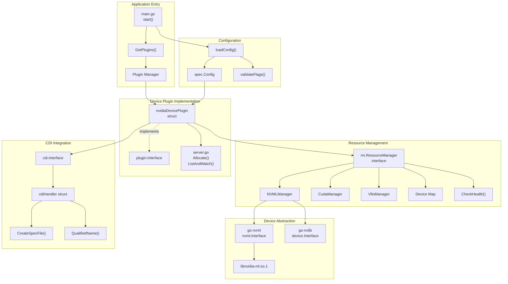
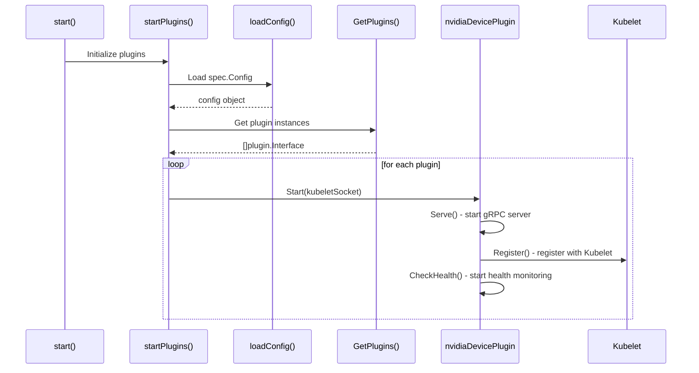
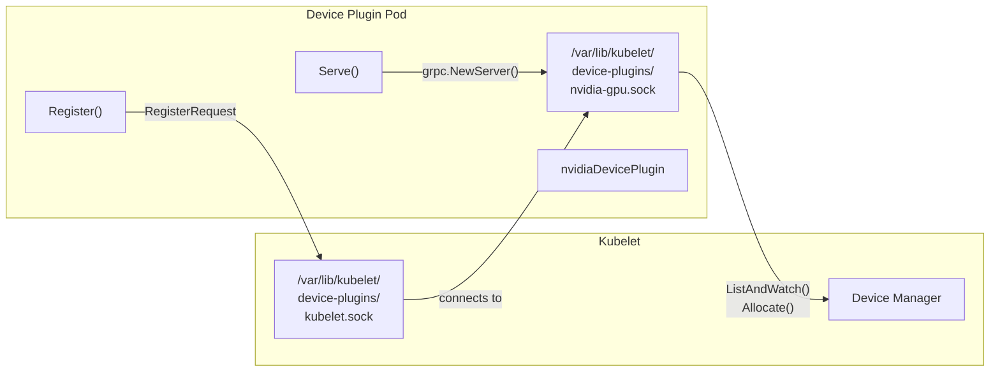
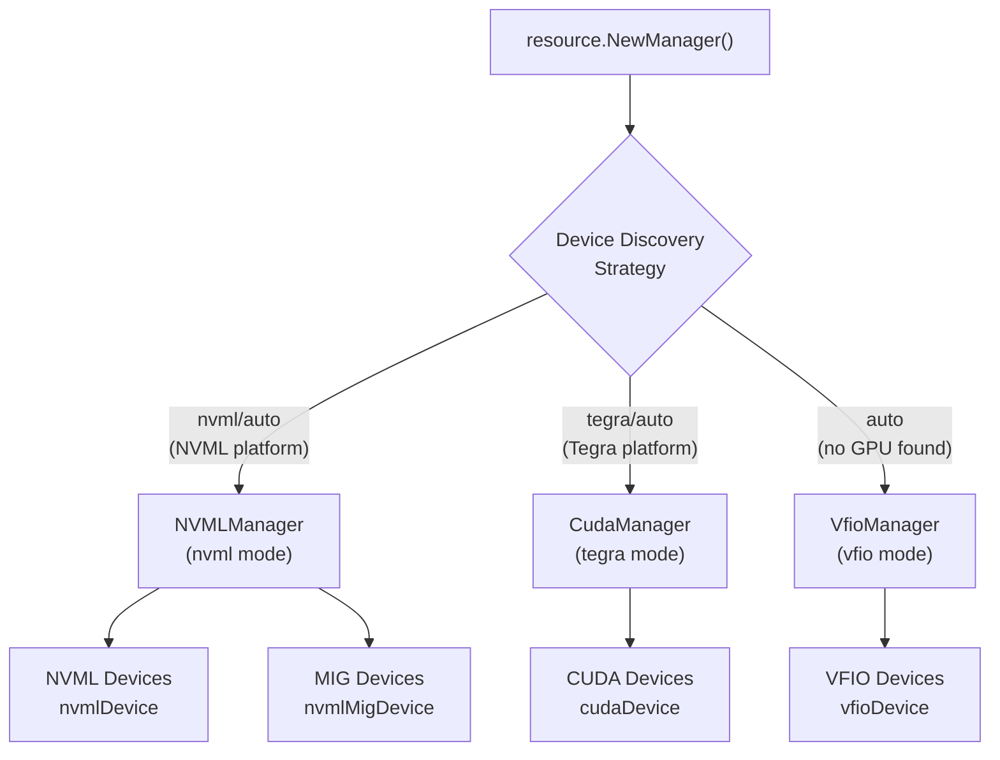

<!-- source: DeepWiki mcp.deepwiki.com · repo NVIDIA/k8s-device-plugin · page 1 NVIDIA Kubernetes Device Plugin Overview · fetched 2026-10-26 -->

# NVIDIA Kubernetes Device Plugin Overview

Relevant source files

The following files were used as context for generating this wiki page:

- [CHANGELOG.md](CHANGELOG.md)
- [CONTRIBUTING.md](CONTRIBUTING.md)
- [LICENSE](LICENSE)
- [Makefile](Makefile)
- [README.md](README.md)
- [RELEASE.md](RELEASE.md)
- [deployments/helm/nvidia-device-plugin/Chart.lock](deployments/helm/nvidia-device-plugin/Chart.lock)
- [deployments/helm/nvidia-device-plugin/Chart.yaml](deployments/helm/nvidia-device-plugin/Chart.yaml)
- [deployments/static/gpu-feature-discovery-daemonset-with-mig-mixed.yaml](deployments/static/gpu-feature-discovery-daemonset-with-mig-mixed.yaml)
- [deployments/static/gpu-feature-discovery-daemonset-with-mig-single.yaml](deployments/static/gpu-feature-discovery-daemonset-with-mig-single.yaml)
- [deployments/static/gpu-feature-discovery-daemonset.yaml](deployments/static/gpu-feature-discovery-daemonset.yaml)
- [deployments/static/gpu-feature-discovery-job.yaml.template](deployments/static/gpu-feature-discovery-job.yaml.template)
- [deployments/static/nvidia-device-plugin-compat-with-cpumanager.yml](deployments/static/nvidia-device-plugin-compat-with-cpumanager.yml)
- [deployments/static/nvidia-device-plugin-privileged-with-service-account.yml](deployments/static/nvidia-device-plugin-privileged-with-service-account.yml)
- [deployments/static/nvidia-device-plugin.yml](deployments/static/nvidia-device-plugin.yml)
- [versions.mk](versions.mk)

## Purpose and Scope

The NVIDIA Kubernetes Device Plugin is a DaemonSet that enables Kubernetes clusters to utilize NVIDIA GPUs as schedulable resources. This document provides a high-level overview of the system architecture, core components, and integration points with Kubernetes. 

For detailed information on specific subsystems, see:
- System architecture details: [System Architecture](#1.1)
- NVML device abstraction: [NVML and Device Abstraction Layer](#2)
- Device plugin implementation: [Device Plugin Core](#3)
- GPU Feature Discovery: [GPU Feature Discovery](#4)
- Configuration management: [Configuration Management](#5)
- MIG-specific behavior: [Multi-Instance GPU (MIG) Support](#6)
- GPU sharing mechanisms: [GPU Sharing Mechanisms](#7)
- Deployment procedures: [Deployment](#8)

**Sources:** [README.md:47-67](), [cmd/nvidia-device-plugin/main.go:1-42]()

## System Overview

The NVIDIA device plugin implements the Kubernetes device plugin API to automatically:

1. **Expose GPU resources** on each node through the `nvidia.com/gpu` resource and MIG-variant resources.
2. **Monitor GPU health** via NVML event-based detection.
3. **Allocate GPUs to containers** using environment variables, volume mounts, or CDI annotations.

The system consists of three primary binaries packaged in a single container image:

| Binary | Purpose | Entry Point |
|--------|---------|-------------|
| `nvidia-device-plugin` | Core device plugin implementing Kubelet device plugin API | [cmd/nvidia-device-plugin/main.go]() |
| `gpu-feature-discovery` | Labels nodes with GPU capabilities | [cmd/gpu-feature-discovery/main.go]() |
| `config-manager` | Manages runtime configuration updates | [cmd/config-manager/main.go]() |

**Sources:** [README.md:47-67](), [Makefile:29-30](), [CHANGELOG.md:160-161]()

## Core Components and Code Entities

### Component Architecture

**Sources:** [cmd/nvidia-device-plugin/main.go:243-394](), [internal/plugin/server.go:52-70](), [cmd/nvidia-device-plugin/plugin-manager.go:33-82](), [CHANGELOG.md:124-124]()

### Plugin Lifecycle and Key Functions

The device plugin lifecycle is managed by the `start()` function in [cmd/nvidia-device-plugin/main.go:243-322](), which handles initialization and enters an event loop for Kubelet restarts and OS signals.

The `startPlugins()` function [cmd/nvidia-device-plugin/main.go:324-395]() orchestrates the startup sequence:

**Sources:** [cmd/nvidia-device-plugin/main.go:243-395]()

## Integration with Kubernetes

### Device Plugin API Implementation

The `nvidiaDevicePlugin` struct [internal/plugin/server.go:52-70]() implements the `pluginapi.DevicePluginServer` interface.

| Method | Purpose | Implementation |
|--------|---------|----------------|
| `ListAndWatch()` | Stream available devices to Kubelet | [internal/plugin/server.go:267-285]() |
| `Allocate()` | Allocate devices to container requests | [internal/plugin/server.go:306-320]() |
| `GetPreferredAllocation()` | Return preferred device allocation for topology awareness | [internal/plugin/server.go:288-303]() |
| `GetDevicePluginOptions()` | Return plugin capabilities | [internal/plugin/server.go:259-264]() |

### Registration and Socket Communication

The plugin socket path is constructed by `getPluginSocketPath()` [internal/plugin/server.go:103-107](), creating paths such as `/var/lib/kubelet/device-plugins/nvidia-gpu.sock`.

**Sources:** [internal/plugin/server.go:129-160](), [internal/plugin/server.go:229-256](), [internal/plugin/server.go:103-107]()

## Key Capabilities

### Resource Managers and Device Discovery

The `ResourceManager` interface [internal/rm/]() abstracts device enumeration with multiple implementations selected via `--device-discovery-strategy`.

The factory function `resource.NewManager()` [internal/resource/factory.go:31-41]() detects the platform type when `--device-discovery-strategy=auto`. Support for `vfio` management was added in v0.16.0 [CHANGELOG.md:124-124]().

**Sources:** [internal/resource/factory.go:31-85](), [cmd/nvidia-device-plugin/main.go:211-217](), [CHANGELOG.md:124-124]()

### Device Allocation Strategies

The `getAllocateResponse()` method [internal/plugin/server.go:322-365]() constructs the container allocation response based on configured strategies.

| Flag | Values | Purpose |
|------|--------|---------|
| `--device-list-strategy` | `envvar`, `volume-mounts`, `cdi-annotations`, `cdi-cri` | How to pass device list to runtime |
| `--device-id-strategy` | `uuid`, `index` | Device identifier format |

A new `cdi-cri` strategy was introduced in v0.15.0 to use the CDIDevices CRI field [CHANGELOG.md:150-151]().

**Sources:** [internal/plugin/server.go:322-365](), [internal/plugin/server.go:376-408](), [CHANGELOG.md:150-151]()

### CDI (Container Device Interface) Support

The `cdiHandler` struct [internal/cdi/cdi.go:44-71]() generates CDI specifications. It integrates with the `nvidia-container-toolkit` to generate specs in `/var/run/cdi/` [internal/cdi/cdi.go:175-225]().

**Sources:** [internal/cdi/cdi.go:76-172](), [cmd/nvidia-device-plugin/plugin-manager.go:48-64]()

### GPU Feature Discovery Integration

`gpu-feature-discovery` (GFD) is now integrated into the same repository and container image as the device plugin as of v0.15.0 [CHANGELOG.md:160-161](). It labels nodes with GPU characteristics, such as `nvidia.com/gpu.product` and `nvidia.com/mig.strategy`.

**Sources:** [README.md:56-57](), [CHANGELOG.md:160-161](), [deployments/static/gpu-feature-discovery-daemonset.yaml]()

## Deployment Architecture

### Helm-Based Deployment

The preferred deployment method uses the Helm chart at [deployments/helm/nvidia-device-plugin/](). It supports deploying both the device plugin and GFD, with optional `node-feature-discovery` as a dependency [deployments/helm/nvidia-device-plugin/Chart.yaml:10-16]().

**Sources:** [deployments/helm/nvidia-device-plugin/Chart.yaml:1-16](), [deployments/helm/nvidia-device-plugin/templates/daemonset-device-plugin.yml:1-274]()

### Static YAML Deployment

Static manifests are provided for various environments:
- **Standard**: [deployments/static/nvidia-device-plugin.yml]()
- **CPUManager-compatible**: [deployments/static/nvidia-device-plugin-compat-with-cpumanager.yml]()
- **OpenShift/MicroShift**: [deployments/static/nvidia-device-plugin-privileged-with-service-account.yml]()

**Sources:** [README.md:152-165](), [deployments/static/nvidia-device-plugin.yml:1-56]()

---

