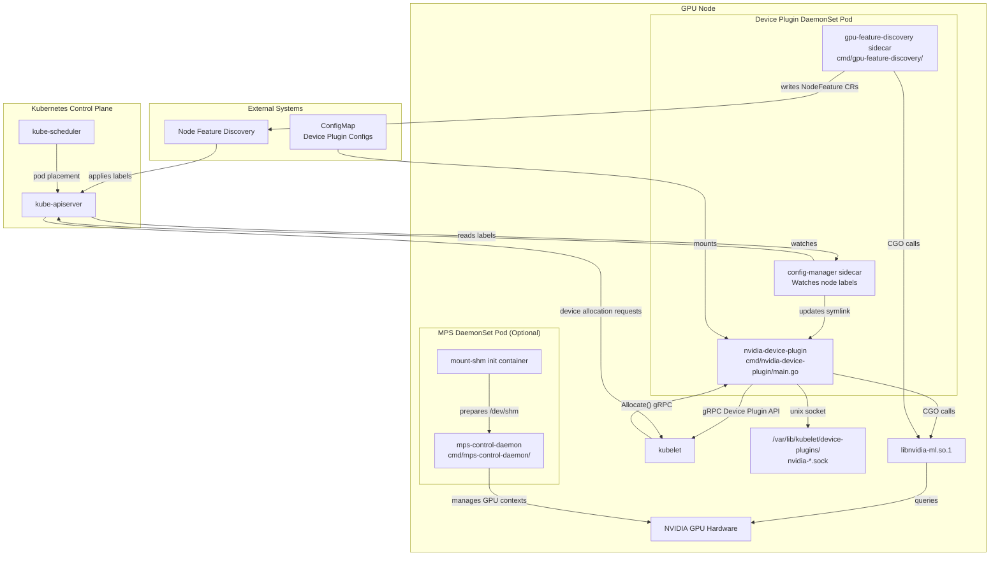
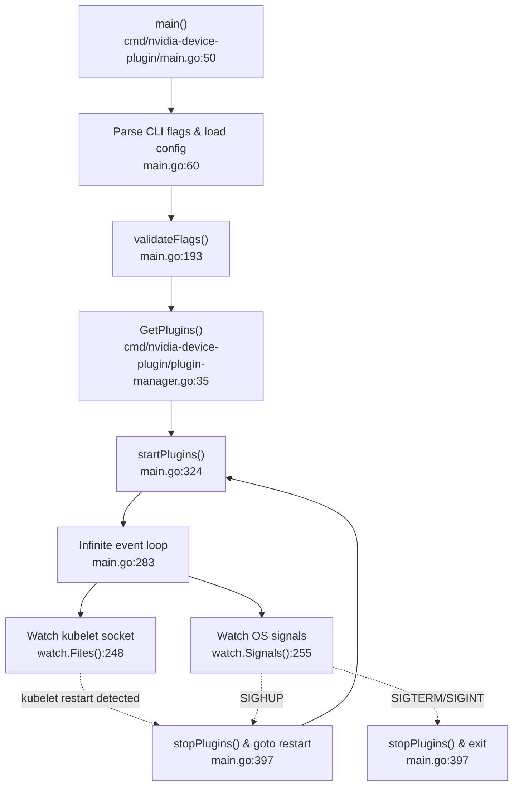
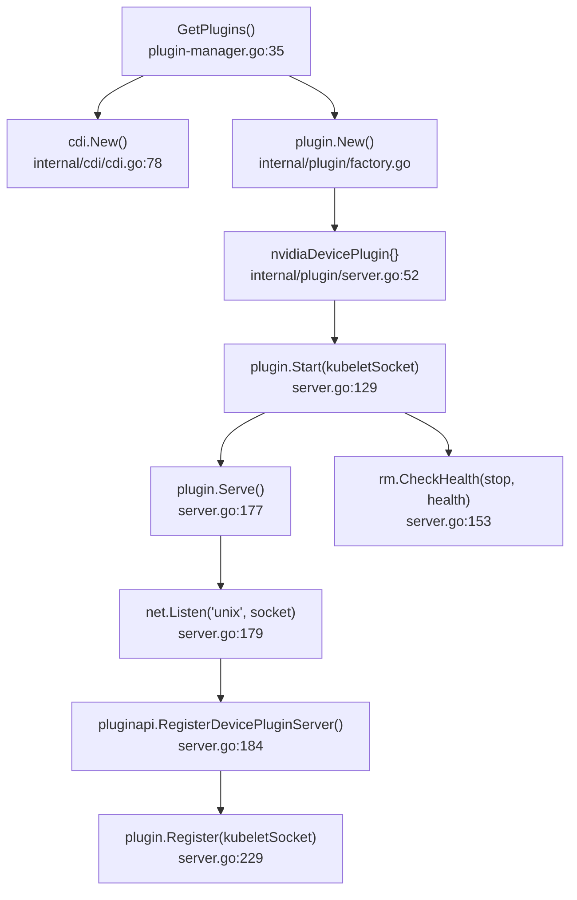
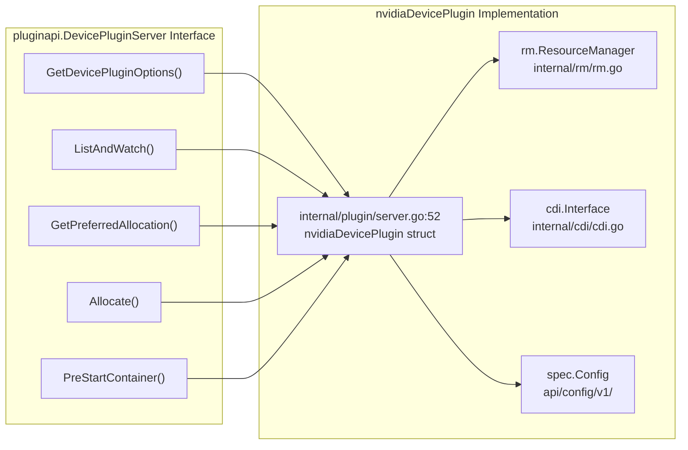
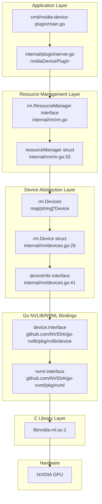
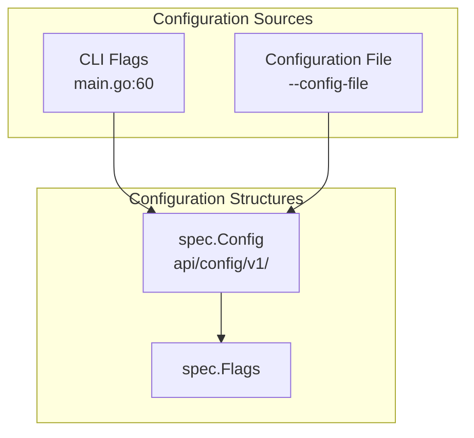
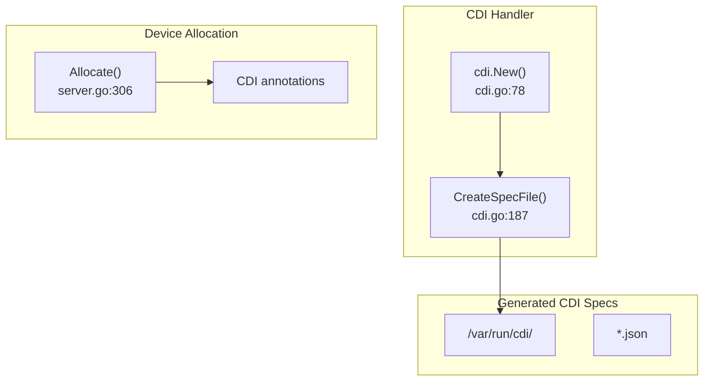
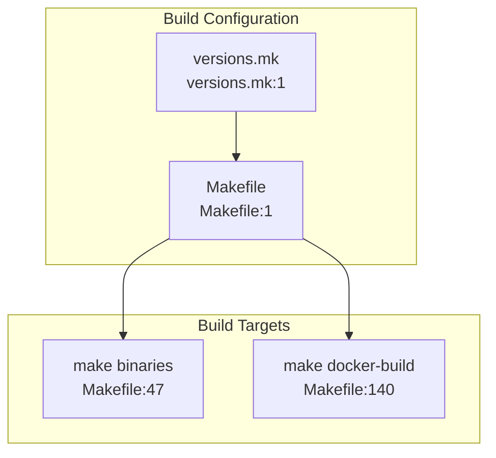
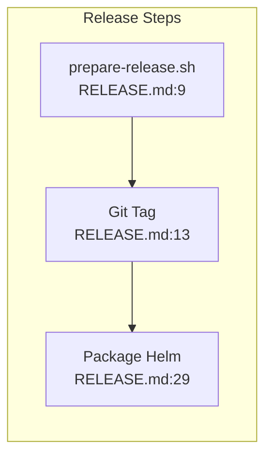

<!-- source: DeepWiki mcp.deepwiki.com · repo NVIDIA/k8s-device-plugin · page 1.1 System Architecture · fetched 2026-10-26 -->

# System Architecture

Relevant source files

The following files were used as context for generating this wiki page:

- [Makefile](Makefile)
- [README.md](README.md)
- [RELEASE.md](RELEASE.md)
- [api/config/v1/strategy.go](api/config/v1/strategy.go)
- [cmd/nvidia-device-plugin/main.go](cmd/nvidia-device-plugin/main.go)
- [cmd/nvidia-device-plugin/plugin-manager.go](cmd/nvidia-device-plugin/plugin-manager.go)
- [deployments/helm/nvidia-device-plugin/Chart.lock](deployments/helm/nvidia-device-plugin/Chart.lock)
- [deployments/helm/nvidia-device-plugin/Chart.yaml](deployments/helm/nvidia-device-plugin/Chart.yaml)
- [deployments/static/nvidia-device-plugin-compat-with-cpumanager.yml](deployments/static/nvidia-device-plugin-compat-with-cpumanager.yml)
- [internal/cdi/cdi.go](internal/cdi/cdi.go)
- [internal/cdi/options.go](internal/cdi/options.go)
- [internal/plugin/factory.go](internal/plugin/factory.go)
- [internal/plugin/options.go](internal/plugin/options.go)
- [internal/plugin/server.go](internal/plugin/server.go)
- [internal/plugin/server_test.go](internal/plugin/server_test.go)
- [internal/rm/device_map.go](internal/rm/device_map.go)
- [internal/rm/device_map_test.go](internal/rm/device_map_test.go)
- [internal/rm/devices.go](internal/rm/devices.go)
- [internal/rm/health.go](internal/rm/health.go)
- [internal/rm/health_test.go](internal/rm/health_test.go)
- [internal/rm/helper.go](internal/rm/helper.go)
- [internal/rm/nvml_devices.go](internal/rm/nvml_devices.go)
- [internal/rm/nvml_manager.go](internal/rm/nvml_manager.go)
- [internal/rm/rm.go](internal/rm/rm.go)
- [internal/rm/tegra_devices.go](internal/rm/tegra_devices.go)
- [internal/rm/tegra_manager.go](internal/rm/tegra_manager.go)
- [internal/rm/wsl_devices.go](internal/rm/wsl_devices.go)
- [versions.mk](versions.mk)

## Purpose and Scope

This document describes the overall architecture of the NVIDIA Kubernetes Device Plugin system, including its core components, their interactions, and integration with Kubernetes. It covers the physical deployment structure, the internal software layers, and the relationships between major subsystems.

For details about specific subsystems:
- For NVML bindings and device abstraction, see [NVML and Device Abstraction Layer](#2)
- For device plugin lifecycle and allocation logic, see [Device Plugin Core](#3)
- For configuration management and dynamic updates, see [Configuration Management](#5)
- For MIG-specific architecture, see [Multi-Instance GPU (MIG) Support](#6)
- For GPU sharing mechanisms, see [GPU Sharing Mechanisms](#7)

---

## Component Overview

The NVIDIA device plugin system consists of multiple cooperating components that run as containers within Kubernetes DaemonSet pods on GPU-enabled nodes.

### High-Level Component Architecture

**Sources:** [README.md:47-58](), [cmd/nvidia-device-plugin/main.go:43-185](), [internal/plugin/server.go:51-70]()

### Component Responsibilities

| Component | Binary/Entry Point | Primary Responsibilities |
|-----------|-------------------|-------------------------|
| **nvidia-device-plugin** | `cmd/nvidia-device-plugin/main.go` | Device discovery, registration with kubelet, resource allocation, health monitoring |
| **config-manager** | Sidecar container (external) | Watches `nvidia.com/device-plugin.config` node labels, updates configuration symlink |
| **gpu-feature-discovery** | `cmd/gpu-feature-discovery/` | GPU capability detection, automatic node labeling via NFD |
| **mps-control-daemon** | `cmd/mps-control-daemon/` | MPS daemon lifecycle management for GPU sharing |

**Sources:** [README.md:47-58](), [cmd/nvidia-device-plugin/main.go:49-185](), [deployments/helm/nvidia-device-plugin/Chart.yaml:1-16]()

---

## Device Plugin Core Architecture

The device plugin implements the Kubernetes Device Plugin API to expose NVIDIA GPUs as schedulable resources.

### Main Process Lifecycle

**Sources:** [cmd/nvidia-device-plugin/main.go:50-397]()

### Plugin Instantiation and Registration

**Sources:** [cmd/nvidia-device-plugin/plugin-manager.go:35-89](), [internal/plugin/server.go:129-226]()

### Device Plugin gRPC Service Implementation

The `nvidiaDevicePlugin` struct implements the Kubernetes Device Plugin API:

**Sources:** [internal/plugin/server.go:52-70](), [internal/rm/rm.go:42-49]()

---

## NVML Abstraction Stack

The device plugin uses a multi-layered abstraction to interface with NVIDIA GPUs, from C library to high-level Go interfaces.

### NVML Abstraction Layers

**Sources:** [internal/rm/rm.go:33-49](), [internal/rm/devices.go:29-47](), [cmd/nvidia-device-plugin/main.go:28-30]()

---

## Configuration and Deployment Architecture

### Configuration Precedence and Loading

**Sources:** [cmd/nvidia-device-plugin/main.go:60-185](), [api/config/v1/config.go]()

### CDI Integration Architecture

**Sources:** [internal/cdi/cdi.go:78-227](), [internal/plugin/server.go:306-408]()

---

## Build and Release Architecture

### Build System Structure

**Sources:** [Makefile:1-164](), [versions.mk:1-28]()

### Release Process

**Sources:** [RELEASE.md:1-47]()

---

