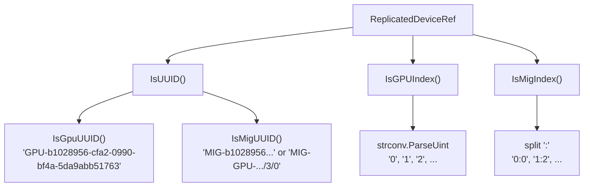
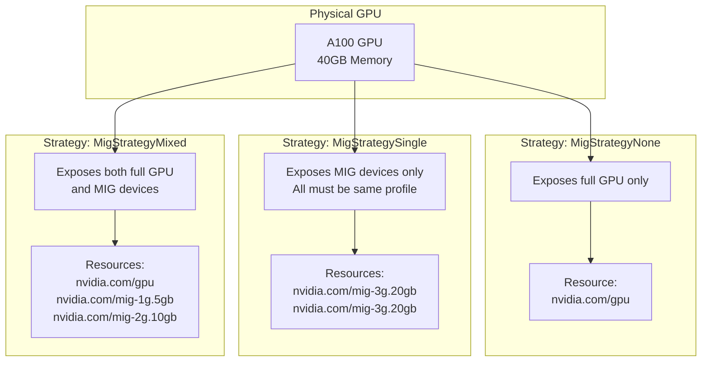
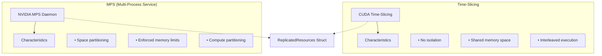
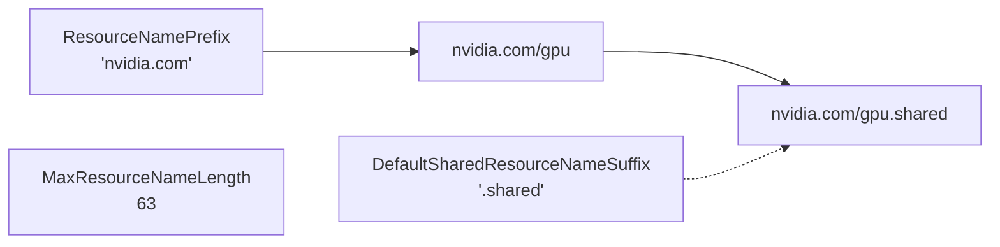
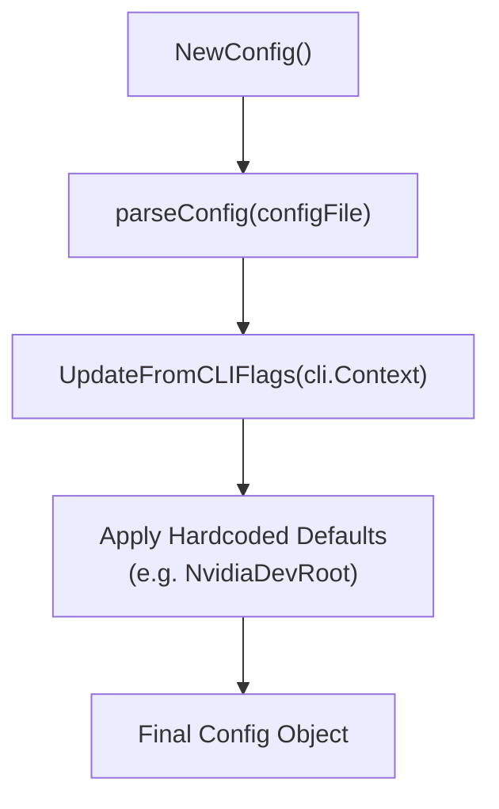

<!-- source: DeepWiki mcp.deepwiki.com · repo NVIDIA/k8s-device-plugin · page 1.2 Key Concepts and Terminology · fetched 2026-10-26 -->

# Key Concepts and Terminology

<details>
<summary>Relevant source files</summary>

The following files were used as context for generating this wiki page:

- [Makefile](Makefile)
- [README.md](README.md)
- [RELEASE.md](RELEASE.md)
- [api/config/v1/config.go](api/config/v1/config.go)
- [api/config/v1/consts.go](api/config/v1/consts.go)
- [api/config/v1/duration.go](api/config/v1/duration.go)
- [api/config/v1/flags.go](api/config/v1/flags.go)
- [api/config/v1/flags_test.go](api/config/v1/flags_test.go)
- [api/config/v1/replicas.go](api/config/v1/replicas.go)
- [api/config/v1/replicas_test.go](api/config/v1/replicas_test.go)
- [api/config/v1/resources.go](api/config/v1/resources.go)
- [api/config/v1/sharing.go](api/config/v1/sharing.go)
- [cmd/gpu-feature-discovery/main.go](cmd/gpu-feature-discovery/main.go)
- [cmd/gpu-feature-discovery/main_test.go](cmd/gpu-feature-discovery/main_test.go)
- [cmd/gpu-feature-discovery/mig_test.go](cmd/gpu-feature-discovery/mig_test.go)
- [deployments/helm/nvidia-device-plugin/Chart.lock](deployments/helm/nvidia-device-plugin/Chart.lock)
- [deployments/helm/nvidia-device-plugin/Chart.yaml](deployments/helm/nvidia-device-plugin/Chart.yaml)
- [deployments/static/nvidia-device-plugin-compat-with-cpumanager.yml](deployments/static/nvidia-device-plugin-compat-with-cpumanager.yml)
- [internal/lm/labeler.go](internal/lm/labeler.go)
- [internal/lm/labels.go](internal/lm/labels.go)
- [internal/resource/factory.go](internal/resource/factory.go)
- [internal/rm/allocate.go](internal/rm/allocate.go)
- [versions.mk](versions.mk)

</details>


## Purpose and Scope

This page defines the core concepts, terminology, and conventions used throughout the NVIDIA Kubernetes Device Plugin codebase. Understanding these concepts is essential for working with the plugin's configuration, resource management, and allocation mechanisms.

For information about the overall system architecture and component interactions, see [System Architecture](1.1). For specific configuration options and their usage, see [Configuration Schema and Options](5.1).

---

## GPU and Device Concepts

### Device Types

The plugin manages several types of NVIDIA hardware devices:

| Device Type | Description | Class Identifier | Example Use Case |
|-------------|-------------|------------------|------------------|
| **Full GPU** | Complete GPU device | `nvidia.com/gpu` | Standard workloads requiring dedicated GPU |
| **MIG Device** | Multi-Instance GPU partition | `nvidia.com/mig-<profile>` | Multiple isolated workloads on single GPU |
| **Shared GPU** | Time-sliced or MPS-enabled GPU | `nvidia.com/gpu.shared` | Oversubscribed workloads |
| **IMEX Channel** | Inter-GPU Memory Exchange channel | Injected as additional device | High-bandwidth GPU communication |

**Sources:** [api/config/v1/consts.go:24-35](), [README.md:169-184]()

### Device Identification

Devices can be identified using multiple strategies. The `ReplicatedDeviceRef` type handles these various formats during configuration parsing.

Title: Device Identification and Reference Types


**UUID Strategy** (`uuid`): Uses hardware UUIDs as stable identifiers. This is the default and recommended approach because UUIDs remain constant across reboots and GPU reordering.

**Index Strategy** (`index`): Uses integer indices as seen by `nvidia-smi`. Indices may change if GPUs are added/removed or system configuration changes.

The strategy is configured via the `DeviceIDStrategy` field in `PluginCommandLineFlags`.

**Sources:** [README.md:329-341](), [api/config/v1/replicas.go:96-163](), [api/config/v1/consts.go:46-49](), [api/config/v1/flags.go:78-78]()

---

## Multi-Instance GPU (MIG)

### MIG Overview

Multi-Instance GPU (MIG) allows a single physical GPU to be partitioned into multiple isolated GPU instances, each with dedicated memory and compute resources. MIG is supported on NVIDIA A100, A30, H100, and similar architectures.

### MIG Strategies

The plugin supports three MIG strategies that determine how MIG devices are exposed to Kubernetes:

Title: MIG Strategy Resource Mapping


| Strategy | Constant | Description | Resource Advertisement |
|----------|----------|-------------|----------------------|
| **none** | `MigStrategyNone` | MIG is disabled; only full GPUs are advertised | `nvidia.com/gpu` |
| **single** | `MigStrategySingle` | Only MIG devices are advertised; all must be the same profile | `nvidia.com/mig-<profile>` |
| **mixed** | `MigStrategyMixed` | Both full GPUs and MIG devices of any profile are advertised | `nvidia.com/gpu` + `nvidia.com/mig-<profile>` |

The strategy is configured via the `MigStrategy` flag.

**Sources:** [README.md:248-261](), [api/config/v1/consts.go:31-35](), [api/config/v1/flags.go:60-60]()

---

## GPU Sharing Mechanisms

### Time-Slicing vs MPS

The plugin supports two methods for sharing GPUs among multiple workloads. Both use the `ReplicatedResources` struct for configuration.

Title: Sharing Mechanisms Comparison


### Time-Slicing Configuration

Time-slicing creates multiple replicas of a GPU resource, allowing oversubscription through CUDA's time-slicing mechanism.

**Key Configuration Options** ([api/config/v1/replicas.go:29-35]()):

```yaml
sharing:
  timeSlicing:
    renameByDefault: true
    failRequestsGreaterThanOne: false
    resources:
    - name: nvidia.com/gpu
      replicas: 10
```

**Sources:** [README.md:378-480](), [api/config/v1/replicas.go:29-35](), [api/config/v1/consts.go:26-27]()

### MPS Configuration

MPS provides space partitioning with enforced memory and compute limits managed by a control daemon.

**Behavior:**
- Each replica gets `1/replicas` fraction of device memory.
- Compute resources are partitioned.
- `FailRequestsGreaterThanOne` is explicitly set to `true` for MPS in `NewConfig` to ensure clear semantics ([api/config/v1/config.go:72-78]()).

**Sources:** [README.md:512-596](), [api/config/v1/sharing.go:19-28](), [api/config/v1/config.go:72-78]()

---

## Resource Naming and Allocation

### Resource Name Structure

All GPU resources follow a standardized naming convention defined by constants.

Title: Resource Naming Constants


**Resource Name Components** ([api/config/v1/consts.go:23-28]()):

| Component | Value | Description |
|-----------|-------|-------------|
| `ResourceNamePrefix` | `"nvidia.com"` | Standard prefix for all NVIDIA resources |
| `DefaultSharedResourceNameSuffix` | `".shared"` | Suffix added when `renameByDefault: true` |
| `MaxResourceNameLength` | `63` | Kubernetes resource name limit |

**Sources:** [api/config/v1/consts.go:23-28](), [api/config/v1/resources.go:19-44]()

### Annotated Device IDs

The plugin uses annotated device IDs internally to track replicated resources.

**Format:** `<device-id>::<replica-index>`

**Example:** `GPU-12345678...::3` represents replica 3 of a specific GPU.

The `AnnotatedID` type ([internal/rm/allocate.go:40-48]()) provides methods to extract the base device ID and parse the annotation.

**Sources:** [internal/rm/allocate.go:23-80]()

---

## Device List Strategies

Device list strategies determine how the list of allocated GPUs is communicated to the container runtime.

| Strategy | Constant | Runtime Requirement | Description |
|----------|----------|---------------------|-------------|
| **envvar** | `DeviceListStrategyEnvVar` | NVIDIA Container Runtime | Sets `NVIDIA_VISIBLE_DEVICES` |
| **volume-mounts** | `DeviceListStrategyVolumeMounts` | NVIDIA Container Runtime | Passes devices as volume mounts |
| **cdi-annotations** | `DeviceListStrategyCDIAnnotations` | CDI-aware runtime | Sets CDI device annotations |
| **cdi-cri** | `DeviceListStrategyCDICRI` | K8s + CDI runtime | Uses CDIDevices CRI field |

**Sources:** [README.md:305-327](), [api/config/v1/consts.go:38-43]()

### CDI (Container Device Interface)

CDI allows runtimes to manage device access via a common specification.

**CDI Configuration Constants** ([api/config/v1/consts.go:51-56]()):
- `DefaultCDIAnnotationPrefix`: `"cdi.k8s.io/"`
- `DefaultNvidiaCTKPath`: `"/usr/bin/nvidia-ctk"`
- `DefaultContainerDriverRoot`: `"/driver-root"`

**Sources:** [api/config/v1/consts.go:51-56]()

---

## IMEX Channel Support

IMEX (Inter-GPU Memory Exchange) channels provide high-bandwidth communication paths.

### IMEX Configuration

Configuration is handled via the `Imex` struct in the versioned `Config` object.

```go
type Imex struct {
	ChannelIDs []int `json:"channelIDs" yaml:"channelIDs"`
	Required   bool  `json:"required"   yaml:"required"`
}
```

The plugin checks `imex-channel-ids` and `imex-required` flags during initialization in `NewConfig`.

**Sources:** [README.md:598-612](), [api/config/v1/config.go:39-64]()

---

## Configuration Precedence

Configuration is resolved in the following order:
1. **Command Line Flags** (highest precedence)
2. **Environment Variables**
3. **Configuration File** (lowest precedence)

The `NewConfig` function in `api/config/v1/config.go` implements this by first parsing the config file and then calling `UpdateFromCLIFlags` to apply overrides.

Title: Config Initialization Flow


**Sources:** [api/config/v1/config.go:42-81](), [api/config/v1/flags.go:117-161]()

---

