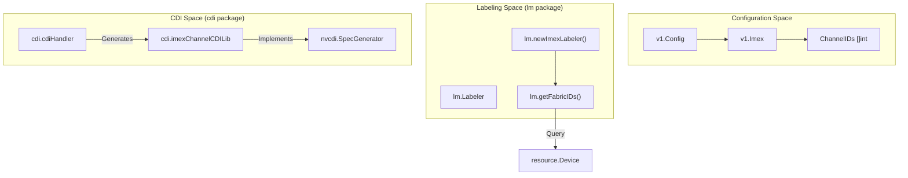
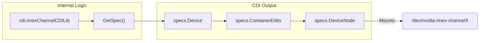

<!-- source: DeepWiki mcp.deepwiki.com · repo NVIDIA/k8s-device-plugin · page 10 IMEX Channel Support · fetched 2026-10-26 -->

# IMEX Channel Support

Relevant source files

The following files were used as context for generating this wiki page:

- [api/config/v1/imex.go](api/config/v1/imex.go)
- [api/config/v1/imex_test.go](api/config/v1/imex_test.go)
- [internal/cdi/api.go](internal/cdi/api.go)
- [internal/cdi/api_mock.go](internal/cdi/api_mock.go)
- [internal/cdi/imex.go](internal/cdi/imex.go)
- [internal/cdi/null.go](internal/cdi/null.go)
- [internal/lm/imex.go](internal/lm/imex.go)
- [internal/lm/imex_test.go](internal/lm/imex_test.go)

## Purpose and Scope

This document describes the IMEX (Inter-GPU Memory Exchange) channel support in the NVIDIA Kubernetes Device Plugin. IMEX channels enable direct memory communication between GPUs for high-performance computing workloads. The device plugin automatically discovers, configures, and allocates IMEX channel devices to containers requesting GPU resources.

For details on discovery and configuration, see [IMEX Channel Discovery and Configuration](#10.1).
For details on CDI integration, see [IMEX CDI Specification Generation](#10.2).

---

## Overview

IMEX channel support enables containers to access specialized device nodes that facilitate inter-GPU communication. The plugin integrates IMEX channels into the device allocation workflow through multiple strategies. The configuration is primarily managed through the `Imex` struct which defines requested channel IDs and whether they are required for plugin startup [api/config/v1/imex.go:31-42]().

| Strategy | Description | Configuration Method |
|----------|-------------|---------------------|
| **CDI Annotations** | Injects IMEX channels via CDI device specifications | Automatic when using CDI-based device list strategies |
| **Environment Variables** | Sets `NVIDIA_IMEX_CHANNELS` environment variable | Standard fallback for non-CDI runtimes [api/config/v1/imex.go:25]() |

---

## Configuration and Validation

The plugin allows users to specify which IMEX channels should be injected into containers. Currently, the validation logic restricts the `ChannelIDs` to either an empty list or a list containing only ID `0` [api/config/v1/imex.go:45-53]().

If a channel is marked as `Required` in the configuration, the plugin expects the associated device nodes to exist on the host during startup [api/config/v1/imex.go:41]().

**Sources:** [api/config/v1/imex.go:24-53](), [api/config/v1/imex_test.go:27-83]()

---

## Architecture

### IMEX Code Entity Mapping

The following diagram bridges the high-level IMEX concepts to the specific Go entities used in the codebase.

**Sources:** [api/config/v1/imex.go:31-42](), [internal/lm/imex.go:29-43](), [internal/cdi/imex.go:28-40]()

---

## Node Labeling and Fabric Discovery

The plugin includes logic to identify if GPUs are fabric-attached and part of a "clique". The `newImexLabeler` function inspects the available devices to determine the `clusterUUID` and `cliqueID` [internal/lm/imex.go:29-33]().

If all devices share a unique fabric identity, the plugin applies a node label:
`nvidia.com/gpu.clique: {clusterUUID}.{cliqueID}` [internal/lm/imex.go:38-40]().

The discovery process uses the following resource methods:
- `device.IsFabricAttached()`: Checks if the GPU supports fabric connectivity [internal/lm/imex.go:49]().
- `device.GetFabricIDs()`: Retrieves the specific Cluster and Clique identifiers [internal/lm/imex.go:57]().

**Sources:** [internal/lm/imex.go:29-83]()

---

## CDI Integration

The plugin generates CDI specifications for IMEX channels to allow container runtimes to handle the complex device node injections.

### IMEX CDI Generation Flow

The `GetSpec` function iterates through discovered `imexChannels` and creates a CDI device with the class `imex-channel` [internal/cdi/imex.go:43-64](). Each device entry maps a host path to a container path for the specific IMEX channel ID [internal/cdi/imex.go:49-54]().

**Sources:** [internal/cdi/imex.go:17-65](), [internal/cdi/api.go:19-26]()

---

## Child Pages

For more granular technical details, refer to the following sub-pages:

- **[IMEX Channel Discovery and Configuration](#10.1)**: Detailed breakdown of how the plugin interacts with the host filesystem and configuration files to identify IMEX resources.
- **[IMEX CDI Specification Generation](#10.2)**: Deep dive into the `imexChannelCDILib` implementation and the resulting JSON structure of the CDI specifications.

---

