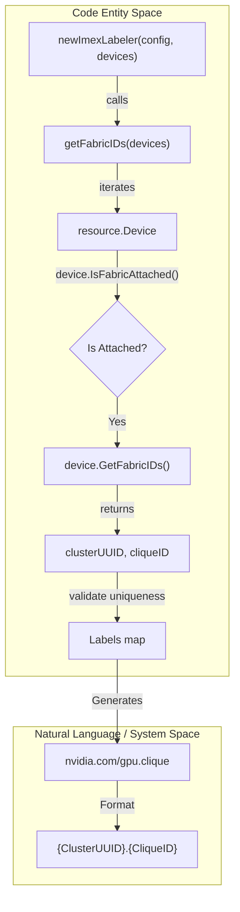
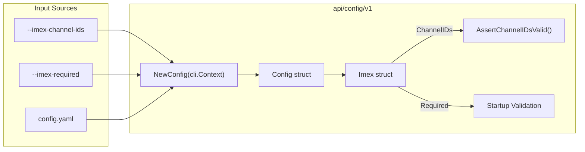

<!-- source: DeepWiki mcp.deepwiki.com · repo NVIDIA/k8s-device-plugin · page 10.1 IMEX Channel Discovery and Configuration · fetched 2026-10-26 -->

# IMEX Channel Discovery and Configuration

Relevant source files

The following files were used as context for generating this wiki page:

- [api/config/v1/config.go](api/config/v1/config.go)
- [api/config/v1/consts.go](api/config/v1/consts.go)
- [api/config/v1/imex.go](api/config/v1/imex.go)
- [api/config/v1/imex_test.go](api/config/v1/imex_test.go)
- [api/config/v1/replicas.go](api/config/v1/replicas.go)
- [api/config/v1/replicas_test.go](api/config/v1/replicas_test.go)
- [api/config/v1/resources.go](api/config/v1/resources.go)
- [api/config/v1/sharing.go](api/config/v1/sharing.go)
- [internal/lm/imex.go](internal/lm/imex.go)
- [internal/lm/imex_test.go](internal/lm/imex_test.go)
- [internal/rm/allocate.go](internal/rm/allocate.go)

Inter-GPU Memory Exchange (IMEX) support in the NVIDIA Kubernetes Device Plugin allows for high-performance memory sharing across GPUs via fabric-attached interfaces. This page details how IMEX channels are discovered, how they are defined within the plugin configuration, and the validation logic applied during startup.

## IMEX Configuration Schema

The IMEX configuration is encapsulated within the `Imex` struct, which is a field of the top-level `Config` object used by the plugin.

| Field | Type | Description |
| :--- | :--- | :--- |
| `ChannelIDs` | `[]int` | A list of channel IDs to inject into containers requesting NVIDIA devices. |
| `Required` | `bool` | If true, the plugin will fail to start if the specified channels do not exist on the host. |

The `ChannelIDs` field currently has strict validation: it must either be empty or contain exactly one element with the value `0` [api/config/v1/imex.go:45-53]().

### Configuration Precedence

IMEX settings can be provided through multiple channels, following the plugin's standard precedence rules:
1. **Command Line Flags**: `--imex-channel-ids` and `--imex-required` [api/config/v1/config.go:59-64]().
2. **Environment Variables**: Mapped via the CLI context [api/config/v1/config.go:45-46]().
3. **Config File**: Defined in the `imex` section of the YAML/JSON configuration file [api/config/v1/config.go:39]().

**Sources:** [api/config/v1/config.go:34-40](), [api/config/v1/imex.go:31-42]()

## Fabric Discovery and Labeling

The plugin identifies IMEX-capable hardware by querying the underlying devices for fabric connectivity. This discovery process is used to generate node labels that inform the Kubernetes scheduler about the IMEX topology (cliques).

### Fabric ID Extraction

The function `getFabricIDs` iterates through the discovered `resource.Device` list to identify "fabric-attached" devices [internal/lm/imex.go:45-48](). 
- It calls `device.IsFabricAttached()` to check for IMEX capability [internal/lm/imex.go:49]().
- If attached, it retrieves the `ClusterUUID` and `CliqueID` via `device.GetFabricIDs()` [internal/lm/imex.go:57]().

### IMEX Labeler logic

The `newImexLabeler` uses these IDs to create the `nvidia.com/gpu.clique` label. The label value is a concatenation of the `ClusterUUID` and `CliqueID` [internal/lm/imex.go:38-40](). To ensure a consistent scheduling domain, the plugin validates that all fabric-attached GPUs on a single node share the same Cluster UUID and Clique ID; if non-unique IDs are found, a warning is logged and no labels are applied [internal/lm/imex.go:67-75]().

### Entity Mapping: Discovery to Labels

This diagram shows the relationship between the physical device attributes queried via the resource interface and the resulting Kubernetes node labels.

Title: IMEX Discovery and Labeling Flow

**Sources:** [internal/lm/imex.go:29-43](), [internal/lm/imex.go:45-83]()

## Validation and Startup

At startup, the plugin performs validation on the IMEX configuration to ensure that the environment meets the requirements specified by the user.

### Configuration Validation logic

The `AssertChannelIDsValid` function enforces the current architectural constraints of the IMEX implementation:
- It returns `nil` (valid) if the slice is empty [api/config/v1/imex.go:47-48]().
- It returns `nil` (valid) if the slice contains exactly `[0]` [api/config/v1/imex.go:49-50]().
- Any other combination results in an `errInvalidImexConfig` [api/config/v1/imex.go:52]().

### Runtime Requirement Enforcement

If `Imex.Required` is set to `true` in the `Config` struct [api/config/v1/imex.go:41](), the plugin logic (typically within the CDI or Resource Manager initialization) expects the corresponding device nodes (e.g., `/dev/nvidia-imex-channel0`) to exist on the host. If they are missing and `Required` is true, the plugin will error out during the startup phase. If `Required` is false, the plugin will log a warning and skip IMEX channel injection for containers [api/config/v1/imex.go:37-41]().

### Configuration Entity Relationship

The following diagram illustrates how the `Config` object is populated and validated.

Title: IMEX Configuration and Validation

**Sources:** [api/config/v1/config.go:45-65](), [api/config/v1/imex.go:19-53]()

---

