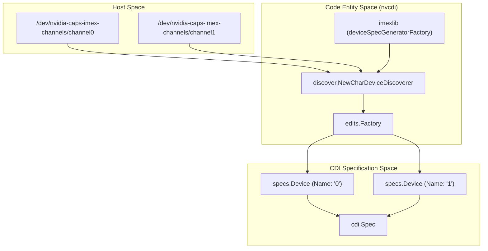
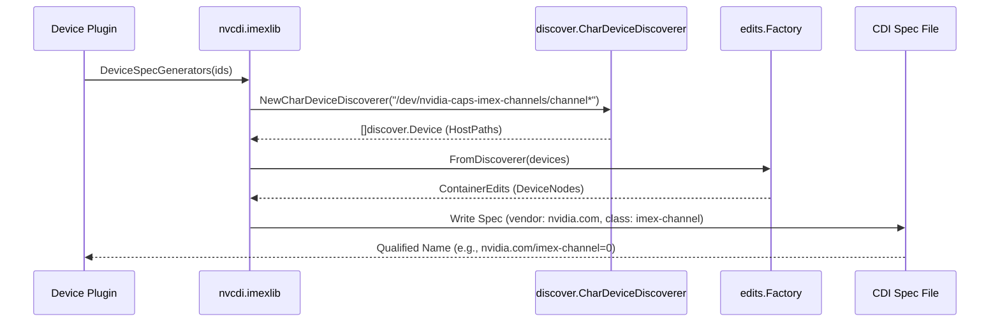

<!-- source: DeepWiki mcp.deepwiki.com · repo NVIDIA/k8s-device-plugin · page 10.2 IMEX CDI Specification Generation · fetched 2026-10-26 -->

# IMEX CDI Specification Generation

Relevant source files

The following files were used as context for generating this wiki page:

- [go.mod](go.mod)
- [go.sum](go.sum)
- [internal/cdi/api.go](internal/cdi/api.go)
- [internal/cdi/api_mock.go](internal/cdi/api_mock.go)
- [internal/cdi/imex.go](internal/cdi/imex.go)
- [internal/cdi/null.go](internal/cdi/null.go)
- [vendor/github.com/NVIDIA/nvidia-container-toolkit/internal/discover/graphics.go](vendor/github.com/NVIDIA/nvidia-container-toolkit/internal/discover/graphics.go)
- [vendor/github.com/NVIDIA/nvidia-container-toolkit/internal/discover/ipc.go](vendor/github.com/NVIDIA/nvidia-container-toolkit/internal/discover/ipc.go)
- [vendor/github.com/NVIDIA/nvidia-container-toolkit/pkg/nvcdi/driver-nvml.go](vendor/github.com/NVIDIA/nvidia-container-toolkit/pkg/nvcdi/driver-nvml.go)
- [vendor/github.com/NVIDIA/nvidia-container-toolkit/pkg/nvcdi/driver-wsl.go](vendor/github.com/NVIDIA/nvidia-container-toolkit/pkg/nvcdi/driver-wsl.go)
- [vendor/github.com/NVIDIA/nvidia-container-toolkit/pkg/nvcdi/lib-csv.go](vendor/github.com/NVIDIA/nvidia-container-toolkit/pkg/nvcdi/lib-csv.go)
- [vendor/github.com/NVIDIA/nvidia-container-toolkit/pkg/nvcdi/lib-nvml.go](vendor/github.com/NVIDIA/nvidia-container-toolkit/pkg/nvcdi/lib-nvml.go)
- [vendor/github.com/NVIDIA/nvidia-container-toolkit/pkg/nvcdi/lib.go](vendor/github.com/NVIDIA/nvidia-container-toolkit/pkg/nvcdi/lib.go)
- [vendor/github.com/NVIDIA/nvidia-container-toolkit/pkg/nvcdi/management.go](vendor/github.com/NVIDIA/nvidia-container-toolkit/pkg/nvcdi/management.go)
- [vendor/github.com/NVIDIA/nvidia-container-toolkit/pkg/nvcdi/options.go](vendor/github.com/NVIDIA/nvidia-container-toolkit/pkg/nvcdi/options.go)
- [vendor/modules.txt](vendor/modules.txt)

The NVIDIA Kubernetes Device Plugin utilizes the **Container Device Interface (CDI)** to expose Inter-GPU Memory Exchange (IMEX) channels to containers. This process involves discovering host-level IMEX channel device nodes and generating a CDI specification that allows containers to request these resources via standardized qualified names.

## IMEX CDI Architecture

The generation of IMEX CDI specifications is handled by the `nvcdi` library within the `nvidia-container-toolkit` dependency, integrated into the device plugin's CDI management layer. When the plugin is configured for IMEX, it utilizes a specific discovery mode to identify channel nodes and map them to CDI device entities.

### CDI Specification Structure
IMEX channels are grouped under a specific CDI device class:
*   **Vendor**: `nvidia.com` [vendor/github.com/NVIDIA/nvidia-container-toolkit/pkg/nvcdi/options.go:148-149]()
*   **Class**: `imex-channel` [vendor/github.com/NVIDIA/nvidia-container-toolkit/pkg/nvcdi/options.go:157-158]()
*   **Qualified Name Format**: `nvidia.com/imex-channel=<ID>`

### Entity Mapping Diagram
The following diagram illustrates how host-level IMEX device nodes are mapped to CDI specification entities within the codebase.

**IMEX Entity Mapping**

**Sources:** [vendor/github.com/NVIDIA/nvidia-container-toolkit/pkg/nvcdi/lib.go:92-93](), [vendor/github.com/NVIDIA/nvidia-container-toolkit/pkg/nvcdi/management.go:97-109]()

## Implementation Details

The core logic for generating IMEX specifications relies on the `managementlib` and `imexlib` components of the `nvcdi` package.

### Discovery and Specification Generation
The plugin identifies IMEX channels by scanning the host filesystem for specific character devices. The `newManagementDeviceDiscoverer` function defines the search pattern for IMEX channels at `/dev/nvidia-caps-imex-channels/channel*` [vendor/github.com/NVIDIA/nvidia-container-toolkit/pkg/nvcdi/management.go:108-108]().

Key functions involved in the generation flow:
1.  **`nvcdi.New(ModeImex)`**: Initializes the CDI library in IMEX mode [vendor/github.com/NVIDIA/nvidia-container-toolkit/pkg/nvcdi/lib.go:92-93]().
2.  **`GetDeviceSpecs()`**: Invokes the discoverer to find nodes and converts them into `specs.Device` objects [vendor/github.com/NVIDIA/nvidia-container-toolkit/pkg/nvcdi/management.go:40-60]().
3.  **`editsFactory.FromDiscoverer()`**: Transforms the discovered character devices into CDI `ContainerEdits`, which include the necessary device node paths for the container runtime [vendor/github.com/NVIDIA/nvidia-container-toolkit/pkg/nvcdi/management.go:46-49]().

### Data Flow Diagram
This diagram traces the flow from the discovery of host device nodes to the final qualified name used in Kubernetes pod annotations.

**IMEX CDI Data Flow**

**Sources:** [vendor/github.com/NVIDIA/nvidia-container-toolkit/pkg/nvcdi/management.go:40-60](), [vendor/github.com/NVIDIA/nvidia-container-toolkit/pkg/nvcdi/management.go:97-109](), [vendor/github.com/NVIDIA/nvidia-container-toolkit/pkg/nvcdi/options.go:157-158]()

## CDI Annotation Format

Once the specification is generated, the plugin provides the qualified names to the Kubelet during the `Allocate` gRPC call. These names are used by CDI-aware runtimes (like `containerd` or `CRI-O`) to inject the IMEX channels into the container.

| Component | Value | Source |
| :--- | :--- | :--- |
| **CDI Vendor** | `nvidia.com` | [vendor/github.com/NVIDIA/nvidia-container-toolkit/pkg/nvcdi/options.go:148]() |
| **CDI Class** | `imex-channel` | [vendor/github.com/NVIDIA/nvidia-container-toolkit/pkg/nvcdi/options.go:158]() |
| **Device Node Path** | `/dev/nvidia-caps-imex-channels/channel*` | [vendor/github.com/NVIDIA/nvidia-container-toolkit/pkg/nvcdi/management.go:108]() |

### Null Handler Fallback
If CDI is not required or enabled in the plugin configuration, the system uses a `null` handler [internal/cdi/null.go:23-31](). This handler implements the `cdi.Interface` but returns no additional devices and logs an error if `QualifiedName` is called [internal/cdi/null.go:33-47]().

**Sources:**
*   [vendor/github.com/NVIDIA/nvidia-container-toolkit/pkg/nvcdi/lib.go:78-96]() (Factory selection)
*   [vendor/github.com/NVIDIA/nvidia-container-toolkit/pkg/nvcdi/options.go:140-164]() (Vendor and Class defaults)
*   [vendor/github.com/NVIDIA/nvidia-container-toolkit/pkg/nvcdi/management.go:96-120]() (IMEX node discovery)
*   [internal/cdi/null.go:17-48]() (Null handler implementation)

---

