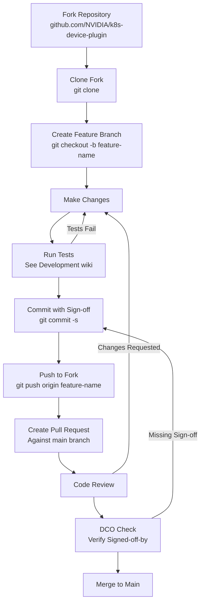
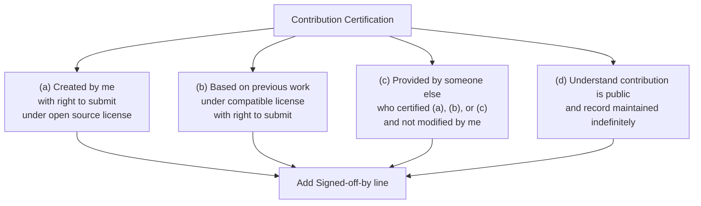
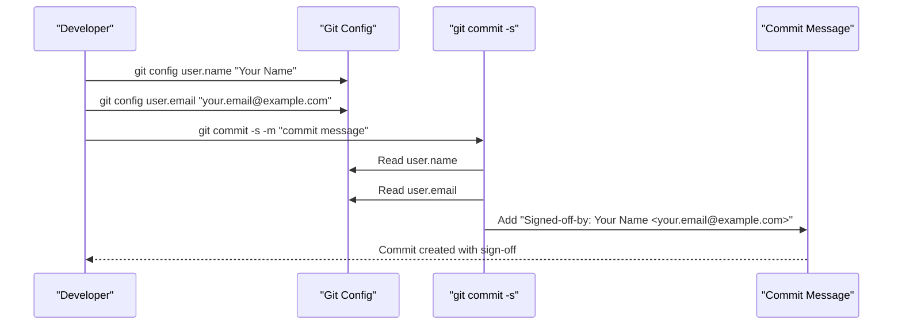

<!-- source: DeepWiki mcp.deepwiki.com · repo NVIDIA/k8s-device-plugin · page 11 Contributing and License · fetched 2026-10-26 -->

# Contributing and License

<details>
<summary>Relevant source files</summary>

The following files were used as context for generating this wiki page:

- [.github/ISSUE_TEMPLATE/bug_report.md](.github/ISSUE_TEMPLATE/bug_report.md)
- [.github/ISSUE_TEMPLATE/config.yml](.github/ISSUE_TEMPLATE/config.yml)
- [.github/ISSUE_TEMPLATE/feature_request.md](.github/ISSUE_TEMPLATE/feature_request.md)
- [.github/ISSUE_TEMPLATE/question.md](.github/ISSUE_TEMPLATE/question.md)
- [CONTRIBUTING.md](CONTRIBUTING.md)
- [LICENSE](LICENSE)

</details>


## Purpose and Scope

This document describes the licensing terms and contribution requirements for the NVIDIA Kubernetes Device Plugin project. It covers the Apache 2.0 license under which the project is distributed, the Developer Certificate of Origin (DCO) requirement for contributions, and the process for signing commits. It also outlines the reporting mechanisms for bugs, features, and general inquiries.

For information about the development workflow, build system, and testing infrastructure, see [Development and CI/CD]().

---

## License Overview

The NVIDIA Kubernetes Device Plugin is licensed under the Apache License, Version 2.0. This is a permissive open-source license that allows use, modification, and distribution of the software with minimal restrictions.

### Key License Terms

The Apache 2.0 license provides the following grants and protections:

| Grant/Protection | Description |
|-----------------|-------------|
| **Copyright License** | Perpetual, worldwide, non-exclusive, royalty-free right to reproduce, prepare derivative works, display, perform, sublicense, and distribute [LICENSE:67-72]() |
| **Patent License** | Protection from patent claims on contributions, with termination clause for patent litigation [LICENSE:74-88]() |
| **Attribution Requirements** | Must retain copyright, patent, trademark notices and include copy of license [LICENSE:90-111]() |
| **Trademark Restrictions** | No permission to use NVIDIA trade names or trademarks except for describing origin [LICENSE:145-151]() |
| **Warranty Disclaimer** | Software provided "AS IS" without warranties of any kind [LICENSE:153-162]() |
| **Liability Limitation** | Contributors not liable for damages arising from use of the software [LICENSE:164-175]() |

### License Application

The license text is located in [LICENSE:1-203]() at the repository root. All source files in the repository are subject to these terms. When creating derivative works or redistributing the software, you must:

1. Include a copy of the Apache 2.0 license [LICENSE:95-96]()
2. Retain all copyright, patent, and attribution notices [LICENSE:101-105]()
3. State changes made to modified files [LICENSE:98-99]()
4. Include notices from any NOTICE file if present [LICENSE:107-111]()

**Sources:** [LICENSE:1-203]()

---

## Contributing to the Project

Contributions to the NVIDIA Kubernetes Device Plugin are welcome. The project follows a standard GitHub workflow with an additional requirement for Developer Certificate of Origin sign-off on all commits.

### Contribution Workflow



**Contribution Workflow Stages**

The diagram above shows the complete contribution flow, with the DCO check as a mandatory gate before merge [CONTRIBUTING.md:4-6]().

### Support for Enterprise Customers
NVIDIA AI Enterprise customers are encouraged to open a case via the [NVIDIA Enterprise Support portal](https://enterprise-support.nvidia.com/s/create-case) rather than using GitHub issues for production-blocking problems [.github/ISSUE_TEMPLATE/bug_report.md:11]().

**Sources:** [CONTRIBUTING.md:1-61](), [.github/ISSUE_TEMPLATE/bug_report.md:11]()

---

## Developer Certificate of Origin

The NVIDIA Kubernetes Device Plugin project requires all contributors to sign their work using the Developer Certificate of Origin (DCO). This is a lightweight mechanism for certifying that you have the right to submit your contribution.

### DCO Version 1.1 Requirements

The DCO (from [developercertificate.org](http://developercertificate.org/)) requires contributors to certify that:



**DCO Certification Requirements**

At least one of conditions (a), (b), or (c) must be true, and condition (d) must always be acknowledged [CONTRIBUTING.md:27-50]().

### DCO Text

The complete DCO text as specified in [CONTRIBUTING.md:14-50]():

- **Copyright**: Copyright (C) 2004, 2006 The Linux Foundation and its contributors [CONTRIBUTING.md:17]()
- **Permitted Use**: Verbatim copies allowed; modifications not permitted [CONTRIBUTING.md:22-23]()
- **Version**: 1.1 [CONTRIBUTING.md:15]()

**Sources:** [CONTRIBUTING.md:13-50]()

---

## Sign-off Process

All commits must include a sign-off line certifying compliance with the DCO.

### Manual Sign-off Format

Add the following line to every git commit message:

```
Signed-off-by: Joe Smith <joe.smith@email.com>
```

**Requirements:**
- Use your real name (no pseudonyms or anonymous contributions) [CONTRIBUTING.md:56]()
- Use a valid email address [CONTRIBUTING.md:54]()
- Sign-off line must appear in commit message [CONTRIBUTING.md:52]()

### Automatic Sign-off

Git can automatically add the sign-off line if you configure your identity and use the `-s` flag [CONTRIBUTING.md:58-59]():



**Automatic Sign-off Process**

The `-s` flag instructs git to append the sign-off line using configured identity information [CONTRIBUTING.md:59]().

**Sources:** [CONTRIBUTING.md:52-60]()

---

## Reporting Issues and Requesting Features

The project uses GitHub issue templates to streamline communication. Blank issues are disabled to ensure all submissions provide necessary context [.github/ISSUE_TEMPLATE/config.yml:1]().

### Bug Reports
Bug reports require detailed environment information to assist in reproduction [.github/ISSUE_TEMPLATE/bug_report.md:13-17]():
- OS/Version (e.g., RHEL 8.6, Ubuntu 22.04)
- Kernel Version
- Container Runtime (e.g., Containerd, CRI-O)
- Kubernetes Flavor/Version

Contributors are encouraged to attach logs from `nvidia-smi`, the device plugin container, and the node `kubelet` [.github/ISSUE_TEMPLATE/bug_report.md:25-28]().

### Feature Requests
Feature requests should clearly state the motivation for the proposal and link to any related issues [.github/ISSUE_TEMPLATE/feature_request.md:9-13]().

### Questions
General discussions and questions can be raised using the Question template [.github/ISSUE_TEMPLATE/question.md:1-9]().

**Sources:** [.github/ISSUE_TEMPLATE/config.yml:1](), [.github/ISSUE_TEMPLATE/bug_report.md:1-37](), [.github/ISSUE_TEMPLATE/feature_request.md:1-14](), [.github/ISSUE_TEMPLATE/question.md:1-9]()

---

## License Compliance Requirements

When contributing code or documentation, ensure compliance with Apache 2.0 license terms:

| Requirement | Implementation |
|-------------|----------------|
| **Source Attribution** | Retain existing copyright notices in modified files [LICENSE:101-105]() |
| **License Headers** | Include Apache 2.0 license header in new source files [LICENSE:179-202]() |
| **Modification Notices** | Document changes in commit messages and code comments [LICENSE:98-99]() |

### License Header Format

As recommended in the license appendix [LICENSE:179-202](), new files should include:

```
Copyright [year] [copyright holder]

Licensed under the Apache License, Version 2.0 (the "License");
you may not use this file except in compliance with the License.
You may obtain a copy of the License at

    http://www.apache.org/licenses/LICENSE-2.0

Unless required by applicable law or agreed to in writing, software
distributed under the License is distributed on an "AS IS" BASIS,
WITHOUT WARRANTIES OR CONDITIONS OF ANY KIND, either express or implied.
See the License for the specific language governing permissions and
limitations under the License.
```

**Sources:** [LICENSE:1-203](), [CONTRIBUTING.md:1-61]()

---

