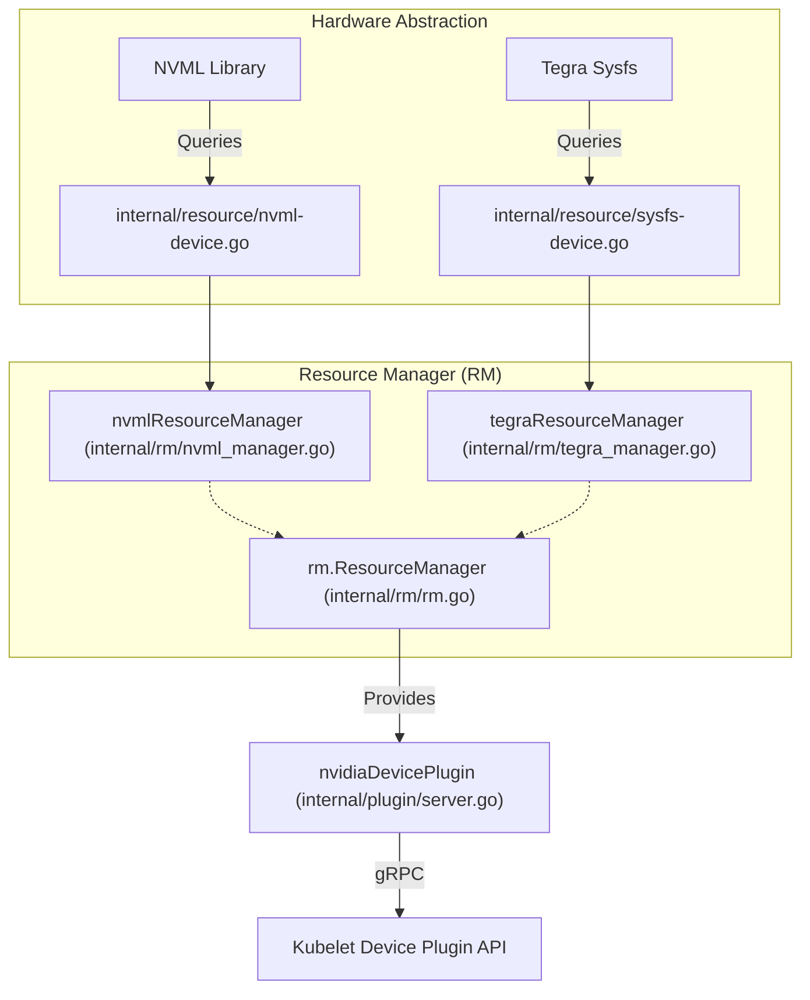

<!-- source: DeepWiki mcp.deepwiki.com · repo NVIDIA/k8s-device-plugin · page 12 Glossary · fetched 2026-10-26 -->

# Glossary

<details>
<summary>Relevant source files</summary>

The following files were used as context for generating this wiki page:

- [Makefile](Makefile)
- [README.md](README.md)
- [RELEASE.md](RELEASE.md)
- [api/config/v1/duration.go](api/config/v1/duration.go)
- [api/config/v1/flags.go](api/config/v1/flags.go)
- [api/config/v1/flags_test.go](api/config/v1/flags_test.go)
- [api/config/v1/strategy.go](api/config/v1/strategy.go)
- [cmd/gpu-feature-discovery/main.go](cmd/gpu-feature-discovery/main.go)
- [cmd/gpu-feature-discovery/main_test.go](cmd/gpu-feature-discovery/main_test.go)
- [cmd/gpu-feature-discovery/mig_test.go](cmd/gpu-feature-discovery/mig_test.go)
- [cmd/nvidia-device-plugin/main.go](cmd/nvidia-device-plugin/main.go)
- [cmd/nvidia-device-plugin/plugin-manager.go](cmd/nvidia-device-plugin/plugin-manager.go)
- [deployments/helm/nvidia-device-plugin/Chart.lock](deployments/helm/nvidia-device-plugin/Chart.lock)
- [deployments/helm/nvidia-device-plugin/Chart.yaml](deployments/helm/nvidia-device-plugin/Chart.yaml)
- [deployments/static/nvidia-device-plugin-compat-with-cpumanager.yml](deployments/static/nvidia-device-plugin-compat-with-cpumanager.yml)
- [docs/gpu-feature-discovery/README.md](docs/gpu-feature-discovery/README.md)
- [go.mod](go.mod)
- [go.sum](go.sum)
- [internal/cdi/cdi.go](internal/cdi/cdi.go)
- [internal/cdi/options.go](internal/cdi/options.go)
- [internal/lm/labeler.go](internal/lm/labeler.go)
- [internal/lm/labels.go](internal/lm/labels.go)
- [internal/lm/nvml.go](internal/lm/nvml.go)
- [internal/lm/nvml_test.go](internal/lm/nvml_test.go)
- [internal/plugin/factory.go](internal/plugin/factory.go)
- [internal/plugin/options.go](internal/plugin/options.go)
- [internal/plugin/server.go](internal/plugin/server.go)
- [internal/plugin/server_test.go](internal/plugin/server_test.go)
- [internal/resource/cuda-device.go](internal/resource/cuda-device.go)
- [internal/resource/device_mock.go](internal/resource/device_mock.go)
- [internal/resource/factory.go](internal/resource/factory.go)
- [internal/resource/nvml-device.go](internal/resource/nvml-device.go)
- [internal/resource/nvml-lib.go](internal/resource/nvml-lib.go)
- [internal/resource/nvml-mig-device.go](internal/resource/nvml-mig-device.go)
- [internal/resource/sysfs-device.go](internal/resource/sysfs-device.go)
- [internal/resource/testing/resource-testing.go](internal/resource/testing/resource-testing.go)
- [internal/resource/types.go](internal/resource/types.go)
- [internal/rm/device_map.go](internal/rm/device_map.go)
- [internal/rm/device_map_test.go](internal/rm/device_map_test.go)
- [internal/rm/devices.go](internal/rm/devices.go)
- [internal/rm/health.go](internal/rm/health.go)
- [internal/rm/health_test.go](internal/rm/health_test.go)
- [internal/rm/helper.go](internal/rm/helper.go)
- [internal/rm/nvml_devices.go](internal/rm/nvml_devices.go)
- [internal/rm/nvml_manager.go](internal/rm/nvml_manager.go)
- [internal/rm/rm.go](internal/rm/rm.go)
- [internal/rm/tegra_devices.go](internal/rm/tegra_devices.go)
- [internal/rm/tegra_manager.go](internal/rm/tegra_manager.go)
- [internal/rm/wsl_devices.go](internal/rm/wsl_devices.go)
- [vendor/github.com/NVIDIA/nvidia-container-toolkit/internal/discover/graphics.go](vendor/github.com/NVIDIA/nvidia-container-toolkit/internal/discover/graphics.go)
- [vendor/github.com/NVIDIA/nvidia-container-toolkit/internal/discover/ipc.go](vendor/github.com/NVIDIA/nvidia-container-toolkit/internal/discover/ipc.go)
- [vendor/github.com/NVIDIA/nvidia-container-toolkit/pkg/nvcdi/driver-nvml.go](vendor/github.com/NVIDIA/nvidia-container-toolkit/pkg/nvcdi/driver-nvml.go)
- [vendor/github.com/NVIDIA/nvidia-container-toolkit/pkg/nvcdi/driver-wsl.go](vendor/github.com/NVIDIA/nvidia-container-toolkit/pkg/nvcdi/driver-wsl.go)
- [vendor/github.com/NVIDIA/nvidia-container-toolkit/pkg/nvcdi/lib-csv.go](vendor/github.com/NVIDIA/nvidia-container-toolkit/pkg/nvcdi/lib-csv.go)
- [vendor/github.com/NVIDIA/nvidia-container-toolkit/pkg/nvcdi/lib-nvml.go](vendor/github.com/NVIDIA/nvidia-container-toolkit/pkg/nvcdi/lib-nvml.go)
- [vendor/github.com/NVIDIA/nvidia-container-toolkit/pkg/nvcdi/lib.go](vendor/github.com/NVIDIA/nvidia-container-toolkit/pkg/nvcdi/lib.go)
- [vendor/github.com/NVIDIA/nvidia-container-toolkit/pkg/nvcdi/management.go](vendor/github.com/NVIDIA/nvidia-container-toolkit/pkg/nvcdi/management.go)
- [vendor/github.com/NVIDIA/nvidia-container-toolkit/pkg/nvcdi/options.go](vendor/github.com/NVIDIA/nvidia-container-toolkit/pkg/nvcdi/options.go)
- [vendor/modules.txt](vendor/modules.txt)
- [versions.mk](versions.mk)

</details>


This page defines codebase-specific terms, jargon, and domain concepts used within the NVIDIA Kubernetes Device Plugin. It serves as a technical reference for onboarding engineers to understand the implementation and data flow of GPU resource management in Kubernetes.

## Core Domain Concepts

### CDI (Container Device Interface)
A specification for container runtimes to support third-party devices. In this codebase, CDI is used to describe how GPU devices and their associated libraries/drivers should be injected into a container without relying on environment variables or manual volume mounts.
*   **Implementation**: The `cdiHandler` generates a CDI specification file (typically at `/var/run/cdi/nvidia.yaml`) containing device nodes and hooks.
*   **Code Pointers**: 
    *   Defined in `internal/cdi/cdi.go`.
    *   CDI Spec creation logic in `cmd/nvidia-device-plugin/plugin-manager.go:84-86`().
    *   Configuration options in `api/config/v1/flags.go`().

### MIG (Multi-Instance GPU)
A technology that allows a single NVIDIA GPU to be partitioned into multiple isolated instances.
*   **Strategies**:
    *   `none`: MIG is ignored; the full GPU is exposed.
    *   `single`: All MIG instances on a node are exposed as a single resource type (e.g., `nvidia.com/gpu`).
    *   `mixed`: Different MIG profiles are exposed as distinct resources (e.g., `nvidia.com/mig-1g.5gb`).
*   **Code Pointers**:
    *   Strategy constants in `api/config/v1/flags.go`().
    *   MIG strategy flag definition in `cmd/nvidia-device-plugin/main.go:61-66`().

### Time-Slicing
A mechanism to share a single GPU among multiple containers by oversubscribing the GPU. The plugin creates "replicas" of a physical GPU and reports them as available resources to the Kubelet.
*   **Code Pointers**:
    *   Configuration logic in `api/config/v1/config.go`().
    *   Resource naming for replicas in `internal/rm/resource_manager.go`().

### IMEX (Inter-GPU Memory Exchange)
A feature enabling direct memory exchange between GPUs. The plugin manages IMEX channels and ensures they are correctly represented in CDI specifications for container injection.
*   **Code Pointers**:
    *   Channel discovery in `internal/imex/imex.go`().
    *   Integration into CDI in `cmd/nvidia-device-plugin/plugin-manager.go:64-64`().

---

## Code Entity Space Mapping

The following diagrams bridge natural language concepts to the specific Go structs and interfaces used in the implementation.

### Resource Management Flow
This diagram shows how physical hardware is abstracted into Kubernetes-ready resources.


**Sources**: [internal/rm/rm.go:1-40](), [internal/plugin/server.go:52-70](), [cmd/nvidia-device-plugin/plugin-manager.go:72-82]()

### Plugin Lifecycle and CDI Integration
This diagram illustrates how the `main` package coordinates the initialization of the plugin and the CDI handler.

```mermaid
graph DT
    subgraph "Initialization"
        MAIN["cmd/nvidia-device-plugin/main.go"] -- "calls" --> GET_PLUGINS["GetPlugins (plugin-manager.go)"]
    end

    subgraph "Entity Creation"
        GET_PLUGINS -- "instantiates" --> CDI_H["cdiHandler (internal/cdi/cdi.go)"]
        GET_PLUGINS -- "instantiates" --> RM["ResourceManager (internal/rm/rm.go)"]
        GET_PLUGINS -- "instantiates" --> PLUGIN_S["nvidiaDevicePlugin (internal/plugin/server.go)"]
    end

    subgraph "Runtime"
        PLUGIN_S -- "Register()" --> KUBELET["Kubelet gRPC"]
        PLUGIN_S -- "Serve()" --> GRPC["gRPC Server"]
        CDI_H -- "CreateSpecFile()" --> FS["/var/run/cdi/nvidia.yaml"]
    end
```
**Sources**: [cmd/nvidia-device-plugin/main.go:50-58](), [cmd/nvidia-device-plugin/plugin-manager.go:35-89](), [internal/plugin/server.go:129-160]()

---

## Technical Terms and Abbreviations

| Term | Definition | Code Reference |
| :--- | :--- | :--- |
| **NVML** | NVIDIA Management Library. The primary C-based API for monitoring and managing NVIDIA GPU devices. | `vendor/github.com/NVIDIA/go-nvml/pkg/nvml` |
| **GFD** | GPU Feature Discovery. A component that generates node labels based on GPU capabilities. | `cmd/gpu-feature-discovery/main.go` |
| **MPS** | Multi-Process Service. A client-server implementation of the CUDA API for concurrent execution. | `internal/plugin/server.go:69-69` |
| **Device List Strategy** | The method used to pass device information to the container (e.g., `envvar`, `cdi-annotations`). | `api/config/v1/flags.go:93-97` |
| **Health Check** | A background routine that monitors NVML events for XID errors to mark devices as `Unhealthy`. | `internal/rm/health.go` |

### Device Discovery Strategies
The plugin supports different methods for finding GPUs depending on the host environment:
1.  **nvml**: Uses the standard NVML library (standard for Data Center GPUs).
2.  **tegra**: Uses sysfs and devicetree (standard for NVIDIA Jetson/Tegra systems).
3.  **auto**: Automatically detects the platform and chooses between `nvml` or `tegra`.

*   **Implementation**: `resolveStrategy` function in `cmd/nvidia-device-plugin/plugin-manager.go:93-109`().

### ResourceManager (RM)
The central interface for device lifecycle management. It is responsible for:
*   `Devices()`: Enumerating all available devices.
*   `CheckHealth()`: Monitoring device status.
*   `Resource()`: Returning the Kubernetes resource name (e.g., `nvidia.com/gpu`).

*   **Implementation**: `internal/rm/rm.go`().

**Sources**: [cmd/nvidia-device-plugin/main.go:60-183](), [cmd/nvidia-device-plugin/plugin-manager.go:93-109](), [internal/plugin/server.go:52-70](), [internal/rm/rm.go:1-30]()