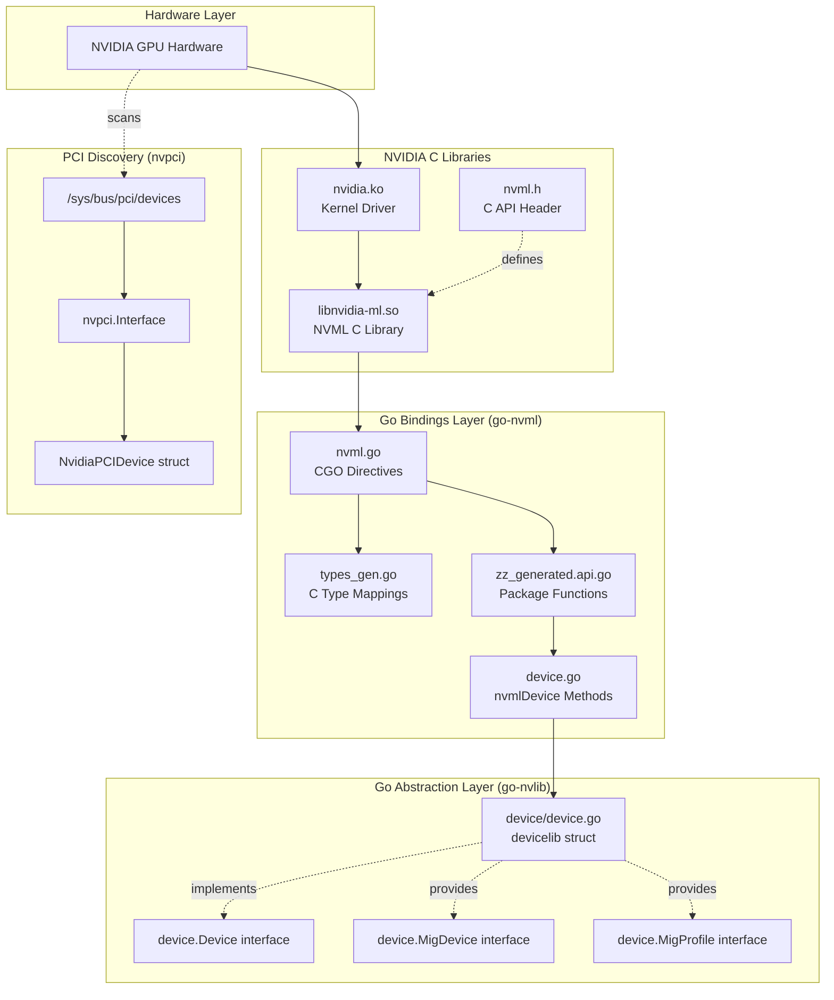

<!-- source: DeepWiki mcp.deepwiki.com · repo NVIDIA/k8s-device-plugin · page 2 NVML and Device Abstraction Layer · fetched 2026-10-26 -->

# NVML and Device Abstraction Layer

<details>
<summary>Relevant source files</summary>

The following files were used as context for generating this wiki page:

- [vendor/github.com/NVIDIA/go-nvlib/pkg/nvlib/device/device.go](vendor/github.com/NVIDIA/go-nvlib/pkg/nvlib/device/device.go)
- [vendor/github.com/NVIDIA/go-nvlib/pkg/nvlib/device/mig_profile.go](vendor/github.com/NVIDIA/go-nvlib/pkg/nvlib/device/mig_profile.go)
- [vendor/github.com/NVIDIA/go-nvlib/pkg/nvpci/mmio/mmio.go](vendor/github.com/NVIDIA/go-nvlib/pkg/nvpci/mmio/mmio.go)
- [vendor/github.com/NVIDIA/go-nvlib/pkg/nvpci/mmio/mock.go](vendor/github.com/NVIDIA/go-nvlib/pkg/nvpci/mmio/mock.go)
- [vendor/github.com/NVIDIA/go-nvlib/pkg/nvpci/mock.go](vendor/github.com/NVIDIA/go-nvlib/pkg/nvpci/mock.go)
- [vendor/github.com/NVIDIA/go-nvlib/pkg/nvpci/nvpci.go](vendor/github.com/NVIDIA/go-nvlib/pkg/nvpci/nvpci.go)
- [vendor/github.com/NVIDIA/go-nvlib/pkg/nvpci/nvpci_mock.go](vendor/github.com/NVIDIA/go-nvlib/pkg/nvpci/nvpci_mock.go)
- [vendor/github.com/NVIDIA/go-nvlib/pkg/nvpci/resources.go](vendor/github.com/NVIDIA/go-nvlib/pkg/nvpci/resources.go)
- [vendor/github.com/NVIDIA/go-nvlib/pkg/pciids/default_pci.ids](vendor/github.com/NVIDIA/go-nvlib/pkg/pciids/default_pci.ids)
- [vendor/github.com/NVIDIA/go-nvlib/pkg/pciids/pciids.go](vendor/github.com/NVIDIA/go-nvlib/pkg/pciids/pciids.go)
- [vendor/github.com/NVIDIA/go-nvml/pkg/nvml/const.go](vendor/github.com/NVIDIA/go-nvml/pkg/nvml/const.go)
- [vendor/github.com/NVIDIA/go-nvml/pkg/nvml/device.go](vendor/github.com/NVIDIA/go-nvml/pkg/nvml/device.go)
- [vendor/github.com/NVIDIA/go-nvml/pkg/nvml/gpm.go](vendor/github.com/NVIDIA/go-nvml/pkg/nvml/gpm.go)
- [vendor/github.com/NVIDIA/go-nvml/pkg/nvml/nvml.go](vendor/github.com/NVIDIA/go-nvml/pkg/nvml/nvml.go)
- [vendor/github.com/NVIDIA/go-nvml/pkg/nvml/nvml.h](vendor/github.com/NVIDIA/go-nvml/pkg/nvml/nvml.h)
- [vendor/github.com/NVIDIA/go-nvml/pkg/nvml/system.go](vendor/github.com/NVIDIA/go-nvml/pkg/nvml/system.go)
- [vendor/github.com/NVIDIA/go-nvml/pkg/nvml/types_gen.go](vendor/github.com/NVIDIA/go-nvml/pkg/nvml/types_gen.go)
- [vendor/github.com/NVIDIA/go-nvml/pkg/nvml/vgpu.go](vendor/github.com/NVIDIA/go-nvml/pkg/nvml/vgpu.go)
- [vendor/github.com/NVIDIA/go-nvml/pkg/nvml/zz_generated.api.go](vendor/github.com/NVIDIA/go-nvml/pkg/nvml/zz_generated.api.go)

</details>


## Purpose and Scope

This page documents the foundational device abstraction layer that provides Go interfaces for interacting with NVIDIA GPUs. It covers:

- The NVML (NVIDIA Management Library) C library and its role
- The `go-nvml` package providing CGO bindings to NVML
- The `go-nvlib` package providing higher-level device abstractions
- The `nvpci` package for PCI device discovery
- How these layers are consumed by the device plugin's resource management system

For detailed documentation on the CGO bindings, see [NVML Go Bindings](#2.1). For specifics on different device type abstractions (MIG, CUDA, VFIO), see [Device Interface Implementations](#2.2).

## Architecture Overview

The device abstraction is organized in distinct layers, each building on the previous one:

**Architecture Layers**



**Sources:** [vendor/github.com/NVIDIA/go-nvml/pkg/nvml/nvml.go:20-51](), [vendor/github.com/NVIDIA/go-nvml/pkg/nvml/device.go:23-58](), [vendor/github.com/NVIDIA/go-nvlib/pkg/nvlib/device/device.go:27-55](), [vendor/github.com/NVIDIA/go-nvpci/nvpci.go:31-62]()

## NVML C Library

The NVIDIA Management Library (NVML) is a C-based library (`libnvidia-ml.so`) that provides programmatic access to GPU monitoring and management functions. It is the primary interface for querying GPU state, topology, and capabilities.

The NVML API is defined in `nvml.h` [vendor/github.com/NVIDIA/go-nvml/pkg/nvml/nvml.h:1-140]() and includes functions for:

- **Device enumeration**: `nvmlDeviceGetCount()`, `nvmlDeviceGetHandleByIndex()` [vendor/github.com/NVIDIA/go-nvml/pkg/nvml/zz_generated.api.go:65-108]()
- **Device properties**: `nvmlDeviceGetName()`, `nvmlDeviceGetUUID()`, `nvmlDeviceGetMemoryInfo()` [vendor/github.com/NVIDIA/go-nvml/pkg/nvml/zz_generated.api.go:121-146]()
- **MIG support**: `nvmlDeviceGetMigMode()`, `nvmlDeviceGetMaxMigDeviceCount()`, `nvmlDeviceGetMigDeviceHandleByIndex()` [vendor/github.com/NVIDIA/go-nvml/pkg/nvml/zz_generated.api.go:102-137]()
- **Topology**: `nvmlDeviceGetTopologyCommonAncestor()`, `nvmlDeviceGetCpuAffinity()` [vendor/github.com/NVIDIA/go-nvml/pkg/nvml/zz_generated.api.go:66-150]()

**Sources:** [vendor/github.com/NVIDIA/go-nvml/pkg/nvml/nvml.h:1-140](), [vendor/github.com/NVIDIA/go-nvml/pkg/nvml/zz_generated.api.go:22-150]()

## go-nvml Package: CGO Bindings

The `go-nvml` package provides Go bindings to the NVML C library using CGO. It handles the low-level translation between Go types and C pointers.

### CGO Bridge and Types
The CGO bridge [vendor/github.com/NVIDIA/go-nvml/pkg/nvml/nvml.go:20-29]() allows dynamic linking. Types like `nvmlDevice` wrap opaque C pointers [vendor/github.com/NVIDIA/go-nvml/pkg/nvml/types_gen.go:8-10]():

```go
type nvmlDevice struct {
	Handle *_Ctype_struct_nvmlDevice_st
}
```

### Device Interface
The `nvml.Device` interface [vendor/github.com/NVIDIA/go-nvml/pkg/nvml/device.go:27-58]() provides methods that map directly to C functions. For example, `GetName()` [vendor/github.com/NVIDIA/go-nvml/pkg/nvml/device.go:150-154]() calls `nvmlDeviceGetName`.

For details on initialization and query operations, see [NVML Go Bindings](#2.1).

**Sources:** [vendor/github.com/NVIDIA/go-nvml/pkg/nvml/nvml.go:20-29](), [vendor/github.com/NVIDIA/go-nvml/pkg/nvml/types_gen.go:8-10](), [vendor/github.com/NVIDIA/go-nvml/pkg/nvml/device.go:150-154]()

## go-nvlib Package: Higher-Level Abstractions

The `go-nvlib` package provides higher-level, more ergonomic interfaces on top of `go-nvml`. It adds domain logic for common operations like architecture string mapping and MIG device enumeration.

### Device Interface Extension
The `device.Device` interface [vendor/github.com/NVIDIA/go-nvlib/pkg/nvlib/device/device.go:27-42]() extends `nvml.Device` with additional methods:

| Method | Purpose |
|--------|---------|
| `GetArchitectureAsString()` | Maps enum to strings like "Ampere" or "Hopper" [vendor/github.com/NVIDIA/go-nvlib/pkg/nvlib/device/device.go:72-100]() |
| `GetBrandAsString()` | Maps brand enum to "Tesla", "GeForce", etc. [vendor/github.com/NVIDIA/go-nvlib/pkg/nvlib/device/device.go:103-148]() |
| `GetPCIBusID()` | Extracts and cleans the PCI bus ID string [vendor/github.com/NVIDIA/go-nvlib/pkg/nvlib/device/device.go:177-197]() |
| `IsMigCapable()` | Checks if the hardware supports MIG partitioning [vendor/github.com/NVIDIA/go-nvlib/pkg/nvlib/device/device.go:230-244]() |

### MIG Abstractions
The library simplifies MIG management via `VisitMigDevices()` [vendor/github.com/NVIDIA/go-nvlib/pkg/nvlib/device/device.go:311-346]() and `VisitMigProfiles()` [vendor/github.com/NVIDIA/go-nvlib/pkg/nvlib/device/device.go:349-408](), which abstract the complexity of iterating over child handles and profile definitions.

**Sources:** [vendor/github.com/NVIDIA/go-nvlib/pkg/nvlib/device/device.go:27-408]()

## nvpci Package: PCI Device Discovery

The `nvpci` package provides PCI-level device discovery by reading from sysfs, complementing NVML's device enumeration. This is particularly useful for identifying devices before NVML is initialized or for identifying non-GPU NVIDIA PCI devices like NVSwitches.

### NvidiaPCIDevice
The `NvidiaPCIDevice` struct [vendor/github.com/NVIDIA/go-nvpci/nvpci.go:108-123]() captures system-level metadata:

```go
type NvidiaPCIDevice struct {
	Path       string
	Address    string
	Vendor     uint16
	Class      uint32
	Device     uint16
	Driver     string
	IommuGroup int
	NumaNode   int
	// ...
}
```

### Discovery Logic
The library scans `PCIDevicesRoot` (`/sys/bus/pci/devices`) [vendor/github.com/NVIDIA/go-nvpci/nvpci.go:33-41]() and filters for `PCINvidiaVendorID` (`0x10de`) [vendor/github.com/NVIDIA/go-nvpci/nvpci.go:35](). It can distinguish between VGA controllers, 3D controllers, and NVSwitches using PCI class IDs [vendor/github.com/NVIDIA/go-nvpci/nvpci.go:126-143]().

**Sources:** [vendor/github.com/NVIDIA/go-nvpci/nvpci.go:31-143](), [vendor/github.com/NVIDIA/go-nvpci/nvpci.go:203-236]()

## Device Interface Implementations

The plugin uses several specialized implementations of device interfaces to handle different hardware configurations and virtualization environments.

| Implementation | Description |
|----------------|-------------|
| `nvmlDevice` | Standard GPU handle using NVML CGO bindings. |
| `nvmlMigDevice` | Specialized handle for MIG partitions. |
| `cudaDevice` | Abstraction for CUDA-level device properties. |
| `vfioDevice` | Used for SR-IOV Virtual Functions bound to VFIO drivers. |

For a deep dive into how these implementations handle path construction and metadata extraction, see [Device Interface Implementations](#2.2).

**Sources:** [vendor/github.com/NVIDIA/go-nvml/pkg/nvml/device.go:27-58](), [vendor/github.com/NVIDIA/go-nvlib/pkg/nvlib/device/device.go:44-50]()

---

