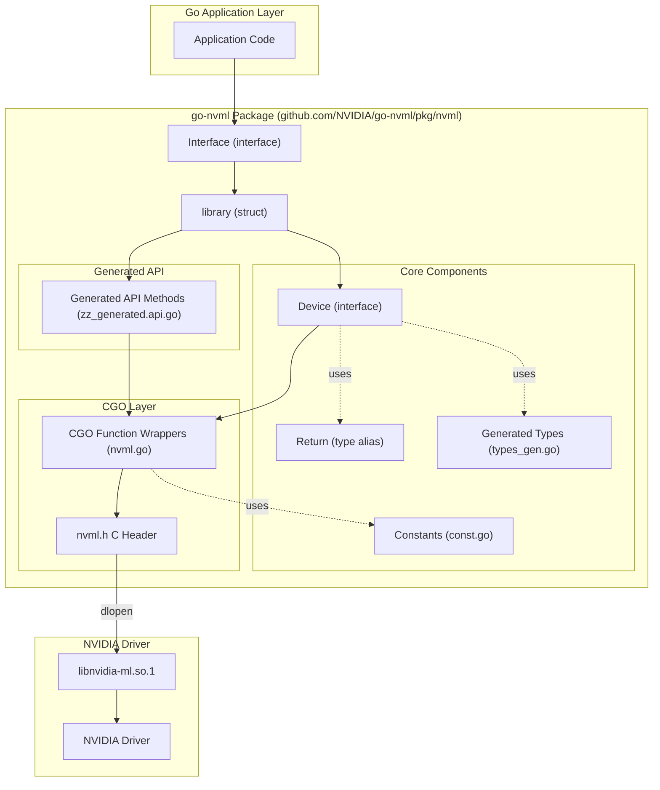
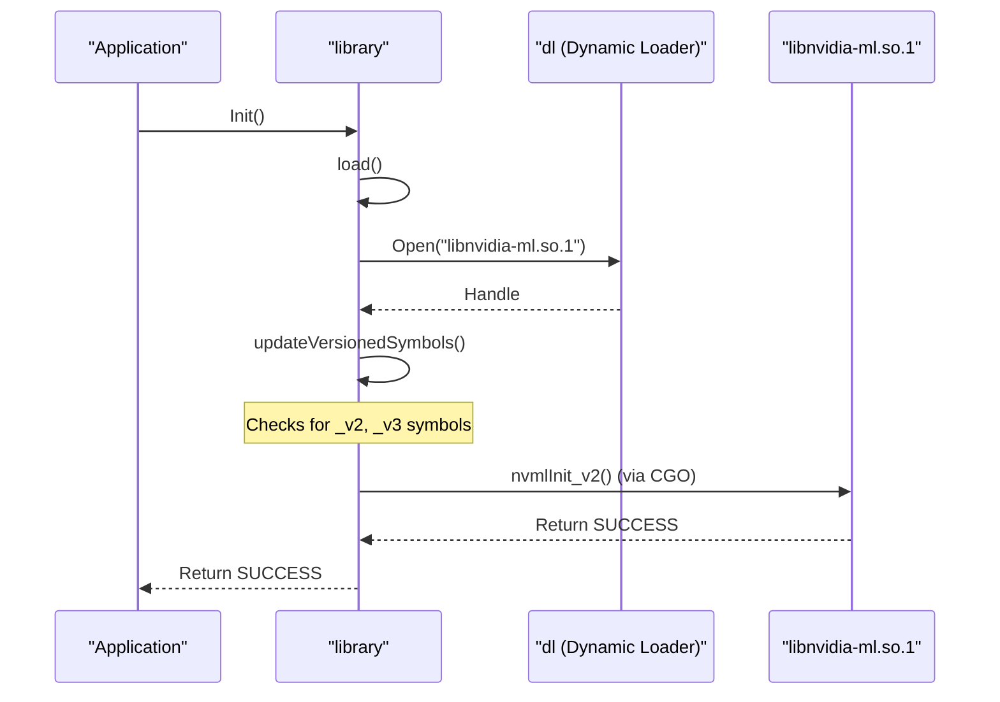
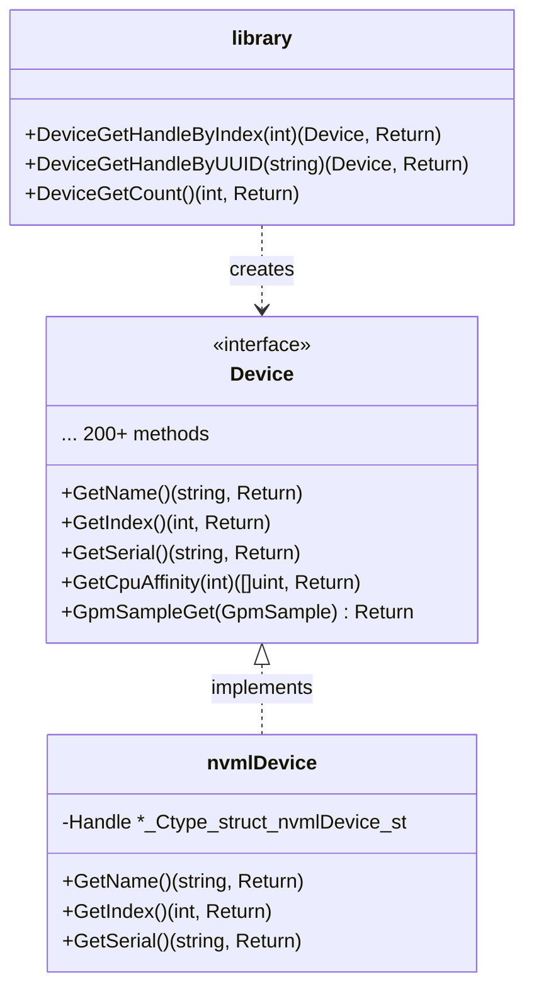
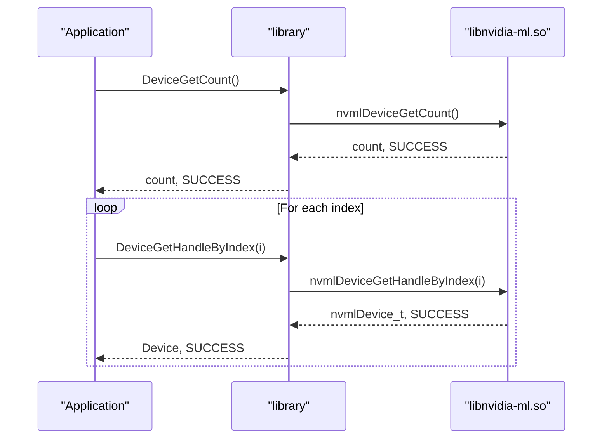
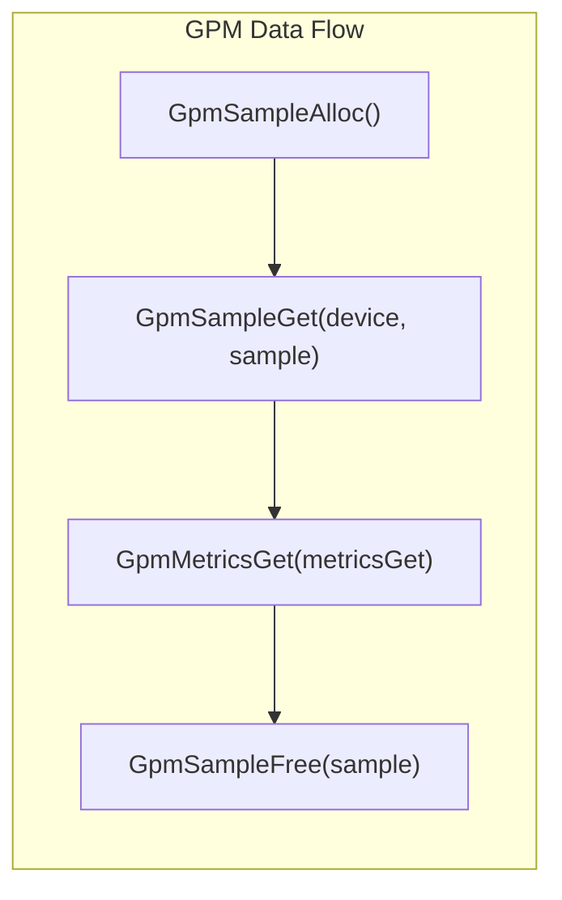

<!-- source: DeepWiki mcp.deepwiki.com · repo NVIDIA/k8s-device-plugin · page 2.1 NVML Go Bindings · fetched 2026-10-26 -->

# NVML Go Bindings

Relevant source files

The following files were used as context for generating this wiki page:

- [vendor/github.com/NVIDIA/go-nvml/pkg/dl/dl.go](vendor/github.com/NVIDIA/go-nvml/pkg/dl/dl.go)
- [vendor/github.com/NVIDIA/go-nvml/pkg/nvml/api.go](vendor/github.com/NVIDIA/go-nvml/pkg/nvml/api.go)
- [vendor/github.com/NVIDIA/go-nvml/pkg/nvml/cgo_helpers_static.go](vendor/github.com/NVIDIA/go-nvml/pkg/nvml/cgo_helpers_static.go)
- [vendor/github.com/NVIDIA/go-nvml/pkg/nvml/const.go](vendor/github.com/NVIDIA/go-nvml/pkg/nvml/const.go)
- [vendor/github.com/NVIDIA/go-nvml/pkg/nvml/const_static.go](vendor/github.com/NVIDIA/go-nvml/pkg/nvml/const_static.go)
- [vendor/github.com/NVIDIA/go-nvml/pkg/nvml/device.go](vendor/github.com/NVIDIA/go-nvml/pkg/nvml/device.go)
- [vendor/github.com/NVIDIA/go-nvml/pkg/nvml/event_set.go](vendor/github.com/NVIDIA/go-nvml/pkg/nvml/event_set.go)
- [vendor/github.com/NVIDIA/go-nvml/pkg/nvml/gpm.go](vendor/github.com/NVIDIA/go-nvml/pkg/nvml/gpm.go)
- [vendor/github.com/NVIDIA/go-nvml/pkg/nvml/init.go](vendor/github.com/NVIDIA/go-nvml/pkg/nvml/init.go)
- [vendor/github.com/NVIDIA/go-nvml/pkg/nvml/lib.go](vendor/github.com/NVIDIA/go-nvml/pkg/nvml/lib.go)
- [vendor/github.com/NVIDIA/go-nvml/pkg/nvml/nvml.go](vendor/github.com/NVIDIA/go-nvml/pkg/nvml/nvml.go)
- [vendor/github.com/NVIDIA/go-nvml/pkg/nvml/nvml.h](vendor/github.com/NVIDIA/go-nvml/pkg/nvml/nvml.h)
- [vendor/github.com/NVIDIA/go-nvml/pkg/nvml/system.go](vendor/github.com/NVIDIA/go-nvml/pkg/nvml/system.go)
- [vendor/github.com/NVIDIA/go-nvml/pkg/nvml/types_gen.go](vendor/github.com/NVIDIA/go-nvml/pkg/nvml/types_gen.go)
- [vendor/github.com/NVIDIA/go-nvml/pkg/nvml/vgpu.go](vendor/github.com/NVIDIA/go-nvml/pkg/nvml/vgpu.go)
- [vendor/github.com/NVIDIA/go-nvml/pkg/nvml/zz_generated.api.go](vendor/github.com/NVIDIA/go-nvml/pkg/nvml/zz_generated.api.go)

## Purpose and Scope

The NVML Go Bindings provide CGO-based bindings to the NVIDIA Management Library (NVML) C API (`libnvidia-ml.so`). This package, located at `github.com/NVIDIA/go-nvml/pkg/nvml`, enables Go programs to interact with NVIDIA GPUs for monitoring, management, and configuration operations. The bindings expose device enumeration, health monitoring, performance metrics, MIG (Multi-Instance GPU) management, and other NVML functionality.

This page documents the low-level CGO bindings layer. For higher-level device abstractions and interfaces, see [Device Interface Implementations](#2.2).

**Sources:** [vendor/github.com/NVIDIA/go-nvml/pkg/nvml/nvml.go:1-29](), [vendor/github.com/NVIDIA/go-nvml/pkg/nvml/lib.go:17-25]()

---

## Library Architecture

### CGO Binding Layer Structure

The `go-nvml` package uses CGO to bind to the NVML C library. The architecture consists of several key components:

**Sources:** [vendor/github.com/NVIDIA/go-nvml/pkg/nvml/nvml.go:20-29](), [vendor/github.com/NVIDIA/go-nvml/pkg/nvml/types_gen.go:1-10](), [vendor/github.com/NVIDIA/go-nvml/pkg/nvml/const.go:1-28](), [vendor/github.com/NVIDIA/go-nvml/pkg/nvml/lib.go:41-55]()

### Library Interface and Implementation

The `library` struct implements the NVML `Interface` and serves as the entry point for all operations. It handles dynamic loading of the underlying shared object via the `dl` package.

| Component | Type | Description |
|-----------|------|-------------|
| `library` | struct | Main implementation that wraps NVML functionality [vendor/github.com/NVIDIA/go-nvml/pkg/nvml/lib.go:49-54]() |
| `libnvml` | variable | Global instance of the `library` struct [vendor/github.com/NVIDIA/go-nvml/pkg/nvml/lib.go:59-59]() |
| `Device` | interface | Represents a GPU device with query methods [vendor/github.com/NVIDIA/go-nvml/pkg/nvml/device.go:27-27]() |
| `nvmlDevice` | struct | Internal handle to C `nvmlDevice_t` [vendor/github.com/NVIDIA/go-nvml/pkg/nvml/types_gen.go:8-10]() |
| `Return` | type alias | NVML return code for error handling [vendor/github.com/NVIDIA/go-nvml/pkg/nvml/nvml.go:32-35]() |

The library uses a global instance pattern where `libnvml` is the default instance, and package-level functions in `zz_generated.api.go` delegate to methods on this instance.

**Sources:** [vendor/github.com/NVIDIA/go-nvml/pkg/nvml/zz_generated.api.go:22-23](), [vendor/github.com/NVIDIA/go-nvml/pkg/nvml/lib.go:49-60]()

---

## Initialization and Lifecycle

### Initialization Flow

The library initialization involves loading the `libnvidia-ml.so.1` shared library and mapping versioned symbols (e.g., mapping `nvmlInit` to `nvmlInit_v2` if available).

**Initialization Functions:**

| Function | CGO Binding | Description |
|----------|-------------|-------------|
| `Init()` | `nvmlInit()` | Loads the library and initializes NVML [vendor/github.com/NVIDIA/go-nvml/pkg/nvml/init.go:20-25]() |
| `InitWithFlags(flags uint32)` | `nvmlInitWithFlags()` | Initialize with specific flags [vendor/github.com/NVIDIA/go-nvml/pkg/nvml/init.go:28-33]() |
| `Shutdown()` | `nvmlShutdown()` | Cleanup and close the dynamic library [vendor/github.com/NVIDIA/go-nvml/pkg/nvml/init.go:36-48]() |

**Sources:** [vendor/github.com/NVIDIA/go-nvml/pkg/nvml/init.go:19-48](), [vendor/github.com/NVIDIA/go-nvml/pkg/nvml/lib.go:103-123](), [vendor/github.com/NVIDIA/go-nvml/pkg/nvml/lib.go:197-226]()

### Version Management

The library automatically detects and uses the highest available version of NVML functions. For example, `nvmlDeviceGetPciInfo` may be mapped to `v1`, `v2`, or `v3` at runtime depending on the driver version.

**Sources:** [vendor/github.com/NVIDIA/go-nvml/pkg/nvml/lib.go:197-226](), [vendor/github.com/NVIDIA/go-nvml/pkg/nvml/system.go:18-43]()

---

## Core Types and Interfaces

### Device Interface Hierarchy

The `Device` interface is the primary abstraction for GPU devices.

**Sources:** [vendor/github.com/NVIDIA/go-nvml/pkg/nvml/device.go:102-187](), [vendor/github.com/NVIDIA/go-nvml/pkg/nvml/types_gen.go:8-10]()

### Key Data Structures

| Type | File Location | Purpose |
|------|---------------|---------|
| `nvmlDevice` | [types_gen.go:8-10]() | Internal C device handle wrapper |
| `PciInfo` | [types_gen.go:40-48]() | PCI bus information including bus ID and domain |
| `Memory` / `Memory_v2` | [types_gen.go:62-74]() | Memory usage statistics |
| `Utilization` | [types_gen.go:57-60]() | GPU and memory utilization percentages |
| `ProcessInfo` | [types_gen.go:94-99]() | Running process information |
| `DeviceAttributes` | [types_gen.go:123-133]() | MIG and hardware attributes |

**Sources:** [vendor/github.com/NVIDIA/go-nvml/pkg/nvml/types_gen.go:1-133]()

---

## Device Discovery and Enumeration

### Device Enumeration Pattern

### Device Handle Retrieval Methods

| Method | CGO Function | Parameters | Use Case |
|--------|--------------|------------|----------|
| `DeviceGetHandleByIndex(index int)` | `nvmlDeviceGetHandleByIndex` | Device index | Enumeration [vendor/github.com/NVIDIA/go-nvml/pkg/nvml/device.go:109-113]() |
| `DeviceGetHandleByUUID(uuid string)` | `nvmlDeviceGetHandleByUUID` | UUID string | Specific device lookup [vendor/github.com/NVIDIA/go-nvml/pkg/nvml/device.go:125-129]() |
| `DeviceGetHandleByPciBusId(id string)` | `nvmlDeviceGetHandleByPciBusId` | PCI Bus ID | Topology-based lookup [vendor/github.com/NVIDIA/go-nvml/pkg/nvml/device.go:139-143]() |

### Internal Handle Conversion

The internal `nvmlDeviceHandle()` function uses reflection to extract the raw C handle from a `Device` interface, enabling interop between the Go interface and CGO functions.

**Sources:** [vendor/github.com/NVIDIA/go-nvml/pkg/nvml/device.go:27-58]()

---

## Return Codes and Error Handling

NVML uses the `Return` type (aliased from `nvmlReturn_t`) for all operations.

| Constant | Value | Meaning |
|----------|-------|---------|
| `SUCCESS` | 0 | Operation completed successfully |
| `ERROR_UNINITIALIZED` | 1 | NVML not initialized |
| `ERROR_INVALID_ARGUMENT` | 2 | Invalid parameter passed |
| `ERROR_NOT_SUPPORTED` | 3 | Feature not supported on this device |
| `ERROR_LIBRARY_NOT_FOUND` | 999 (Internal) | Failed to load `libnvidia-ml.so.1` [vendor/github.com/NVIDIA/go-nvml/pkg/nvml/init.go:22-22]() |

**Sources:** [vendor/github.com/NVIDIA/go-nvml/pkg/nvml/nvml.go:54-59](), [vendor/github.com/NVIDIA/go-nvml/pkg/nvml/init.go:21-23]()

---

## GPU Performance Metrics (GPM)

The GPM subsystem provides high-fidelity metrics for GPU and MIG instances.

| Function | Description |
|----------|-------------|
| `GpmSampleAlloc()` | Allocates an opaque GPM sample buffer [vendor/github.com/NVIDIA/go-nvml/pkg/nvml/gpm.go:89-93]() |
| `GpmSampleGet()` | Populates a sample from a `Device` [vendor/github.com/NVIDIA/go-nvml/pkg/nvml/gpm.go:96-106]() |
| `GpmMigSampleGet()` | Populates a sample from a MIG instance [vendor/github.com/NVIDIA/go-nvml/pkg/nvml/gpm.go:140-150]() |
| `GpmMetricsGet()` | Calculates metrics between two samples [vendor/github.com/NVIDIA/go-nvml/pkg/nvml/gpm.go:67-70]() |

**Sources:** [vendor/github.com/NVIDIA/go-nvml/pkg/nvml/gpm.go:18-170]()

---

## Multi-Instance GPU (MIG) Support

The bindings provide structures to manage the MIG hierarchy: `Device` -> `GpuInstance` -> `ComputeInstance`.

| Go Type | Description |
|---------|-------------|
| `GpuInstanceInfo` | Metadata for a GPU Instance [vendor/github.com/NVIDIA/go-nvml/pkg/nvml/device.go:64-69]() |
| `ComputeInstanceInfo` | Metadata for a Compute Instance [vendor/github.com/NVIDIA/go-nvml/pkg/nvml/device.go:82-88]() |
| `nvmlGpuInstance` | Raw handle to a MIG GPU Instance [vendor/github.com/NVIDIA/go-nvml/pkg/nvml/types_gen.go:12-14]() |

**Sources:** [vendor/github.com/NVIDIA/go-nvml/pkg/nvml/device.go:60-99](), [vendor/github.com/NVIDIA/go-nvml/pkg/nvml/types_gen.go:12-14]()

---

## Summary of Key Components

| Component | File | Purpose |
|-----------|------|---------|
| `library` | [lib.go]() | Manages dynamic loading and symbol mapping |
| `nvmlDevice` | [types_gen.go]() | CGO handle wrapper |
| `Device` interface | [device.go]() | Primary device query API |
| Package-level functions | [zz_generated.api.go]() | Global entry points via `libnvml` |
| GPM Support | [gpm.go]() | Performance monitoring bindings |
| vGPU Support | [vgpu.go]() | Virtual GPU management bindings |

**Sources:** [vendor/github.com/NVIDIA/go-nvml/pkg/nvml/lib.go:1-150](), [vendor/github.com/NVIDIA/go-nvml/pkg/nvml/zz_generated.api.go:1-170](), [vendor/github.com/NVIDIA/go-nvml/pkg/nvml/device.go:1-187]()

---

