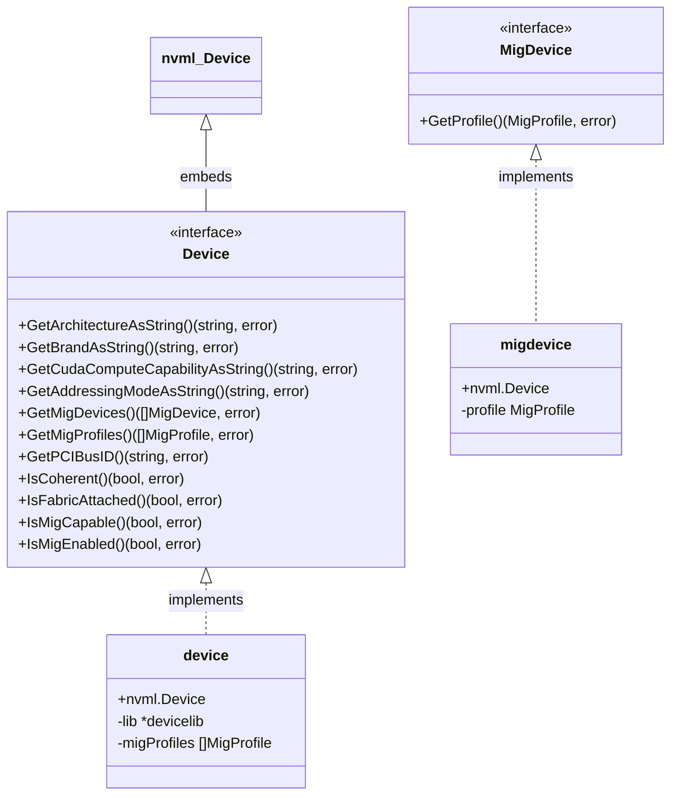
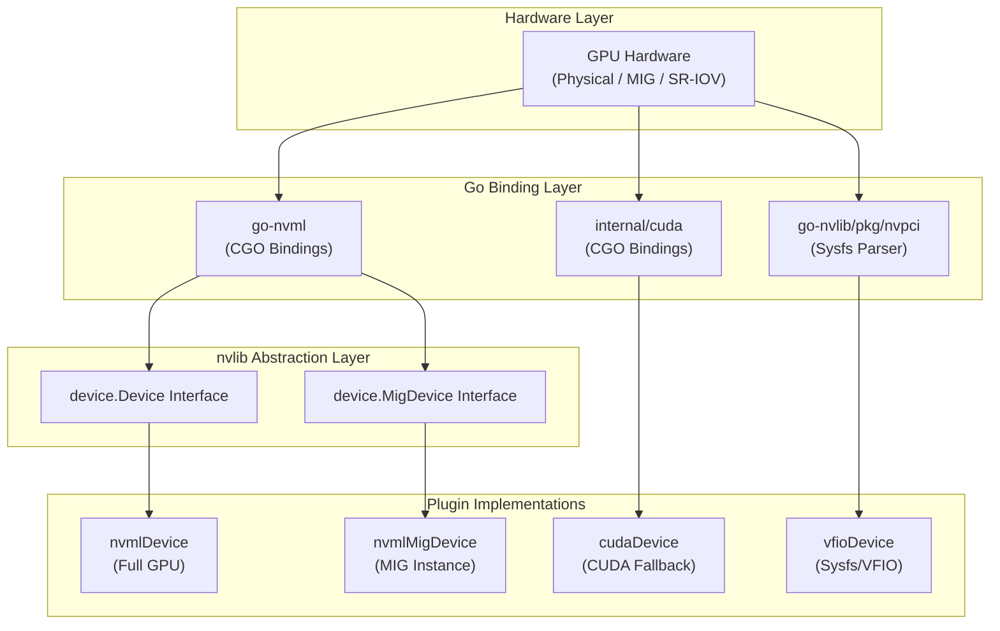

<!-- source: DeepWiki mcp.deepwiki.com · repo NVIDIA/k8s-device-plugin · page 2.2 Device Interface Implementations · fetched 2026-10-26 -->

# Device Interface Implementations

Relevant source files

The following files were used as context for generating this wiki page:

- [internal/resource/cuda-lib.go](internal/resource/cuda-lib.go)
- [internal/resource/fallback.go](internal/resource/fallback.go)
- [internal/resource/manager_mock.go](internal/resource/manager_mock.go)
- [internal/resource/null.go](internal/resource/null.go)
- [internal/resource/sysfs-lib.go](internal/resource/sysfs-lib.go)
- [vendor/github.com/NVIDIA/go-nvlib/pkg/nvlib/device/api.go](vendor/github.com/NVIDIA/go-nvlib/pkg/nvlib/device/api.go)
- [vendor/github.com/NVIDIA/go-nvlib/pkg/nvlib/device/device.go](vendor/github.com/NVIDIA/go-nvlib/pkg/nvlib/device/device.go)
- [vendor/github.com/NVIDIA/go-nvlib/pkg/nvlib/device/mig_device.go](vendor/github.com/NVIDIA/go-nvlib/pkg/nvlib/device/mig_device.go)
- [vendor/github.com/NVIDIA/go-nvlib/pkg/nvlib/device/mig_profile.go](vendor/github.com/NVIDIA/go-nvlib/pkg/nvlib/device/mig_profile.go)
- [vendor/github.com/NVIDIA/go-nvlib/pkg/nvlib/info/api.go](vendor/github.com/NVIDIA/go-nvlib/pkg/nvlib/info/api.go)
- [vendor/github.com/NVIDIA/go-nvlib/pkg/nvlib/info/builder.go](vendor/github.com/NVIDIA/go-nvlib/pkg/nvlib/info/builder.go)
- [vendor/github.com/NVIDIA/go-nvlib/pkg/nvlib/info/property-extractor.go](vendor/github.com/NVIDIA/go-nvlib/pkg/nvlib/info/property-extractor.go)
- [vendor/github.com/NVIDIA/go-nvlib/pkg/nvlib/info/property-extractor_mock.go](vendor/github.com/NVIDIA/go-nvlib/pkg/nvlib/info/property-extractor_mock.go)
- [vendor/github.com/NVIDIA/go-nvlib/pkg/nvlib/info/resolver.go](vendor/github.com/NVIDIA/go-nvlib/pkg/nvlib/info/resolver.go)
- [vendor/github.com/NVIDIA/go-nvlib/pkg/nvpci/mmio/mmio.go](vendor/github.com/NVIDIA/go-nvlib/pkg/nvpci/mmio/mmio.go)
- [vendor/github.com/NVIDIA/go-nvlib/pkg/nvpci/mmio/mock.go](vendor/github.com/NVIDIA/go-nvlib/pkg/nvpci/mmio/mock.go)
- [vendor/github.com/NVIDIA/go-nvlib/pkg/nvpci/mock.go](vendor/github.com/NVIDIA/go-nvlib/pkg/nvpci/mock.go)
- [vendor/github.com/NVIDIA/go-nvlib/pkg/nvpci/nvpci.go](vendor/github.com/NVIDIA/go-nvlib/pkg/nvpci/nvpci.go)
- [vendor/github.com/NVIDIA/go-nvlib/pkg/nvpci/nvpci_mock.go](vendor/github.com/NVIDIA/go-nvlib/pkg/nvpci/nvpci_mock.go)
- [vendor/github.com/NVIDIA/go-nvlib/pkg/nvpci/resources.go](vendor/github.com/NVIDIA/go-nvlib/pkg/nvpci/resources.go)
- [vendor/github.com/NVIDIA/go-nvlib/pkg/pciids/default_pci.ids](vendor/github.com/NVIDIA/go-nvlib/pkg/pciids/default_pci.ids)
- [vendor/github.com/NVIDIA/go-nvlib/pkg/pciids/pciids.go](vendor/github.com/NVIDIA/go-nvlib/pkg/pciids/pciids.go)

This page documents the various device interface implementations that provide an abstraction layer for interacting with NVIDIA GPUs in the Kubernetes device plugin. These implementations enable the plugin to work with different device types (full GPUs, MIG devices, CUDA devices, and VFIO devices) through a unified interface.

## Purpose and Scope

The device interface implementations provide a common abstraction for querying GPU device properties regardless of the underlying access mechanism (NVML, CUDA runtime, or sysfs). This abstraction enables the device plugin and GPU Feature Discovery (GFD) to obtain device information such as memory capacity, compute capabilities, MIG status, and fabric attachment without coupling to specific libraries or access methods.

## Device Interface Definition

The foundational `Device` interface is defined in the `go-nvlib` package. It extends the raw `nvml.Device` bindings with high-level helper methods for architecture detection, MIG profile management, and capability checks.

**Sources:** [vendor/github.com/NVIDIA/go-nvlib/pkg/nvlib/device/device.go:27-42](), [vendor/github.com/NVIDIA/go-nvlib/pkg/nvlib/device/mig_device.go:26-29]()

## Device Abstraction Layer Hierarchy

The system uses a layered approach to bridge physical hardware to Kubernetes resources.

**Sources:** [vendor/github.com/NVIDIA/go-nvlib/pkg/nvlib/device/device.go:53-64](), [internal/resource/cuda-lib.go:35-51](), [vendor/github.com/NVIDIA/go-nvlib/pkg/nvpci/nvpci.go:203-236]()

## nvmlDevice Implementation

The `nvmlDevice` (implemented via the `device` struct in `go-nvlib`) wraps a raw NVML handle to provide string-based property extraction and capability detection.

### Architecture and Brand Detection
The implementation maps numerical NVML constants to human-readable strings for labeling.
- **Architecture:** Maps `nvml.DEVICE_ARCH_AMPERE` to `"Ampere"`, `nvml.DEVICE_ARCH_HOPPER` to `"Hopper"`, etc. [vendor/github.com/NVIDIA/go-nvlib/pkg/nvlib/device/device.go:72-100]()
- **Brand:** Maps `nvml.BRAND_TESLA` to `"Tesla"`, `nvml.BRAND_GEFORCE` to `"GeForce"`, etc. [vendor/github.com/NVIDIA/go-nvlib/pkg/nvlib/device/device.go:103-148]()

### Capability Checks
- **Coherency:** Checks for `DEVICE_ADDRESSING_MODE_ATS` support. [vendor/github.com/NVIDIA/go-nvlib/pkg/nvlib/device/device.go:210-227]()
- **MIG Capability:** Checks if the device supports MIG mode by querying the NVML `GetMigMode` symbol. [vendor/github.com/NVIDIA/go-nvlib/pkg/nvlib/device/device.go:230-244]()

**Sources:** [vendor/github.com/NVIDIA/go-nvlib/pkg/nvlib/device/device.go:44-69]()

## nvmlMigDevice Implementation

The `migdevice` implementation handles Multi-Instance GPU partitions. Its primary responsibility is resolving the `MigProfile` associated with a partition.

### Profile Resolution
The `GetProfile()` method performs a complex lookup to match a MIG instance to its profile:
1. It retrieves the parent device handle. [vendor/github.com/NVIDIA/go-nvlib/pkg/nvlib/device/mig_device.go:66-69]()
2. It queries the GPU Instance (GI) and Compute Instance (CI) IDs. [vendor/github.com/NVIDIA/go-nvlib/pkg/nvlib/device/mig_device.go:81-89]()
3. It iterates through all supported GI and CI profile infos on the parent device to find a match for the instance's attributes. [vendor/github.com/NVIDIA/go-nvlib/pkg/nvlib/device/mig_device.go:111-153]()

### MigProfile Representation
A `MigProfile` (e.g., `1g.5gb`) is represented by `MigProfileInfo`, which tracks:
- **C:** Compute slices.
- **G:** GPU slices.
- **GB:** Memory size.
- **Attributes:** Extra capabilities like `+me` (media extensions).

**Sources:** [vendor/github.com/NVIDIA/go-nvlib/pkg/nvlib/device/mig_profile.go:46-55](), [vendor/github.com/NVIDIA/go-nvlib/pkg/nvlib/device/mig_device.go:61-157]()

## cudaDevice Implementation

The `cudaDevice` provides a fallback mechanism when NVML is not present, primarily on Tegra systems or in restricted environments.

- **Discovery:** Uses `cuda.DeviceGetCount()` and `cuda.DeviceGet(i)` to enumerate handles. [internal/resource/cuda-lib.go:35-51]()
- **Driver Version:** Reports versioning via `cuda.DriverGetVersion()`. [internal/resource/cuda-lib.go:54-63]()
- **Capabilities:** Limited to properties exposed by the CUDA Runtime API (Compute Capability, Total Memory).

**Sources:** [internal/resource/cuda-lib.go:1-89]()

## vfioDevice Implementation (nvpci)

The `nvpci` package implements device discovery via Linux `sysfs`. This is critical for SR-IOV Virtual Functions (VFs) and devices bound to `vfio-pci`.

### PCI Device Discovery
The `nvpci` implementation scans `/sys/bus/pci/devices` for the NVIDIA Vendor ID (`0x10de`). [vendor/github.com/NVIDIA/go-nvlib/pkg/nvpci/nvpci.go:31-35]()

### SR-IOV Support
The `NvidiaPCIDevice` struct tracks SR-IOV relationships:
- **Physical Function (PF):** Tracks `TotalVFs` and `NumVFs`. [vendor/github.com/NVIDIA/go-nvlib/pkg/nvpci/nvpci.go:88-92]()
- **Virtual Function (VF):** Maintains a pointer back to its parent `NvidiaPCIDevice`. [vendor/github.com/NVIDIA/go-nvlib/pkg/nvpci/nvpci.go:95-97]()

### Memory Resource Mapping
It parses the `resource` file in sysfs to build a map of Memory Resources (BARs). [vendor/github.com/NVIDIA/go-nvlib/pkg/nvpci/nvpci.go:108-123]()

**Sources:** [vendor/github.com/NVIDIA/go-nvlib/pkg/nvpci/nvpci.go:48-62](), [vendor/github.com/NVIDIA/go-nvlib/pkg/nvpci/nvpci.go:203-236]()

## Platform Resolver and Property Extractor

The `info` package provides a `PropertyExtractor` that determines which device implementation should be used based on system state.

| Function | Logic |
|----------|-------|
| `HasNvml()` | Checks for presence of `libnvidia-ml.so.1`. [vendor/github.com/NVIDIA/go-nvlib/pkg/nvlib/info/property-extractor.go:50-59]() |
| `HasTegraFiles()` | Checks for `/etc/nv_tegra_release` or Tegra soc family. [vendor/github.com/NVIDIA/go-nvlib/pkg/nvlib/info/property-extractor.go:69-91]() |
| `HasAnIntegratedGPU()` | Iterates through NVML devices and checks for names like "Orin" or "Thor". [vendor/github.com/NVIDIA/go-nvlib/pkg/nvlib/info/property-extractor.go:106-147]() |
| `ResolvePlatform()` | Switches between `PlatformNVML`, `PlatformTegra`, or `PlatformWSL`. [vendor/github.com/NVIDIA/go-nvlib/pkg/nvlib/info/resolver.go:36-64]() |

**Sources:** [vendor/github.com/NVIDIA/go-nvlib/pkg/nvlib/info/api.go:34-39](), [vendor/github.com/NVIDIA/go-nvlib/pkg/nvlib/info/builder.go:41-78]()

---

