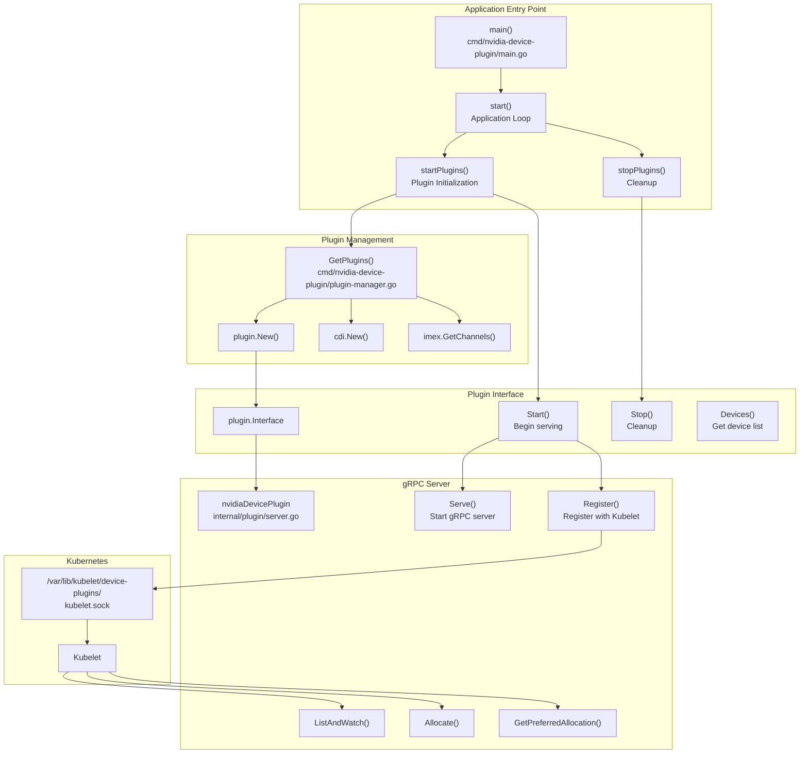
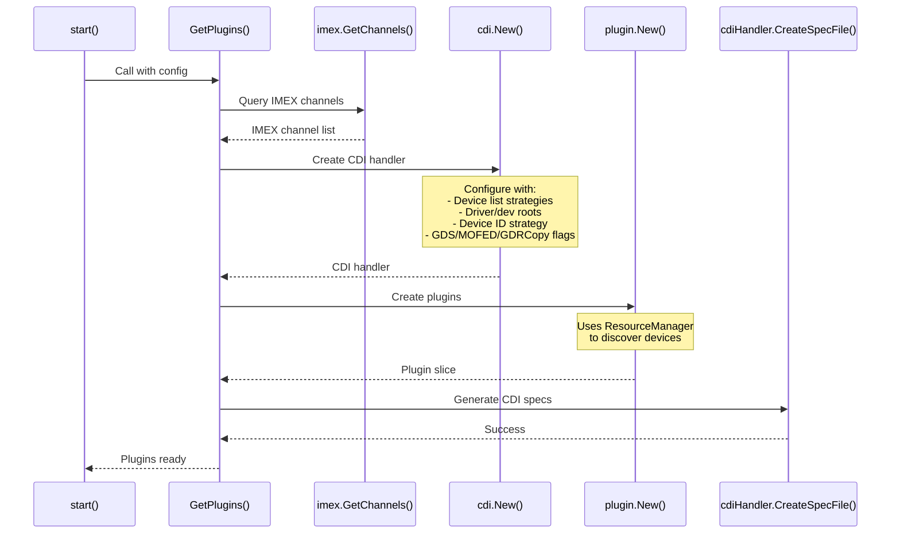
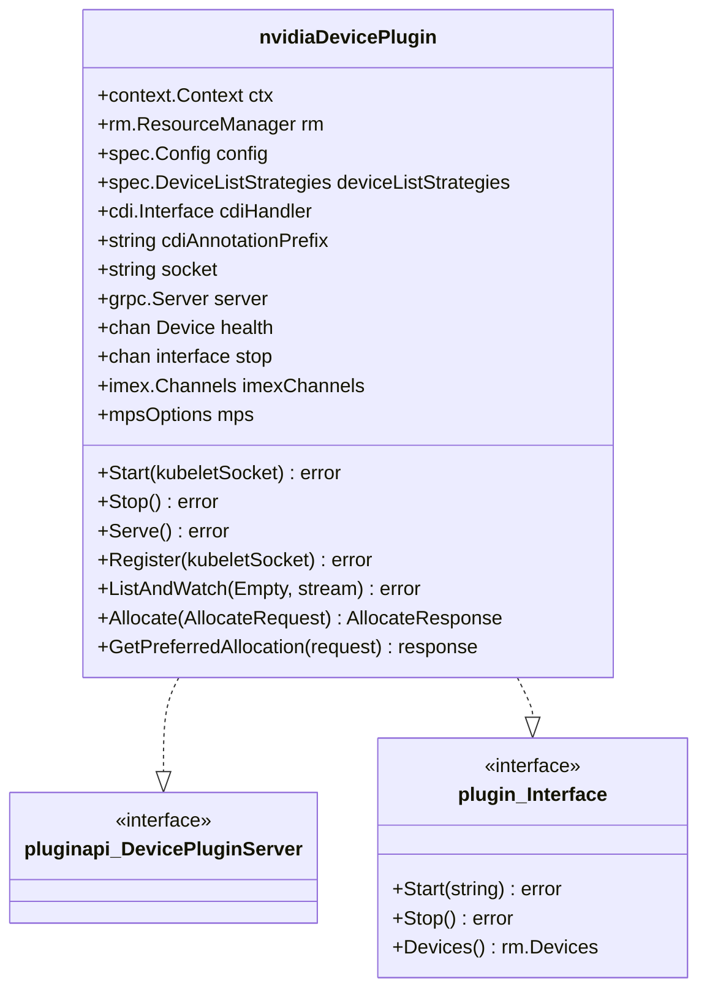

<!-- source: DeepWiki mcp.deepwiki.com · repo NVIDIA/k8s-device-plugin · page 3 Device Plugin Core · fetched 2026-10-26 -->

# Device Plugin Core

Relevant source files

The following files were used as context for generating this wiki page:

- [api/config/v1/strategy.go](api/config/v1/strategy.go)
- [cmd/nvidia-device-plugin/main.go](cmd/nvidia-device-plugin/main.go)
- [cmd/nvidia-device-plugin/plugin-manager.go](cmd/nvidia-device-plugin/plugin-manager.go)
- [internal/cdi/cdi.go](internal/cdi/cdi.go)
- [internal/cdi/options.go](internal/cdi/options.go)
- [internal/plugin/factory.go](internal/plugin/factory.go)
- [internal/plugin/options.go](internal/plugin/options.go)
- [internal/plugin/server.go](internal/plugin/server.go)
- [internal/plugin/server_test.go](internal/plugin/server_test.go)
- [internal/rm/device_map.go](internal/rm/device_map.go)
- [internal/rm/device_map_test.go](internal/rm/device_map_test.go)
- [internal/rm/devices.go](internal/rm/devices.go)
- [internal/rm/health.go](internal/rm/health.go)
- [internal/rm/health_test.go](internal/rm/health_test.go)
- [internal/rm/helper.go](internal/rm/helper.go)
- [internal/rm/nvml_devices.go](internal/rm/nvml_devices.go)
- [internal/rm/nvml_manager.go](internal/rm/nvml_manager.go)
- [internal/rm/rm.go](internal/rm/rm.go)
- [internal/rm/tegra_devices.go](internal/rm/tegra_devices.go)
- [internal/rm/tegra_manager.go](internal/rm/tegra_manager.go)
- [internal/rm/wsl_devices.go](internal/rm/wsl_devices.go)

## Purpose and Scope

This document covers the core device plugin application, including the main entry point, plugin lifecycle management, and integration with the Kubernetes device plugin API. It focuses on how the application initializes, creates plugin instances, and communicates with the Kubelet via gRPC.

For information about resource management and device discovery, see [Resource Manager](#3.2). For details on allocation strategies, see [Device Allocation Strategies](#3.3). For health monitoring specifics, see [Health Monitoring](#3.4). For CDI integration details, see [Container Device Interface (CDI) Integration](#3.5). For configuration options, see [Configuration Management](#5).

---

## Application Architecture

The device plugin application consists of three main layers: the application entry point, plugin management, and the gRPC server implementation that communicates with Kubelet.

### High-Level Component Structure

**Sources:** [cmd/nvidia-device-plugin/main.go:50-191](), [cmd/nvidia-device-plugin/plugin-manager.go:35-89](), [internal/plugin/server.go:52-160]()

---

## Application Entry Point

The application entry point is defined in `main()`, which creates a CLI application using the `urfave/cli` library [cmd/nvidia-device-plugin/main.go:51](). The application supports numerous command-line flags for configuration.

### Main Function Structure

The `main()` function performs the following:

1. Creates a new CLI application with metadata (name, version, usage) [cmd/nvidia-device-plugin/main.go:51-55]()
2. Defines all command-line flags and environment variable mappings [cmd/nvidia-device-plugin/main.go:60-183]()
3. Sets the main action to call `start()` [cmd/nvidia-device-plugin/main.go:56-58]()
4. Runs the CLI application with `os.Args` [cmd/nvidia-device-plugin/main.go:186]()

Key flags include:

| Flag | Default | Purpose |
|------|---------|---------|
| `mig-strategy` | `none` | Strategy for exposing MIG devices: none, single, or mixed [cmd/nvidia-device-plugin/main.go:62-66]() |
| `fail-on-init-error` | `true` | Whether to fail or block indefinitely on init errors [cmd/nvidia-device-plugin/main.go:67-72]() |
| `device-list-strategy` | `envvar` | How to pass device list to runtime: envvar, volume-mounts, or cdi-annotations [cmd/nvidia-device-plugin/main.go:92-97]() |
| `device-id-strategy` | `uuid` | How to identify devices: uuid or index [cmd/nvidia-device-plugin/main.go:98-103]() |
| `kubelet-socket` | `/var/lib/kubelet/device-plugins/kubelet.sock` | Socket for Kubelet communication [cmd/nvidia-device-plugin/main.go:164-170]() |
| `config-file` | - | Path to configuration file (alternative to CLI flags) [cmd/nvidia-device-plugin/main.go:171-176]() |

**Sources:** [cmd/nvidia-device-plugin/main.go:50-185]()

### Application Main Loop

The application implements a main loop that handles the lifecycle of the plugin through:

1. **File System Watcher**: Monitors the Kubelet device plugin directory for socket changes.
2. **Signal Watcher**: Listens for termination signals (`SIGINT`, `SIGTERM`) and configuration reload signals (`SIGHUP`).
3. **Restart Logic**: If any plugin fails to start, it retries based on the `fail-on-init-error` setting.
4. **Graceful Restart**: On configuration updates, stops existing plugins and restarts them with new parameters.

**Sources:** [cmd/nvidia-device-plugin/main.go:56-58](), [internal/plugin/server.go:186-216]()

### Configuration Loading and Validation

Before starting plugins, the application loads and validates configuration. The `validateFlags` function ensures that requested strategies are compatible with the host environment [cmd/nvidia-device-plugin/main.go:193-201]().

The validation process checks:
- Device list strategies are valid and compatible with the platform (CDI requires NVML) [cmd/nvidia-device-plugin/main.go:199-201]()
- Device ID strategy is either `uuid` or `index`.
- MIG strategy is one of: `none`, `single`, `mixed`.
- MPS configuration is valid and compatible with the resource management strategy.
- Device discovery strategy is `auto`, `nvml`, or `tegra`.
- IMEX channel IDs are valid [cmd/nvidia-device-plugin/main.go:153-157]().

**Sources:** [cmd/nvidia-device-plugin/main.go:193-201](), [cmd/nvidia-device-plugin/plugin-manager.go:91-109]()

---

## Plugin Manager

The plugin manager is responsible for creating plugin instances based on the system configuration. The main entry point is the `GetPlugins()` function.

### Plugin Creation Flow

### GetPlugins Implementation

The `GetPlugins()` function in `plugin-manager.go` performs the following steps:

1. **Driver Root Resolution**: Resolves the driver root path for NVML library loading [cmd/nvidia-device-plugin/plugin-manager.go:37]().
2. **IMEX Channel Discovery**: Calls `imex.GetChannels()` to discover available IMEX channels based on configuration [cmd/nvidia-device-plugin/plugin-manager.go:44]().
3. **CDI Handler Creation**: Creates a CDI handler with various options including device list strategies, driver/device roots, and feature flags [cmd/nvidia-device-plugin/plugin-manager.go:52-67]().
4. **Plugin Creation**: Calls `plugin.New()` to create plugin instances (one per resource type) [cmd/nvidia-device-plugin/plugin-manager.go:72-79]().
5. **CDI Spec Generation**: Generates CDI specification files at `/var/run/cdi/` [cmd/nvidia-device-plugin/plugin-manager.go:84-86]().

**Sources:** [cmd/nvidia-device-plugin/plugin-manager.go:35-89]()

---

## Device Plugin Server Implementation

Each plugin instance implements the Kubernetes device plugin API through the `nvidiaDevicePlugin` struct.

### nvidiaDevicePlugin Structure

**Sources:** [internal/plugin/server.go:52-70]()

### Plugin Lifecycle

The plugin lifecycle is managed through `Start()` and `Stop()` methods. `Start()` initializes the gRPC server, registers with Kubelet, and begins health checks [internal/plugin/server.go:129-160](). `Stop()` performs a graceful shutdown [internal/plugin/server.go:163-174]().

**Sources:** [internal/plugin/server.go:109-174](), [internal/plugin/server.go:176-226]()

### Plugin Socket Management

Each plugin creates a Unix socket in the Kubelet device plugin directory. The socket path is derived from the resource name [internal/plugin/server.go:103-107]().

- Socket path: `/var/lib/kubelet/device-plugins/nvidia-<resource-name>.sock`
- Example: `/var/lib/kubelet/device-plugins/nvidia-gpu.sock`

**Sources:** [internal/plugin/server.go:102-107]()

---

## Kubernetes Device Plugin API Implementation

The `nvidiaDevicePlugin` implements the Kubernetes device plugin gRPC API defined in `k8s.io/kubelet/pkg/apis/deviceplugin/v1beta1`.

### Registration with Kubelet

The `Register()` method creates a gRPC client connection to the Kubelet's registration socket and sends a `RegisterRequest` [internal/plugin/server.go:229-256]().

- **Version**: `pluginapi.Version` (v1beta1)
- **Endpoint**: The base name of the plugin socket.
- **ResourceName**: The full resource name (e.g., `nvidia.com/gpu`).

**Sources:** [internal/plugin/server.go:229-256]()

### ListAndWatch Implementation

The `ListAndWatch()` RPC streams device status updates to Kubelet. It initially sends the full set of devices and then monitors the health channel for updates [internal/plugin/server.go:266-285]().

**Sources:** [internal/plugin/server.go:266-285]()

### Allocate Implementation

The `Allocate()` method processes device allocation requests. It validates the request through the `ResourceManager` and then builds a `ContainerAllocateResponse` based on the configured `DeviceListStrategy` [internal/plugin/server.go:306-365]().

**For CDI-based allocation**:
- It adds CDI annotations to the response containing qualified device names [internal/plugin/server_test.go:133-137]().
- It includes additional CDI devices for features like GDS or MOFED if enabled [internal/plugin/server_test.go:199-204]().

**For environment variable allocation**:
- It sets the `NVIDIA_VISIBLE_DEVICES` environment variable with the list of allocated device IDs [internal/plugin/server_test.go:51-53]().

**Sources:** [internal/plugin/server.go:306-365](), [internal/plugin/server_test.go:32-109]()

### GetPreferredAllocation Implementation

The `GetPreferredAllocation()` method allows the device plugin to influence device selection when multiple devices are available. It delegates the logic to the `ResourceManager`'s implementation [internal/plugin/server.go:288-303]().

**Sources:** [internal/plugin/server.go:288-303](), [internal/rm/nvml_manager.go:89-91]()

---

## Device ID Management

The plugin supports different strategies for identifying devices. The `Device` struct wraps the Kubernetes plugin API device with extra metadata like UUID, Index, and Paths [internal/rm/devices.go:29-38]().

- **UUID Strategy**: Uses the GPU's unique identifier.
- **Index Strategy**: Uses the device index (e.g., "0", "1").

Device IDs can be "annotated" to support replication (e.g., for time-slicing), where the ID includes a replica suffix [internal/rm/devices.go:243-245]().

**Sources:** [internal/rm/devices.go:29-38](), [internal/rm/devices.go:243-265]()

---

## Error Handling and Restart Logic

### Plugin Startup Failure Handling

The application's behavior on startup error is governed by the `fail-on-init-error` flag [cmd/nvidia-device-plugin/main.go:67-72](). If set to `true`, the application exits on initialization failure. If `false`, it logs the error and continues to block, allowing for potential recovery or manual intervention.

**Sources:** [cmd/nvidia-device-plugin/main.go:67-72](), [internal/rm/nvml_manager.go:41-43]()

### gRPC Server Crash Recovery

The `Serve()` method includes a loop that attempts to restart the gRPC server if it crashes. It tracks restart frequency and will fatal the application if the server crashes more than 5 times within an hour [internal/plugin/server.go:186-216]().

**Sources:** [internal/plugin/server.go:186-216]()

---

## Summary

The Device Plugin Core implements a robust application that:

1. **Initializes** with flexible configuration via CLI flags, environment variables, or config files.
2. **Manages multiple plugins** through a factory pattern, creating one plugin per resource type.
3. **Implements Kubernetes device plugin API** via gRPC, supporting discovery, allocation, and topology-aware selection.
4. **Handles graceful restart** on configuration changes or Kubelet restart.
5. **Monitors health** and reports device status changes to Kubelet.
6. **Supports multiple device list strategies**, including environment variables, volume mounts, and CDI.
7. **Recovers from failures** with configurable retry and restart behavior.

The core serves as the foundation for GPU resource management in Kubernetes, delegating device-specific logic to the ResourceManager (covered in [Resource Manager](#3.2)) and allocation strategies (covered in [Device Allocation Strategies](#3.3)).

---

