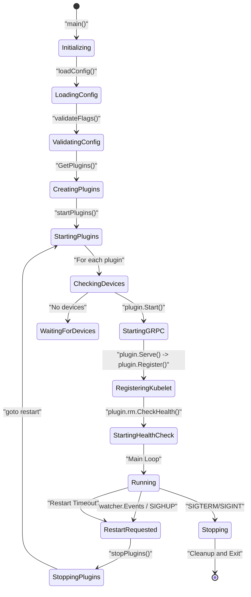
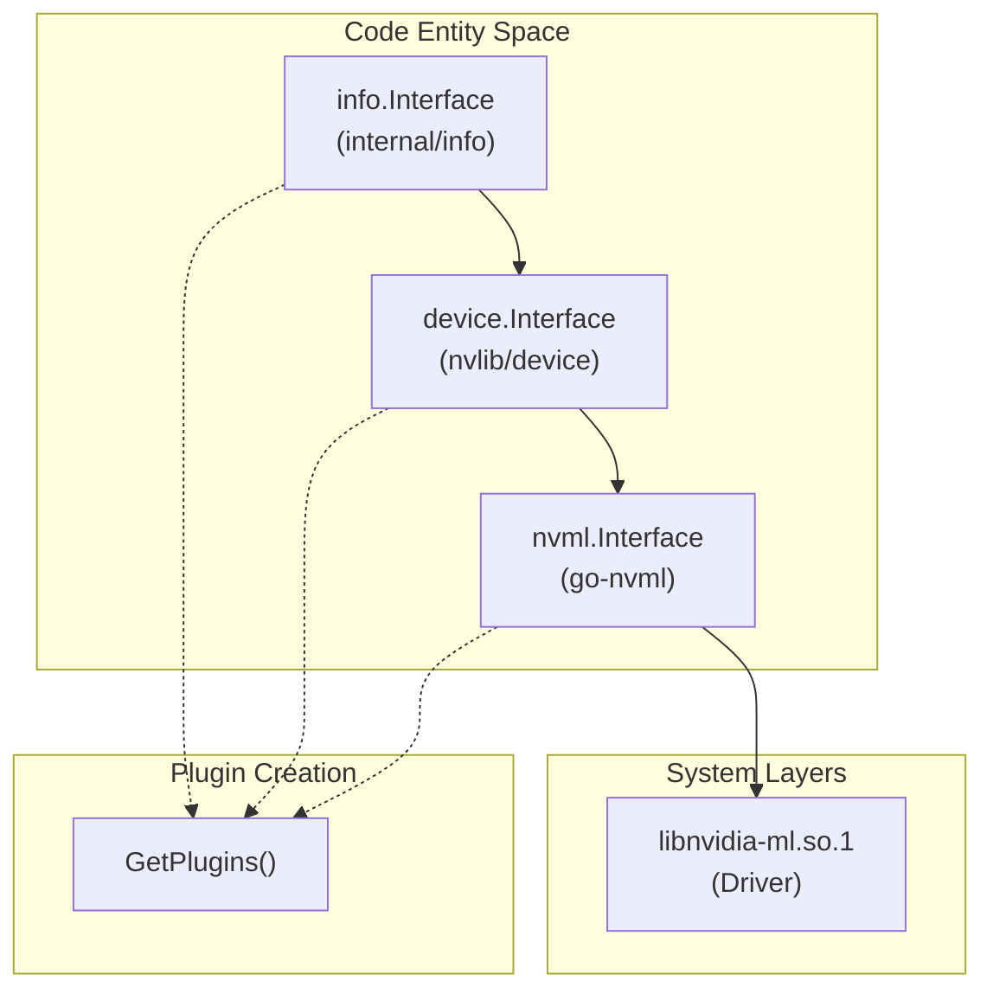
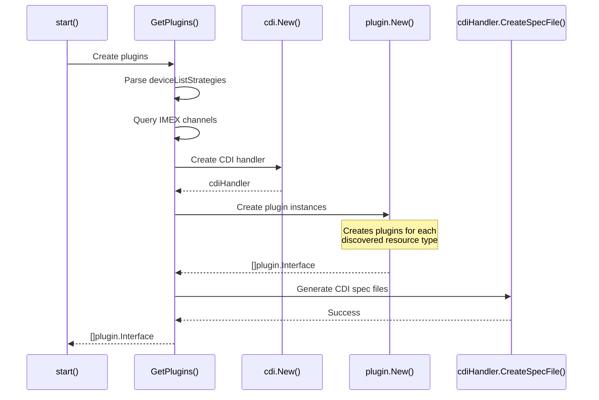
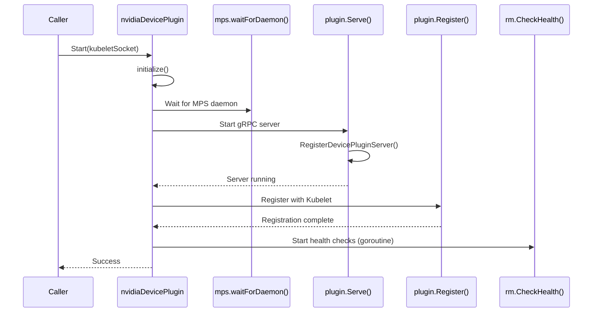

<!-- source: DeepWiki mcp.deepwiki.com · repo NVIDIA/k8s-device-plugin · page 3.1 Plugin Lifecycle and Registration · fetched 2026-10-26 -->

# Plugin Lifecycle and Registration

Relevant source files

The following files were used as context for generating this wiki page:

- [api/config/v1/strategy.go](api/config/v1/strategy.go)
- [cmd/nvidia-device-plugin/main.go](cmd/nvidia-device-plugin/main.go)
- [cmd/nvidia-device-plugin/plugin-manager.go](cmd/nvidia-device-plugin/plugin-manager.go)
- [internal/cdi/cdi.go](internal/cdi/cdi.go)
- [internal/cdi/options.go](internal/cdi/options.go)
- [internal/plugin/factory.go](internal/plugin/factory.go)
- [internal/plugin/options.go](internal/plugin/options.go)
- [internal/plugin/server.go](internal/plugin/server.go)
- [internal/plugin/server_test.go](internal/plugin/server_test.go)
- [vendor/google.golang.org/grpc/clientconn.go](vendor/google.golang.org/grpc/clientconn.go)
- [vendor/google.golang.org/grpc/experimental/stats/metrics.go](vendor/google.golang.org/grpc/experimental/stats/metrics.go)
- [vendor/google.golang.org/grpc/internal/envconfig/envconfig.go](vendor/google.golang.org/grpc/internal/envconfig/envconfig.go)
- [vendor/google.golang.org/grpc/internal/experimental.go](vendor/google.golang.org/grpc/internal/experimental.go)
- [vendor/google.golang.org/grpc/internal/internal.go](vendor/google.golang.org/grpc/internal/internal.go)
- [vendor/google.golang.org/grpc/internal/transport/http2_client.go](vendor/google.golang.org/grpc/internal/transport/http2_client.go)
- [vendor/google.golang.org/grpc/internal/transport/http_util.go](vendor/google.golang.org/grpc/internal/transport/http_util.go)
- [vendor/google.golang.org/grpc/internal/transport/transport.go](vendor/google.golang.org/grpc/internal/transport/transport.go)
- [vendor/google.golang.org/grpc/mem/buffer_pool.go](vendor/google.golang.org/grpc/mem/buffer_pool.go)
- [vendor/google.golang.org/grpc/resolver_wrapper.go](vendor/google.golang.org/grpc/resolver_wrapper.go)
- [vendor/google.golang.org/grpc/rpc_util.go](vendor/google.golang.org/grpc/rpc_util.go)
- [vendor/google.golang.org/grpc/stream.go](vendor/google.golang.org/grpc/stream.go)
- [vendor/google.golang.org/grpc/version.go](vendor/google.golang.org/grpc/version.go)

This document describes the lifecycle of the NVIDIA Device Plugin from initialization to graceful shutdown, including how it registers with the Kubernetes Kubelet and maintains its gRPC server connection. The focus is on the main control flow, plugin instantiation, and registration procedures.

For details on resource discovery and device management, see [Resource Manager](#3.2). For information on how devices are allocated to containers, see [Device Allocation Strategies](#3.3). For configuration loading and precedence, see [Configuration Schema and Options](#5.1).

---

## Overview

The device plugin operates as a long-running daemon that:
1. Initializes NVML and device libraries
2. Creates one or more plugin instances based on detected resources
3. Starts a gRPC server for each plugin and registers with Kubelet
4. Monitors for Kubelet restarts and configuration changes
5. Gracefully handles shutdown signals

The main loop uses file system watchers and OS signal handlers to respond to events that require plugin restart, such as Kubelet restarts or `SIGHUP` signals for configuration reloads.

---

## Application Entry Point

### Main Function and CLI Setup

The application entry point is defined in `cmd/nvidia-device-plugin/main.go`, which uses the `urfave/cli` framework to define command-line flags and execute the `start` function [cmd/nvidia-device-plugin/main.go:50-191]().

**Key Responsibilities:**
- Define CLI flags for MIG strategy, device list strategy, CDI options, driver paths, etc. [cmd/nvidia-device-plugin/main.go:60-183]()
- Parse command-line arguments and environment variables [cmd/nvidia-device-plugin/main.go:186]()
- Invoke the `start` function with the parsed context [cmd/nvidia-device-plugin/main.go:56-58]()

**CLI Flag Categories:**

| Category | Example Flags | Purpose |
|----------|--------------|---------|
| MIG Configuration | `--mig-strategy` | Controls how MIG devices are exposed [cmd/nvidia-device-plugin/main.go:61-66]() |
| Device Discovery | `--device-discovery-strategy` | Selects NVML, Tegra, or auto mode [cmd/nvidia-device-plugin/main.go:148-152]() |
| Device List Strategy | `--device-list-strategy` | Controls envvar, volume-mounts, or CDI [cmd/nvidia-device-plugin/main.go:92-97]() |
| Driver Paths | `--driver-root`, `--dev-root` | Specifies NVIDIA driver installation paths [cmd/nvidia-device-plugin/main.go:73-85]() |
| CDI Options | `--cdi-annotation-prefix`, `--nvidia-cdi-hook-path` | CDI-specific configuration [cmd/nvidia-device-plugin/main.go:122-134]() |
| Feature Flags | `--gds-enabled`, `--mofed-enabled`, `--gdrcopy-enabled` | Enables additional device types [cmd/nvidia-device-plugin/main.go:104-121]() |

Sources: [cmd/nvidia-device-plugin/main.go:50-191]()

---

## Lifecycle State Machine

The following diagram maps the logical lifecycle states to the primary function calls in the codebase.

**Lifecycle States:**

1. **Initializing**: Application startup and CLI parsing [cmd/nvidia-device-plugin/main.go:50-191]().
2. **LoadingConfig**: Configuration loading with precedence rules.
3. **ValidatingConfig**: Validation of MIG strategy, device list strategy, and platform requirements [cmd/nvidia-device-plugin/main.go:193-232]().
4. **CreatingPlugins**: Instantiation of plugin instances via `GetPlugins` [cmd/nvidia-device-plugin/plugin-manager.go:35-89]().
5. **StartingGRPC**: gRPC server initialization for each plugin [internal/plugin/server.go:176-226]().
6. **RegisteringKubelet**: Registration with Kubelet device plugin API [internal/plugin/server.go:228-256]().
7. **Running**: Main event loop monitoring for restart triggers [cmd/nvidia-device-plugin/main.go:281-322]().
8. **Stopping**: Graceful shutdown and cleanup [internal/plugin/server.go:162-174]().

Sources: [cmd/nvidia-device-plugin/main.go:50-322](), [internal/plugin/server.go:109-256]()

---

## Configuration and Initialization Phase

### Library Initialization

The device plugin initializes core libraries based on the resolved discovery strategy:

1. **NVML Library**: `nvml.Interface` for interaction with GPU driver [internal/plugin/factory.go:96-109]().
2. **Device Library**: `device.Interface` for device abstractions [internal/plugin/factory.go:114]().
3. **Info Library**: `info.Interface` for platform detection [internal/plugin/factory.go:114]().

The `driverRoot` is used to construct paths, ensuring the plugin can find NVML even in non-standard driver installations.

Sources: [internal/plugin/factory.go:93-128](), [cmd/nvidia-device-plugin/plugin-manager.go:35-89]()

---

## Plugin Creation Phase

### GetPlugins Function

The `GetPlugins` function in `cmd/nvidia-device-plugin/plugin-manager.go` orchestrates the creation of plugin instances:

**Creation Flow:**

**CDI Handler Creation:**

The `cdiHandler` is created with configuration options including driver root paths, device ID strategy, and vendor name (`k8s.device-plugin.nvidia.com`) [internal/cdi/cdi.go:78-184]().

**Plugin Instance Creation:**

The `plugin.New()` function creates one plugin instance per resource type. Each plugin manages a specific resource like `nvidia.com/gpu` or `nvidia.com/mig-3g.20gb` [internal/plugin/factory.go:51-88]().

Sources: [cmd/nvidia-device-plugin/plugin-manager.go:35-89](), [internal/plugin/factory.go:51-88](), [internal/cdi/cdi.go:78-184]()

---

## Plugin Start and Registration

### Plugin.Start Method

The `Start` method on the `nvidiaDevicePlugin` type performs the following operations:

**Key Components:**

1. **initialize()**: Creates gRPC server instance and communication channels [internal/plugin/server.go:109-113]().
2. **MPS Daemon Wait**: If MPS is enabled, waits for the control daemon [internal/plugin/server.go:132-134]().
3. **Serve()**: Starts gRPC server on a Unix socket [internal/plugin/server.go:176-226]().
4. **Register()**: Registers with Kubelet device plugin API [internal/plugin/server.go:228-256]().
5. **CheckHealth()**: Launches health monitoring in a background goroutine [internal/plugin/server.go:151-157]().

Sources: [internal/plugin/server.go:109-256]()

---

## gRPC Server Setup

### Serve Method

The `Serve` method in `internal/plugin/server.go` sets up the gRPC server:

**Server Initialization Steps:**

1. **Remove Existing Socket**: Ensures a clean start by removing any stale socket file [internal/plugin/server.go:178]().
2. **Listen**: Creates a Unix domain socket listener [internal/plugin/server.go:179]().
3. **Register Server**: Registers the `nvidiaDevicePlugin` as a `DevicePluginServer` with the gRPC server [internal/plugin/server.go:184]().
4. **Serve Loop**: Starts the server in a goroutine with crash recovery logic [internal/plugin/server.go:186-216]().
5. **Verification**: Dials the socket to verify the server is responding before returning [internal/plugin/server.go:219-225]().

**Crash Recovery Logic:**
The server goroutine tracks restarts. If the server crashes more than 5 times within an hour, the plugin exits fatally [internal/plugin/server.go:191-215]().

Sources: [internal/plugin/server.go:176-226]()

### Registration with Kubelet

The `Register` method registers the plugin for a given resource name with Kubelet [internal/plugin/server.go:228-256]().

**RegisterRequest Fields:**

| Field | Value | Purpose |
|-------|-------|---------|
| `Version` | `v1beta1` | API version compatibility [internal/plugin/server.go:243]() |
| `Endpoint` | `nvidia-<resource>.sock` | Socket filename [internal/plugin/server.go:244]() |
| `ResourceName` | e.g., `nvidia.com/gpu` | Resource identifier [internal/plugin/server.go:245]() |
| `Options` | `GetPreferredAllocationAvailable: true` | Topology-aware allocation support [internal/plugin/server.go:247]() |

Sources: [internal/plugin/server.go:228-256]()

---

## Main Event Loop and Shutdown

### Restart Triggers and Signal Handling

The `start` function in `cmd/nvidia-device-plugin/main.go` implements an infinite loop that monitors for restart triggers [cmd/nvidia-device-plugin/main.go:281-322]().

**Restart Triggers:**
- **Kubelet Restart**: Detected via `fsnotify` when the Kubelet socket is recreated [cmd/nvidia-device-plugin/main.go:292-296]().
- **SIGHUP**: Received when configuration changes occur [cmd/nvidia-device-plugin/main.go:305-307]().
- **Restart Timeout**: A 30-second delay after a plugin start failure [cmd/nvidia-device-plugin/main.go:285-290]().

**Graceful Shutdown:**
When `SIGINT`, `SIGTERM`, or `SIGQUIT` is received, the plugin invokes `stopPlugins()` and exits [cmd/nvidia-device-plugin/main.go:308-312]().

### Stop and Cleanup

The `Stop` method performs the following:
1. Stops the gRPC server [internal/plugin/server.go:168]().
2. Removes the Unix socket file [internal/plugin/server.go:169]().
3. Invokes `cleanup()` to close the `stop` channel, signaling background goroutines (like health checks) to terminate [internal/plugin/server.go:115-120]().

Sources: [cmd/nvidia-device-plugin/main.go:281-322](), [internal/plugin/server.go:162-174](), [internal/plugin/server.go:115-120]()

---

