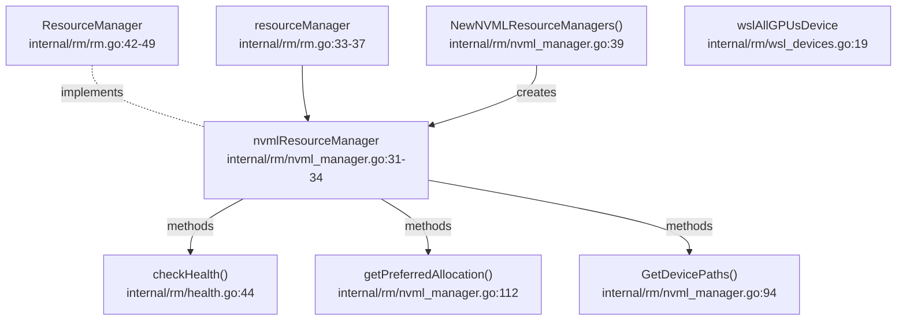
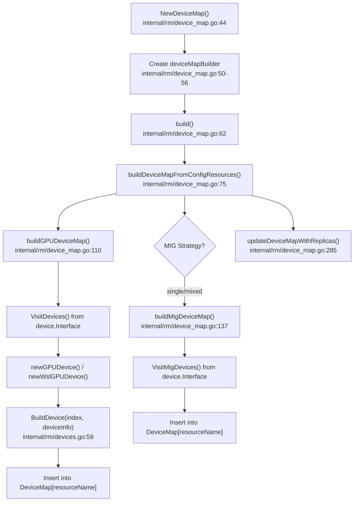

<!-- source: DeepWiki mcp.deepwiki.com · repo NVIDIA/k8s-device-plugin · page 3.2 Resource Manager · fetched 2026-10-26 -->

# Resource Manager

<details>
<summary>Relevant source files</summary>

The following files were used as context for generating this wiki page:

- [api/config/v1/config.go](api/config/v1/config.go)
- [api/config/v1/consts.go](api/config/v1/consts.go)
- [api/config/v1/replicas.go](api/config/v1/replicas.go)
- [api/config/v1/replicas_test.go](api/config/v1/replicas_test.go)
- [api/config/v1/resources.go](api/config/v1/resources.go)
- [api/config/v1/sharing.go](api/config/v1/sharing.go)
- [internal/rm/allocate.go](internal/rm/allocate.go)
- [internal/rm/device_map.go](internal/rm/device_map.go)
- [internal/rm/device_map_test.go](internal/rm/device_map_test.go)
- [internal/rm/devices.go](internal/rm/devices.go)
- [internal/rm/health.go](internal/rm/health.go)
- [internal/rm/health_test.go](internal/rm/health_test.go)
- [internal/rm/helper.go](internal/rm/helper.go)
- [internal/rm/nvml_devices.go](internal/rm/nvml_devices.go)
- [internal/rm/nvml_manager.go](internal/rm/nvml_manager.go)
- [internal/rm/rm.go](internal/rm/rm.go)
- [internal/rm/tegra_devices.go](internal/rm/tegra_devices.go)
- [internal/rm/tegra_manager.go](internal/rm/tegra_manager.go)
- [internal/rm/wsl_devices.go](internal/rm/wsl_devices.go)

</details>


The Resource Manager is responsible for managing collections of GPU devices, organizing them by Kubernetes resource name, and providing device metadata for allocation decisions. It implements the `ResourceManager` interface defined in [internal/rm/rm.go:42-49]().

**Primary Responsibilities:**
- Enumerating GPU devices via NVML or platform-specific interfaces.
- Building `DeviceMap` structures indexed by `spec.ResourceName`.
- Providing device paths for container mounting.
- Validating allocation requests against sharing constraints.
- Supporting device replication for time-slicing and MPS.

Sources: [internal/rm/rm.go:1-156](), [internal/rm/device_map.go:1-224]()

## ResourceManager Interface

The `ResourceManager` interface defines the contract for device management implementations:

| Method | Parameters | Returns | Purpose |
|--------|-----------|---------|---------|
| `Resource()` | - | `spec.ResourceName` | Returns the resource name (e.g., `nvidia.com/gpu`). |
| `Devices()` | - | `Devices` | Returns the managed device collection. |
| `GetDevicePaths()` | `[]string` IDs | `[]string` paths | Returns device paths for mounting. |
| `GetPreferredAllocation()` | `available`, `required []string`, `size int` | `[]string`, `error` | Computes optimal allocation. |
| `CheckHealth()` | `stop <-chan interface{}`, `unhealthy chan<- *Device` | `error` | Monitors device health. |
| `ValidateRequest()` | `AnnotatedIDs` | `error` | Validates requests against sharing limits. |

The interface includes a `go:generate` directive at [internal/rm/rm.go:41]() for mock generation.

Sources: [internal/rm/rm.go:42-49]()

## Core Types

### resourceManager Base Type

The `resourceManager` struct at [internal/rm/rm.go:33-37]() provides shared implementation:

```go
type resourceManager struct {
	config   *spec.Config
	resource spec.ResourceName
	devices  Devices
}
```

This base type implements `Resource()` at [internal/rm/rm.go:69-71](), `Devices()` at [internal/rm/rm.go:74-76](), and `ValidateRequest()` at [internal/rm/rm.go:83-113](). Platform-specific implementations embed this struct and add specialized functionality.

Sources: [internal/rm/rm.go:33-37](), [internal/rm/rm.go:69-76](), [internal/rm/rm.go:83-113]()

### ResourceManager Implementations

**Implementation Hierarchy:**

Title: ResourceManager Implementation Map


**nvmlResourceManager** [internal/rm/nvml_manager.go:31-34]():
- Embeds `resourceManager` base.
- Adds `nvml nvml.Interface` field for NVML access.
- Implements health checking via NVML events [internal/rm/health.go:44-172]().
- Supports aligned allocation for multi-GPU topology [internal/rm/nvml_manager.go:125-151]().
- Returns standard NVIDIA device paths plus common control nodes [internal/rm/nvml_manager.go:94-103]().

Sources: [internal/rm/rm.go:33-49](), [internal/rm/nvml_manager.go:31-85](), [internal/rm/nvml_manager.go:94-151](), [internal/rm/health.go:44-172]()

## Device and Devices Types

### Device Structure

The `Device` struct wraps the Kubernetes `pluginapi.Device` with additional metadata:

| Field | Type | Purpose |
|-------|------|---------|
| `pluginapi.Device` | embedded | Kubernetes device plugin Device (ID, Health, Topology). |
| `Paths` | `[]string` | Device node paths (e.g., `/dev/nvidia0`). |
| `Index` | `string` | Device index (e.g., `"0"` for GPU, `"0:1"` for MIG). |
| `TotalMemory` | `uint64` | Total device memory in bytes. |
| `ComputeCapability` | `string` | CUDA compute capability (e.g., `"8.0"`). |
| `Replicas` | `int` | Number of replicas for shared devices. |

Key device methods:
- `GetUUID()`: Returns the device UUID from an annotated ID [internal/rm/devices.go:238-240]().
- `IsMigDevice()`: Returns true if the device is a MIG instance (Index contains `":"`) [internal/rm/devices.go:233-235]().
- `AlignedAllocationSupported()`: Returns false for MIG devices or WSL devices [internal/rm/devices.go:218-230]().

### Devices Collection

`Devices` is defined as `map[string]*Device` [internal/rm/devices.go:50](), providing utility methods:

| Method | Purpose |
|--------|---------|
| `Contains(ids ...string) bool` | Checks if all specified IDs exist [internal/rm/devices.go:107-114](). |
| `Subset(ids []string) Devices` | Returns a subset matching the IDs [internal/rm/devices.go:133-141](). |
| `Difference(other Devices) Devices` | Returns devices in this set but not in other [internal/rm/devices.go:144-152](). |
| `GetPaths() []string` | Returns all device paths [internal/rm/devices.go:198-204](). |

### AnnotatedID for Device Sharing

When devices are replicated for sharing, their IDs are annotated with a replica number:
`Format: <UUID>::<replica_number>` (e.g., `GPU-123::0`).

The `AnnotatedID` type provides methods to work with these:
- `Split()`: Splits into UUID and replica number [internal/rm/devices.go:254-261]().
- `GetID()`: Returns just the UUID part [internal/rm/devices.go:264-267]().

Sources: [internal/rm/devices.go:28-267]()

## DeviceMap Construction

**Device Map Building Flow:**

Title: DeviceMap Construction Logic


### deviceInfo Interface

During device construction, platform-specific information is obtained through the `deviceInfo` interface [internal/rm/devices.go:41-47]():
- `nvmlDevice`: Standard NVIDIA GPU [internal/rm/nvml_devices.go:37-39]().
- `nvmlMigDevice`: MIG device instance [internal/rm/nvml_devices.go:42]().
- `wslAllGPUsDevice`: Windows Subsystem for Linux GPU [internal/rm/wsl_devices.go:19]().

Sources: [internal/rm/device_map.go:44-210](), [internal/rm/devices.go:41-104](), [internal/rm/nvml_devices.go:37-58](), [internal/rm/wsl_devices.go:19-46]()

## Device Path Resolution

Each resource manager implementation provides device paths for mounting into containers:

### NVML Device Paths

`nvmlResourceManager.GetDevicePaths()` returns standard NVIDIA device nodes plus device-specific paths [internal/rm/nvml_manager.go:94-103]():
- `/dev/nvidiactl`
- `/dev/nvidia-uvm`
- `/dev/nvidia-uvm-tools`
- `/dev/nvidia-modeset`

**GPU-Specific Paths:**
- `/dev/nvidia<minor>` [internal/rm/nvml_devices.go:75-83]().

**MIG-Specific Paths:**
- Parent GPU device path.
- GPU Instance (GI) and Compute Instance (CI) capability paths from `/proc/driver/nvidia/capabilities/...` [internal/rm/nvml_devices.go:104-147]().

### WSL Device Paths
WSL devices use the DirectX Graphics kernel device: `/dev/dxg` [internal/rm/wsl_devices.go:29-31]().

Sources: [internal/rm/nvml_manager.go:94-103](), [internal/rm/nvml_devices.go:75-147](), [internal/rm/wsl_devices.go:29-31]()

## Device Replication for Sharing

The `updateDeviceMapWithReplicas()` function implements device sharing by creating virtual replicas of physical devices [internal/rm/device_map.go:285-347]().

**Replication Configuration:**
Defined in `spec.ReplicatedResources` [api/config/v1/replicas.go:30-34]().
- `Replicas`: Number of replicas per device.
- `Rename`: Optional new resource name (e.g., `nvidia.com/gpu.shared`).

**Replication Process:**
1. Identify devices to replicate based on `All`, `Count`, or `List` criteria [api/config/v1/replicas.go:90-94]().
2. Create N replicas with annotated IDs (e.g., `UUID::0`, `UUID::1`) [internal/rm/device_map.go:317-320]().
3. Insert replicas into `DeviceMap` under the original or renamed resource name [internal/rm/device_map.go:334-343]().

Sources: [internal/rm/device_map.go:285-347](), [api/config/v1/replicas.go:30-214]()

## Request Validation

The `resourceManager.ValidateRequest()` method verifies that allocation requests are valid [internal/rm/rm.go:83-113]():

1. **Device Existence**: Verifies all requested IDs exist in the manager's device set.
2. **Sharing Constraints**:
   - **TimeSlicing**: If `FailRequestsGreaterThanOne` is true, limits requests to 1 replica [internal/rm/rm.go:97-99]().
   - **MPS**: Always limits requests to 1 replica per pod [internal/rm/rm.go:108-110]().

Sources: [internal/rm/rm.go:83-113](), [api/config/v1/replicas.go:30-34]()

## Default Resource Configuration

`AddDefaultResourcesToConfig()` automatically configures resource matching rules [internal/rm/rm.go:116-156]():

- **GPU Resources**: Defaults to matching `*` as `gpu`.
- **MIG Resources (Mixed)**:
  1. Initializes NVML.
  2. Visits all MIG profiles via `devicelib.VisitMigProfiles()`.
  3. Adds a resource for each profile (e.g., `mig-1g.5gb`) where Compute (C) equals Graphics (G) count [internal/rm/rm.go:146-153]().

Sources: [internal/rm/rm.go:116-156]()

---

