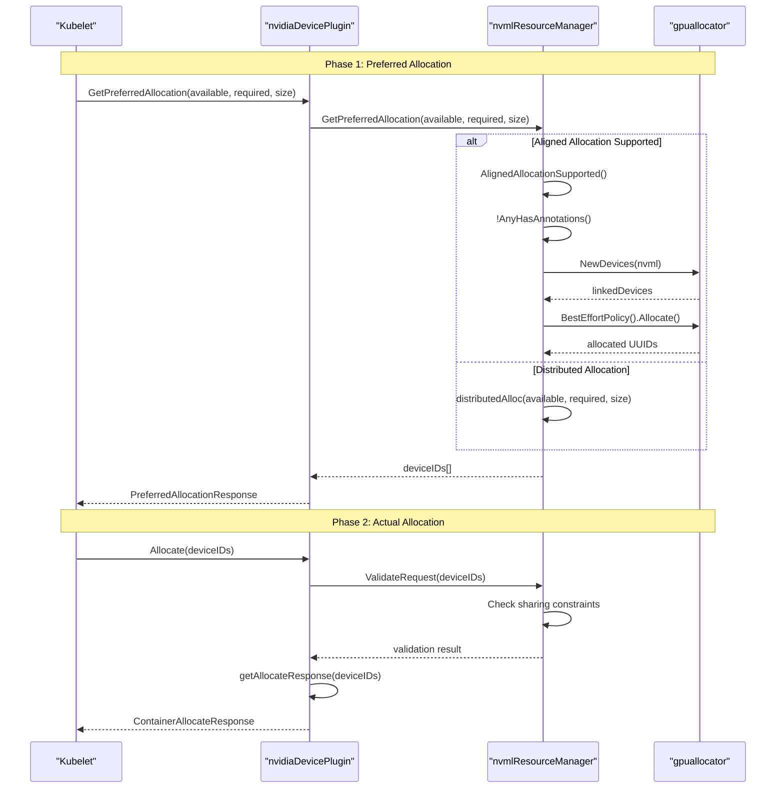
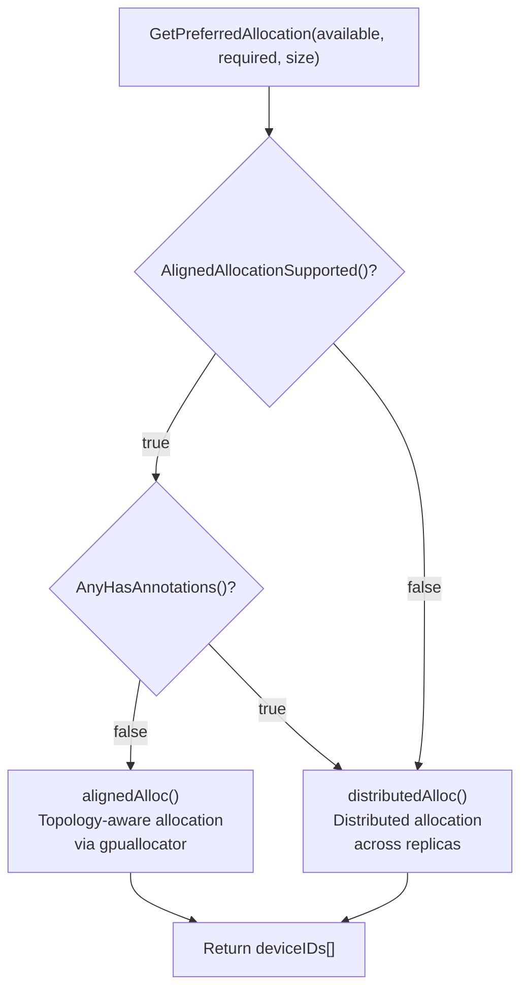
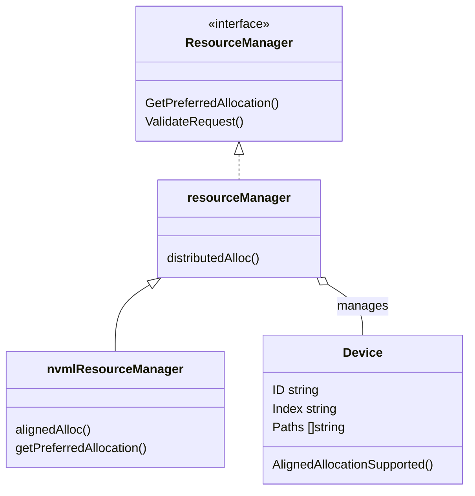

<!-- source: DeepWiki mcp.deepwiki.com · repo NVIDIA/k8s-device-plugin · page 3.3 Device Allocation Strategies · fetched 2026-10-26 -->

# Device Allocation Strategies

Relevant source files

The following files were used as context for generating this wiki page:

- [api/config/v1/config.go](api/config/v1/config.go)
- [api/config/v1/consts.go](api/config/v1/consts.go)
- [api/config/v1/replicas.go](api/config/v1/replicas.go)
- [api/config/v1/replicas_test.go](api/config/v1/replicas_test.go)
- [api/config/v1/resources.go](api/config/v1/resources.go)
- [api/config/v1/sharing.go](api/config/v1/sharing.go)
- [internal/rm/allocate.go](internal/rm/allocate.go)
- [internal/rm/device_map.go](internal/rm/device_map.go)
- [internal/rm/device_map_test.go](internal/rm/device_map_test.go)
- [internal/rm/devices.go](internal/rm/devices.go)
- [internal/rm/health.go](internal/rm/health.go)
- [internal/rm/health_test.go](internal/rm/health_test.go)
- [internal/rm/helper.go](internal/rm/helper.go)
- [internal/rm/nvml_devices.go](internal/rm/nvml_devices.go)
- [internal/rm/nvml_manager.go](internal/rm/nvml_manager.go)
- [internal/rm/rm.go](internal/rm/rm.go)
- [internal/rm/tegra_devices.go](internal/rm/tegra_devices.go)
- [internal/rm/tegra_manager.go](internal/rm/tegra_manager.go)
- [internal/rm/wsl_devices.go](internal/rm/wsl_devices.go)
- [vendor/github.com/NVIDIA/go-gpuallocator/LICENSE](vendor/github.com/NVIDIA/go-gpuallocator/LICENSE)
- [vendor/github.com/NVIDIA/go-gpuallocator/gpuallocator/allocator.go](vendor/github.com/NVIDIA/go-gpuallocator/gpuallocator/allocator.go)
- [vendor/github.com/NVIDIA/go-gpuallocator/gpuallocator/besteffort_policy.go](vendor/github.com/NVIDIA/go-gpuallocator/gpuallocator/besteffort_policy.go)
- [vendor/github.com/NVIDIA/go-gpuallocator/gpuallocator/device.go](vendor/github.com/NVIDIA/go-gpuallocator/gpuallocator/device.go)
- [vendor/github.com/NVIDIA/go-gpuallocator/gpuallocator/simple_policy.go](vendor/github.com/NVIDIA/go-gpuallocator/gpuallocator/simple_policy.go)
- [vendor/github.com/NVIDIA/go-gpuallocator/gpuallocator/staticdgx_policies.go](vendor/github.com/NVIDIA/go-gpuallocator/gpuallocator/staticdgx_policies.go)
- [vendor/github.com/NVIDIA/go-gpuallocator/internal/links/device.go](vendor/github.com/NVIDIA/go-gpuallocator/internal/links/device.go)
- [vendor/github.com/NVIDIA/go-nvlib/pkg/nvlib/device/identifier.go](vendor/github.com/NVIDIA/go-nvlib/pkg/nvlib/device/identifier.go)
- [vendor/github.com/google/uuid/CONTRIBUTING.md](vendor/github.com/google/uuid/CONTRIBUTING.md)

## Purpose and Scope

This page documents the device allocation strategies used by the NVIDIA Kubernetes Device Plugin when responding to Kubelet's allocation requests. The allocation system determines which specific GPU devices should be assigned to requesting containers and how to optimize device selection based on topology, sharing configuration, and resource constraints.

The core logic resides within the `ResourceManager` interface implementations, specifically handling how preferred devices are selected from a set of available candidates.

**Sources:** [internal/rm/rm.go:42-49](), [internal/rm/nvml_manager.go:31-34]()

---

## Allocation Request Flow

The device allocation process involves two primary operations exposed through the Kubernetes Device Plugin API: `GetPreferredAllocation` and `Allocate`.

### Allocation Sequence Diagram

**Sources:** [internal/rm/nvml_manager.go:89-91](), [internal/rm/nvml_manager.go:112-121](), [internal/rm/rm.go:83-113]()

---

## Preferred Allocation Strategies

The `GetPreferredAllocation` method selects which devices from the available set should be allocated to satisfy a container request. The strategy selection depends on device characteristics and configuration.

### Strategy Selection Logic

**Sources:** [internal/rm/nvml_manager.go:112-121](), [internal/rm/devices.go:207-214]()

### Aligned Allocation Strategy

Aligned allocation is used when all available devices are full GPUs (not MIG devices, not WSL devices) and do not have replica annotations. This strategy uses GPU topology information to select devices with optimal interconnect bandwidth.

**Key Characteristics:**
- Uses the `github.com/NVIDIA/go-gpuallocator` library [internal/rm/nvml_manager.go:128-130]().
- Considers NVLink and PCIe topology.
- Implements a `BestEffortPolicy` for maximizing inter-GPU bandwidth [internal/rm/nvml_manager.go:145]().

**Implementation:**
The `alignedAlloc` method at [internal/rm/nvml_manager.go:125-151]() performs the following:
1. Initializes `gpuallocator.NewDevices` with the NVML library [internal/rm/nvml_manager.go:128-130]().
2. Filters the topology-aware devices based on `available` and `required` strings [internal/rm/nvml_manager.go:135-143]().
3. Executes `gpuallocator.NewBestEffortPolicy().Allocate(...)` [internal/rm/nvml_manager.go:145]().

**Alignment Support Check:**
The system determines if aligned allocation is supported via `AlignedAllocationSupported()`:

| Device Type | Aligned Allocation Supported | Logic |
|------------|------------------------------|-------|
| Full GPU (NVML) | ✓ Yes | Default for standard GPUs |
| MIG Device | ✗ No | `strings.Contains(d.Index, ":")` [internal/rm/devices.go:219-221]() |
| WSL Device | ✗ No | Path matches `/dev/dxg` [internal/rm/devices.go:223-226]() |

**Sources:** [internal/rm/nvml_manager.go:125-151](), [internal/rm/devices.go:218-230]()

### Distributed Allocation Strategy

Distributed allocation is used when devices have replica annotations (for time-slicing or MPS) or when aligned allocation is not supported. It ensures that any replicated devices are distributed across all physical GPUs equally [internal/rm/allocate.go:24-26]().

**Implementation Details:**
The `distributedAlloc` function [internal/rm/allocate.go:27-80]() implements a balancing algorithm:
1. **Candidate Selection:** Identifies candidate devices by taking the difference between `available` and `required` sets [internal/rm/allocate.go:29]().
2. **Replica Mapping:** Builds a map of physical device IDs to their `total` and `available` replica counts [internal/rm/allocate.go:38-53]().
3. **Sorting and Selection:** Iteratively selects candidates by sorting them based on the difference between total and available replications (`idiff < jdiff`) [internal/rm/allocate.go:63-69](). This ensures the device with the most free capacity is picked next.

**Sources:** [internal/rm/allocate.go:27-80](), [internal/rm/rm.go:64-66]()

---

## Request Validation

The `ValidateRequest` function [internal/rm/rm.go:83-113]() asserts that all requested IDs are known and that the request is valid for the configured sharing strategy.

### Validation Rules

| Strategy | Rule | Source |
|----------|------|--------|
| **General** | All requested IDs must exist in the `devices` map. | [internal/rm/rm.go:85-89]() |
| **Time-Slicing** | If `FailRequestsGreaterThanOne` is true, requests for >1 replicated device are rejected. | [internal/rm/rm.go:96-99]() |
| **MPS** | Requests for >1 replicated device are always rejected (MPS currently supports max request size of 1). | [internal/rm/rm.go:100-111]() |

**Sources:** [internal/rm/rm.go:83-113]()

---

## Device ID Annotation and Metadata

Device IDs are represented as `AnnotatedID` strings, which can embed replica information.

### Annotation Structure
**Format:** `<base-uuid>::<replica-index>` [internal/rm/devices.go:243-245]()

**Key Methods:**
- `Split()`: Returns the base UUID and the replica index [internal/rm/devices.go:252-261]().
- `GetID()`: Returns only the base UUID [internal/rm/devices.go:264-267]().
- `HasAnnotations()`: Checks for the `::` separator [internal/rm/devices.go:248-251]().

### Device Metadata
The `Device` struct [internal/rm/devices.go:29-38]() wraps the Kubernetes plugin API device with:
- `Paths`: Device node paths (e.g., `/dev/nvidia0`).
- `Index`: Device index (e.g., `0` for GPU, `0:1` for MIG).
- `Topology`: NUMA node information [internal/rm/devices.go:93-101]().
- `Replicas`: Total number of times this device is replicated.

**Sources:** [internal/rm/devices.go:29-38](), [internal/rm/devices.go:242-267]()

---

## Strategy Interaction with Device Types

The following table summarizes how the `ResourceManager` handles different hardware abstractions:

| Hardware Type | Implementation Class | Path Detection | Source |
|---------------|----------------------|----------------|--------|
| **NVML GPU** | `nvmlDevice` | `/dev/nvidia%d` | [internal/rm/nvml_devices.go:75-83]() |
| **MIG Device** | `nvmlMigDevice` | Parent path + MIG capability paths | [internal/rm/nvml_devices.go:104-147]() |
| **WSL GPU** | `wslAllGPUsDevice` | `/dev/dxg` | [internal/rm/wsl_devices.go:29-31]() |

### Code Entity Mapping

**Sources:** [internal/rm/rm.go:32-49](), [internal/rm/nvml_manager.go:31-34](), [internal/rm/devices.go:29-38]()

---

