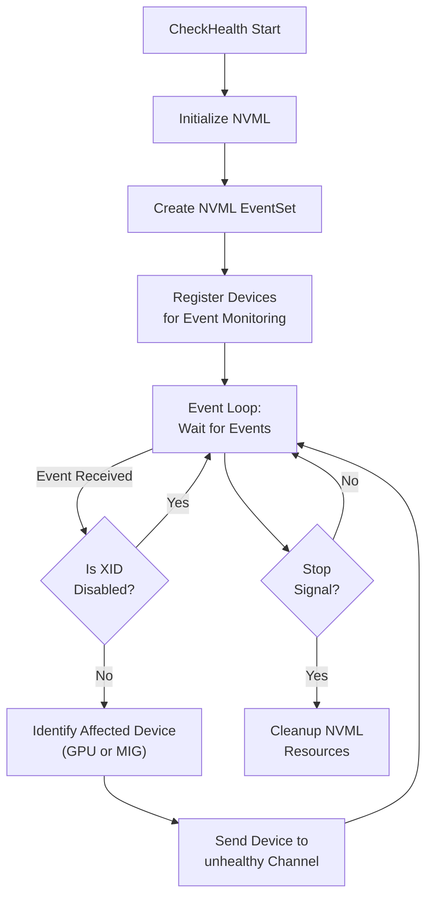
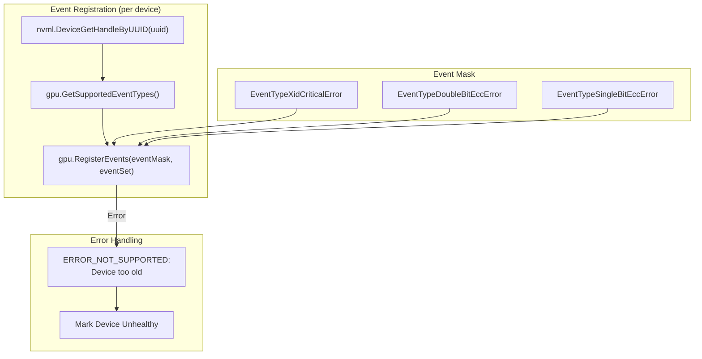
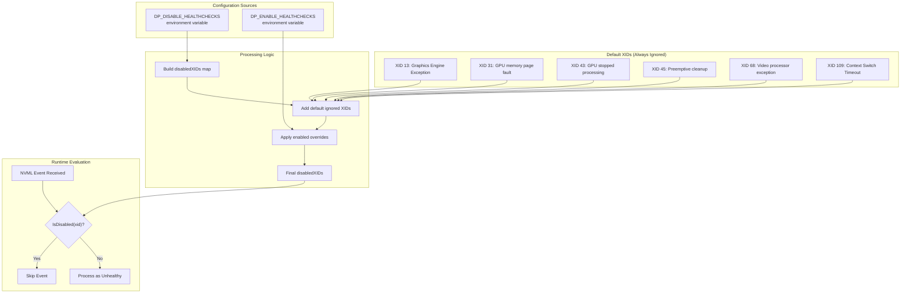
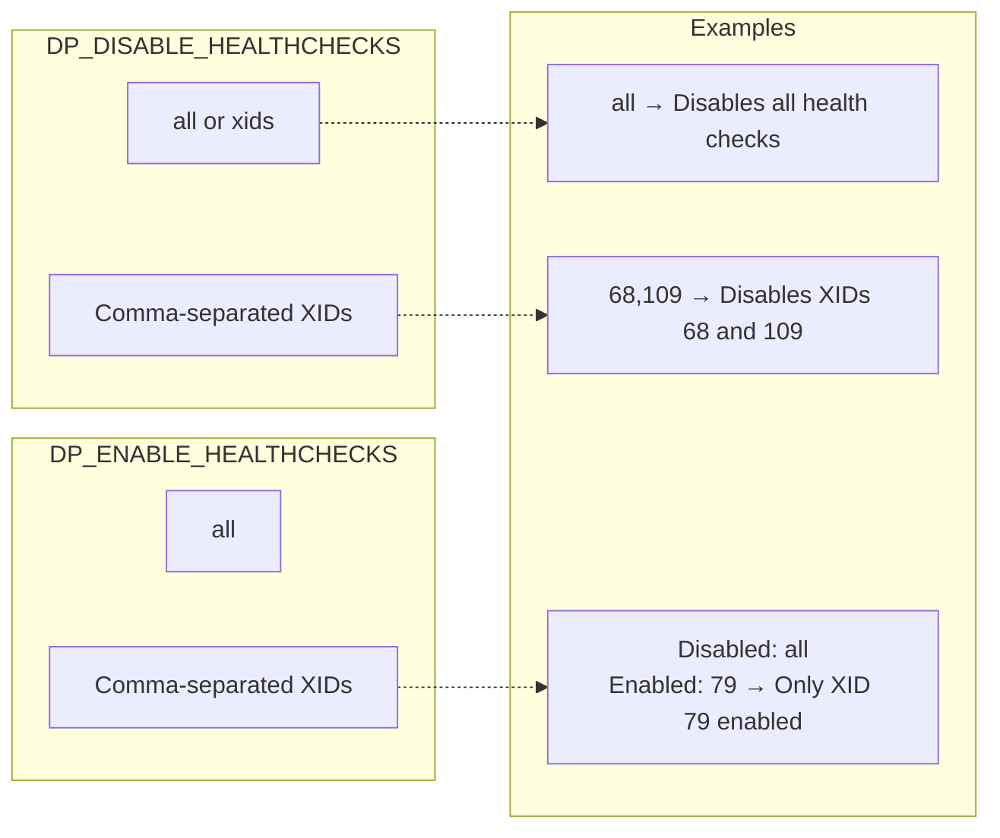
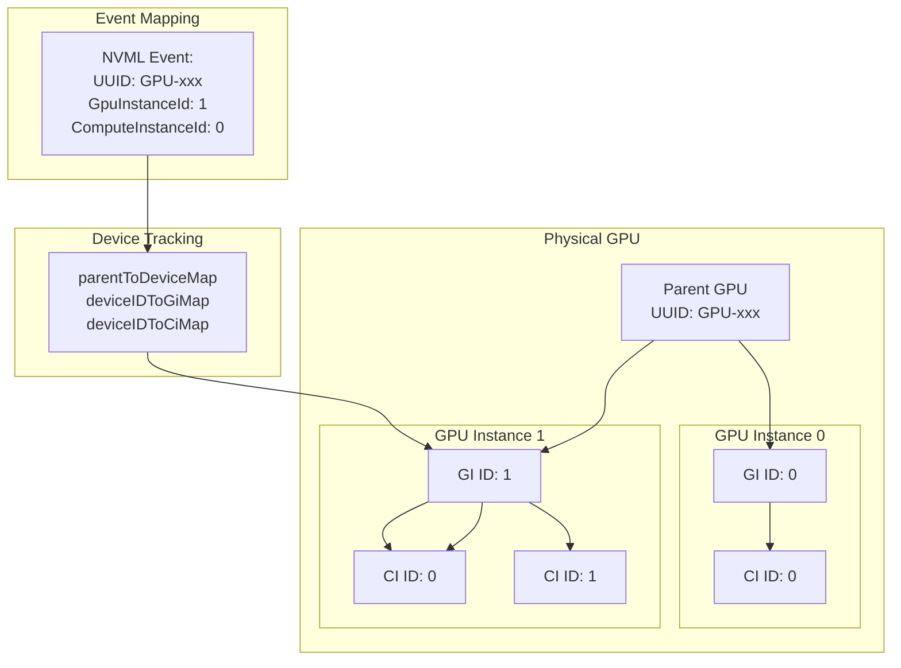
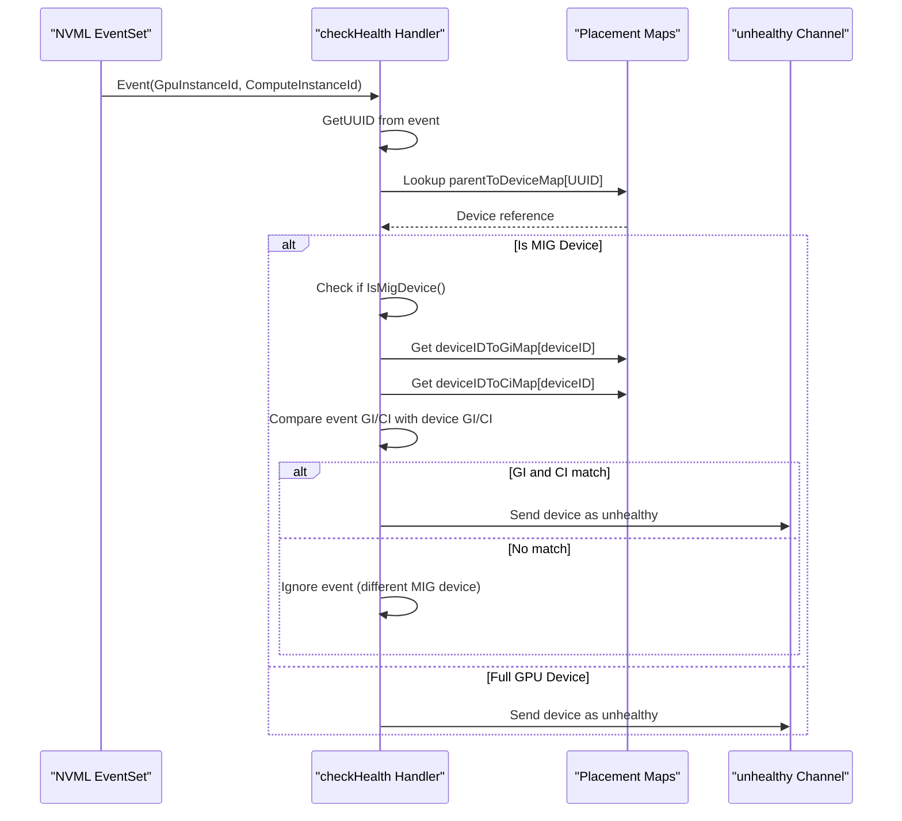
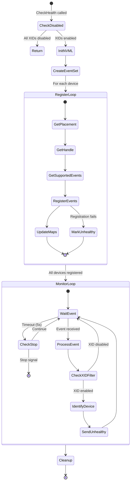
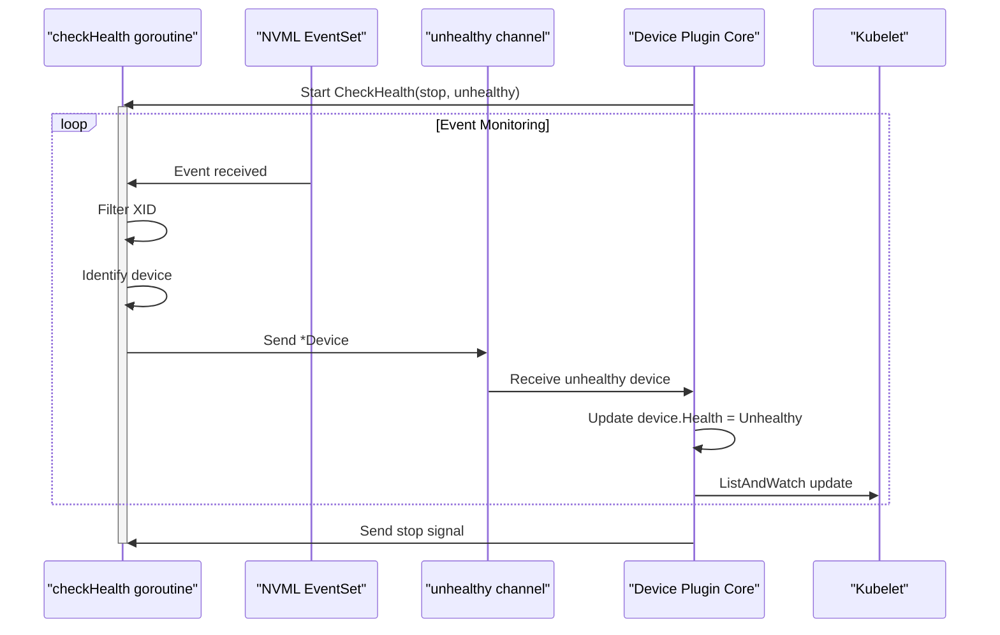

<!-- source: DeepWiki mcp.deepwiki.com · repo NVIDIA/k8s-device-plugin · page 3.4 Health Monitoring · fetched 2026-10-26 -->

# Health Monitoring

<details>
<summary>Relevant source files</summary>

The following files were used as context for generating this wiki page:

- [internal/rm/device_map.go](internal/rm/device_map.go)
- [internal/rm/device_map_test.go](internal/rm/device_map_test.go)
- [internal/rm/devices.go](internal/rm/devices.go)
- [internal/rm/health.go](internal/rm/health.go)
- [internal/rm/health_test.go](internal/rm/health_test.go)
- [internal/rm/helper.go](internal/rm/helper.go)
- [internal/rm/nvml_devices.go](internal/rm/nvml_devices.go)
- [internal/rm/nvml_manager.go](internal/rm/nvml_manager.go)
- [internal/rm/rm.go](internal/rm/rm.go)
- [internal/rm/tegra_devices.go](internal/rm/tegra_devices.go)
- [internal/rm/tegra_manager.go](internal/rm/tegra_manager.go)
- [internal/rm/wsl_devices.go](internal/rm/wsl_devices.go)
- [vendor/github.com/NVIDIA/go-nvml/pkg/nvml/const.go](vendor/github.com/NVIDIA/go-nvml/pkg/nvml/const.go)
- [vendor/github.com/NVIDIA/go-nvml/pkg/nvml/device.go](vendor/github.com/NVIDIA/go-nvml/pkg/nvml/device.go)
- [vendor/github.com/NVIDIA/go-nvml/pkg/nvml/gpm.go](vendor/github.com/NVIDIA/go-nvml/pkg/nvml/gpm.go)
- [vendor/github.com/NVIDIA/go-nvml/pkg/nvml/nvml.go](vendor/github.com/NVIDIA/go-nvml/pkg/nvml/nvml.go)
- [vendor/github.com/NVIDIA/go-nvml/pkg/nvml/nvml.h](vendor/github.com/NVIDIA/go-nvml/pkg/nvml/nvml.h)
- [vendor/github.com/NVIDIA/go-nvml/pkg/nvml/system.go](vendor/github.com/NVIDIA/go-nvml/pkg/nvml/system.go)
- [vendor/github.com/NVIDIA/go-nvml/pkg/nvml/types_gen.go](vendor/github.com/NVIDIA/go-nvml/pkg/nvml/types_gen.go)
- [vendor/github.com/NVIDIA/go-nvml/pkg/nvml/vgpu.go](vendor/github.com/NVIDIA/go-nvml/pkg/nvml/vgpu.go)
- [vendor/github.com/NVIDIA/go-nvml/pkg/nvml/zz_generated.api.go](vendor/github.com/NVIDIA/go-nvml/pkg/nvml/zz_generated.api.go)

</details>


## Purpose and Scope

This document describes the health monitoring system in the NVIDIA Kubernetes Device Plugin. The health monitoring system detects GPU failures in real-time using NVML events and reports unhealthy devices to Kubelet, which can then take appropriate action such as marking pods as failed or preventing new allocations on unhealthy devices.

For information about the overall Resource Manager architecture that integrates health monitoring, see [Resource Manager](#3.2). For device allocation strategies, see [Device Allocation Strategies](#3.3).

---

## Overview

The health monitoring system continuously monitors GPU devices for hardware errors and critical failures. When a device becomes unhealthy, it is reported to Kubelet through the device plugin API, which triggers the necessary recovery actions in the Kubernetes cluster.

**Key Characteristics:**

| Feature | Description |
|---------|-------------|
| **Detection Method** | NVML event-based monitoring |
| **Monitoring Scope** | Full GPUs and MIG devices |
| **Error Types** | XID critical errors, ECC errors |
| **Configurability** | Environment variable-based XID filtering |
| **Recovery** | Automatic reporting to Kubelet |

Sources: [internal/rm/health.go:1-356]()

---

## Health Check Interface

The `ResourceManager` interface defines the health checking contract that all resource managers must implement:

```go
CheckHealth(stop <-chan interface{}, unhealthy chan<- *Device) error
```

This method runs continuously until signaled to stop via the `stop` channel. When a device becomes unhealthy, it is sent to the `unhealthy` channel for processing by the device plugin core.

**Implementation Matrix:**

| Resource Manager Type | Health Check Support |
|-----------------------|---------------------|
| `nvmlResourceManager` | Fully supported with NVML events |
| `resourceManager` (base) | Disabled (returns nil) |

Sources: [internal/rm/rm.go:42-49](), [internal/rm/rm.go:54-56](), [internal/rm/nvml_manager.go:106-108](), [internal/rm/tegra_manager.go:42-46]()

---

## NVML Event-Based Monitoring Architecture

### System Flow



**Diagram: Health monitoring event loop flow**

Sources: [internal/rm/health.go:44-172]()

### Event Registration Process

The health monitoring system registers each device with an NVML event set to receive notifications about hardware errors:



**Diagram: Device event registration for health monitoring**

The event mask combines three types of hardware errors:
- `nvml.EventTypeXidCriticalError` - Critical GPU errors identified by XID codes [internal/rm/health.go:78]()
- `nvml.EventTypeDoubleBitEccError` - Uncorrectable memory errors [internal/rm/health.go:78]()
- `nvml.EventTypeSingleBitEccError` - Correctable memory errors [internal/rm/health.go:78]()

Sources: [internal/rm/health.go:78-112]()

---

## XID Error Management

### XID Overview

XIDs (GPU error codes) are NVIDIA-specific error identifiers that indicate various types of GPU failures. The health monitoring system allows selective enabling/disabling of XID-based health checks through a sophisticated precedence system.

### XID Filtering Architecture



**Diagram: XID filtering precedence and evaluation**

Sources: [internal/rm/health.go:29-41](), [internal/rm/health.go:217-250]()

### disabledXIDs Data Structure

The `disabledXIDs` type is a map-based structure that manages which XIDs should be ignored:

```go
type disabledXIDs map[uint64]bool
```

**Key Methods:**

| Method | Purpose |
|--------|---------|
| `IsAllDisabled()` | Returns true if all XIDs are disabled [internal/rm/health.go:184-192]() |
| `IsDisabled(xid)` | Returns true if the specific XID is disabled [internal/rm/health.go:197-207]() |

The special key `allXIDs` (value 0) indicates that all XIDs are disabled. Individual XIDs can override this by setting their value to `false`.

Sources: [internal/rm/health.go:174-207]()

### Environment Variable Configuration



**Diagram: Environment variable configuration patterns**

**Precedence Rules:**
1. Explicitly enabled XIDs (via `DP_ENABLE_HEALTHCHECKS`) override all other settings [internal/rm/health.go:215-216]()
2. Explicitly disabled XIDs (via `DP_DISABLE_HEALTHCHECKS`) apply unless overridden [internal/rm/health.go:211]()
3. Default ignored XIDs (13, 31, 43, 45, 68, 109) are always added unless explicitly enabled [internal/rm/health.go:233-241]()
4. If `DP_DISABLE_HEALTHCHECKS=all`, all XIDs are disabled unless explicitly enabled [internal/rm/health.go:185-187]()

Sources: [internal/rm/health.go:217-250](), [internal/rm/health.go:257-277]()

---

## MIG Device Health Monitoring

### MIG Device Placement

MIG (Multi-Instance GPU) devices require special handling because they are sub-devices of a parent GPU. A health event for a MIG device includes the parent GPU UUID and the GPU Instance (GI) and Compute Instance (CI) identifiers.



**Diagram: MIG device identification in health events**

Sources: [internal/rm/health.go:74-88]()

### Device Placement Resolution

The health monitoring system maintains three maps to track MIG device placement:

| Map | Key | Value | Purpose |
|-----|-----|-------|---------|
| `parentToDeviceMap` | Parent UUID (string) | Device pointer | Maps parent GPU to device [internal/rm/health.go:74]() |
| `deviceIDToGiMap` | Device ID (string) | GI ID (uint32) | Maps device to GPU Instance [internal/rm/health.go:75]() |
| `deviceIDToCiMap` | Device ID (string) | CI ID (uint32) | Maps device to Compute Instance [internal/rm/health.go:76]() |

**MIG Event Processing Flow:**



**Diagram: MIG device matching sequence during health events**

Sources: [internal/rm/health.go:160-171]()

### Device Placement Methods

The system provides methods for obtaining device placement information:

**`getDevicePlacement(d *Device)`** - Returns placement tuple (UUID, GI, CI):
- For full GPUs: Returns device UUID with GI=0xFFFFFFFF, CI=0xFFFFFFFF [internal/rm/health.go:285-288]()
- For MIG devices: Returns parent UUID with actual GI and CI values [internal/rm/health.go:292-306]()

**`getMigDeviceParts(d *Device)`** - Extracts MIG-specific placement:
1. Attempts to get handle via `DeviceGetHandleByUUID` [internal/rm/health.go:312]()
2. Uses NVML methods: `GetDeviceHandleFromMigDeviceHandle`, `GetGpuInstanceId`, `GetComputeInstanceId` [internal/rm/health.go:317-319]()
3. Falls back to `parseMigDeviceUUID` for older drivers that don't support MIG device handles [internal/rm/health.go:323-326]()

Sources: [internal/rm/health.go:279-346]()

### MIG UUID Parsing

For older driver versions that don't support direct MIG device handle queries, the system parses the MIG device UUID string:

**MIG UUID Format:** `MIG-GPU-{parent-uuid}/{gi}/{ci}`

**Example:** `MIG-GPU-12345678-1234-1234-1234-123456789012/1/0`

The `parseMigDeviceUUID` function splits this into:
- Parent GPU UUID: `GPU-12345678-1234-1234-1234-123456789012` [internal/rm/health.go:343]()
- GPU Instance ID: `1` [internal/rm/health.go:348]()
- Compute Instance ID: `0` [internal/rm/health.go:353]()

Sources: [internal/rm/health.go:323-355]()

---

## Health Check Lifecycle

### Initialization and Registration



**Diagram: Health check state machine**

Sources: [internal/rm/health.go:44-172]()

### Error Recovery Strategies

The health monitoring system handles various error conditions:

| Error Condition | Recovery Action | Reporting |
|----------------|-----------------|-----------|
| NVML initialization fails | Return if `FailOnInitError=true` [internal/rm/health.go:52-54]() | Error logged |
| Event set creation fails | Return error [internal/rm/health.go:68]() | Critical failure |
| Device placement unknown | Mark device unhealthy [internal/rm/health.go:81-84]() | Warning logged |
| Device handle unavailable | Mark device unhealthy [internal/rm/health.go:91-95]() | Info logged |
| Event type not supported | Log warning (old device) [internal/rm/health.go:106-107]() | No action |
| Event UUID retrieval fails | Mark ALL devices unhealthy [internal/rm/health.go:146-151]() | Safety fallback |
| Event wait error | Mark ALL devices unhealthy [internal/rm/health.go:126-130]() | Safety fallback |

Sources: [internal/rm/health.go:50-62](), [internal/rm/health.go:80-111](), [internal/rm/health.go:121-152]()

---

## Integration with Device Plugin

### Communication Channel

The health monitoring system communicates with the device plugin core through a Go channel:

```go
unhealthy chan<- *Device
```

When a device is detected as unhealthy, a pointer to the `Device` struct is sent through this channel. The device plugin core receives these notifications and updates the device health status in its internal state, which is then propagated to Kubelet.



**Diagram: Health monitoring integration with device plugin**

Sources: [internal/rm/rm.go:42-49](), [internal/rm/health.go:44-172]()

### Device State Updates

The `Device` struct contains a `Health` field from the Kubelet device plugin API:

```go
type Device struct {
    pluginapi.Device  // Embeds Health field [internal/rm/devices.go:30]()
    // ... other fields
}
```

The `Health` field can have two values:
- `pluginapi.Healthy` - Device is operating normally
- `pluginapi.Unhealthy` - Device has failed and should not be allocated

When initialized, all devices start with `Health` set to `pluginapi.Healthy` as seen in the device building process. [internal/rm/devices.go:92]()

Sources: [internal/rm/devices.go:28-38](), [internal/rm/devices.go:85-103]()

---

## Configuration Options

### Environment Variables

| Variable | Values | Default | Description |
|----------|--------|---------|-------------|
| `DP_DISABLE_HEALTHCHECKS` | `all`, `xids`, or comma-separated XIDs | Empty | Disables health checks entirely or for specific XIDs [internal/rm/health.go:34]() |
| `DP_ENABLE_HEALTHCHECKS` | `all` or comma-separated XIDs | Empty | Explicitly enables health checks, overriding disabled settings [internal/rm/health.go:40]() |

Sources: [internal/rm/health.go:29-41]()

### Config Flag Integration

The health monitoring system respects the `FailOnInitError` configuration flag:

```go
if *r.config.Flags.FailOnInitError {
    return fmt.Errorf("failed to initialize NVML: %v", ret)
}
```

When `FailOnInitError` is `true`, NVML initialization failures cause the health check to return an error. [internal/rm/health.go:52-54]()

Sources: [internal/rm/health.go:52-56]()

---

## Implementation Details

### Health Check Constants

```go
const (
    envDisableHealthChecks = "DP_DISABLE_HEALTHCHECKS"
    envEnableHealthChecks = "DP_ENABLE_HEALTHCHECKS"
)
```

### Hardcoded Ignored XIDs

The following XIDs are always ignored by default as they represent application errors rather than hardware failures:

| XID | Description | Reason for Ignoring |
|-----|-------------|-------------------|
| 13 | Graphics Engine Exception | Application error |
| 31 | GPU memory page fault | Application error |
| 43 | GPU stopped processing | Application error |
| 45 | Preemptive cleanup | Recovery action from previous error |
| 68 | Video processor exception | Application error |
| 109 | Context Switch Timeout Error | Application error |

These XIDs can be explicitly enabled using the `DP_ENABLE_HEALTHCHECKS` environment variable.

Sources: [internal/rm/health.go:233-241]()

### Event Wait Timeout

The health monitoring system uses a 5-second timeout when waiting for NVML events:

```go
e, ret := eventSet.Wait(5000) // 5000 milliseconds [internal/rm/health.go:121]()
```

Sources: [internal/rm/health.go:121]()

---

## Testing and Validation

The health monitoring system includes unit tests for XID filtering logic:

**Test Coverage:**

- `TestNewHealthCheckXIDs` - Validates XID parsing from comma-separated strings [internal/rm/health_test.go:27-80]()
- `TestGetDisabledHealthCheckXids` - Validates precedence rules and environment variable handling [internal/rm/health_test.go:82-223]()

Sources: [internal/rm/health_test.go:1-223]()

---

