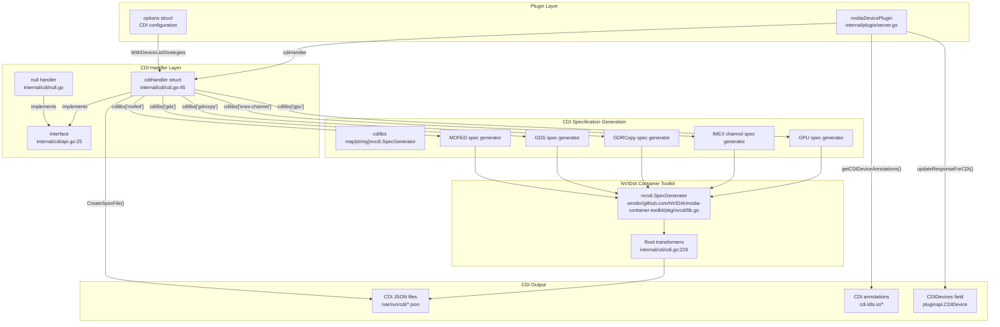
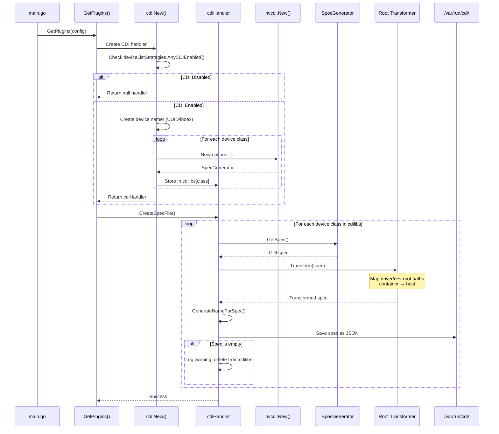
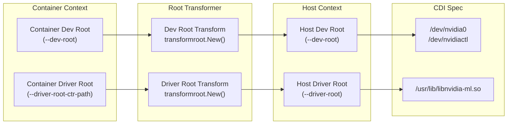

<!-- source: DeepWiki mcp.deepwiki.com · repo NVIDIA/k8s-device-plugin · page 3.5 Container Device Interface (CDI) Integration · fetched 2026-10-26 -->

# Container Device Interface (CDI) Integration

<details>
<summary>Relevant source files</summary>

The following files were used as context for generating this wiki page:

- [api/config/v1/strategy.go](api/config/v1/strategy.go)
- [cmd/nvidia-device-plugin/main.go](cmd/nvidia-device-plugin/main.go)
- [cmd/nvidia-device-plugin/plugin-manager.go](cmd/nvidia-device-plugin/plugin-manager.go)
- [go.mod](go.mod)
- [go.sum](go.sum)
- [internal/cdi/api.go](internal/cdi/api.go)
- [internal/cdi/api_mock.go](internal/cdi/api_mock.go)
- [internal/cdi/cdi.go](internal/cdi/cdi.go)
- [internal/cdi/imex.go](internal/cdi/imex.go)
- [internal/cdi/null.go](internal/cdi/null.go)
- [internal/cdi/options.go](internal/cdi/options.go)
- [internal/plugin/factory.go](internal/plugin/factory.go)
- [internal/plugin/options.go](internal/plugin/options.go)
- [internal/plugin/server.go](internal/plugin/server.go)
- [internal/plugin/server_test.go](internal/plugin/server_test.go)
- [vendor/github.com/NVIDIA/nvidia-container-toolkit/internal/discover/graphics.go](vendor/github.com/NVIDIA/nvidia-container-toolkit/internal/discover/graphics.go)
- [vendor/github.com/NVIDIA/nvidia-container-toolkit/internal/discover/ipc.go](vendor/github.com/NVIDIA/nvidia-container-toolkit/internal/discover/ipc.go)
- [vendor/github.com/NVIDIA/nvidia-container-toolkit/pkg/nvcdi/driver-nvml.go](vendor/github.com/NVIDIA/nvidia-container-toolkit/pkg/nvcdi/driver-nvml.go)
- [vendor/github.com/NVIDIA/nvidia-container-toolkit/pkg/nvcdi/driver-wsl.go](vendor/github.com/NVIDIA/nvidia-container-toolkit/pkg/nvcdi/driver-wsl.go)
- [vendor/github.com/NVIDIA/nvidia-container-toolkit/pkg/nvcdi/lib-csv.go](vendor/github.com/NVIDIA/nvidia-container-toolkit/pkg/nvcdi/lib-csv.go)
- [vendor/github.com/NVIDIA/nvidia-container-toolkit/pkg/nvcdi/lib-nvml.go](vendor/github.com/NVIDIA/nvidia-container-toolkit/pkg/nvcdi/lib-nvml.go)
- [vendor/github.com/NVIDIA/nvidia-container-toolkit/pkg/nvcdi/lib.go](vendor/github.com/NVIDIA/nvidia-container-toolkit/pkg/nvcdi/lib.go)
- [vendor/github.com/NVIDIA/nvidia-container-toolkit/pkg/nvcdi/management.go](vendor/github.com/NVIDIA/nvidia-container-toolkit/pkg/nvcdi/management.go)
- [vendor/github.com/NVIDIA/nvidia-container-toolkit/pkg/nvcdi/options.go](vendor/github.com/NVIDIA/nvidia-container-toolkit/pkg/nvcdi/options.go)
- [vendor/modules.txt](vendor/modules.txt)
- [vendor/tags.cncf.io/container-device-interface/pkg/cdi/container-edits.go](vendor/tags.cncf.io/container-device-interface/pkg/cdi/container-edits.go)
- [vendor/tags.cncf.io/container-device-interface/pkg/cdi/container-edits_unix.go](vendor/tags.cncf.io/container-device-interface/pkg/cdi/container-edits_unix.go)
- [vendor/tags.cncf.io/container-device-interface/pkg/cdi/oci.go](vendor/tags.cncf.io/container-device-interface/pkg/cdi/oci.go)
- [vendor/tags.cncf.io/container-device-interface/specs-go/config.go](vendor/tags.cncf.io/container-device-interface/specs-go/config.go)
- [vendor/tags.cncf.io/container-device-interface/specs-go/version.go](vendor/tags.cncf.io/container-device-interface/specs-go/version.go)

</details>


This document describes the Container Device Interface (CDI) integration in the NVIDIA device plugin. CDI provides a vendor-agnostic mechanism for container runtimes to make devices available in containers. The device plugin supports CDI as an alternative to the traditional NVIDIA Container Runtime approach for device injection.

For information about device allocation strategies more broadly, see [Device Allocation Strategies](#3.3). For configuration of the device plugin, see [Configuration Management](#5).

---

## Purpose and Scope

The CDI integration enables the device plugin to work with CDI-enabled container engines (containerd, CRI-O, etc.) without requiring the NVIDIA Container Runtime. The device plugin generates CDI specification files describing NVIDIA GPU devices and other optional devices (IMEX channels, GDRCopy, GDS, MOFED), then communicates device selections to the container engine via CDI annotations or the CRI `CDIDevices` field.

CDI support is generally available on NVML-based systems and requires a CDI-enabled container engine. On Tegra platforms, the plugin uses a CSV-based discovery strategy to generate CDI specifications.

---

## CDI Device List Strategies

The device plugin supports two CDI-based strategies for communicating device selections to the container runtime, configured via the `DEVICE_LIST_STRATEGY` option:

| Strategy | Description | Kubernetes Support | Container Engine Requirement |
|----------|-------------|-------------------|------------------------------|
| `cdi-annotations` | Uses CDI container annotations to specify devices | All versions | CDI-enabled engine |
| `cdi-cri` | Uses the `CDIDevices` field in the CRI protocol | Requires CRI field support | CDI-enabled engine with CRI support |

**Multiple strategies can be specified simultaneously** (comma-separated list), allowing both CDI and traditional approaches to be used together.

```yaml
# Configuration example
flags:
  plugin:
    deviceListStrategy: ["envvar", "cdi-annotations"]
```

When CDI strategies are enabled, the device plugin:
1. Does not require the NVIDIA Container Runtime on the host.
2. Generates CDI specification files at plugin startup.
3. Returns CDI device references in allocation responses.
4. Can still use traditional strategies (envvar, volume-mounts) concurrently.

Sources: [cmd/nvidia-device-plugin/main.go:91-96](), [api/config/v1/strategy.go:24-34]()

---

## CDI Handler Architecture

The CDI integration is implemented through a `cdiHandler` that generates CDI specifications and manages CDI device references.

### CDI Handler Structure



**Diagram: CDI Handler Architecture and Component Relationships**

The `cdiHandler` is constructed at plugin initialization and:
- Maintains multiple CDI spec generators in the `cdilibs` map, keyed by device class `[internal/cdi/cdi.go:71]()`.
- Uses the NVIDIA Container Toolkit's `nvcdi` library for spec generation `[internal/cdi/cdi.go:145]()`.
- Applies root transformers to map container paths to host paths `[internal/cdi/cdi.go:198]()`.
- Provides methods to generate qualified CDI device names `[internal/cdi/cdi.go:251]()`.

Sources: [internal/cdi/cdi.go:45-73](), [cmd/nvidia-device-plugin/plugin-manager.go:52-67]()

---

## CDI Specification Generation

### Spec Generation Flow



**Diagram: CDI Specification Generation Sequence**

The CDI spec generation occurs once at plugin startup and involves:

1. **Handler Creation**: The `cdiHandler` is initialized with configuration options including device ID strategy, driver roots, and enabled features `[internal/cdi/cdi.go:78-184]()`.
2. **Spec Generator Setup**: For each device class (gpu, imex-channel, gdrcopy, gds, mofed), a corresponding `nvcdi.SpecGenerator` is created `[internal/cdi/cdi.go:143-181]()`.
3. **Spec Generation**: Each generator produces a CDI specification describing available devices `[internal/cdi/cdi.go:192]()`.
4. **Root Transformation**: Path transformers map container-relative paths to host paths based on driver and device root configuration `[internal/cdi/cdi.go:198-201]()`.
5. **Spec Persistence**: Specifications are saved as JSON files in `/var/run/cdi/` with generated names `[internal/cdi/cdi.go:208]()`.

Sources: [internal/cdi/cdi.go:187-227](), [cmd/nvidia-device-plugin/plugin-manager.go:84-86]()

### CDI Device Classes

The device plugin generates CDI specifications for multiple device classes:

| Device Class | Purpose | Configuration Flag | CDI Vendor/Class |
|--------------|---------|-------------------|------------------|
| `gpu` | NVIDIA GPU devices | Always enabled | `k8s.device-plugin.nvidia.com/gpu=<id>` |
| `imex-channel` | IMEX communication channels | `imex-channel-ids` | `k8s.device-plugin.nvidia.com/imex-channel=<id>` |
| `gdrcopy` | GDRCopy support | `--gdrcopy-enabled` | `k8s.device-plugin.nvidia.com/gdrcopy=all` |
| `gds` | GPUDirect Storage | `--gds-enabled` | `k8s.device-plugin.nvidia.com/gds=all` |
| `mofed` | MOFED (RDMA) support | `--mofed-enabled` | `k8s.device-plugin.nvidia.com/mofed=all` |

The vendor name is configurable but defaults to `k8s.device-plugin.nvidia.com` `[internal/cdi/cdi.go:60]()`.

**Device ID Strategies**: The device ID used in GPU CDI names follows the configured `deviceIDStrategy` `[internal/cdi/cdi.go:119]()`:
- `uuid` (default): Uses GPU UUID (e.g., `GPU-abc123...`)
- `index`: Uses GPU index (e.g., `0`, `1`, `2`)

Sources: [internal/cdi/cdi.go:143-181](), [cmd/nvidia-device-plugin/main.go:98-103]()

### Path Mapping and Root Transformation

CDI specifications must correctly map device and driver paths from the plugin container's view to the host's view:



**Diagram: CDI Path Transformation Logic**

The transformation ensures that:
- **Driver paths** (libraries, binaries) are remapped from the container's driver root to the host's driver root `[internal/cdi/cdi.go:230-234]()`.
- **Device nodes** (e.g., `/dev/nvidia*`) are remapped from the container's dev root to the host's dev root `[internal/cdi/cdi.go:240-248]()`.

Sources: [internal/cdi/cdi.go:229-249](), [cmd/nvidia-device-plugin/plugin-manager.go:37-57]()

---

## Device Allocation with CDI

### Allocation Response Generation

When a pod requests GPU resources, the device plugin's `Allocate()` method generates a response that includes CDI device references if configured.

1. **Qualified Names**: The plugin uses `cdiHandler.QualifiedName` to build references like `nvidia.com/gpu=GPU-UUID` `[internal/plugin/server_test.go:97-99]()`.
2. **Additional Devices**: Optional features like GDS or MOFED are appended to the CDI device list `[internal/plugin/server_test.go:199-204]()`.
3. **IMEX Channels**: If IMEX is enabled, the channel ID is included in the CDI device list `[internal/plugin/server_test.go:210-216]()`.

### CDI Annotation Format

When using the `cdi-annotations` strategy, the device plugin generates annotations:

- **Key**: Configurable via `--cdi-annotation-prefix` (default: `cdi.k8s.io/`). The plugin appends a unique ID to ensure uniqueness per container request `[internal/plugin/server_test.go:135]()`.
- **Value**: A comma-separated list of fully-qualified CDI device names `[internal/plugin/server_test.go:157]()`.

Sources: [internal/plugin/server_test.go:111-217](), [cmd/nvidia-device-plugin/main.go:123-127]()

---

## Configuration Options

### Command-Line Flags

The following command-line flags control CDI integration:

| Flag | Environment Variable | Default | Description |
|------|---------------------|---------|-------------|
| `--device-list-strategy` | `DEVICE_LIST_STRATEGY` | `envvar` | List of strategies (includes `cdi-annotations`) `[main.go:92]()` |
| `--cdi-annotation-prefix` | `CDI_ANNOTATION_PREFIX` | `cdi.k8s.io/` | Prefix for CDI annotation keys `[main.go:123]()` |
| `--nvidia-cdi-hook-path` | `NVIDIA_CDI_HOOK_PATH` | `/usr/bin/nvidia-ctk` | Path to NVIDIA CTK for CDI hooks `[main.go:129]()` |
| `--driver-root-ctr-path` | `DRIVER_ROOT_CTR_PATH` | `/run/nvidia/driver` | Driver root path in plugin container `[main.go:136]()` |
| `--cdi-feature-flags` | `CDI_FEATURE_FLAGS` | (none) | Feature flags for CDI spec generation `[main.go:177]()` |

Sources: [cmd/nvidia-device-plugin/main.go:60-183]()

### CDI Handler Options

The CDI handler accepts various options via functional option pattern:

```go
cdiHandler, err := cdi.New(infolib, nvmllib, devicelib,
    cdi.WithDeviceListStrategies(deviceListStrategies),
    cdi.WithDriverRoot(driverRoot),
    cdi.WithDevRoot(devRoot),
    cdi.WithNvidiaCTKPath(nvidiaCTKPath),
    cdi.WithDeviceIDStrategy(deviceIDStrategy),
    cdi.WithImexChannels(imexChannels),
    cdi.WithFeatureFlags(flags...),
)
```

Sources: [internal/cdi/options.go:25-126](), [cmd/nvidia-device-plugin/plugin-manager.go:52-67]()

---

## CDI Validation

The device plugin validates CDI configuration at startup. Specifically, it checks if CDI is enabled on systems without NVML (unless in Tegra mode):

```go
func validateFlags(infolib nvinfo.Interface, config *spec.Config) error {
    // ...
    hasNvml, _ := infolib.HasNvml()
    if deviceListStrategies.AnyCDIEnabled() && !hasNvml {
        return fmt.Errorf("CDI --device-list-strategy options are only supported on NVML-based systems")
    }
    // ...
}
```

Sources: [cmd/nvidia-device-plugin/main.go:193-202]()

---

## Integration Points

### IMEX Channels

IMEX channels are automatically included in CDI device allocations when configured. The CDI handler generates a separate spec generator for IMEX channels and includes them in allocation responses.

Sources: [internal/cdi/cdi.go:156-158](), [internal/plugin/server_test.go:210-216]()

### Tegra Platform Support

On Tegra platforms, the CDI handler uses a CSV-based discovery strategy. It injects driver-root-aware paths for CSV files to ensure the `nvcdi` library finds the correct host configuration.

Sources: [internal/cdi/cdi.go:139-141](), [cmd/nvidia-device-plugin/plugin-manager.go:93-109]()

---

