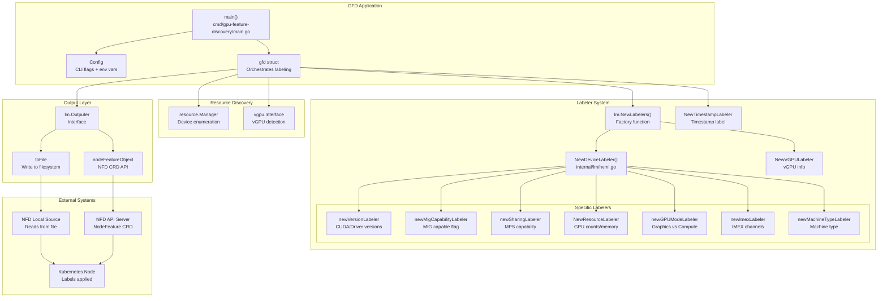
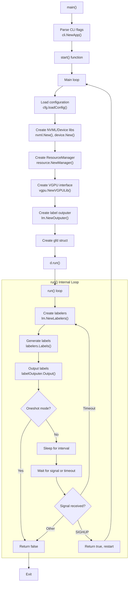
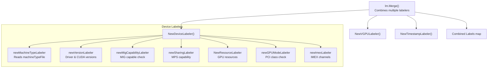
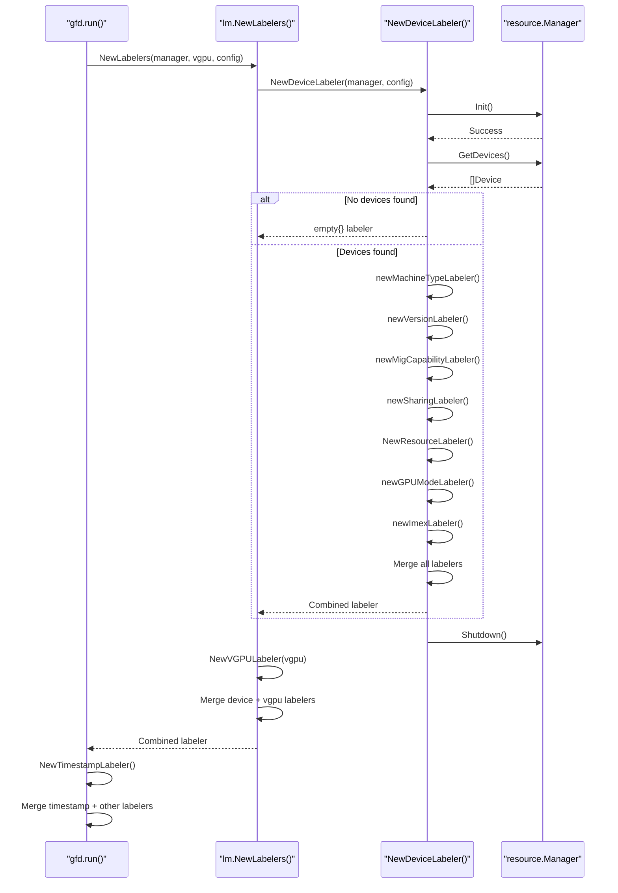

<!-- source: DeepWiki mcp.deepwiki.com · repo NVIDIA/k8s-device-plugin · page 4 GPU Feature Discovery · fetched 2026-10-26 -->

# GPU Feature Discovery

<details>
<summary>Relevant source files</summary>

The following files were used as context for generating this wiki page:

- [api/config/v1/duration.go](api/config/v1/duration.go)
- [api/config/v1/flags.go](api/config/v1/flags.go)
- [api/config/v1/flags_test.go](api/config/v1/flags_test.go)
- [cmd/gpu-feature-discovery/main.go](cmd/gpu-feature-discovery/main.go)
- [cmd/gpu-feature-discovery/main_test.go](cmd/gpu-feature-discovery/main_test.go)
- [cmd/gpu-feature-discovery/mig_test.go](cmd/gpu-feature-discovery/mig_test.go)
- [docs/gpu-feature-discovery/README.md](docs/gpu-feature-discovery/README.md)
- [internal/lm/labeler.go](internal/lm/labeler.go)
- [internal/lm/labels.go](internal/lm/labels.go)
- [internal/lm/machine-type.go](internal/lm/machine-type.go)
- [internal/lm/mig-strategy.go](internal/lm/mig-strategy.go)
- [internal/lm/mig-strategy_test.go](internal/lm/mig-strategy_test.go)
- [internal/lm/nvml.go](internal/lm/nvml.go)
- [internal/lm/nvml_test.go](internal/lm/nvml_test.go)
- [internal/lm/resource.go](internal/lm/resource.go)
- [internal/lm/resource_test.go](internal/lm/resource_test.go)
- [internal/resource/cuda-device.go](internal/resource/cuda-device.go)
- [internal/resource/device_mock.go](internal/resource/device_mock.go)
- [internal/resource/factory.go](internal/resource/factory.go)
- [internal/resource/nvml-device.go](internal/resource/nvml-device.go)
- [internal/resource/nvml-lib.go](internal/resource/nvml-lib.go)
- [internal/resource/nvml-mig-device.go](internal/resource/nvml-mig-device.go)
- [internal/resource/sysfs-device.go](internal/resource/sysfs-device.go)
- [internal/resource/testing/resource-testing.go](internal/resource/testing/resource-testing.go)
- [internal/resource/types.go](internal/resource/types.go)

</details>


GPU Feature Discovery (GFD) is a component that automatically detects GPU hardware features and generates Kubernetes node labels. It runs independently from the device plugin to provide scheduling hints about GPU capabilities, driver versions, memory sizes, and other hardware attributes. For information about the device plugin itself, see [Device Plugin Core](#3).

## System Overview

GFD queries GPU devices through NVML and generates labels describing:
- Driver and CUDA versions
- GPU model, memory, and compute capability
- MIG (Multi-Instance GPU) capabilities and configurations
- GPU mode (graphics vs compute)
- Sharing capabilities (MPS support)
- IMEX channel presence

These labels enable sophisticated pod scheduling based on GPU attributes without requiring the pod to allocate a GPU first.

**Sources:** [cmd/gpu-feature-discovery/main.go:40-49](), [docs/gpu-feature-discovery/README.md:25-30]()

## Architecture



The architecture separates concerns into resource discovery, label generation, and output mechanisms. The labeler system is composable, with individual labelers responsible for specific hardware attributes.

**Sources:** [cmd/gpu-feature-discovery/main.go:40-130](), [cmd/gpu-feature-discovery/main.go:215-230](), [internal/lm/nvml.go:35-99]()

## Main Entry Point and Lifecycle

### Application Structure

The GFD application is defined in [cmd/gpu-feature-discovery/main.go:29-38]():

```go
type Config struct {
	configFile string

	kubeClientConfig flags.KubeClientConfig
	nodeConfig       flags.NodeConfig

	// flags stores the CLI flags for later processing.
	flags []cli.Flag
}

type gfd struct {
	manager resource.Manager
	vgpu    vgpu.Interface
	config  *spec.Config

	labelOutputer lm.Outputer
}
```

### Execution Flow



The application supports three execution modes:
1. **Oneshot mode**: Labels once and exits (configured via `--oneshot` flag).
2. **Continuous mode**: Labels periodically based on `--sleep-interval`.
3. **Signal-driven reload**: Reloads configuration on `SIGHUP`.

**Sources:** [cmd/gpu-feature-discovery/main.go:65-69](), [cmd/gpu-feature-discovery/main.go:76-81](), [cmd/gpu-feature-discovery/main.go:158-230](), [cmd/gpu-feature-discovery/main.go:240-308]()

## Labeler System

The GFD labeler system is a collection of modular components that each report a subset of GPU features. For a deep dive into individual labelers, see [Feature Detection and Labeling](#4.1).

### Labeler Interface

The core abstraction is the `Labeler` interface. The `Labels` type is a `map[string]string` that also implements the `Labeler` interface, allowing static labels and dynamic labelers to be used interchangeably.

**Sources:** [internal/lm/nvml.go:125-141](), [internal/lm/resource.go:173-177]()

### Labeler Composition



The labelers are composed using `Merge()` which combines multiple labelers into a single map that aggregates all hardware attributes.

**Sources:** [internal/lm/nvml.go:88-96](), [cmd/gpu-feature-discovery/main.go:264-267]()

### Labeler Initialization Flow



The `resource.Manager` is initialized and shut down during labeler creation in `NewDeviceLabeler`. This ensures devices are properly queried and released before the continuous labeling loop begins.

**Sources:** [internal/lm/nvml.go:36-42](), [cmd/gpu-feature-discovery/main.go:259-267]()

## Node Feature Discovery Integration

GFD integrates with the Node Feature Discovery (NFD) framework to apply labels to Kubernetes nodes. For details on NFD integration and output strategies, see [Node Feature Discovery Integration](#4.2).

### Output Mechanisms

GFD supports two output strategies configured via the `UseNodeFeatureAPI` flag (CLI: `--use-node-feature-api`):

1.  **File-Based Output**: Labels are written to a file (default: `/etc/kubernetes/node-feature-discovery/features.d/gfd`). NFD's local source reads this file to apply labels.
2.  **NodeFeature API**: GFD directly creates or updates a `NodeFeature` custom resource. NFD then processes this resource to label the node.

**Sources:** [cmd/gpu-feature-discovery/main.go:101-105](), [cmd/gpu-feature-discovery/main.go:197-203](), [api/config/v1/flags.go:108-114]()

## Configuration

GFD is configured via command-line flags, environment variables, or a configuration file.

### GFD Specific Flags

The `GFDCommandLineFlags` struct defines options specific to the feature discovery component:

| Flag | Field | Description |
| :--- | :--- | :--- |
| `--oneshot` | `Oneshot` | Label once and exit immediately. |
| `--no-timestamp` | `NoTimestamp` | Do not add the `nvidia.com/gfd.timestamp` label. |
| `--sleep-interval` | `SleepInterval` | Time to sleep between labeling iterations. |
| `--output-file` | `OutputFile` | Path to the output file for NFD local source. |
| `--machine-type-file` | `MachineTypeFile` | Path to DMI/SMBIOS information. |

**Sources:** [api/config/v1/flags.go:108-114](), [cmd/gpu-feature-discovery/main.go:65-93]()

### Shared Configuration

GFD also respects shared configuration options like `MigStrategy` and `DeviceDiscoveryStrategy` which influence how devices are enumerated and labeled.

**Sources:** [api/config/v1/flags.go:60-72](), [cmd/gpu-feature-discovery/main.go:52-57](), [cmd/gpu-feature-discovery/main.go:107-111]()

---

