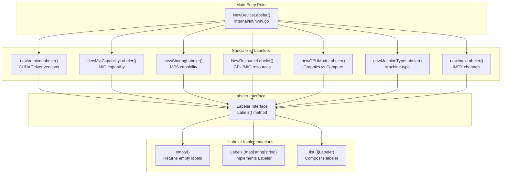
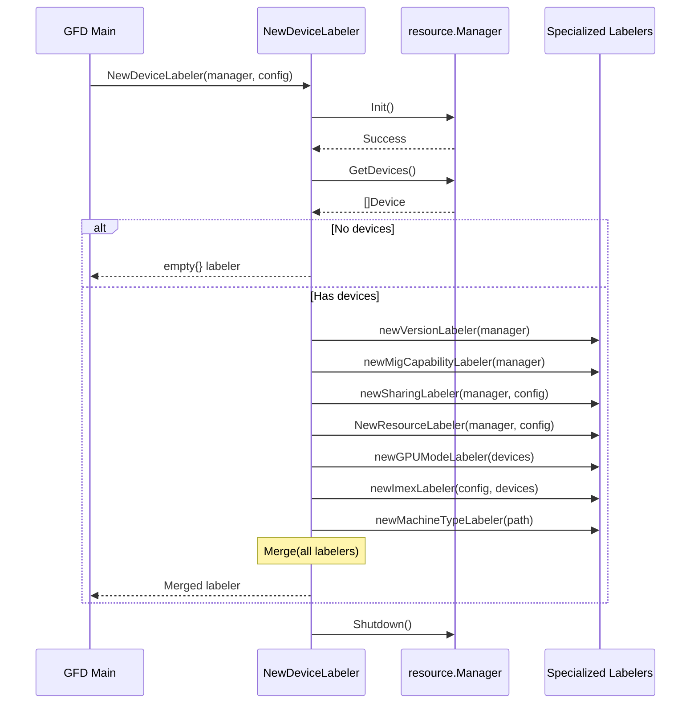
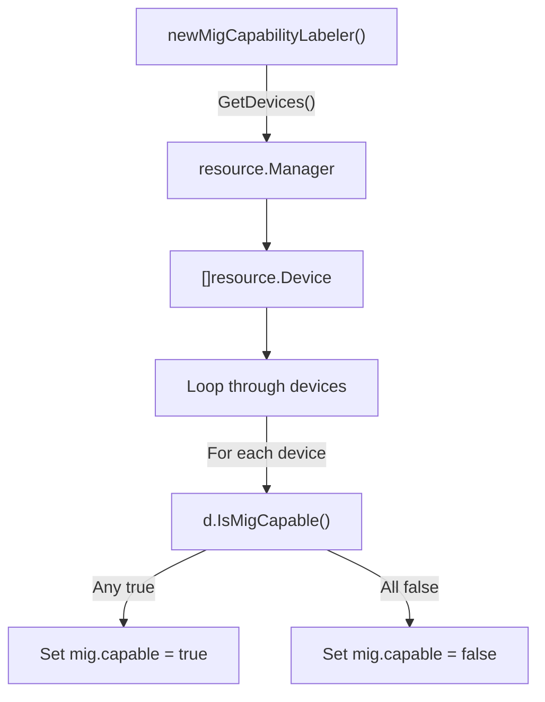
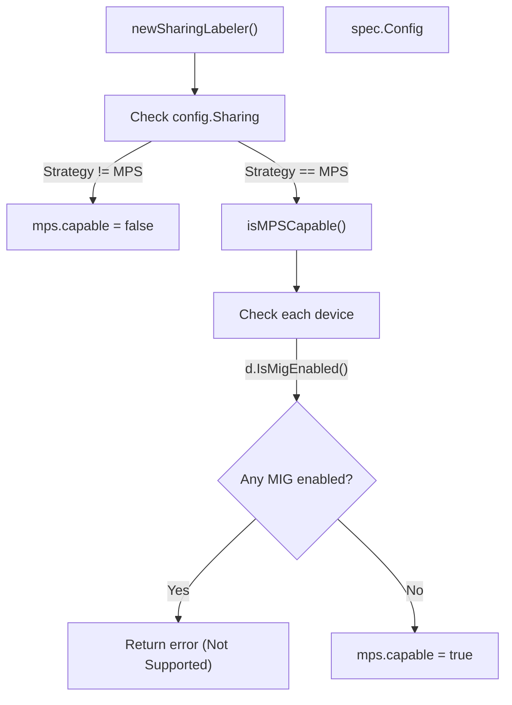
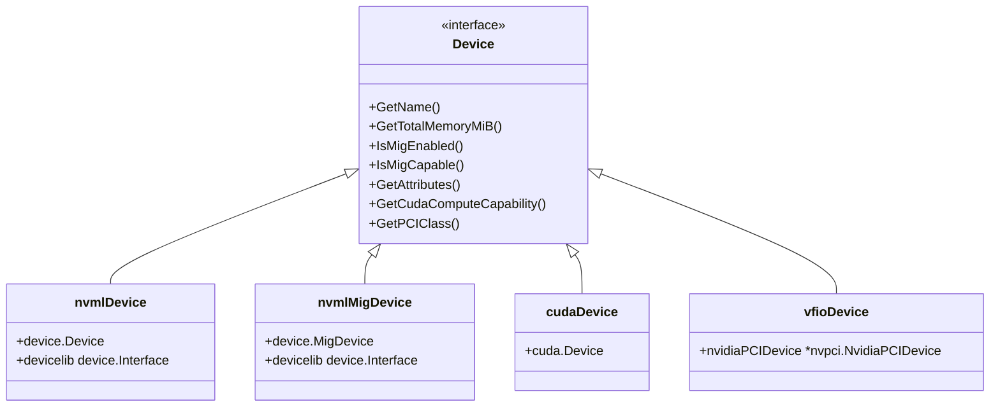
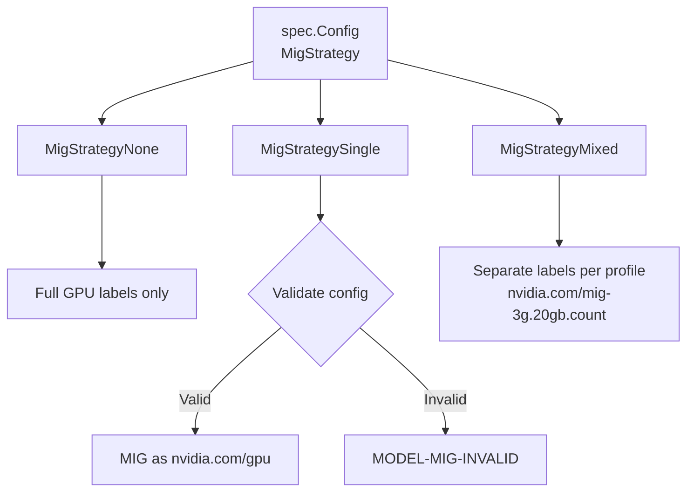
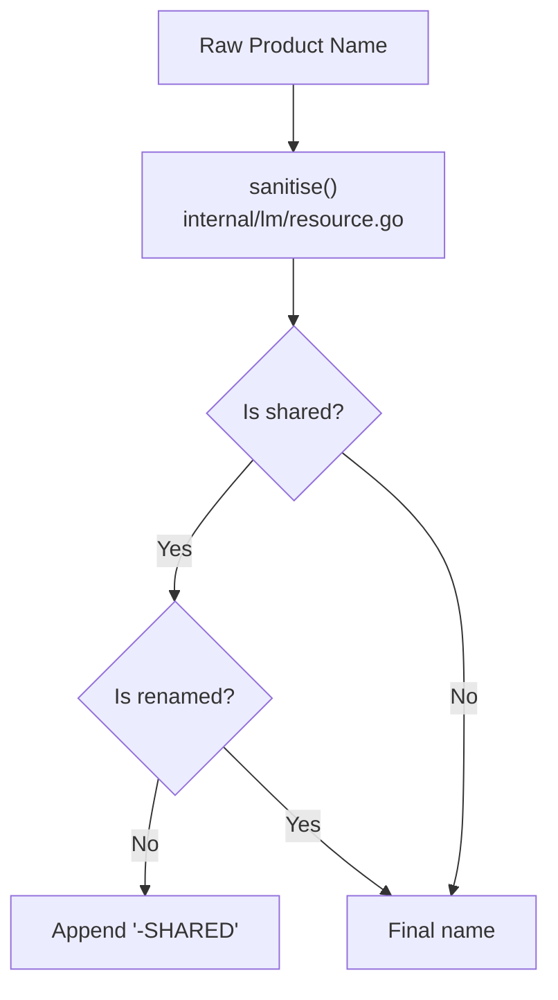

<!-- source: DeepWiki mcp.deepwiki.com · repo NVIDIA/k8s-device-plugin · page 4.1 Feature Detection and Labeling · fetched 2026-10-26 -->

# Feature Detection and Labeling

Relevant source files

The following files were used as context for generating this wiki page:

- [api/config/v1/imex.go](api/config/v1/imex.go)
- [api/config/v1/imex_test.go](api/config/v1/imex_test.go)
- [docs/gpu-feature-discovery/README.md](docs/gpu-feature-discovery/README.md)
- [internal/lm/imex.go](internal/lm/imex.go)
- [internal/lm/imex_test.go](internal/lm/imex_test.go)
- [internal/lm/machine-type.go](internal/lm/machine-type.go)
- [internal/lm/mig-strategy.go](internal/lm/mig-strategy.go)
- [internal/lm/mig-strategy_test.go](internal/lm/mig-strategy_test.go)
- [internal/lm/nvml.go](internal/lm/nvml.go)
- [internal/lm/nvml_test.go](internal/lm/nvml_test.go)
- [internal/lm/resource.go](internal/lm/resource.go)
- [internal/lm/resource_test.go](internal/lm/resource_test.go)
- [internal/lm/vgpu.go](internal/lm/vgpu.go)
- [internal/resource/cuda-device.go](internal/resource/cuda-device.go)
- [internal/resource/device_mock.go](internal/resource/device_mock.go)
- [internal/resource/nvml-device.go](internal/resource/nvml-device.go)
- [internal/resource/nvml-lib.go](internal/resource/nvml-lib.go)
- [internal/resource/nvml-mig-device.go](internal/resource/nvml-mig-device.go)
- [internal/resource/sysfs-device.go](internal/resource/sysfs-device.go)
- [internal/resource/testing/resource-testing.go](internal/resource/testing/resource-testing.go)
- [internal/resource/types.go](internal/resource/types.go)

## Purpose and Scope

This page documents the feature detection and labeling system in the GPU Feature Discovery (GFD) component. The labeling system automatically discovers GPU hardware capabilities and generates Kubernetes node labels that describe the available GPU resources. These labels enable workload scheduling decisions and provide visibility into GPU capabilities across the cluster.

For information about how these labels integrate with Node Feature Discovery (NFD) and are written to Kubernetes nodes, see [Node Feature Discovery Integration](#4.2). For details about the overall GFD component architecture, see [GPU Feature Discovery](#4).

The labeling system is implemented in the `internal/lm` package, which stands for "label manager". It queries GPU devices through the resource manager abstraction and produces a structured set of labels describing driver versions, GPU models, memory, compute capabilities, MIG configurations, and sharing capabilities.

**Sources:** [internal/lm/nvml.go:1-99](), [docs/gpu-feature-discovery/README.md:1-25]()

## Labeler System Architecture

The labeling system follows a composable architecture where multiple specialized labelers each contribute a subset of labels. The system merges these label sets to produce the complete set of node labels.

### Labeler Interface and Composition

**Sources:** [internal/lm/nvml.go:36-99](), [internal/lm/resource.go:33-108]()

### Label Generation Flow

**Sources:** [internal/lm/nvml.go:36-99](), [internal/lm/resource.go:33-108]()

## Label Types and Sources

### Version Labels

The version labeler detects NVIDIA driver and CUDA runtime versions and generates labels in both deprecated and current formats.

| Label Key | Value Type | Description |
|-----------|------------|-------------|
| `nvidia.com/cuda.driver-version.major` | Integer | Driver major version |
| `nvidia.com/cuda.driver-version.minor` | Integer | Driver minor version |
| `nvidia.com/cuda.driver-version.revision` | Integer | Driver revision |
| `nvidia.com/cuda.driver-version.full` | String | Full driver version |
| `nvidia.com/cuda.runtime-version.major` | Integer | CUDA major version |
| `nvidia.com/cuda.runtime-version.minor` | Integer | CUDA minor version |
| `nvidia.com/cuda.runtime-version.full` | String | Full CUDA version |

**Sources:** [internal/lm/nvml.go:102-143]()

### MIG Capability Labels

The MIG capability labeler determines whether any GPU on the node supports Multi-Instance GPU (MIG) mode. If any single device is MIG-capable, the node receives `nvidia.com/mig.capable: "true"`.

**Sources:** [internal/lm/nvml.go:147-174](), [internal/lm/nvml_test.go:13-79]()

### Sharing Labels

The sharing labeler determines whether the node can support Multi-Process Service (MPS) based on the configuration and device capabilities. MPS is not supported on MIG-enabled devices.

**Sources:** [internal/lm/nvml.go:176-211](), [internal/lm/nvml_test.go:81-206]()

### GPU Mode Labels

The GPU mode labeler detects whether GPUs are in graphics mode or compute mode by examining their PCI class codes.

| PCI Class | GPU Mode |
|-----------|----------|
| 0x030000 | graphics |
| 0x030200 | compute |
| Other | unknown |

**Sources:** [internal/lm/nvml.go:215-263](), [internal/lm/nvml_test.go:208-275]()

### Resource Labels

Resource labels describe specific GPU or MIG device characteristics including model, memory, count, and compute capabilities.

#### Full GPU Resource Labels

Full GPU labeling uses `NewGPUResourceLabeler()` which creates labels for complete GPU devices:

| Label Suffix | Value Type | Source Method |
|--------------|------------|---------------|
| `product` | String | `device.GetName()` |
| `count` | Integer | Input count |
| `replicas` | Integer | `rl.getReplicas()` |
| `sharing-strategy` | String | `config.Sharing` |
| `memory` | Integer | `device.GetTotalMemoryMiB()` |
| `family` | String | `device.GetCudaComputeCapability()` |

**Sources:** [internal/lm/resource.go:39-73](), [internal/lm/resource.go:160-178]()

#### MIG Device Resource Labels

MIG device labeling uses `NewMIGResourceLabeler()` which includes MIG-specific attributes:

| Label Suffix | Value Type | Description |
|--------------|------------|-------------|
| `product` | String | Parent Name + MIG Profile |
| `memory` | Integer | Memory from `GetAttributes()` |
| `multiprocessors` | Integer | SM count from `GetAttributes()` |
| `slices.gi` | Integer | GPU Instance slices |
| `slices.ci` | Integer | Compute Instance slices |

**Sources:** [internal/lm/resource.go:76-108](), [internal/resource/nvml-mig-device.go:36-54]()

### IMEX Channel Labels

The IMEX labeler detects Inter-GPU Memory Exchange (IMEX) channels and labels nodes based on their availability.

**Sources:** [internal/lm/nvml.go:83-86](), [internal/lm/imex.go:1-50]()

## Device Interface Implementations

All labelable devices implement the `resource.Device` interface which provides methods for querying device properties.

**Sources:** [internal/resource/types.go:33-45](), [internal/resource/nvml-device.go:29-32](), [internal/resource/nvml-mig-device.go:28-31](), [internal/resource/cuda-device.go:25-27](), [internal/resource/sysfs-device.go:25-27]()

### Device Type Capabilities Matrix

| Device Type | Compute Capability | MIG Devices | Attributes | Memory Source |
|-------------|--------------------|-------------|------------|---------------|
| `nvmlDevice` | Supported | Supported | Not Supported | `GetMemoryInfo()` |
| `nvmlMigDevice` | Not Supported | Not Supported | Supported | `GetAttributes()` |
| `cudaDevice` | Supported | Not Supported | Not Supported | `TotalMem()` |
| `vfioDevice` | Not Supported | Not Supported | Not Supported | `PCI Resources` |

**Sources:** [internal/resource/nvml-device.go:56-91](), [internal/resource/nvml-mig-device.go:36-119](), [internal/resource/cuda-device.go:42-68](), [internal/resource/sysfs-device.go:35-58]()

## MIG Strategy Label Generation

The MIG strategy determines how MIG devices are exposed and labeled.

### Strategy Overview

**Sources:** [internal/lm/mig-strategy.go:28-78](), [docs/gpu-feature-discovery/README.md:235-273]()

### Product Name Sanitization

The product name undergoes sanitization and may have sharing suffixes appended:

**Sources:** [internal/lm/resource.go:189-206](), [internal/lm/resource_test.go:219-263]()

---

