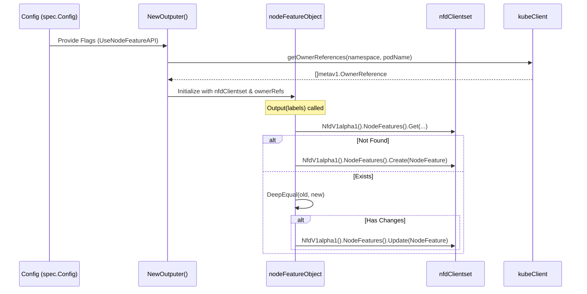

<!-- source: DeepWiki mcp.deepwiki.com · repo NVIDIA/k8s-device-plugin · page 4.2 Node Feature Discovery Integration · fetched 2026-10-26 -->

# Node Feature Discovery Integration

<details>
<summary>Relevant source files</summary>

The following files were used as context for generating this wiki page:

- [internal/flags/kubeclient.go](internal/flags/kubeclient.go)
- [internal/flags/node.go](internal/flags/node.go)
- [internal/lm/output.go](internal/lm/output.go)
- [tests/go.mod](tests/go.mod)
- [tests/go.sum](tests/go.sum)
- [tests/vendor/github.com/containerd/containerd/archive/compression/compression.go](tests/vendor/github.com/containerd/containerd/archive/compression/compression.go)
- [tests/vendor/github.com/containerd/containerd/content/content.go](tests/vendor/github.com/containerd/containerd/content/content.go)
- [tests/vendor/github.com/containerd/containerd/content/helpers.go](tests/vendor/github.com/containerd/containerd/content/helpers.go)
- [tests/vendor/modules.txt](tests/vendor/modules.txt)
- [tests/vendor/sigs.k8s.io/node-feature-discovery/api/nfd/v1alpha1/doc.go](tests/vendor/sigs.k8s.io/node-feature-discovery/api/nfd/v1alpha1/doc.go)
- [tests/vendor/sigs.k8s.io/node-feature-discovery/api/nfd/v1alpha1/types.go](tests/vendor/sigs.k8s.io/node-feature-discovery/api/nfd/v1alpha1/types.go)
- [tests/vendor/sigs.k8s.io/node-feature-discovery/api/nfd/v1alpha1/utils.go](tests/vendor/sigs.k8s.io/node-feature-discovery/api/nfd/v1alpha1/utils.go)
- [tests/vendor/sigs.k8s.io/node-feature-discovery/api/nfd/v1alpha1/zz_generated.deepcopy.go](tests/vendor/sigs.k8s.io/node-feature-discovery/api/nfd/v1alpha1/zz_generated.deepcopy.go)
- [vendor/github.com/google/renameio/.golangci.yml](vendor/github.com/google/renameio/.golangci.yml)
- [vendor/github.com/google/renameio/CONTRIBUTING.md](vendor/github.com/google/renameio/CONTRIBUTING.md)
- [vendor/github.com/google/renameio/LICENSE](vendor/github.com/google/renameio/LICENSE)
- [vendor/github.com/google/renameio/README.md](vendor/github.com/google/renameio/README.md)
- [vendor/github.com/google/renameio/doc.go](vendor/github.com/google/renameio/doc.go)
- [vendor/github.com/google/renameio/tempfile.go](vendor/github.com/google/renameio/tempfile.go)
- [vendor/github.com/google/renameio/writefile.go](vendor/github.com/google/renameio/writefile.go)
- [vendor/sigs.k8s.io/node-feature-discovery/api/nfd/v1alpha1/doc.go](vendor/sigs.k8s.io/node-feature-discovery/api/nfd/v1alpha1/doc.go)
- [vendor/sigs.k8s.io/node-feature-discovery/api/nfd/v1alpha1/types.go](vendor/sigs.k8s.io/node-feature-discovery/api/nfd/v1alpha1/types.go)
- [vendor/sigs.k8s.io/node-feature-discovery/api/nfd/v1alpha1/utils.go](vendor/sigs.k8s.io/node-feature-discovery/api/nfd/v1alpha1/utils.go)
- [vendor/sigs.k8s.io/node-feature-discovery/api/nfd/v1alpha1/zz_generated.deepcopy.go](vendor/sigs.k8s.io/node-feature-discovery/api/nfd/v1alpha1/zz_generated.deepcopy.go)

</details>


This document describes how the NVIDIA GPU Device Plugin integrates with Node Feature Discovery (NFD) to automatically detect and label GPU capabilities on Kubernetes nodes. The integration relies on the GPU Feature Discovery (GFD) component to generate `NodeFeature` custom resources, which NFD then processes to apply labels to nodes.

For information about GPU feature detection mechanisms, see [Feature Detection and Labeling](4.1). For device plugin core functionality, see [Device Plugin Core](3).

## NFD Integration Architecture

The integration follows a pattern where GFD acts as a feature source for the NFD framework. GFD detects hardware properties via NVML and outputs them either as local files for the NFD-worker or directly as Kubernetes `NodeFeature` objects via the Node Feature API.

```mermaid
graph TB
    subgraph "GPU Node"
        GPU["NVIDIA GPU Hardware"]
        
        subgraph "GFD Container"
            GFD_BIN["gpu-feature-discovery"]
            OUTPUTER["Outputer Interface"]
            NF_OBJ["nodeFeatureObject"]
            TO_FILE["toFile"]
        end
        
        subgraph "NFD Worker"
            NFD_WORKER["NFD Worker Process"]
        end
        
        FEATURE_DIR["/etc/kubernetes/node-feature-discovery/features.d"]
    end
    
    KUBE_API["Kubernetes API Server"]
    NF_CRD["NodeFeature CRD"]
    NODE["Node Object"]
    
    GPU --> GFD_BIN
    GFD_BIN --> OUTPUTER
    
    OUTPUTER -->| "UseNodeFeatureAPI=false" | TO_FILE
    TO_FILE -->|"Atomic Write"| FEATURE_DIR
    FEATURE_DIR --> NFD_WORKER
    NFD_WORKER --> KUBE_API
    
    OUTPUTER -->| "UseNodeFeatureAPI=true" | NF_OBJ
    NF_OBJ -->|"Create/Update"| NF_CRD
    NF_CRD --> KUBE_API
    
    KUBE_API -->|"NFD Master applies labels"| NODE
```

**Sources**: [internal/lm/output.go:41-50](), [internal/lm/output.go:124-153]()

## The Outputer Interface

The `Outputer` interface abstracts the mechanism used to publish discovered labels. This allows GFD to support both legacy file-based integration and modern API-driven integration with NFD.

```go
type Outputer interface {
	Output(Labels) error
}
```

### Output Strategies

The specific implementation is determined by the `NewOutputer` function based on the plugin configuration:

| Implementation | Logic | Trigger |
|----------------|-------|---------|
| `toFile` | Writes labels to a local file (e.g., `/etc/kubernetes/node-feature-discovery/features.d/gfd`) | `config.Flags.UseNodeFeatureAPI` is `false` or `nil` |
| `nodeFeatureObject` | Creates/Updates a `NodeFeature` custom resource in the cluster | `config.Flags.UseNodeFeatureAPI` is `true` |
| `toWriter` | Writes labels to `stdout` | Output path is empty |

**Sources**: [internal/lm/output.go:41-50](), [internal/lm/output.go:73-80](), [internal/lm/output.go:117-121]()

## NodeFeature API Integration

When `UseNodeFeatureAPI` is enabled, GFD communicates directly with the Kubernetes API server using the NFD clientset to manage `NodeFeature` resources.

### NodeFeature Resource Structure

GFD populates the `NodeFeature` resource defined by the NFD project:

- **Name**: Formatted as `nvidia-features-for-<nodename>` [internal/lm/output.go:115-130]()
- **Labels**: Includes the mandatory `nfd.k8s-sigs.io/node-name` label [internal/lm/output.go:142-142]()
- **Spec**: Contains the raw `Features` data and the calculated `Labels` map [internal/lm/output.go:145-145]()

### Implementation Flow

The `nodeFeatureObject.Output` function performs the following steps:
1. **Fetch**: Attempts to `Get` the existing `NodeFeature` object for the node [internal/lm/output.go:132-132]().
2. **Compare**: Uses `apiequality.Semantic.DeepEqual` to check if the new labels differ from the existing resource [internal/lm/output.go:160-160]().
3. **Update/Create**: If changes are detected, it calls `Update` [internal/lm/output.go:166-166](); if the resource doesn't exist, it calls `Create` [internal/lm/output.go:147-147]().

**Sources**: [internal/lm/output.go:124-172](), [vendor/sigs.k8s.io/node-feature-discovery/api/nfd/v1alpha1/types.go:40-56]()

## Ownership and Garbage Collection

To ensure that `NodeFeature` resources are cleaned up when the GFD DaemonSet or the specific Pod is removed, GFD implements owner reference resolution.

### Owner Reference Resolution

The `getOwnerReferences` function identifies the parent resources of the current GFD process:

```mermaid
graph TD
    subgraph "Kubernetes API"
        POD["Pod Object"]
        DS["DaemonSet Object"]
    end
    
    subgraph "GFD Logic"
        GET_POD["client.CoreV1().Pods().Get(podName)"]
        FIND_DS["Iterate pod.OwnerReferences"]
        BUILD_REFS["Build []metav1.OwnerReference"]
    end
    
    GET_POD --> POD
    POD --> FIND_DS
    FIND_DS -->| "Kind == 'DaemonSet'" | BUILD_REFS
    BUILD_REFS -->|"Set as Owners of NodeFeature"| NF_CR["NodeFeature CR"]
```

The resulting `NodeFeature` object is owned by both the **DaemonSet** (with `controller: true`) and the specific **Pod** [internal/lm/output.go:201-216]().

**Sources**: [internal/lm/output.go:176-218](), [internal/flags/node.go:24-28]()

## Atomic File Output

For legacy NFD-worker integration, GFD ensures that label files are written atomically to prevent the NFD-worker from reading a partial file.

1. **Buffer**: Labels are first formatted into a `bytes.Buffer` [internal/lm/output.go:93-97]().
2. **Atomic Write**: The `renameio.WriteFile` utility is used to write the buffer to a temporary file and then rename it to the final destination [internal/lm/output.go:99-101]().

This mechanism utilizes the `github.com/google/renameio` package to guarantee that the file update is an atomic operation at the filesystem level.

**Sources**: [internal/lm/output.go:90-103](), [tests/vendor/modules.txt:35-35]()

## Data Flow: Code Entities

The following diagram bridges the high-level NFD integration concepts to the specific code entities responsible for the data flow.



**Sources**: [internal/lm/output.go:47-71](), [internal/lm/output.go:124-172](), [internal/lm/output.go:176-185]()

## Configuration Flags

NFD integration is controlled via the following configuration and command-line flags:

| Flag / Config Field | Type | Description |
|---------------------|------|-------------|
| `UseNodeFeatureAPI` | `bool` | Whether to use the NFD NodeFeature API instead of file output |
| `GFD.OutputFile` | `string` | Path to the file where labels are written (default: `/etc/kubernetes/node-feature-discovery/features.d/gfd`) |
| `node-name` | `string` | Name of the node (required for API mode) |
| `namespace` | `string` | Namespace for the `NodeFeature` resource |
| `pod-name` | `string` | Name of the GFD pod (used for owner references) |

**Sources**: [internal/lm/output.go:48-57](), [internal/flags/node.go:30-53]()

---

