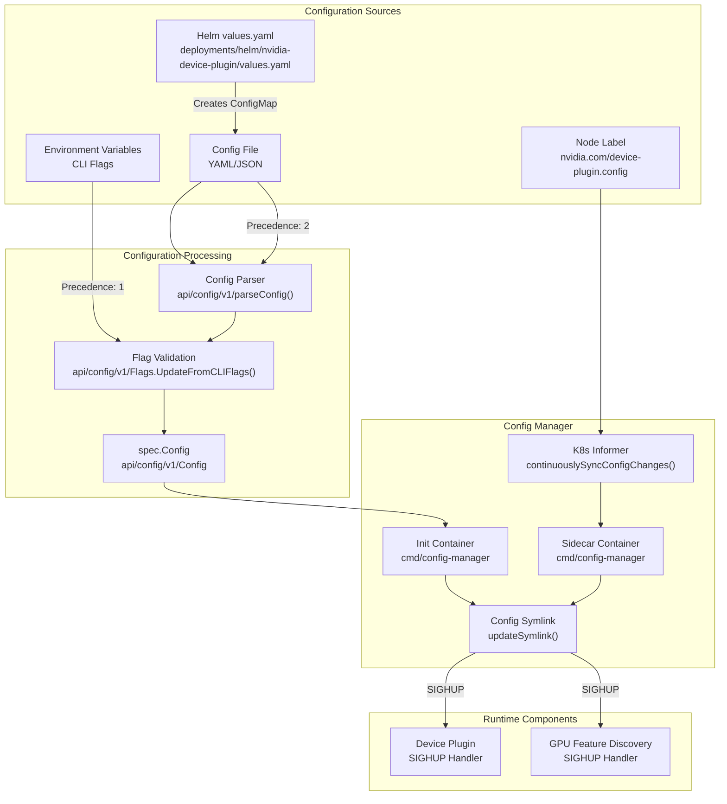
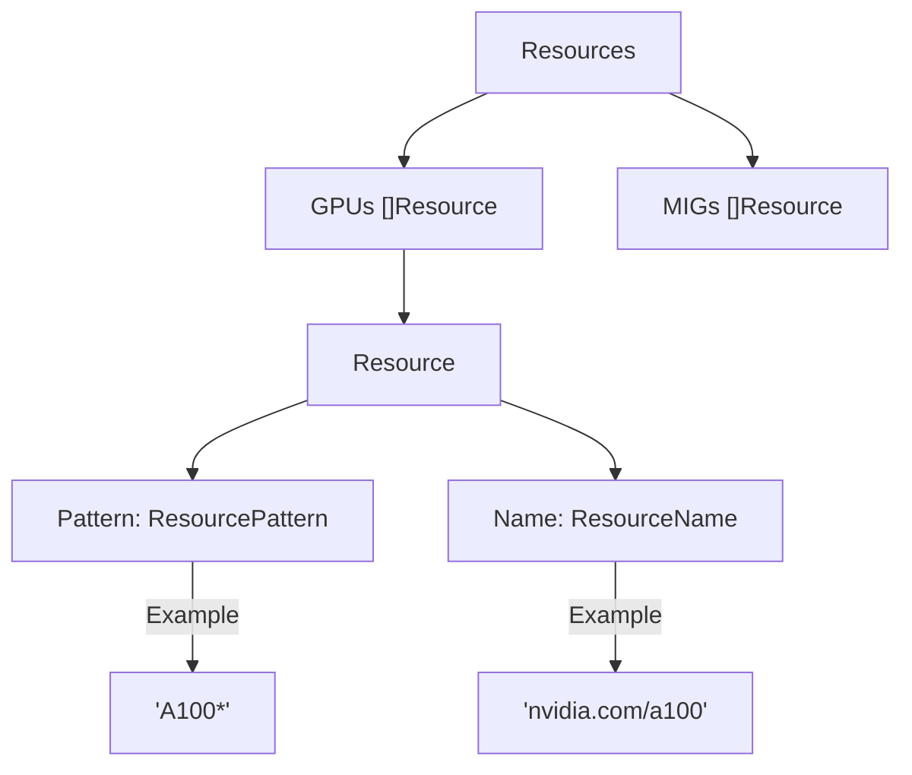
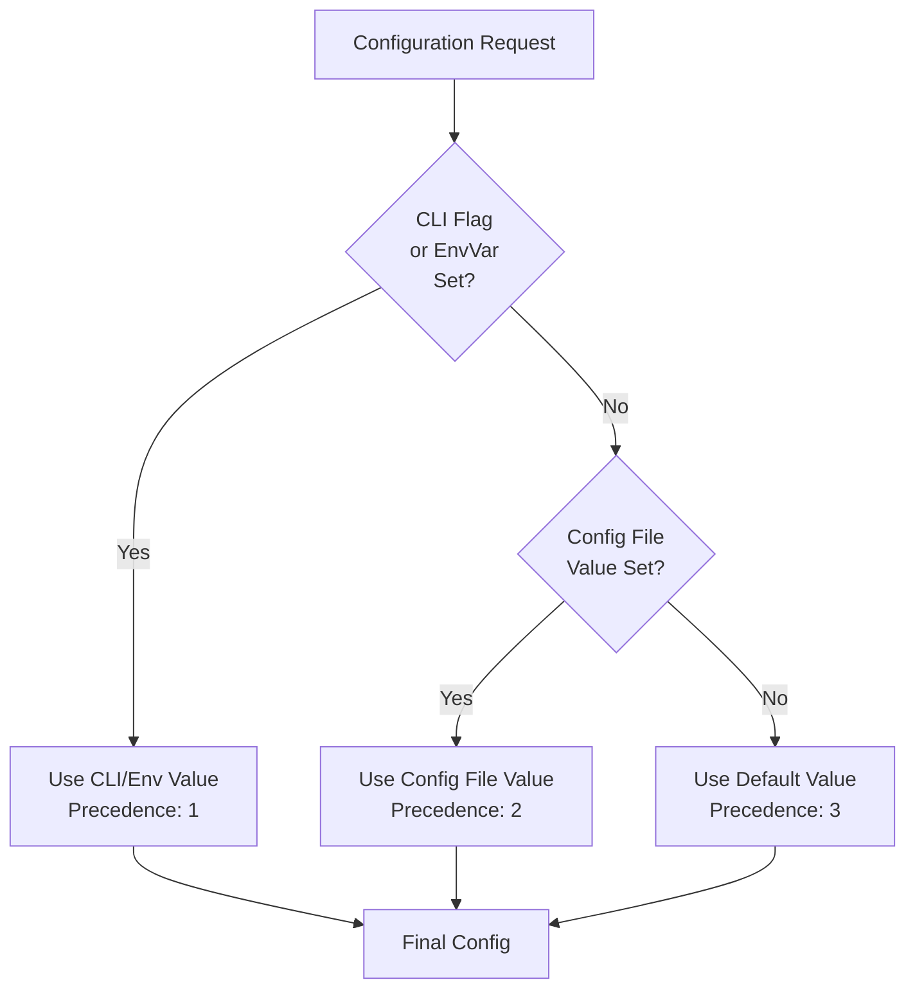
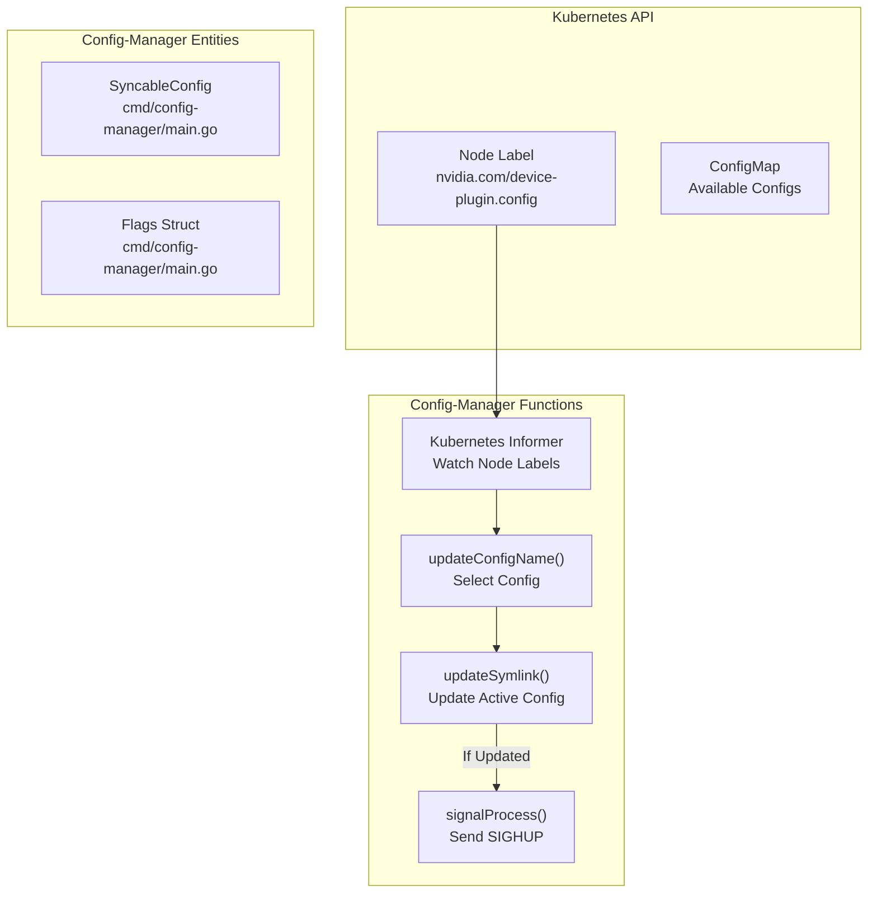

<!-- source: DeepWiki mcp.deepwiki.com · repo NVIDIA/k8s-device-plugin · page 5 Configuration Management · fetched 2026-10-26 -->

# Configuration Management

<details>
<summary>Relevant source files</summary>

The following files were used as context for generating this wiki page:

- [api/config/v1/config.go](api/config/v1/config.go)
- [api/config/v1/consts.go](api/config/v1/consts.go)
- [api/config/v1/duration.go](api/config/v1/duration.go)
- [api/config/v1/flags.go](api/config/v1/flags.go)
- [api/config/v1/flags_test.go](api/config/v1/flags_test.go)
- [api/config/v1/replicas.go](api/config/v1/replicas.go)
- [api/config/v1/replicas_test.go](api/config/v1/replicas_test.go)
- [api/config/v1/resources.go](api/config/v1/resources.go)
- [api/config/v1/sharing.go](api/config/v1/sharing.go)
- [cmd/config-manager/main.go](cmd/config-manager/main.go)
- [cmd/gpu-feature-discovery/main.go](cmd/gpu-feature-discovery/main.go)
- [cmd/gpu-feature-discovery/main_test.go](cmd/gpu-feature-discovery/main_test.go)
- [cmd/gpu-feature-discovery/mig_test.go](cmd/gpu-feature-discovery/mig_test.go)
- [deployments/helm/nvidia-device-plugin/templates/_helpers.tpl](deployments/helm/nvidia-device-plugin/templates/_helpers.tpl)
- [deployments/helm/nvidia-device-plugin/templates/configmap.yml](deployments/helm/nvidia-device-plugin/templates/configmap.yml)
- [deployments/helm/nvidia-device-plugin/templates/role-binding.yml](deployments/helm/nvidia-device-plugin/templates/role-binding.yml)
- [deployments/helm/nvidia-device-plugin/templates/role.yml](deployments/helm/nvidia-device-plugin/templates/role.yml)
- [deployments/helm/nvidia-device-plugin/templates/service-account.yml](deployments/helm/nvidia-device-plugin/templates/service-account.yml)
- [deployments/helm/nvidia-device-plugin/templates/validation.yml](deployments/helm/nvidia-device-plugin/templates/validation.yml)
- [deployments/helm/nvidia-device-plugin/values.yaml](deployments/helm/nvidia-device-plugin/values.yaml)
- [internal/lm/labeler.go](internal/lm/labeler.go)
- [internal/lm/labels.go](internal/lm/labels.go)
- [internal/resource/factory.go](internal/resource/factory.go)
- [internal/rm/allocate.go](internal/rm/allocate.go)

</details>


This page documents the configuration system for the NVIDIA Kubernetes Device Plugin, including the configuration schema, configuration sources, precedence rules, and the dynamic configuration management capabilities enabled by the `config-manager` component.

For information about specific configuration options like MIG strategies, see [Multi-Instance GPU (MIG) Support](#6). For details about GPU sharing mechanisms including time-slicing and MPS configuration, see [GPU Sharing Mechanisms](#7).

---

## Configuration Architecture

The device plugin configuration system supports multiple configuration sources with a well-defined precedence hierarchy and enables runtime configuration updates without pod restarts.

### Configuration Flow



**Sources:** [api/config/v1/config.go:42-81](), [cmd/config-manager/main.go:230-254](), [deployments/helm/nvidia-device-plugin/values.yaml:1-28]()

---

## Configuration Schema

The configuration is defined by the `spec.Config` struct in the `api/config/v1` package, which uses a versioned schema to ensure compatibility.

### Core Configuration Structure

| Field | Type | Description |
|-------|------|-------------|
| `version` | string | Configuration schema version (must be `"v1"`) |
| `flags` | Flags | Plugin behavior flags and options |
| `resources` | Resources | Resource naming and pattern matching configuration |
| `sharing` | Sharing | GPU sharing configuration (time-slicing, MPS) |
| `imex` | Imex | IMEX channel configuration |

**Sources:** [api/config/v1/config.go:34-40]()

### Flags Configuration

The `Flags` struct contains the primary configuration options for device plugin behavior. These can be updated from CLI context using `UpdateFromCLIFlags`.

```mermaid
graph LR
    subgraph "api/config/v1/Flags"
        MigStrategy["MigStrategy<br/>*string"]
        DeviceListStrategy["DeviceListStrategy<br/>[]string"]
        DeviceIDStrategy["DeviceIDStrategy<br/>*string"]
        NvidiaDriverRoot["NvidiaDriverRoot<br/>*string"]
        NvidiaDevRoot["NvidiaDevRoot<br/>*string"]
        PassDeviceSpecs["PassDeviceSpecs<br/>*bool"]
        CDIConfig["Plugin.CDI<br/>CDI configuration"]
    </支撑Config>
    
    MigStrategy -->|"Values"| MigValues["none<br/>single<br/>mixed"]
    DeviceListStrategy -->|"Values"| DLSValues["envvar<br/>volume-mounts<br/>cdi-annotations<br/>cdi-cri"]
    DeviceIDStrategy -->|"Values"| DIDValues["uuid<br/>index"]
```

**Sources:** [api/config/v1/flags.go:54-82](), [api/config/v1/flags.go:117-174](), [api/config/v1/consts.go:24-56]()

### Resources Configuration

The `Resources` struct enables resource naming patterns for GPU and MIG devices. Note that `DisableResourceNamingInConfig` currently clears these fields as the feature is being finalized.



**Sources:** [api/config/v1/config.go:85-97](), [api/config/v1/resources.go:28-44]()

### Sharing Configuration

The `Sharing` struct defines GPU sharing strategies:

| Strategy | Field | Description |
|----------|-------|-------------|
| Time-Slicing | `timeSlicing` | Replicates GPU resources for oversubscription |
| MPS | `mps` | Multi-Process Service for process-level sharing |

Both strategies use the `ReplicatedResources` type to specify which devices to replicate and how many replicas to create.

**Sources:** [api/config/v1/sharing.go:19-54](), [api/config/v1/replicas.go:29-34]()

---

## Configuration Sources and Precedence

Configuration values are merged from multiple sources with a clearly defined precedence hierarchy.

### Precedence Order



**Precedence Hierarchy** (highest to lowest):
1. **CLI Flags / Environment Variables** - Handled via `UpdateFromCLIFlags`
2. **Config File** - Parsed via `parseConfig`
3. **Default Values** - Hardcoded defaults or fallback strategies

**Sources:** [api/config/v1/config.go:42-56](), [api/config/v1/flags.go:32-51]()

### Helm Chart Configuration

The Helm chart provides the primary interface for configuration:

```yaml
config:
  name: "" # External ConfigMap reference
  map: {}  # Embedded ConfigMap with multiple named configurations
  default: "" # Default configuration to use
  fallbackStrategies: ["named", "single"] # Fallback strategies
```

**Sources:** [deployments/helm/nvidia-device-plugin/values.yaml:20-28]()

---

## Dynamic Configuration Updates

The `config-manager` component enables runtime configuration updates by watching for changes to a node label and updating the active configuration without requiring pod restarts.

### Config-Manager Architecture



**Sources:** [cmd/config-manager/main.go:63-115](), [cmd/config-manager/main.go:230-254]()

### Sidecar Mode

The `config-manager` can run as a sidecar container (`ONESHOT=false`) to continuously watch for configuration changes. When a node label changes, it can send a signal (default `SIGHUP`) to the target process.

**Sources:** [cmd/config-manager/main.go:44-50](), [cmd/config-manager/main.go:128-205]()

---

## Fallback Strategies

When no configuration is explicitly selected via node label, the config-manager applies fallback strategies defined in `FallbackStrategies`.

| Strategy | Behavior |
|----------|----------|
| `named` | Look for a configuration named `"default"` |
| `single` | If exactly one configuration exists, use it |
| `empty` | Use an empty configuration |

**Sources:** [cmd/config-manager/main.go:53-57](), [deployments/helm/nvidia-device-plugin/values.yaml:27-28]()

---

## Security Context Derivation

The Helm chart automatically determines required security contexts based on configuration. For example, if any MIG strategy is not `none`, or if `volume-mounts` is used, the plugin requires `CAP_SYS_ADMIN`.

**Sources:** [deployments/helm/nvidia-device-plugin/templates/_helpers.tpl:127-159](), [deployments/helm/nvidia-device-plugin/templates/_helpers.tpl:164-185]()

---

