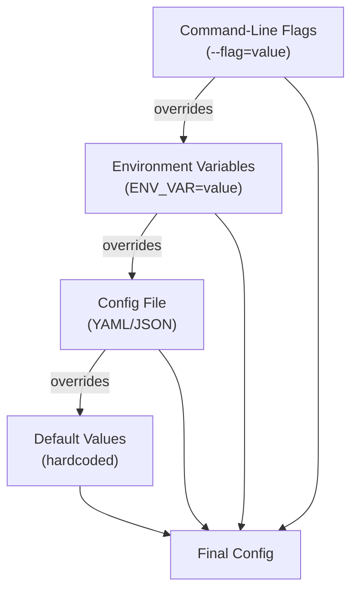
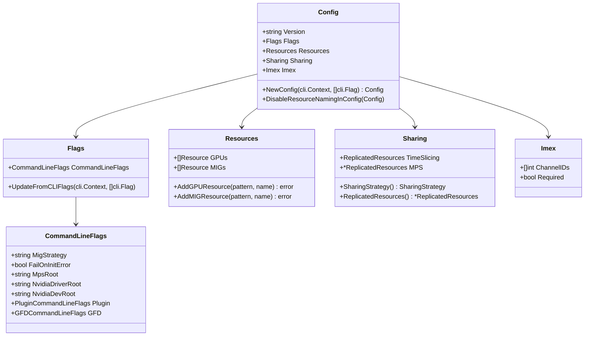
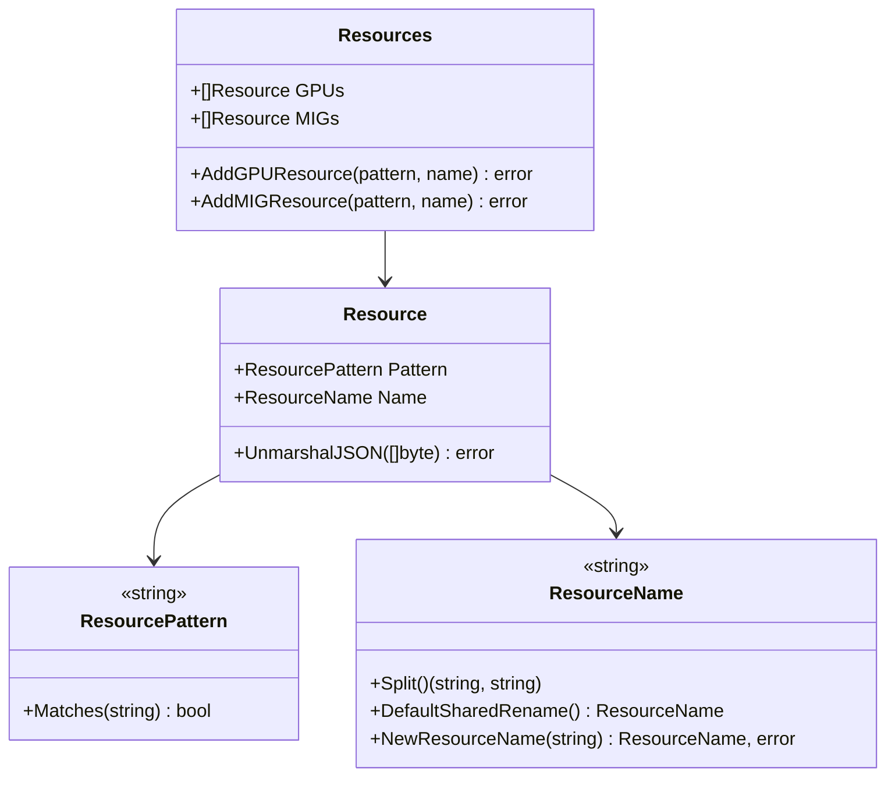
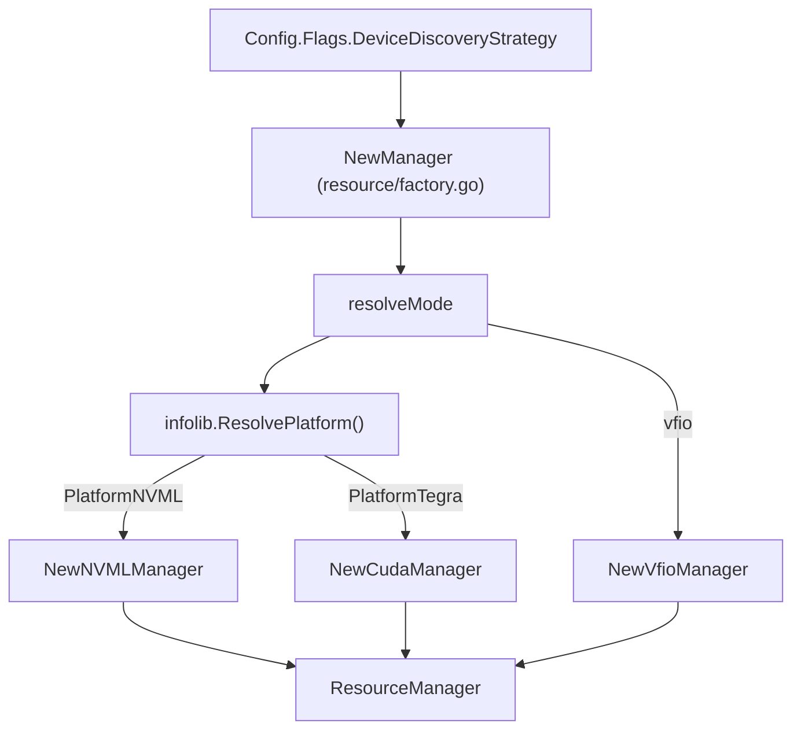
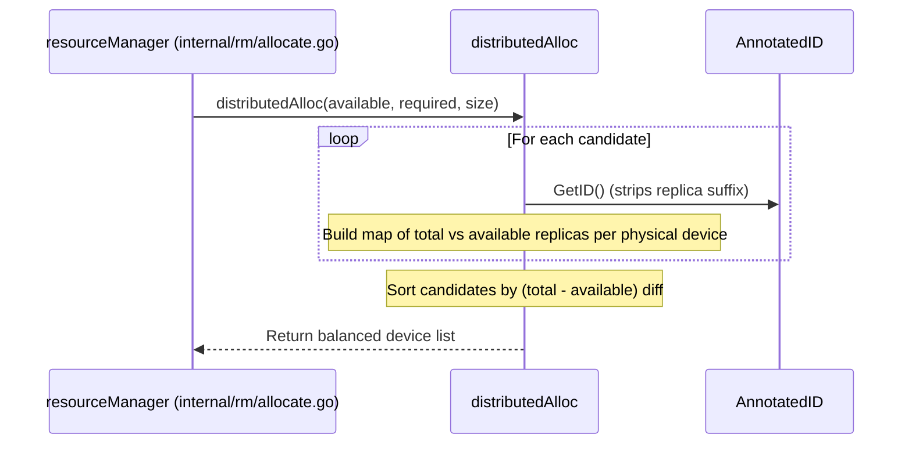

<!-- source: DeepWiki mcp.deepwiki.com · repo NVIDIA/k8s-device-plugin · page 5.1 Configuration Schema and Options · fetched 2026-10-26 -->

# Configuration Schema and Options

Relevant source files

The following files were used as context for generating this wiki page:

- [api/config/v1/config.go](api/config/v1/config.go)
- [api/config/v1/consts.go](api/config/v1/consts.go)
- [api/config/v1/duration.go](api/config/v1/duration.go)
- [api/config/v1/flags.go](api/config/v1/flags.go)
- [api/config/v1/flags_test.go](api/config/v1/flags_test.go)
- [api/config/v1/replicas.go](api/config/v1/replicas.go)
- [api/config/v1/replicas_test.go](api/config/v1/replicas_test.go)
- [api/config/v1/resources.go](api/config/v1/resources.go)
- [api/config/v1/sharing.go](api/config/v1/sharing.go)
- [cmd/gpu-feature-discovery/main.go](cmd/gpu-feature-discovery/main.go)
- [cmd/gpu-feature-discovery/main_test.go](cmd/gpu-feature-discovery/main_test.go)
- [cmd/gpu-feature-discovery/mig_test.go](cmd/gpu-feature-discovery/mig_test.go)
- [internal/lm/labeler.go](internal/lm/labeler.go)
- [internal/lm/labels.go](internal/lm/labels.go)
- [internal/resource/factory.go](internal/resource/factory.go)
- [internal/rm/allocate.go](internal/rm/allocate.go)

This document details the configuration schema for the NVIDIA Kubernetes Device Plugin, including all configuration structures, validation rules, and precedence ordering. Configuration controls device discovery, resource naming, sharing strategies, and runtime behavior.

For information about dynamic configuration updates via the config-manager sidecar, see [Dynamic Configuration Updates](#5.2). For details on resource replication and sharing mechanisms, see [Resource Naming and Replication](#5.3).

---

## Purpose and Scope

The device plugin accepts configuration from multiple sources with a clear precedence hierarchy: command-line flags override environment variables, which override configuration file settings. The configuration schema is versioned (currently `v1`) and includes settings for:

- Runtime flags (paths, strategies, operational modes)
- Resource naming and pattern matching
- GPU sharing via time-slicing or MPS
- IMEX channel configuration
- CDI integration options

All configuration is defined in the `api/config/v1` package, with the root structure in [api/config/v1/config.go:34-40]().

---

## Configuration Precedence

Configuration values are resolved in the following order (highest to lowest priority):

**Configuration Resolution Flow**

The `NewConfig` function implements this precedence hierarchy in [api/config/v1/config.go:45-81]():

1. If `--config-file` is specified, parse YAML/JSON configuration.
2. Apply command-line flags via `UpdateFromCLIFlags` (overrides file values) [api/config/v1/flags.go:117-183]().
3. Apply special handling for IMEX flags if set [api/config/v1/config.go:59-64]().
4. Set default values (e.g., `NvidiaDevRoot` defaults to `NvidiaDriverRoot`) [api/config/v1/config.go:68-70]().
5. Enforce invariants (e.g., MPS `FailRequestsGreaterThanOne` always true) [api/config/v1/config.go:76-78]().

**Sources:** [api/config/v1/config.go:45-81](), [api/config/v1/flags.go:117-183]()

---

## Configuration Structure

### Root Config Object

**Main Configuration Schema**

The `Config` struct at [api/config/v1/config.go:34-40]() represents the complete configuration:

| Field | Type | Description |
|-------|------|-------------|
| `Version` | `string` | Schema version (currently `"v1"`) |
| `Flags` | `Flags` | Runtime flags and operational settings |
| `Resources` | `Resources` | GPU and MIG resource naming configuration |
| `Sharing` | `Sharing` | Time-slicing and MPS sharing settings |
| `Imex` | `Imex` | IMEX channel configuration |

**Sources:** [api/config/v1/config.go:34-40](), [api/config/v1/flags.go:54-72]()

### Configuration File Format

Configuration files are parsed as YAML or JSON by [api/config/v1/config.go:99-139](). The `Flags` struct unmarshals settings into `CommandLineFlags`, `PluginCommandLineFlags`, and `GFDCommandLineFlags` [api/config/v1/flags.go:54-114]().

**Sources:** [api/config/v1/config.go:99-139](), [api/config/v1/flags.go:54-114]()

---

## Flags Configuration

The `Flags` struct contains runtime operational settings split into common and component-specific flags [api/config/v1/flags.go:59-114]():

### Common Flags
- **MIG Strategy**: `migStrategy` (none, single, mixed) [api/config/v1/consts.go:31-35]().
- **Paths**: `mpsRoot`, `nvidiaDriverRoot`, `nvidiaDevRoot`.
- **Discovery**: `deviceDiscoveryStrategy` (auto, nvml, tegra, vfio) [api/config/v1/flags.go:69]().
- **Features**: `gdrcopyEnabled`, `gdsEnabled`, `mofedEnabled`.

### Plugin-Specific Flags (`PluginCommandLineFlags`)
- **Device List Strategy**: `deviceListStrategy` (envvar, volume-mounts, cdi-annotations, cdi-cri) [api/config/v1/consts.go:38-43]().
- **Device ID Strategy**: `deviceIDStrategy` (uuid, index) [api/config/v1/consts.go:46-49]().
- **CDI**: `cdiAnnotationPrefix`, `nvidiaCTKPath`, `containerDriverRoot`.

### GFD-Specific Flags (`GFDCommandLineFlags`)
- **Intervals**: `sleepInterval`.
- **Outputs**: `outputFile`, `noTimestamp`.

**Sources:** [api/config/v1/flags.go:59-114](), [api/config/v1/consts.go:31-56]()

---

## Resource Naming Configuration

### Resource Structure

### ResourceName Validation

The `ResourceName` type represents a validated Kubernetes resource name [api/config/v1/resources.go:32](). Validation occurs in `NewResourceName` [api/config/v1/resources.go:48-64]():

1. Have the prefix `nvidia.com/` (added automatically if missing) [api/config/v1/resources.go:49-51]().
2. Be ≤ 63 characters total length [api/config/v1/resources.go:53-55]().
3. Follow DNS subdomain naming rules via `k8s.NameIsDNSSubdomain` [api/config/v1/resources.go:58-61]().

**Sources:** [api/config/v1/resources.go:32-64](), [api/config/v1/consts.go:23-28]()

### Resource Pattern Matching

The `ResourcePattern` type supports wildcard matching [api/config/v1/resources.go:28-29](). Pattern matching is implemented by converting wildcards to regular expressions in `wildCardToRegexp` [api/config/v1/resources.go:163-180]().

**Sources:** [api/config/v1/resources.go:28-29](), [api/config/v1/resources.go:163-180]()

---

## Sharing Configuration

### Sharing Strategies

The `Sharing` struct [api/config/v1/sharing.go:20-25]() supports two mutually exclusive strategies:

| Strategy | Field | Description |
|----------|-------|-------------|
| **Time-Slicing** | `TimeSlicing` | Virtual GPU replicas via time-multiplexing |
| **MPS** | `MPS` | GPU sharing via NVIDIA Multi-Process Service |

Strategy selection is determined by `SharingStrategy()` [api/config/v1/sharing.go:36-45]():
- If `MPS != nil` and has replicas > 1, return `SharingStrategyMPS`.
- Else if `TimeSlicing` has replicas > 1, return `SharingStrategyTimeSlicing`.

**Sources:** [api/config/v1/sharing.go:20-54]()

### ReplicatedResources and Replicas

The `ReplicatedResources` struct [api/config/v1/replicas.go:30-34]() defines how devices are replicated. It contains a list of `ReplicatedResource` [api/config/v1/replicas.go:81-86]().

**MPS Invariant:** The config loader [api/config/v1/config.go:76-78]() always sets `FailRequestsGreaterThanOne = true` for MPS, preventing pods from requesting multiple MPS devices.

**Sources:** [api/config/v1/replicas.go:30-86](), [api/config/v1/config.go:76-78]()

### ReplicatedDevices Selection

The `ReplicatedDevices` struct [api/config/v1/replicas.go:90-94]() allows selecting devices for replication via:
1. **All Devices**: `All: true` [api/config/v1/replicas.go:91]().
2. **Count**: `Count: N` [api/config/v1/replicas.go:92]().
3. **Explicit List**: `List: []ReplicatedDeviceRef` [api/config/v1/replicas.go:93]().

The `ReplicatedDeviceRef` type [api/config/v1/replicas.go:97]() supports GPU indices, MIG indices, and UUIDs (both GPU and MIG) [api/config/v1/replicas.go:99-163]().

**Sources:** [api/config/v1/replicas.go:90-163]()

---

## Device Discovery Strategies

The `deviceDiscoveryStrategy` flag [api/config/v1/flags.go:69]() determines which `ResourceManager` is instantiated.

**Manager Resolution Logic**

The `getManager` function [internal/resource/factory.go:54-69]() resolves the strategy:
- `nvml`: Uses `NewNVMLManager` [internal/resource/factory.go:59]().
- `tegra`: Uses `NewCudaManager` [internal/resource/factory.go:62]().
- `vfio`: Uses `NewVfioManager` [internal/resource/factory.go:65]().
- `auto`: Resolves based on the host platform (NVML, WSL, or Tegra) [internal/resource/factory.go:71-84]().

**Sources:** [internal/resource/factory.go:30-84](), [api/config/v1/flags.go:69]()

---

## Allocation and Distribution

When sharing is enabled, the plugin uses a distribution strategy to balance replicas across physical GPUs.

The `distributedAlloc` function [internal/rm/allocate.go:27-80]() ensures that replicated devices are distributed equally across all available physical GPUs by building a mapping of total vs. available replicas for each physical device ID.

**Sources:** [internal/rm/allocate.go:27-80]()

---

## Configuration Validation and Constraints

### Automatic Corrections and Disabling
- **NvidiaDevRoot**: If unset, it defaults to `NvidiaDriverRoot` [api/config/v1/config.go:68-70]().
- **Resource Renaming**: Temporarily disabled via `DisableResourceNamingInConfig` [api/config/v1/config.go:85-97](). This clears `Resources.GPUs`, `Resources.MIGs`, and resets `Rename` fields in sharing configurations [api/config/v1/replicas.go:36-66]().
- **MIG Strategies**: Validated in GFD startup to ensure they match `none`, `single`, `mixed`, or `auto` [cmd/gpu-feature-discovery/main.go:132-142]().

**Sources:** [api/config/v1/config.go:68-97](), [api/config/v1/replicas.go:36-66](), [cmd/gpu-feature-discovery/main.go:132-142]()

---

