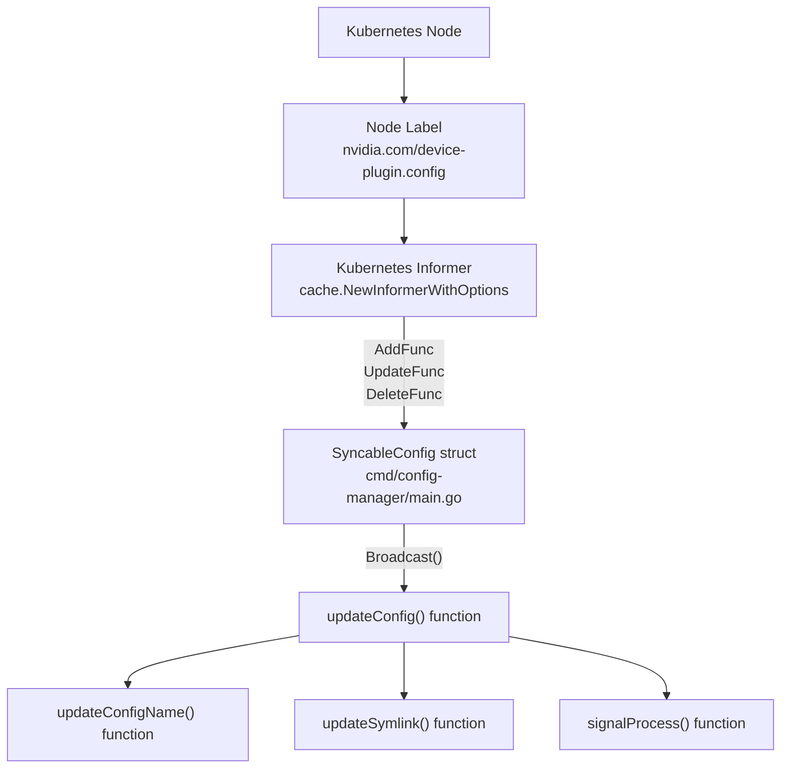
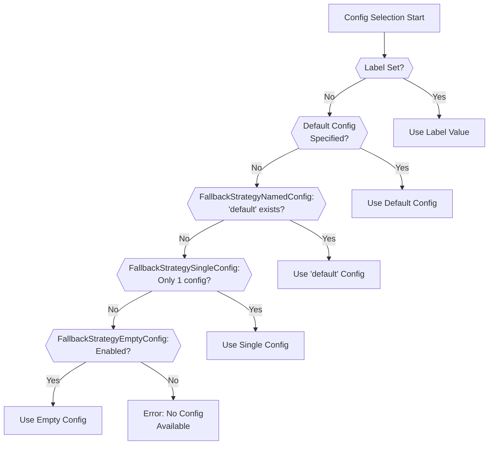
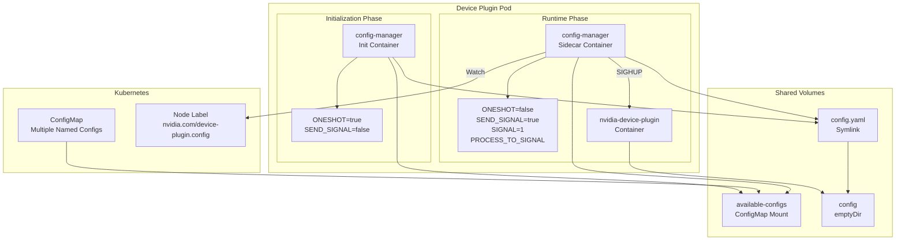
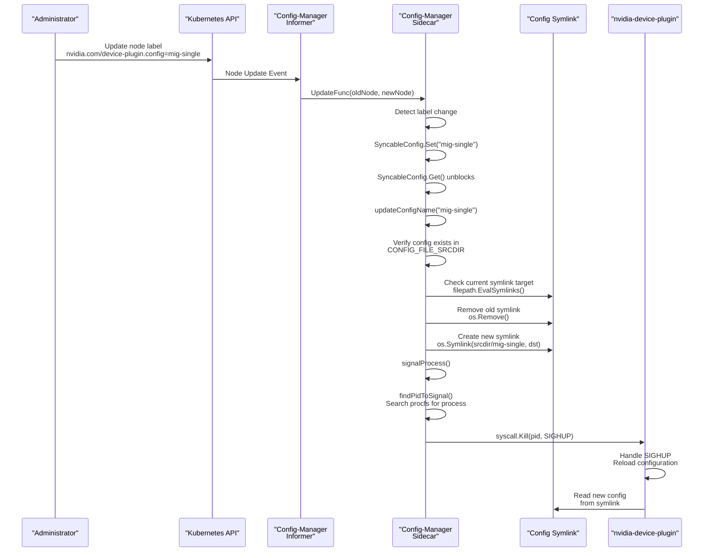
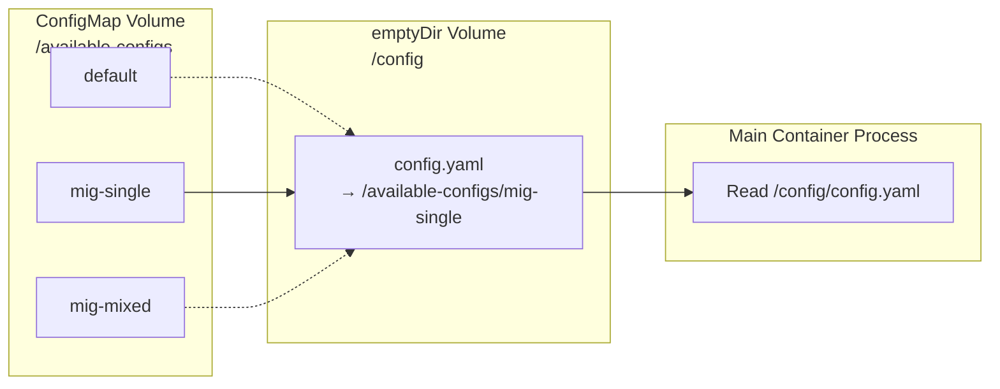
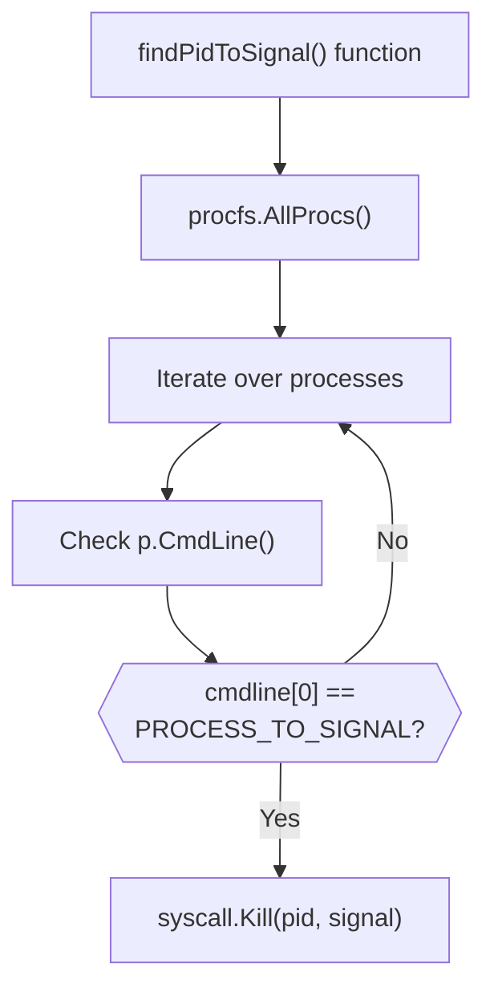
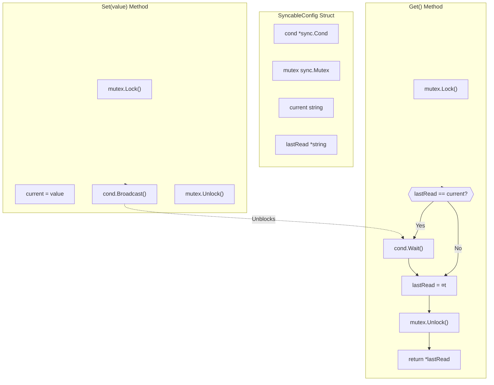

<!-- source: DeepWiki mcp.deepwiki.com · repo NVIDIA/k8s-device-plugin · page 5.2 Dynamic Configuration Updates · fetched 2026-10-26 -->

# Dynamic Configuration Updates

<details>
<summary>Relevant source files</summary>

The following files were used as context for generating this wiki page:

- [cmd/config-manager/main.go](cmd/config-manager/main.go)
- [deployments/helm/nvidia-device-plugin/templates/_helpers.tpl](deployments/helm/nvidia-device-plugin/templates/_helpers.tpl)
- [deployments/helm/nvidia-device-plugin/templates/configmap.yml](deployments/helm/nvidia-device-plugin/templates/configmap.yml)
- [deployments/helm/nvidia-device-plugin/templates/role-binding.yml](deployments/helm/nvidia-device-plugin/templates/role-binding.yml)
- [deployments/helm/nvidia-device-plugin/templates/role.yml](deployments/helm/nvidia-device-plugin/templates/role.yml)
- [deployments/helm/nvidia-device-plugin/templates/service-account.yml](deployments/helm/nvidia-device-plugin/templates/service-account.yml)
- [deployments/helm/nvidia-device-plugin/templates/validation.yml](deployments/helm/nvidia-device-plugin/templates/validation.yml)
- [deployments/helm/nvidia-device-plugin/values.yaml](deployments/helm/nvidia-device-plugin/values.yaml)
- [vendor/github.com/fsnotify/fsnotify/.cirrus.yml](vendor/github.com/fsnotify/fsnotify/.cirrus.yml)
- [vendor/github.com/fsnotify/fsnotify/CHANGELOG.md](vendor/github.com/fsnotify/fsnotify/CHANGELOG.md)
- [vendor/github.com/fsnotify/fsnotify/CONTRIBUTING.md](vendor/github.com/fsnotify/fsnotify/CONTRIBUTING.md)
- [vendor/github.com/fsnotify/fsnotify/README.md](vendor/github.com/fsnotify/fsnotify/README.md)
- [vendor/github.com/fsnotify/fsnotify/backend_fen.go](vendor/github.com/fsnotify/fsnotify/backend_fen.go)
- [vendor/github.com/fsnotify/fsnotify/backend_inotify.go](vendor/github.com/fsnotify/fsnotify/backend_inotify.go)
- [vendor/github.com/fsnotify/fsnotify/backend_kqueue.go](vendor/github.com/fsnotify/fsnotify/backend_kqueue.go)
- [vendor/github.com/fsnotify/fsnotify/backend_other.go](vendor/github.com/fsnotify/fsnotify/backend_other.go)
- [vendor/github.com/fsnotify/fsnotify/backend_windows.go](vendor/github.com/fsnotify/fsnotify/backend_windows.go)

</details>


## Purpose and Scope

This page documents the `config-manager` component that enables runtime configuration changes for the NVIDIA Device Plugin and GPU Feature Discovery (GFD) without requiring pod restarts. The `config-manager` watches Kubernetes node labels and dynamically updates the active configuration by managing symlinks and signaling processes to reload their configuration.

For information about the configuration schema and available options, see [Configuration Schema and Options](#5.1). For information about resource replication and naming controlled by these configurations, see [Resource Naming and Replication](#5.3).

## Overview

The `config-manager` is a sidecar container that runs alongside the Device Plugin or GFD in their respective DaemonSets. It provides dynamic configuration updates by:

1.  Watching a Kubernetes node label for configuration changes.
2.  Selecting an appropriate configuration file from available options based on [Fallback Strategies](#fallback-strategies).
3.  Creating/updating a symlink to the selected configuration.
4.  Sending signals to target processes to trigger configuration reload.

The `config-manager` supports multiple configurations per cluster, allowing different nodes to use different configurations based on their node labels without requiring separate Helm releases.

**Sources:** [cmd/config-manager/main.go:1-211]()

## Configuration Selection Mechanism

### Node Label Watching

The `config-manager` watches a specific node label to determine which configuration to apply. By default, it monitors the `nvidia.com/device-plugin.config` label, but this can be customized via the `--node-label` flag [cmd/config-manager/main.go:150-156]().

Title: Configuration Selection and Update Flow

**Sources:** [cmd/config-manager/main.go:256-293](), [cmd/config-manager/main.go:49-50]()

The informer watches for three types of events:
*   **AddFunc**: Triggered when the node is first seen, sets initial config from label [cmd/config-manager/main.go:264-270]().
*   **UpdateFunc**: Triggered when label changes, updates only if value differs [cmd/config-manager/main.go:271-285]().
*   **DeleteFunc**: Triggered when label is removed, sets config to empty string [cmd/config-manager/main.go:286-290]().

### Fallback Strategies

When no node label is set or no explicit default is configured, the `config-manager` applies fallback strategies in order:

| Strategy | Behavior | Use Case |
| :--- | :--- | :--- |
| `named` | Looks for a config file named `default` [cmd/config-manager/main.go:60]() | Standard convention-based fallback |
| `single` | Selects the only config if exactly one exists in the source directory | Simplified single-config deployments |
| `empty` | Applies an empty configuration | Fail-safe to avoid blocking startup |

Title: Configuration Selection Decision Tree

**Sources:** [cmd/config-manager/main.go:334-392](), [cmd/config-manager/main.go:52-60]()

## Deployment Architecture

### Init Container and Sidecar Pattern

The `config-manager` is deployed using both an init container and a sidecar container to ensure proper initialization and continuous monitoring.

Title: Config-Manager Deployment Architecture

**Sources:** [deployments/helm/nvidia-device-plugin/values.yaml:2-28](), [cmd/config-manager/main.go:44-50]()

### Environment Variables

The `config-manager` accepts the following configuration via flags (often mapped to environment variables in the Helm chart):

| Flag / Env Var | Default | Description |
| :--- | :--- | :--- |
| `ONESHOT` | `false` | If true, update config once and exit (init container mode) [cmd/config-manager/main.go:129-135]() |
| `KUBECONFIG` | `""` | Path to kubeconfig file [cmd/config-manager/main.go:136-142]() |
| `NODE_NAME` | Required | Name of the node to watch for label changes [cmd/config-manager/main.go:143-149]() |
| `NODE_LABEL` | `nvidia.com/device-plugin.config` | Node label to watch for config selection [cmd/config-manager/main.go:150-156]() |
| `CONFIG_FILE_SRCDIR` | Required | Directory containing available config files [cmd/config-manager/main.go:157-163]() |
| `CONFIG_FILE_DST` | Required | Path to destination config symlink [cmd/config-manager/main.go:164-170]() |
| `DEFAULT_CONFIG` | `""` | Explicit default config name [cmd/config-manager/main.go:171-177]() |
| `FALLBACK_STRATEGIES` | `["named","single"]` | Ordered list of fallback strategies [cmd/config-manager/main.go:178-183]() |
| `SEND_SIGNAL` | `true` | Whether to signal process after config update [cmd/config-manager/main.go:184-190]() |
| `SIGNAL` | `1` (SIGHUP) | Signal number to send [cmd/config-manager/main.go:191-197]() |
| `PROCESS_TO_SIGNAL` | `nvidia-device-plugin` | Name of the process to signal [cmd/config-manager/main.go:198-204]() |

**Sources:** [cmd/config-manager/main.go:128-205]()

## Runtime Update Workflow

### Configuration Change Sequence

Title: Dynamic Configuration Update Sequence

**Sources:** [cmd/config-manager/main.go:229-254](), [cmd/config-manager/main.go:295-332](), [cmd/config-manager/main.go:433-460]()

### Symlink Management

The `config-manager` manages configuration through symlinks to enable atomic updates. This provides atomic updates on most filesystems and avoids the need to copy files [cmd/config-manager/main.go:394-431]().

Title: Configuration Symlink Structure

**Sources:** [cmd/config-manager/main.go:394-431]()

### Process Signaling

The `config-manager` uses the `procfs` package to find and signal the target process. It iterates over all processes and matches the process name against the command line [cmd/config-manager/main.go:445-460]().

Title: Process Discovery and Signaling

**Sources:** [cmd/config-manager/main.go:445-460]()

## Integration with Helm Chart

### ConfigMap Generation

The Helm chart can generate a `ConfigMap` with multiple named configurations using the `config.map` value [deployments/helm/nvidia-device-plugin/values.yaml:20-24]().

```yaml
config:
  map:
    default: |-
      version: v1
      flags:
        migStrategy: none
    mig-single: |-
      version: v1
      flags:
        migStrategy: single
```
**Sources:** [deployments/helm/nvidia-device-plugin/templates/configmap.yml:1-14]()

### RBAC Requirements

When using dynamic configuration, the Helm chart creates RBAC resources to allow the `config-manager` to watch node objects.

```yaml
rules:
  - apiGroups: [""]
    resources: ["nodes"]
    verbs: ["get", "list", "watch"]
```
**Sources:** [deployments/helm/nvidia-device-plugin/templates/role.yml:11-13](), [deployments/helm/nvidia-device-plugin/templates/role-binding.yml:4-18]()

## SyncableConfig Implementation

The `SyncableConfig` type provides thread-safe synchronization for configuration changes using a condition variable (`sync.Cond`) [cmd/config-manager/main.go:81-86]().

Title: SyncableConfig Synchronization Mechanism

**Sources:** [cmd/config-manager/main.go:77-115]()

---

