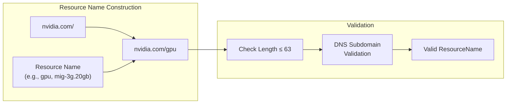
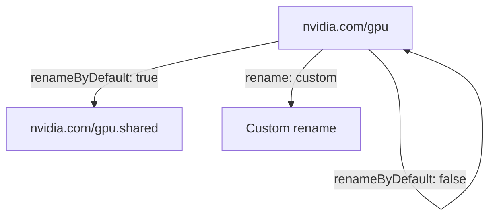
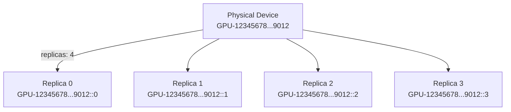
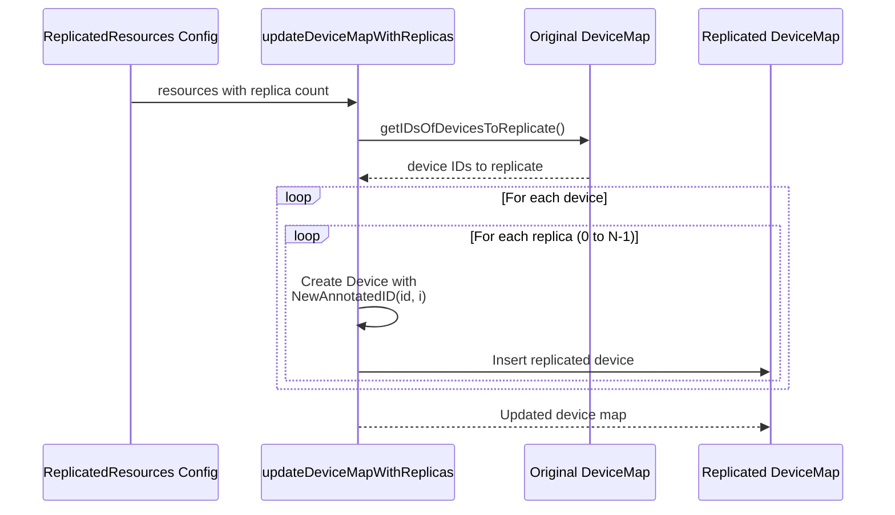
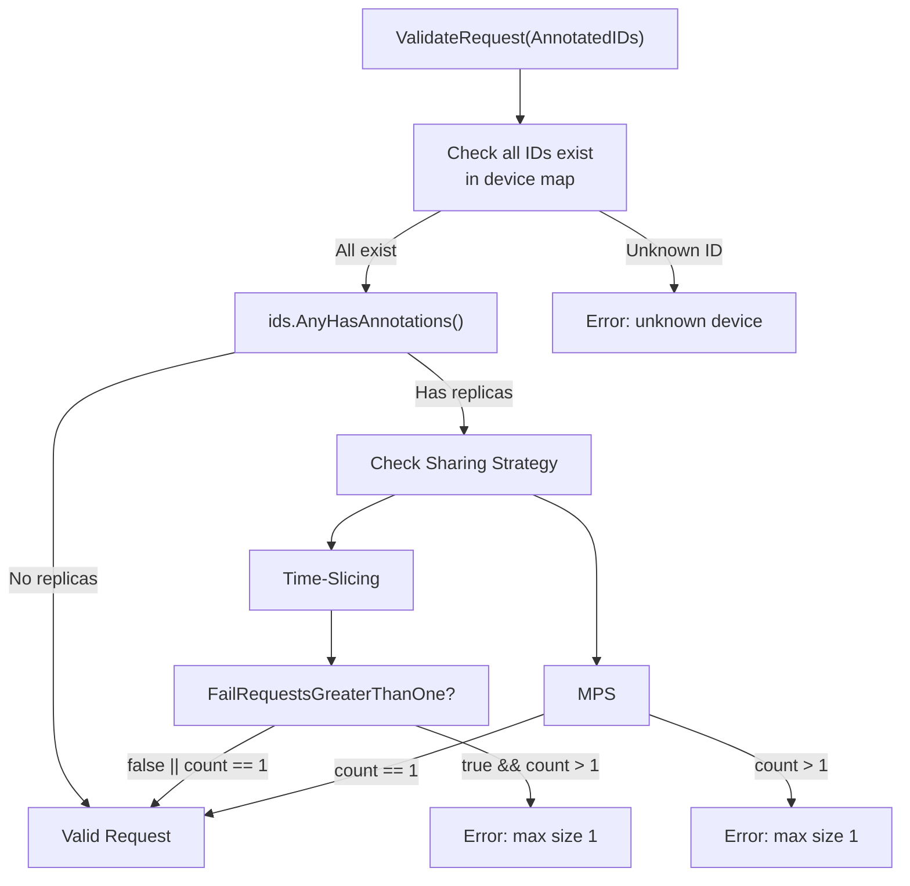
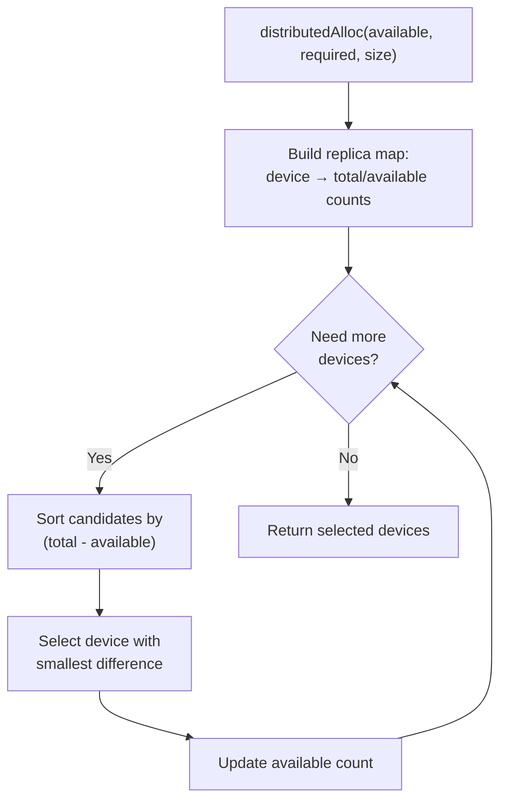

<!-- source: DeepWiki mcp.deepwiki.com · repo NVIDIA/k8s-device-plugin · page 5.3 Resource Naming and Replication · fetched 2026-10-26 -->

# Resource Naming and Replication

<details>
<summary>Relevant source files</summary>

The following files were used as context for generating this wiki page:

- [api/config/v1/config.go](api/config/v1/config.go)
- [api/config/v1/consts.go](api/config/v1/consts.go)
- [api/config/v1/replicas.go](api/config/v1/replicas.go)
- [api/config/v1/replicas_test.go](api/config/v1/replicas_test.go)
- [api/config/v1/resources.go](api/config/v1/resources.go)
- [api/config/v1/sharing.go](api/config/v1/sharing.go)
- [internal/rm/allocate.go](internal/rm/allocate.go)
- [internal/rm/device_map.go](internal/rm/device_map.go)
- [internal/rm/device_map_test.go](internal/rm/device_map_test.go)
- [internal/rm/devices.go](internal/rm/devices.go)
- [internal/rm/health.go](internal/rm/health.go)
- [internal/rm/health_test.go](internal/rm/health_test.go)
- [internal/rm/helper.go](internal/rm/helper.go)
- [internal/rm/nvml_devices.go](internal/rm/nvml_devices.go)
- [internal/rm/nvml_manager.go](internal/rm/nvml_manager.go)
- [internal/rm/rm.go](internal/rm/rm.go)
- [internal/rm/tegra_devices.go](internal/rm/tegra_devices.go)
- [internal/rm/tegra_manager.go](internal/rm/tegra_manager.go)
- [internal/rm/wsl_devices.go](internal/rm/wsl_devices.go)

</details>


## Purpose and Scope

This document describes the resource naming conventions used by the NVIDIA Kubernetes Device Plugin and the replication mechanism that enables GPU sharing through time-slicing and Multi-Process Service (MPS). Resource naming defines how GPU and MIG devices are advertised to Kubernetes, while replication creates multiple virtual instances of physical devices to enable oversubscription.

For information about the sharing strategies that use replication (time-slicing and MPS), see **7. GPU Sharing Mechanisms**. For details on MIG device strategies, see **6.1. MIG Strategies**.

---

## Resource Naming

### Resource Name Format

All resources exposed by the device plugin follow the Kubernetes extended resource naming convention with the prefix `nvidia.com/`. Resource names are represented by the `ResourceName` type and must adhere to DNS subdomain naming rules [api/config/v1/consts.go:25-28]().



**Sources:** [api/config/v1/consts.go:24-28](), [api/config/v1/resources.go:46-64]()

### Default Resource Names

The plugin automatically creates default resource names based on device types. The `AddDefaultResourcesToConfig` function handles this based on the configured MIG strategy [internal/rm/rm.go:116-156]().

| Device Type | Default Resource Name | Pattern |
|-------------|----------------------|---------|
| Full GPU | `nvidia.com/gpu` | `*` (all GPUs) |
| MIG Device (single strategy) | `nvidia.com/gpu` | `*` (all MIG profiles) |
| MIG Device (mixed strategy) | `nvidia.com/mig-<profile>` | e.g., `nvidia.com/mig-3g.20gb` |

For mixed MIG strategy, the resource name is derived from the MIG profile string, replacing `+` with `.` [internal/rm/rm.go:151-152]().

**Sources:** [internal/rm/rm.go:116-156](), [api/config/v1/consts.go:24-28]()

### Shared Resource Naming Convention

When devices are replicated for sharing, they can optionally be renamed to distinguish shared resources from dedicated resources. The default shared resource naming convention appends `.shared` to the original resource name, as defined by `DefaultSharedResourceNameSuffix` [api/config/v1/consts.go:26]().



**Sources:** [api/config/v1/consts.go:26](), [api/config/v1/replicas.go:208-211]()

---

## Device Replication Mechanism

### Annotated Device IDs

Device replication is implemented using an **annotated ID** format that embeds a replica number into the device UUID. This allows the same physical device to be advertised multiple times to Kubernetes with distinct identifiers [internal/rm/devices.go:52-56]().

**Annotated ID Format:**
`<device-uuid>::<replica-number>`

For example, if GPU with UUID `GPU-12345678...` is replicated 4 times, the replicas are identified as `GPU-12345678...::0` through `GPU-12345678...::3` [internal/rm/devices.go:243-245]().



**Sources:** [internal/rm/devices.go:52-56](), [internal/rm/devices.go:242-267]()

### AnnotatedID Type and Operations

The `AnnotatedID` type provides methods for working with replicated device identifiers [internal/rm/devices.go:53-56]().

| Method | Purpose | Implementation |
|--------|---------|----------------|
| `NewAnnotatedID(id, replica)` | Create annotated ID | `fmt.Sprintf("%s::%d", id, replica)` [internal/rm/devices.go:243-245]() |
| `HasAnnotations()` | Check if ID has replica info | `strings.SplitN(string(r), "::", 2)` [internal/rm/devices.go:248-251]() |
| `Split()` | Extract UUID and replica number | Returns `(string, int)` [internal/rm/devices.go:254-261]() |
| `GetID()` | Get base UUID | Returns just the ID part [internal/rm/devices.go:264-267]() |

**Sources:** [internal/rm/devices.go:242-267]()

### Replica Creation Process

Device replication occurs during the device map building process. The `deviceMapBuilder.build()` function calls `updateDeviceMapWithReplicas` to transform physical devices into replicated ones [internal/rm/device_map.go:62-72]().



**Sources:** [internal/rm/device_map.go:67-72](), [internal/rm/device_map.go:283-347]()

---

## Replication Configuration

### ReplicatedResources Structure

The `ReplicatedResources` configuration defines how devices should be replicated [api/config/v1/replicas.go:30-34]().

```yaml
sharing:
  timeSlicing:
    renameByDefault: true
    failRequestsGreaterThanOne: false
    resources:
      - name: nvidia.com/gpu
        rename: nvidia.com/gpu.shared
        devices: all
        replicas: 4
```

| Field | Purpose |
|-------|---------|
| `renameByDefault` | Apply default `.shared` suffix to all replicated resources [api/config/v1/replicas.go:31]() |
| `failRequestsGreaterThanOne` | Reject pod requests for more than 1 replica [api/config/v1/replicas.go:32]() |
| `resources` | List of `ReplicatedResource` definitions [api/config/v1/replicas.go:33]() |

**Sources:** [api/config/v1/replicas.go:30-34](), [api/config/v1/replicas.go:81-86]()

### Device Selection Strategies

The `devices` field in `ReplicatedResource` supports three selection strategies implemented in `ReplicatedDevices` [api/config/v1/replicas.go:90-94]():

1. **All Devices** (`devices: "all"`): Replicates every device of the specified resource type [api/config/v1/replicas.go:91]().
2. **Count** (`devices: 2`): Replicates the first N devices [api/config/v1/replicas.go:92]().
3. **List** (`devices: [0, "1:0", "GPU-xxx"]`): Replicates specific devices by reference [api/config/v1/replicas.go:93]().

**Device Reference Validation:**
The `ReplicatedDeviceRef` type includes methods to validate references:
- `IsGPUIndex()`: Checks if it's a numeric index [api/config/v1/replicas.go:100-105]().
- `IsMigIndex()`: Checks for `i:j` format [api/config/v1/replicas.go:108-119]().
- `IsUUID()`: Checks for GPU or MIG UUID formats [api/config/v1/replicas.go:122-124]().

**Sources:** [api/config/v1/replicas.go:90-163](), [internal/rm/device_map.go:238-281]()

---

## Validation and Request Handling

### Replica-Aware Validation

The `ValidateRequest` method in `resourceManager` enforces limits on shared resource requests [internal/rm/rm.go:83-113]().



**Sources:** [internal/rm/rm.go:83-113]()

### Distributed Allocation Strategy

When replicas are present, the `distributedAlloc` method ensures fair distribution across physical devices by tracking the difference between total and available replicas for each physical device [internal/rm/allocate.go:27-80]().



**Implementation Detail:** The function builds a mapping of base UUIDs to their current allocation status and sorts candidates such that devices with the fewest allocated replicas are prioritized [internal/rm/allocate.go:38-74]().

**Sources:** [internal/rm/allocate.go:27-80]()

### Device Structure Metadata

Replicated devices store their replica count in the `Device` structure. A value of 0 or 1 indicates the device is not shared [internal/rm/devices.go:37-38]().

```go
type Device struct {
	pluginapi.Device
	Paths             []string
	Index             string
	TotalMemory       uint64
	ComputeCapability string
	// Replicas stores the total number of times this device is replicated.
	Replicas int
}
```

**Sources:** [internal/rm/devices.go:29-38](), [internal/rm/device_map.go:326-342]()

---

