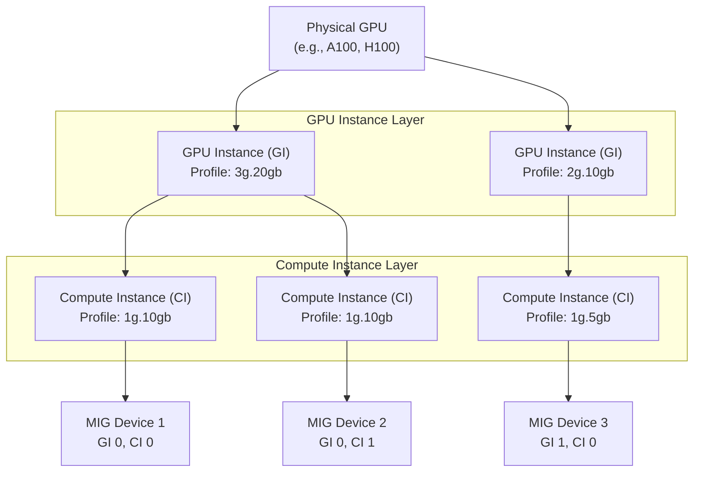
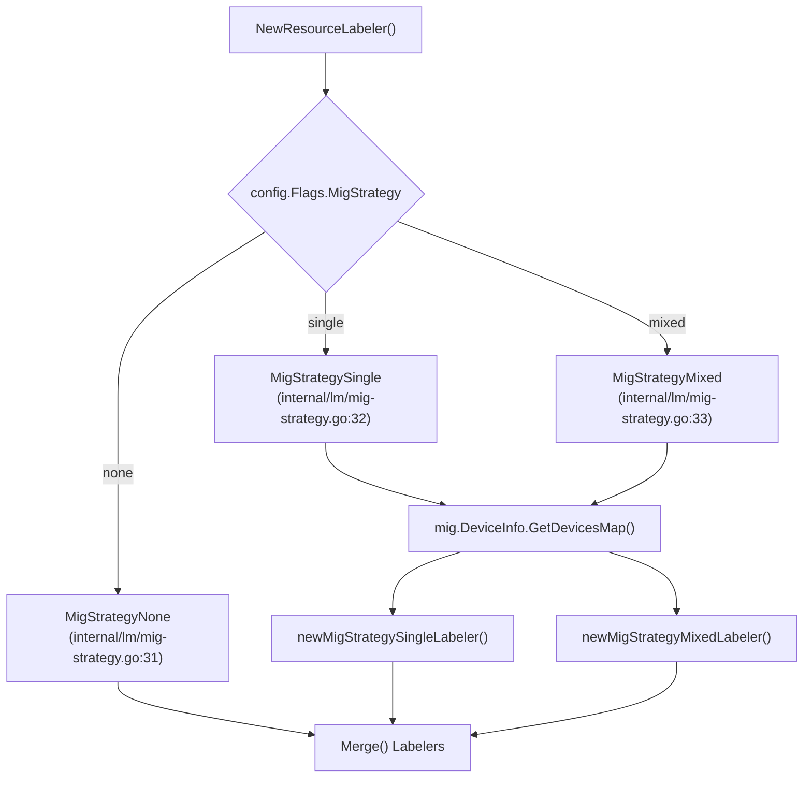
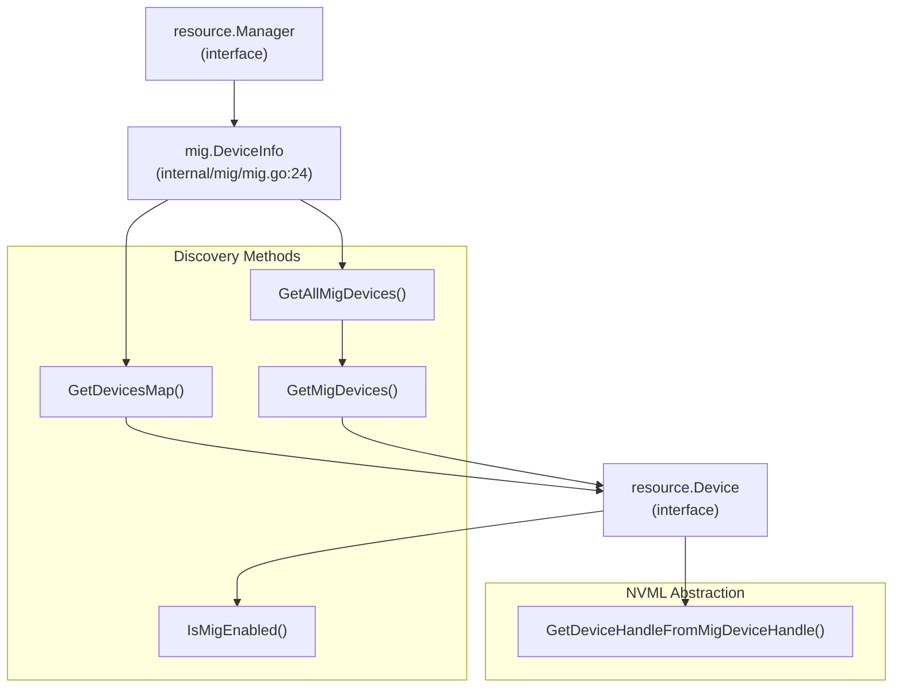
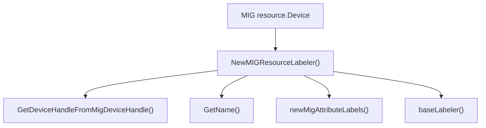

<!-- source: DeepWiki mcp.deepwiki.com · repo NVIDIA/k8s-device-plugin · page 6 Multi-Instance GPU (MIG) Support · fetched 2026-10-26 -->

# Multi-Instance GPU (MIG) Support

Relevant source files

The following files were used as context for generating this wiki page:

- [internal/lm/machine-type.go](internal/lm/machine-type.go)
- [internal/lm/mig-strategy.go](internal/lm/mig-strategy.go)
- [internal/lm/mig-strategy_test.go](internal/lm/mig-strategy_test.go)
- [internal/lm/resource.go](internal/lm/resource.go)
- [internal/lm/resource_test.go](internal/lm/resource_test.go)
- [internal/mig/mig.go](internal/mig/mig.go)

## Purpose and Scope

This document describes how the NVIDIA Kubernetes Device Plugin discovers, manages, and exposes Multi-Instance GPU (MIG) devices to Kubernetes workloads. MIG is a feature available on certain NVIDIA GPU architectures (Ampere and later) that allows a single physical GPU to be partitioned into multiple isolated GPU instances, each with dedicated memory and compute resources.

For information about configuring MIG strategies, see [MIG Strategies](#6.1). For details on how MIG devices are discovered and mapped, see [MIG Device Discovery and Profiles](#6.2).

---

## MIG Device Hierarchy

MIG enables partitioning of a physical GPU into smaller, isolated instances. The partitioning follows a two-level hierarchy:

**GPU Instance (GI)**: The first level of partitioning that divides GPU memory slices, streaming multiprocessors (SMs), and other resources. Each GI has its own memory allocation and compute resources.

**Compute Instance (CI)**: The second level of partitioning within a GPU Instance. A GI can be further subdivided into one or more CIs, each with its own dedicated compute resources within the parent GI's allocation.

**MIG Device**: The final device handle that corresponds to a specific Compute Instance. This is what gets exposed to containers as a usable GPU resource.

Sources: [internal/mig/mig.go:23-124](), [internal/lm/resource.go:75-108]()

---

## MIG Strategies

The device plugin supports three MIG strategies that determine how MIG-enabled GPUs are exposed to Kubernetes. The strategy is configured via the `mig-strategy` field in the device plugin configuration.

### Strategy Comparison

| Strategy | Full GPUs Exposed | MIG Devices Exposed | Use Case |
|----------|------------------|---------------------|----------|
| `none` | Yes | No | No MIG support; expose only full GPUs regardless of MIG configuration |
| `single` | No | Yes (uniform types only) | All GPUs must have identical MIG configuration |
| `mixed` | Yes (if MIG-disabled) | Yes (if MIG-enabled) | Heterogeneous cluster with both MIG and non-MIG GPUs |

### MIG Strategy Flow

Sources: [internal/lm/mig-strategy.go:29-111]()

For details, see [MIG Strategies](#6.1).

---

## MIG Device Discovery

The device plugin discovers MIG devices through a layered abstraction over NVML. The discovery process involves multiple components working together to enumerate and characterize MIG devices.

### Discovery Architecture

Sources: [internal/mig/mig.go:23-124](), [internal/lm/resource.go:81-84]()

### DeviceInfo Component

The `DeviceInfo` struct in `internal/mig/mig.go` provides a high-level interface for querying MIG device information:

**Key Methods**:

| Method | Purpose | Returns |
|--------|---------|---------|
| `GetDevicesMap()` | Returns devices grouped by MIG enabled status | `map[bool][]resource.Device` |
| `AnyMigEnabledDeviceIsEmpty()` | Checks if any MIG GPU has no MIG devices configured | `bool, error` |
| `GetAllMigDevices()` | Returns all MIG devices across all GPUs | `[]resource.Device` |

Sources: [internal/mig/mig.go:41-124]()

For details, see [MIG Device Discovery and Profiles](#6.2).

---

## MIG Resource Naming and Labeling

The device plugin generates resource names and labels for MIG devices based on their profiles and configuration. The naming convention varies by MIG strategy.

### Resource Name Format

**Full GPU**: `nvidia.com/gpu` (defined as `fullGPUResourceName` in [internal/lm/resource.go:30]())

**MIG Device** (mixed strategy): `nvidia.com/mig-<profile>`
- Profile format: `<gi>g.<memory>gb`
- Examples: `nvidia.com/mig-3g.20gb`, `nvidia.com/mig-1g.5gb`

### MIG Label Generation

The `NewMIGResourceLabeler` function in `internal/lm/resource.go` creates a labeler that generates comprehensive labels for MIG devices, including parent device model and MIG attributes.

Sources: [internal/lm/resource.go:75-108](), [internal/lm/resource.go:159-178]()

### Example MIG Labels

For a MIG device, the plugin generates several standard labels:

| Label Key | Value | Description |
|-----------|-------|-------------|
| `.../mig-<profile>.count` | `int` | Number of this MIG type |
| `.../mig-<profile>.product` | `string` | Full product identifier (e.g. `A100-SXM4-40GB-MIG-3g.20gb`) |
| `.../mig-<profile>.replicas` | `int` | Replicas (usually 1 for MIG) |
| `.../mig-<profile>.sharing-strategy` | `string` | Sharing strategy (usually `none` for MIG) |

Sources: [internal/lm/resource.go:159-178](), [internal/lm/resource_test.go:265-437]()

### Product Name Construction

The product name for MIG devices is constructed by combining the parent GPU model name with the MIG profile name. This is handled by `getProductName` in `internal/lm/resource.go`.

Sources: [internal/lm/resource.go:189-206]()

---

