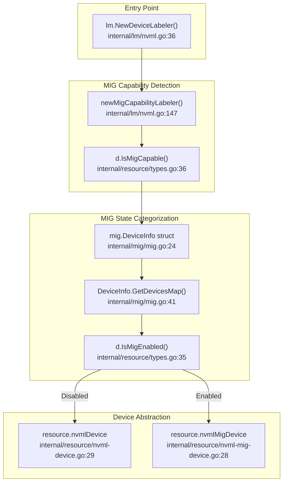
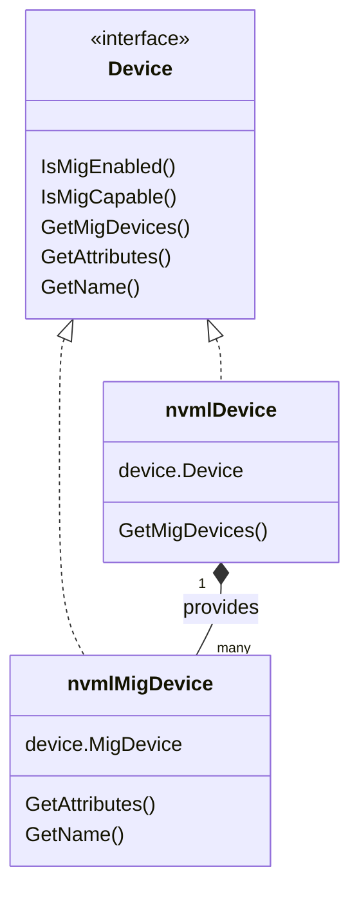

<!-- source: DeepWiki mcp.deepwiki.com · repo NVIDIA/k8s-device-plugin · page 6.1 MIG Strategies · fetched 2026-10-26 -->

# MIG Strategies

<details>
<summary>Relevant source files</summary>

The following files were used as context for generating this wiki page:

- [docs/gpu-feature-discovery/README.md](docs/gpu-feature-discovery/README.md)
- [internal/lm/nvml.go](internal/lm/nvml.go)
- [internal/lm/nvml_test.go](internal/lm/nvml_test.go)
- [internal/mig/mig.go](internal/mig/mig.go)
- [internal/resource/cuda-device.go](internal/resource/cuda-device.go)
- [internal/resource/device_mock.go](internal/resource/device_mock.go)
- [internal/resource/nvml-device.go](internal/resource/nvml-device.go)
- [internal/resource/nvml-lib.go](internal/resource/nvml-lib.go)
- [internal/resource/nvml-mig-device.go](internal/resource/nvml-mig-device.go)
- [internal/resource/sysfs-device.go](internal/resource/sysfs-device.go)
- [internal/resource/testing/resource-testing.go](internal/resource/testing/resource-testing.go)
- [internal/resource/types.go](internal/resource/types.go)
- [tests/expected-output-mig-mixed.txt](tests/expected-output-mig-mixed.txt)
- [tests/expected-output-mig-none.txt](tests/expected-output-mig-none.txt)
- [tests/expected-output-mig-single.txt](tests/expected-output-mig-single.txt)
- [tests/expected-output.txt](tests/expected-output.txt)

</details>


## Purpose and Scope

This document explains the three MIG (Multi-Instance GPU) strategies supported by the NVIDIA device plugin: `none`, `single`, and `mixed`. These strategies determine how MIG-capable GPUs are exposed to Kubernetes as schedulable resources. The document covers the behavior of each strategy, resource naming conventions, configuration methods, and implementation details.

For information about time-slicing or MPS sharing mechanisms that can be applied to MIG resources, see [Time-Slicing Configuration](#7.1) and [Multi-Process Service (MPS)](#7.2). For broader MIG support architecture, see [Multi-Instance GPU (MIG) Support](#6).

---

## What is MIG?

Multi-Instance GPU (MIG) is a feature available on NVIDIA GPUs (such as A100 and H100) that allows a single physical GPU to be partitioned into multiple isolated GPU instances. Each MIG instance has dedicated memory, cache, and compute resources, providing hardware-level isolation between workloads.

MIG instances are identified by their profile, which specifies:
- **Compute slices**: Indicated by a number (e.g., `1g`, `2g`, `3g`, `7g`)
- **Memory size**: Indicated in gigabytes (e.g., `5gb`, `10gb`, `20gb`, `40gb`, `80gb`)

Example MIG profiles: `1g.5gb`, `2g.10gb`, `3g.20gb`, `7g.40gb`

---

## Strategy Overview

The device plugin supports three strategies for exposing MIG devices to Kubernetes, controlled by the `migStrategy` configuration option:

| Strategy | Resource Naming | Use Case |
|----------|----------------|----------|
| `none` (default) | `nvidia.com/gpu` | No MIG support; GPUs exposed as whole units |
| `single` | `nvidia.com/gpu` | All MIG instances exposed as homogeneous resources |
| `mixed` | `nvidia.com/mig-<profile>` | Each MIG profile exposed as a distinct resource type |

**Sources:** [docs/gpu-feature-discovery/README.md:170-170](), [docs/gpu-feature-discovery/README.md:152-171]()

---

## Strategy: none

### Behavior

When `migStrategy: "none"`, the device plugin ignores MIG configuration entirely and exposes GPUs as whole, undivided units. This is the default behavior.

- **MIG-capable GPUs with MIG enabled**: Exposed as regular GPUs (not MIG instances)
- **MIG-capable GPUs with MIG disabled**: Exposed as regular GPUs
- **Non-MIG GPUs**: Exposed as regular GPUs

### Resource Naming

All GPUs are exposed as `nvidia.com/gpu` resources, regardless of MIG capability or configuration.

### Configuration

```yaml
version: v1
flags:
  migStrategy: "none"
```

### When to Use

- Clusters without MIG-capable GPUs
- Environments where full GPU access is required for all workloads
- When MIG functionality is not needed

**Sources:** [docs/gpu-feature-discovery/README.md:170-170](), [internal/lm/nvml.go:145-174]()

---

## Strategy: single

### Behavior

When `migStrategy: "single"`, all MIG instances across all GPUs are aggregated into a single homogeneous pool and exposed as `nvidia.com/gpu` resources. This strategy treats all MIG instances as equivalent, regardless of their profile.

- **MIG instances**: Each instance counts as one `nvidia.com/gpu` resource
- **Non-MIG GPUs**: Each GPU counts as one `nvidia.com/gpu` resource
- **Mixed environments**: MIG and non-MIG GPUs are pooled together

### Resource Naming

All devices (MIG instances and whole GPUs) share the same resource name: `nvidia.com/gpu`

### Limitations

- **No profile differentiation**: Kubernetes cannot distinguish between MIG profiles (e.g., `1g.5gb` vs `7g.40gb`)
- **Unpredictable allocation**: Workloads requesting `nvidia.com/gpu: 1` may receive any MIG profile or a full GPU

### When to Use

- Homogeneous MIG configurations where all instances have the same profile
- Simplified resource management when profile-specific allocation is not required

**Sources:** [docs/gpu-feature-discovery/README.md:19-19](), [tests/expected-output-mig-single.txt:1-35]()

---

## Strategy: mixed

### Behavior

When `migStrategy: "mixed"`, each distinct MIG profile is exposed as a separate Kubernetes resource type. This enables fine-grained scheduling based on specific compute and memory requirements.

- **MIG instances**: Exposed as `nvidia.com/mig-<slice_count>g.<memory_size>gb`
- **Non-MIG GPUs**: Exposed as `nvidia.com/gpu`
- **Profile-specific allocation**: Kubernetes can schedule workloads to specific MIG profiles

### Resource Naming Convention

The resource name encodes the MIG profile. In code, the `+` character in profile strings is replaced with `.` to follow Kubernetes resource naming conventions.

```
nvidia.com/mig-<compute_slices>g.<memory_size>gb
```

**Sources:** [internal/resource/nvml-mig-device.go:95-105](), [docs/gpu-feature-discovery/README.md:20-20]()

---

## MIG Strategy Logic Flow

The following diagram maps the logical decision flow for MIG strategies to the code entities responsible for detection and categorization.

### Logic to Code Entity Mapping



**Sources:** [internal/lm/nvml.go:36-174](), [internal/mig/mig.go:24-64](), [internal/resource/types.go:33-45]()

---

## Implementation Details

### MIG Device Discovery

MIG devices are discovered through the `resource.Manager` interface. The `DeviceInfo` helper in the `mig` package provides the primary logic for partitioning physical GPUs based on their MIG state.

| Function | Location | Purpose |
|----------|----------|---------|
| `GetDevicesMap` | [internal/mig/mig.go:41-64]() | Iterates over all devices and maps them by `IsMigEnabled()` status. |
| `GetAllMigDevices` | [internal/mig/mig.go:109-124]() | Flattens all MIG instances from all MIG-enabled GPUs into a single list. |
| `AnyMigEnabledDeviceIsEmpty` | [internal/mig/mig.go:85-106]() | Validates if any GPU has MIG enabled but no instances configured. |

**Sources:** [internal/mig/mig.go:41-124]()

### Resource Representation

MIG instances are represented by the `nvmlMigDevice` struct, which implements the `resource.Device` interface but restricts certain operations that only apply to full GPUs.



- **`nvmlDevice.GetMigDevices()`**: Calls the underlying NVML library to return instances [internal/resource/nvml-device.go:37-53]().
- **`nvmlMigDevice.GetName()`**: Returns the MIG profile name (e.g., `1g.5gb`) [internal/resource/nvml-mig-device.go:97-105]().
- **`nvmlMigDevice.GetAttributes()`**: Returns compute and memory slice counts [internal/resource/nvml-mig-device.go:36-54]().

**Sources:** [internal/resource/nvml-device.go:29-53](), [internal/resource/nvml-mig-device.go:28-105]()

---

## Labeling and Discovery

The `DeviceLabeler` uses several sub-labelers to communicate MIG status to the Kubernetes node.

### MIG Capability Labeling
The `newMigCapabilityLabeler` checks if any device on the node is MIG-capable. If at least one device returns `true` for `IsMigCapable()`, the node is labeled with `nvidia.com/mig.capable: true`.

**Sources:** [internal/lm/nvml.go:147-174]()

### Resource Labeling
The `ResourceLabeler` (initialized in [internal/lm/nvml.go:73]()) is responsible for generating labels that reflect the specific counts of MIG resources available on the node, which varies significantly between `single` and `mixed` strategies.

### GPU Mode Labeling
MIG-capable GPUs typically operate in compute mode. The `newGPUModeLabeler` identifies the PCI class of the devices to determine if they are in `graphics` or `compute` mode. MIG devices always report as `PCI3dControllerClass` (compute).

**Sources:** [internal/lm/nvml.go:215-226](), [internal/resource/nvml-mig-device.go:141-144]()

---

## Interaction with Sharing Mechanisms

MIG partitioning is hardware-level isolation. However, the plugin allows further software-level sharing on top of MIG or instead of it.

- **MPS Sharing**: Currently, MPS sharing is **not supported** on MIG-enabled devices. The `isMPSCapable` check specifically returns an error if any device has `IsMigEnabled() == true`.
- **Time-Slicing**: Can be used to oversubscribe MIG instances or full GPUs by creating replicas.

**Sources:** [internal/lm/nvml.go:195-211](), [internal/lm/nvml_test.go:166-192]()

---

