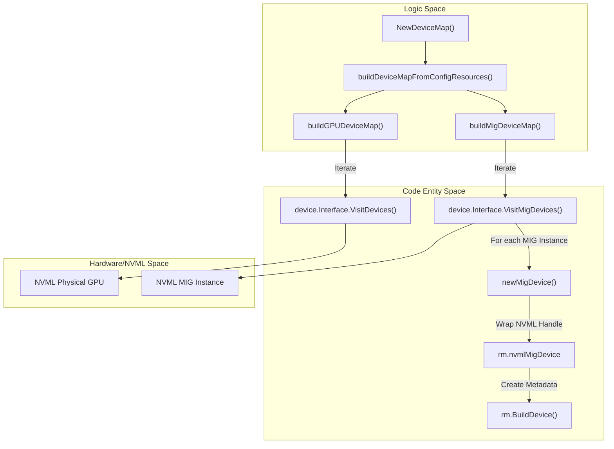

<!-- source: DeepWiki mcp.deepwiki.com · repo NVIDIA/k8s-device-plugin · page 6.2 MIG Device Discovery and Profiles · fetched 2026-10-26 -->

# MIG Device Discovery and Profiles

<details>
<summary>Relevant source files</summary>

The following files were used as context for generating this wiki page:

- [docs/gpu-feature-discovery/README.md](docs/gpu-feature-discovery/README.md)
- [internal/lm/nvml.go](internal/lm/nvml.go)
- [internal/lm/nvml_test.go](internal/lm/nvml_test.go)
- [internal/resource/cuda-device.go](internal/resource/cuda-device.go)
- [internal/resource/device_mock.go](internal/resource/device_mock.go)
- [internal/resource/nvml-device.go](internal/resource/nvml-device.go)
- [internal/resource/nvml-lib.go](internal/resource/nvml-lib.go)
- [internal/resource/nvml-mig-device.go](internal/resource/nvml-mig-device.go)
- [internal/resource/sysfs-device.go](internal/resource/sysfs-device.go)
- [internal/resource/testing/resource-testing.go](internal/resource/testing/resource-testing.go)
- [internal/resource/types.go](internal/resource/types.go)
- [internal/rm/device_map.go](internal/rm/device_map.go)
- [internal/rm/device_map_test.go](internal/rm/device_map_test.go)
- [internal/rm/devices.go](internal/rm/devices.go)
- [internal/rm/health.go](internal/rm/health.go)
- [internal/rm/health_test.go](internal/rm/health_test.go)
- [internal/rm/helper.go](internal/rm/helper.go)
- [internal/rm/nvml_devices.go](internal/rm/nvml_devices.go)
- [internal/rm/nvml_manager.go](internal/rm/nvml_manager.go)
- [internal/rm/rm.go](internal/rm/rm.go)
- [internal/rm/tegra_devices.go](internal/rm/tegra_devices.go)
- [internal/rm/tegra_manager.go](internal/rm/tegra_manager.go)
- [internal/rm/wsl_devices.go](internal/rm/wsl_devices.go)
- [vendor/github.com/NVIDIA/go-nvlib/pkg/nvlib/device/device.go](vendor/github.com/NVIDIA/go-nvlib/pkg/nvlib/device/device.go)
- [vendor/github.com/NVIDIA/go-nvlib/pkg/nvlib/device/mig_profile.go](vendor/github.com/NVIDIA/go-nvlib/pkg/nvlib/device/mig_profile.go)
- [vendor/github.com/NVIDIA/go-nvlib/pkg/nvpci/mmio/mmio.go](vendor/github.com/NVIDIA/go-nvlib/pkg/nvpci/mmio/mmio.go)
- [vendor/github.com/NVIDIA/go-nvlib/pkg/nvpci/mmio/mock.go](vendor/github.com/NVIDIA/go-nvlib/pkg/nvpci/mmio/mock.go)
- [vendor/github.com/NVIDIA/go-nvlib/pkg/nvpci/mock.go](vendor/github.com/NVIDIA/go-nvlib/pkg/nvpci/mock.go)
- [vendor/github.com/NVIDIA/go-nvlib/pkg/nvpci/nvpci.go](vendor/github.com/NVIDIA/go-nvlib/pkg/nvpci/nvpci.go)
- [vendor/github.com/NVIDIA/go-nvlib/pkg/nvpci/nvpci_mock.go](vendor/github.com/NVIDIA/go-nvlib/pkg/nvpci/nvpci_mock.go)
- [vendor/github.com/NVIDIA/go-nvlib/pkg/nvpci/resources.go](vendor/github.com/NVIDIA/go-nvlib/pkg/nvpci/resources.go)
- [vendor/github.com/NVIDIA/go-nvlib/pkg/pciids/default_pci.ids](vendor/github.com/NVIDIA/go-nvlib/pkg/pciids/default_pci.ids)
- [vendor/github.com/NVIDIA/go-nvlib/pkg/pciids/pciids.go](vendor/github.com/NVIDIA/go-nvlib/pkg/pciids/pciids.go)

</details>


Multi-Instance GPU (MIG) support in the NVIDIA Kubernetes Device Plugin relies on a multi-layered discovery process. This process identifies physical GPUs, determines their MIG status, and enumerates individual MIG instances (partitions) as discrete Kubernetes resources.

## MIG Discovery Architecture

The discovery of MIG devices is handled by the `deviceMapBuilder` which coordinates between the high-level configuration and the underlying `nvlib` and `NVML` interfaces.

### Data Flow for MIG Discovery

The following diagram illustrates how the system transitions from physical GPU detection to the registration of specific MIG profiles.

**MIG Discovery Flow**


**Sources:**
- [internal/rm/device_map.go:44-59]()
- [internal/rm/device_map.go:75-107]()
- [internal/rm/device_map.go:137-153]()
- [internal/rm/nvml_devices.go:56-58]()

## MIG Profile Parsing and Matching

MIG profiles represent specific partitions of a GPU's compute and memory resources (e.g., `1g.5gb`). The plugin matches these profiles against patterns defined in the configuration.

### Profile Mapping Process

1.  **Enumeration**: The `VisitMigDevices` function traverses all MIG instances available on the host [internal/rm/device_map.go:139-140]().
2.  **Profile Extraction**: For each instance, the `GetProfile()` method is called to retrieve its standardized string representation [internal/rm/device_map.go:140-141]().
3.  **Pattern Matching**: The plugin compares the profile string against patterns in `config.Resources.MIGs` [internal/rm/device_map.go:144-145]().
4.  **Resource Naming**: If a match is found, the device is associated with the resource name defined in the config (e.g., `nvidia.com/mig-1g.5gb`) [internal/rm/device_map.go:146-147]().

### Default Resource Generation

When `mig-strategy` is set to `mixed`, the plugin automatically generates resource names for all valid MIG profiles discovered on the hardware.

| Function | Role | Logic |
| :--- | :--- | :--- |
| `AddDefaultResourcesToConfig` | Configuration Injection | Populates the config with hardware-detected MIG profiles [internal/rm/rm.go:116-156](). |
| `VisitMigProfiles` | Profile Discovery | Iterates through all possible MIG profiles supported by the hardware [internal/rm/rm.go:146](). |
| `p.String()` | Serialization | Converts a profile to a string like `1g.5gb` [internal/rm/rm.go:151](). |

**Sources:**
- [internal/rm/rm.go:116-156]()
- [internal/rm/device_map.go:137-153]()

## MIG Device Mapping to Kubernetes

Once discovered, a MIG instance is represented as an `rm.Device` struct. This struct contains the necessary metadata for the Kubelet Device Plugin API.

### Mapping Entity Relationship

The following diagram maps the relationships between NVML handles and the internal plugin representations used for Kubernetes registration.

**MIG Entity Mapping**
```mermaid
classDiagram
    class "nvml.Device" {
        <<Interface>>
        GetUUID()
        GetMemoryInfo()
    }
    class "rm.nvmlMigDevice" {
        +nvml.Device Device
        +GetPaths()
        +GetComputeCapability()
    }
    class "rm.Device" {
        +string ID
        +string Index
        +string[] Paths
        +TopologyInfo Topology
    }
    class "pluginapi.Device" {
        +string ID
        +string Health
    }

    "rm.nvmlMigDevice" ..|> "rm.deviceInfo" : implements
    "rm.nvmlMigDevice" o-- "nvml.Device" : wraps
    "rm.Device" o-- "pluginapi.Device" : embeds
    "rm.BuildDevice" ..> "rm.Device" : constructs
    "rm.BuildDevice" --> "rm.deviceInfo" : queries
```

### Key Technical Details

*   **Device Indexing**: MIG devices use a colon-separated index format `GPU_INDEX:MIG_INDEX` (e.g., `0:1`) [internal/rm/nvml_devices.go:56-58]().
*   **Path Discovery**: Unlike physical GPUs, MIG devices require additional capability paths from `/proc/driver/nvidia/capabilities` to allow proper container access [internal/rm/nvml_devices.go:104-147]().
*   **UUID Handling**: The UUID of a MIG device is retrieved directly via NVML, ensuring it is unique within the cluster [internal/rm/nvml_devices.go:70-72]().
*   **NUMA Affinity**: The NUMA node of a MIG device is inherited from its parent physical GPU [internal/rm/nvml_devices.go:177-184]().

**Sources:**
- [internal/rm/devices.go:29-38]()
- [internal/rm/devices.go:59-104]()
- [internal/rm/nvml_devices.go:42-58]()
- [internal/rm/nvml_devices.go:104-147]()

## Health Monitoring for MIG

MIG health is monitored using NVML events. The plugin maps events from the parent GPU to specific MIG instances.

1.  **Placement Resolution**: The plugin determines the `GpuInstanceId` (GI) and `ComputeInstanceId` (CI) for each registered MIG device [internal/rm/health.go:80-87]().
2.  **Event Filtering**: When an `XidCriticalError` occurs, the plugin checks if the event's `GpuInstanceId` matches the specific MIG instance being monitored [internal/rm/health.go:160-167]().
3.  **Unhealthy Reporting**: If a match is found, only the affected MIG instance is marked unhealthy, rather than the entire physical GPU [internal/rm/health.go:169-170]().

**Sources:**
- [internal/rm/health.go:44-172]()
- [internal/rm/health.go:160-167]()

---

