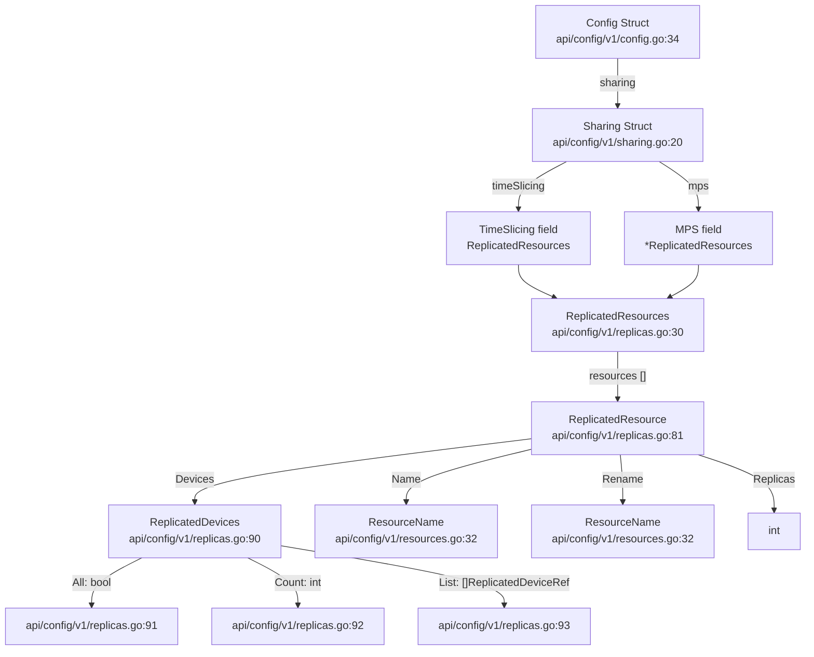
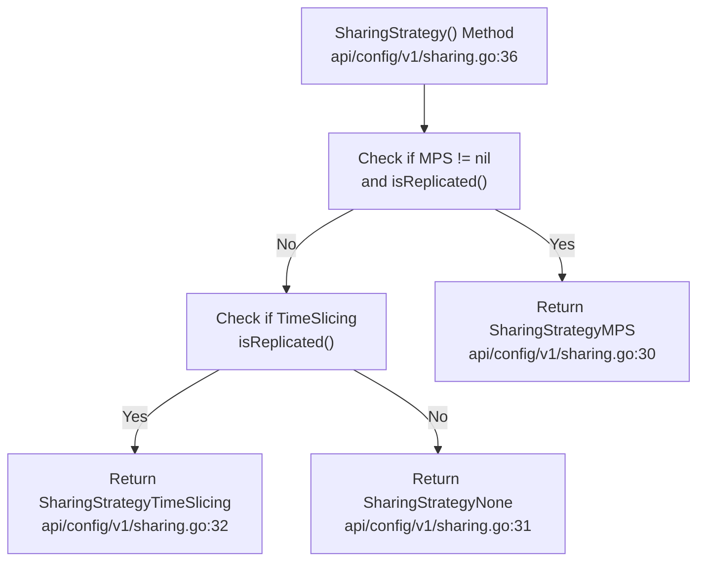
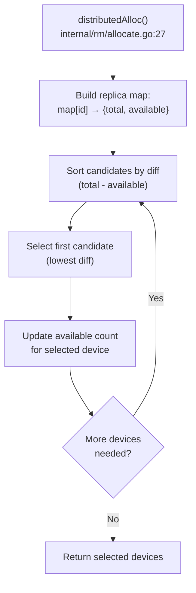
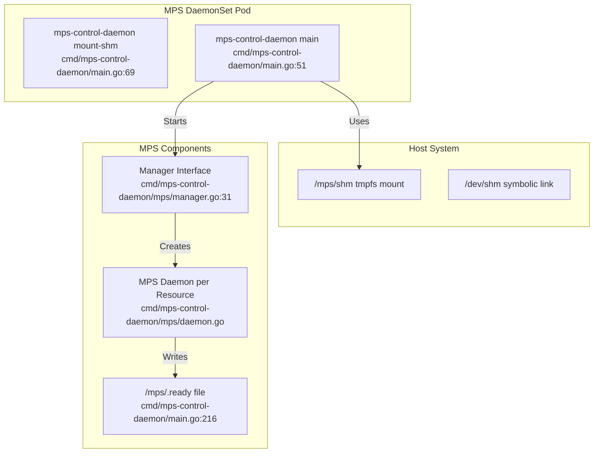

<!-- source: DeepWiki mcp.deepwiki.com · repo NVIDIA/k8s-device-plugin · page 7 GPU Sharing Mechanisms · fetched 2026-10-26 -->

# GPU Sharing Mechanisms

<details>
<summary>Relevant source files</summary>

The following files were used as context for generating this wiki page:

- [api/config/v1/config.go](api/config/v1/config.go)
- [api/config/v1/consts.go](api/config/v1/consts.go)
- [api/config/v1/replicas.go](api/config/v1/replicas.go)
- [api/config/v1/replicas_test.go](api/config/v1/replicas_test.go)
- [api/config/v1/resources.go](api/config/v1/resources.go)
- [api/config/v1/sharing.go](api/config/v1/sharing.go)
- [cmd/mps-control-daemon/main.go](cmd/mps-control-daemon/main.go)
- [cmd/mps-control-daemon/mps/manager.go](cmd/mps-control-daemon/mps/manager.go)
- [cmd/mps-control-daemon/mps/options.go](cmd/mps-control-daemon/mps/options.go)
- [deployments/helm/nvidia-device-plugin/templates/daemonset-device-plugin.yml](deployments/helm/nvidia-device-plugin/templates/daemonset-device-plugin.yml)
- [deployments/helm/nvidia-device-plugin/templates/daemonset-gfd.yml](deployments/helm/nvidia-device-plugin/templates/daemonset-gfd.yml)
- [deployments/helm/nvidia-device-plugin/templates/daemonset-mps-control-daemon.yml](deployments/helm/nvidia-device-plugin/templates/daemonset-mps-control-daemon.yml)
- [internal/rm/allocate.go](internal/rm/allocate.go)

</details>


## Purpose and Scope

This document describes the GPU sharing mechanisms provided by the NVIDIA Kubernetes device plugin. GPU sharing enables multiple containers to access the same physical GPU through two distinct strategies: **time-slicing** and **Multi-Process Service (MPS)**. These mechanisms allow oversubscription of GPU resources, enabling better utilization in scenarios where workloads do not require exclusive GPU access.

For information about MIG (Multi-Instance GPU) partitioning, which provides hardware-level isolation, see [Multi-Instance GPU (MIG) Support](#6). For details on resource allocation algorithms, see [Device Allocation Strategies](#3.3). For configuration file formats and precedence, see [Configuration Management](#5).

---

## Overview of Sharing Mechanisms

The device plugin supports two mutually exclusive GPU sharing mechanisms:

**Time-Slicing**: Creates virtual replicas of physical GPUs by allowing multiple workloads to time-multiplex access to the same GPU. Workloads share the GPU's memory and compute resources without isolation, and all workloads run in the same fault domain.

**MPS (Multi-Process Service)**: Provides space-partitioned sharing where an MPS control daemon manages GPU contexts. Unlike time-slicing, MPS explicitly partitions and enforces memory and compute resource limits per workload.

> **Important**: Time-slicing and MPS are mutually exclusive. A GPU resource can use one sharing method or the other, but not both simultaneously.

Sources: [api/config/v1/sharing.go:19-45](), [api/config/v1/sharing.go:48-54]()

---

## Configuration Structure

### Sharing Configuration Schema

Both sharing mechanisms are configured through the `Sharing` struct in the configuration file:

```yaml
version: v1
sharing:
  timeSlicing:
    renameByDefault: <bool>
    failRequestsGreaterThanOne: <bool>
    resources:
    - name: <resource-name>
      replicas: <num-replicas>
  mps:
    renameByDefault: <bool>
    resources:
    - name: <resource-name>
      replicas: <num-replicas>
```

The `Sharing` type contains two fields representing the two strategies:
- `TimeSlicing`: Configuration for time-slicing sharing [api/config/v1/sharing.go:22]()
- `MPS`: Configuration for MPS sharing (pointer to allow nil check) [api/config/v1/sharing.go:24]()

Each sharing strategy uses the `ReplicatedResources` structure to define which resources should be replicated and how many replicas to create.

**Sharing Configuration Diagram**



Sources: [api/config/v1/config.go:34-40](), [api/config/v1/sharing.go:19-26](), [api/config/v1/replicas.go:30-94]()

---

## Replicated Resources Configuration

### ReplicatedResources Fields

The `ReplicatedResources` struct defines common configuration for both sharing mechanisms [api/config/v1/replicas.go:30-34]():

| Field | Type | Description |
|-------|------|-------------|
| `renameByDefault` | bool | If true, shared resources are advertised as `<resource-name>.shared` by default |
| `failRequestsGreaterThanOne` | bool | If true, container requests for more than one shared resource will fail |
| `resources` | []ReplicatedResource | List of resources to replicate with their configurations |

### ReplicatedResource Fields

Each `ReplicatedResource` specifies [api/config/v1/replicas.go:81-86]():

| Field | Type | Description |
|-------|------|-------------|
| `name` | ResourceName | The base resource name (e.g., `nvidia.com/gpu`) |
| `rename` | ResourceName | Optional renamed resource (e.g., `nvidia.com/gpu.shared`) |
| `devices` | ReplicatedDevices | Which devices to replicate: "all", count, or specific list |
| `replicas` | int | Number of replicas to create |

### ReplicatedDevices Union Type

The `ReplicatedDevices` struct is treated as a union [api/config/v1/replicas.go:88-94]():

1. **All devices**: `All: true` - Apply replication to all available devices.
2. **Count**: `Count: N` - Apply replication to the first N devices.
3. **List**: `List: []ReplicatedDeviceRef` - Apply to specific devices by index or UUID. `ReplicatedDeviceRef` can be a GPU index, MIG index, or UUID [api/config/v1/replicas.go:97-163]().

Sources: [api/config/v1/replicas.go:30-94](), [api/config/v1/replicas.go:97-163]()

---

## Sharing Strategy Detection

The device plugin determines which sharing strategy is active using the `SharingStrategy()` method:



The `isReplicated()` helper method checks if any resource in the configuration has `replicas > 1` [api/config/v1/replicas.go:68-78]().

Sources: [api/config/v1/sharing.go:35-45](), [api/config/v1/replicas.go:68-78]()

---

## Time-Slicing Mechanism

### Overview

Time-slicing allows multiple containers to share a GPU by time-multiplexing access. The device plugin creates virtual replicas of each physical GPU, and the Kubernetes scheduler can allocate these replicas to different containers. For more details, see [Time-Slicing Configuration](#7.1).

### Resource Renaming

With `renameByDefault: true`, resources are advertised with a `.shared` suffix by default [api/config/v1/replicas.go:208-211](). The suffix is defined by `DefaultSharedResourceNameSuffix` [api/config/v1/consts.go:26]().

### Request Validation

Setting `failRequestsGreaterThanOne: true` prevents pods from requesting multiple shared resources [api/config/v1/replicas.go:32](). This helps clarify that a request is for access to a shared resource rather than exclusive hardware.

Sources: [api/config/v1/replicas.go:30-34](), [api/config/v1/consts.go:24-28](), [api/config/v1/replicas.go:207-211]()

---

## Distributed Allocation for Time-Slicing

When time-slicing creates replicas, the device plugin uses a distributed allocation strategy to balance workloads across all replicated GPUs.

### Distributed Allocation Algorithm

The `distributedAlloc()` method in the resource manager ensures even distribution [internal/rm/allocate.go:27]():



The algorithm uses `AnnotatedID` to strip replica suffixes and track the underlying physical device [internal/rm/allocate.go:40]().

Sources: [internal/rm/allocate.go:24-80]()

---

## MPS (Multi-Process Service) Mechanism

### Overview

MPS provides space-partitioned GPU sharing where an MPS control daemon manages GPU contexts. Unlike time-slicing, MPS enforces explicit memory and compute resource limits per workload. For more details, see [Multi-Process Service (MPS)](#7.2).

### MPS Configuration Enforcement

The device plugin automatically sets `failRequestsGreaterThanOne: true` for MPS configurations [api/config/v1/config.go:76-78](). This ensures pods cannot request more than one MPS-shared GPU. Additionally, MPS sharing is not supported for MIG devices; the manager will skip daemon creation for such resources [cmd/mps-control-daemon/mps/manager.go:93-95]().

Sources: [api/config/v1/config.go:72-79](), [cmd/mps-control-daemon/mps/manager.go:91-100]()

---

## MPS Control Daemon

### Architecture

The MPS control daemon is deployed as a separate DaemonSet. It manages MPS server processes for each GPU configured for MPS sharing.

**MPS Daemon Architecture**



### Shared Memory Setup

The `mount-shm` command is responsible for setting up the required shared memory environment [cmd/mps-control-daemon/main.go:61](). The daemon also creates a `.ready` file at `/mps/.ready` once all MPS daemons have successfully started [cmd/mps-control-daemon/main.go:216]().

Sources: [cmd/mps-control-daemon/main.go:51-86](), [cmd/mps-control-daemon/main.go:216-222](), [cmd/mps-control-daemon/mps/manager.go:45-51]()

---

## Configuration Validation and Enforcement

### Configuration Processing

When the device plugin loads configuration, it disables certain features that are not yet fully supported:
- **Resource Renaming**: Customizing the `resources` field in the top-level config is disabled [api/config/v1/config.go:86-91]().
- **Sharing Renaming**: Customizing the `rename` or `devices` field in `Sharing.TimeSlicing.Resources` or `Sharing.MPS.Resources` is currently ignored with a warning [api/config/v1/replicas.go:36-66]().

### Replica Validation

The `ReplicatedResource` unmarshaling validates that replicas are specified and name/devices fields are present [api/config/v1/replicas.go:217-251]().

Sources: [api/config/v1/config.go:83-97](), [api/config/v1/replicas.go:36-66](), [api/config/v1/replicas.go:216-251]()

---

