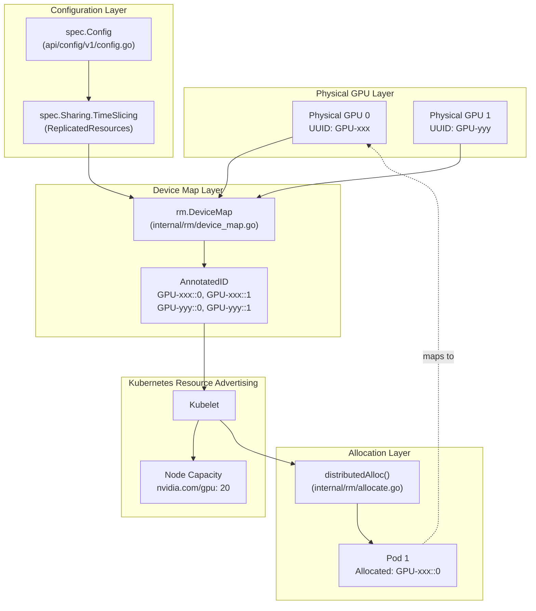
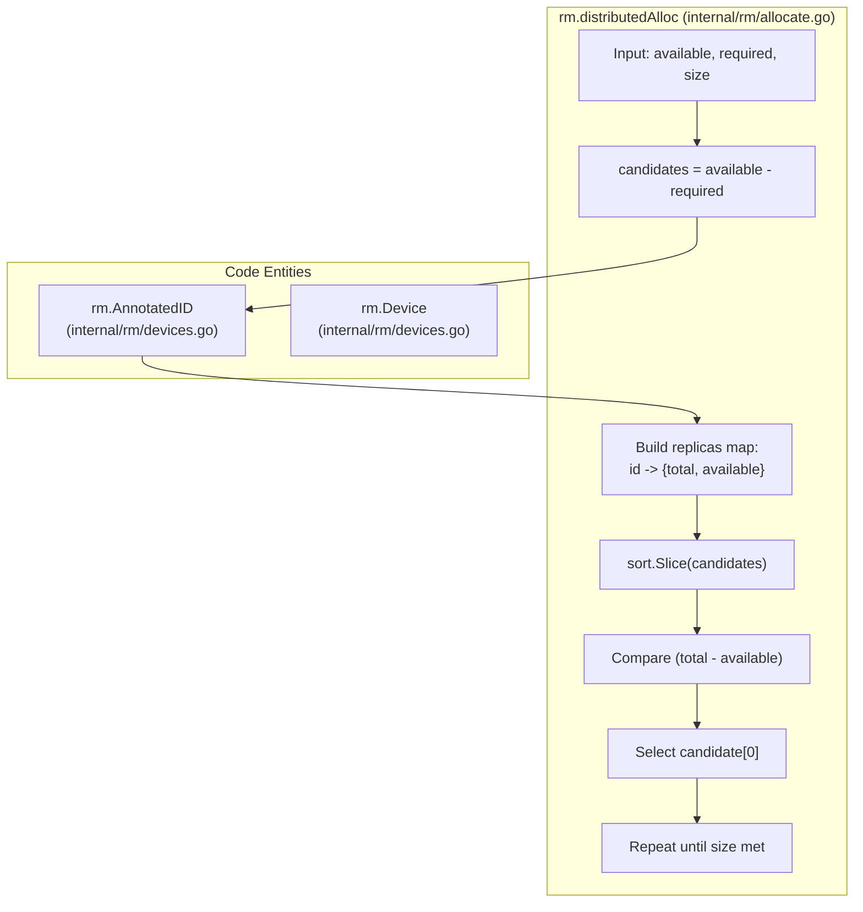

<!-- source: DeepWiki mcp.deepwiki.com · repo NVIDIA/k8s-device-plugin · page 7.1 Time-Slicing Configuration · fetched 2026-10-26 -->

# Time-Slicing Configuration

<details>
<summary>Relevant source files</summary>

The following files were used as context for generating this wiki page:

- [api/config/v1/config.go](api/config/v1/config.go)
- [api/config/v1/consts.go](api/config/v1/consts.go)
- [api/config/v1/replicas.go](api/config/v1/replicas.go)
- [api/config/v1/replicas_test.go](api/config/v1/replicas_test.go)
- [api/config/v1/resources.go](api/config/v1/resources.go)
- [api/config/v1/sharing.go](api/config/v1/sharing.go)
- [internal/rm/allocate.go](internal/rm/allocate.go)
- [internal/rm/device_map.go](internal/rm/device_map.go)
- [internal/rm/device_map_test.go](internal/rm/device_map_test.go)
- [internal/rm/devices.go](internal/rm/devices.go)
- [internal/rm/health.go](internal/rm/health.go)
- [internal/rm/health_test.go](internal/rm/health_test.go)
- [internal/rm/helper.go](internal/rm/helper.go)
- [internal/rm/nvml_devices.go](internal/rm/nvml_devices.go)
- [internal/rm/nvml_manager.go](internal/rm/nvml_manager.go)
- [internal/rm/rm.go](internal/rm/rm.go)
- [internal/rm/tegra_devices.go](internal/rm/tegra_devices.go)
- [internal/rm/tegra_manager.go](internal/rm/tegra_manager.go)
- [internal/rm/wsl_devices.go](internal/rm/wsl_devices.go)

</details>


## Purpose and Scope

This document describes the time-slicing configuration mechanism in the NVIDIA device plugin, which enables GPU oversubscription by creating virtual replicas of physical GPUs. Time-slicing allows multiple containers to share a single GPU through CUDA time-multiplexing, where workloads interleave their execution on the GPU without explicit memory or compute isolation.

For information about the alternative MPS (Multi-Process Service) sharing mechanism, see [Multi-Process Service (MPS)](#7.2). For general information about GPU sharing mechanisms, see [GPU Sharing Mechanisms](#7). For details on the MIG strategy which provides hardware-level partitioning, see [MIG Strategies](#6.1).

**Note**: Time-slicing and MPS are mutually exclusive sharing strategies. A node can use one or the other, but not both simultaneously.

---

## Time-Slicing Mechanism Overview

Time-slicing creates multiple virtual GPU resources from a single physical GPU by replicating device references. The NVIDIA device plugin maintains these replicas and distributes them to requesting workloads without any special isolation guarantees. All workloads sharing a GPU through time-slicing have access to the full GPU memory and run in the same fault domain—if one workload crashes, it may affect all others sharing that GPU.

### System Architecture Diagram



**Sources**: [api/config/v1/config.go:34-40](), [internal/rm/device_map.go:41-42](), [internal/rm/allocate.go:27-35]()

---

## Configuration Schema

Time-slicing is configured through the `sharing.timeSlicing` section of the device plugin configuration file. The configuration uses the `ReplicatedResources` type, which allows multiple resources to be replicated with different settings.

### Configuration Structure

```yaml
version: v1
sharing:
  timeSlicing:
    renameByDefault: <bool>
    failRequestsGreaterThanOne: <bool>
    resources:
    - name: <resource-name>
      replicas: <num-replicas>
      devices: <device-selection>
      rename: <optional-renamed-resource>
```

### Configuration Fields

| Field | Type | Required | Default | Description |
|-------|------|----------|---------|-------------|
| `renameByDefault` | boolean | No | `false` | When `true`, resources are advertised as `<resource-name>.shared` instead of `<resource-name>` |
| `failRequestsGreaterThanOne` | boolean | No | `false` | When `true`, allocation fails if a container requests more than one unit of a shared resource |
| `resources` | array | Yes | - | List of resources to replicate with their configurations |
| `resources[].name` | ResourceName | Yes | - | The resource to replicate (e.g., `nvidia.com/gpu`) |
| `resources[].replicas` | integer | Yes | - | Number of virtual replicas per physical device (must be ≥ 2) |
| `resources[].devices` | ReplicatedDevices | No | `"all"` | Which devices to replicate (see Device Selection) |
| `resources[].rename` | ResourceName | No | - | Override name for the replicated resource |

**Sources**: [api/config/v1/replicas.go:30-34](), [api/config/v1/replicas.go:81-86](), [api/config/v1/replicas.go:173-192]()

---

## Resource Naming and Renaming

Time-slicing supports two modes for advertising replicated resources:

### Default Resource Names

When `renameByDefault: false` (default), replicated resources are advertised under their original resource name.

### Renamed Resources

When `renameByDefault: true`, resources are automatically renamed with the `.shared` suffix. This is handled during unmarshaling where the `DefaultSharedRename()` method appends the suffix defined by `DefaultSharedResourceNameSuffix` (`.shared`).

**Sources**: [api/config/v1/replicas.go:207-212](), [api/config/v1/consts.go:26-26]()

---

## Device Selection Strategies

The `devices` field in a `ReplicatedResource` specifies which physical devices should be replicated. This field is a union type handled by `ReplicatedDevices`.

### Device Reference Types

The plugin supports several ways to reference a device for replication:

| Reference Type | Example | Validation Method |
|----------------|---------|-------------------|
| **GPU Index** | `"0"` | `IsGPUIndex()` [api/config/v1/replicas.go:100-105]() |
| **MIG Index** | `"0:0"` | `IsMigIndex()` [api/config/v1/replicas.go:108-120]() |
| **GPU UUID** | `"GPU-xxx"` | `IsGpuUUID()` [api/config/v1/replicas.go:128-134]() |
| **MIG UUID** | `"MIG-xxx"` | `IsMigUUID()` [api/config/v1/replicas.go:140-163]() |

### Implementation Note: Feature Restrictions
While the schema supports complex selection, the function `disableResoureRenaming` in `api/config/v1/replicas.go` currently enforces that `devices.All` must be true for time-slicing and MPS, effectively ignoring custom device lists or counts in current versions to maintain stability.

**Sources**: [api/config/v1/replicas.go:36-66](), [api/config/v1/replicas.go:90-94]()

---

## Distributed Allocation Algorithm

When multiple replicas exist for a single physical GPU, the `resourceManager` uses the `distributedAlloc` strategy to balance load across physical hardware.

### Algorithm Data Flow



### Allocation Logic
1. **Strip Annotations**: The algorithm uses `AnnotatedID(c).GetID()` to strip the replica suffix (e.g., `::0`) to identify the underlying physical GPU [internal/rm/allocate.go:40-40]().
2. **Load Balancing**: It calculates the difference between `total` replicas and `available` replicas for each physical device [internal/rm/allocate.go:66-67]().
3. **Selection**: It prioritizes allocating from physical GPUs that have the fewest active allocations (highest `available` relative to `total`) [internal/rm/allocate.go:63-69]().

**Sources**: [internal/rm/allocate.go:27-80](), [internal/rm/devices.go:243-266]()

---

## Request Validation and Failure Behavior

The `resourceManager` validates incoming allocation requests to ensure they adhere to the sharing policy.

### failRequestsGreaterThanOne Logic
The `ValidateRequest` function implements the failure behavior for over-sized requests:

- **Time-Slicing**: If `includesReplicas` is true and `numRequestedDevices > 1`, the request is rejected if `FailRequestsGreaterThanOne` is enabled in the config [internal/rm/rm.go:96-99]().
- **MPS**: For MPS, the plugin explicitly ignores the config value and always enforces a maximum request size of 1 for shared resources [internal/rm/rm.go:100-111]().

### Unknown Device Check
The plugin first asserts that all requested IDs are known to the `resourceManager` using `r.devices.Contains(id)` [internal/rm/rm.go:85-89]().

**Sources**: [internal/rm/rm.go:83-113]()

---

## Health Monitoring for Shared Devices

Health checks are performed at the physical device level. Even if a resource is time-sliced into multiple replicas, the health monitor tracks the underlying hardware.

1. **NVML Events**: The `checkHealth` function in `nvmlResourceManager` creates an event set for critical XID errors [internal/rm/health.go:66-72]().
2. **Mapping**: It maintains a `parentToDeviceMap` which maps physical UUIDs to the `Device` object [internal/rm/health.go:74-88]().
3. **MIG Awareness**: For MIG-backed time-slicing, it checks `GpuInstanceId` and `ComputeInstanceId` against the event data to ensure the correct virtual partition is marked unhealthy [internal/rm/health.go:160-167]().

**Sources**: [internal/rm/health.go:44-172]()

---

## Configuration Example: Mixed Strategy MIG Time-Slicing

This configuration enables time-slicing on specific MIG profiles when the `mixed` strategy is active.

```yaml
version: v1
flags:
  migStrategy: mixed
sharing:
  timeSlicing:
    renameByDefault: true
    resources:
    - name: nvidia.com/mig-1g.10gb
      replicas: 4
    - name: nvidia.com/mig-2g.20gb
      replicas: 2
```

In this scenario:
- `AddDefaultResourcesToConfig` uses `devicelib.VisitMigProfiles` to identify valid profiles [internal/rm/rm.go:146-153]().
- `DeviceMap` is updated with replicas via `updateDeviceMapWithReplicas` [internal/rm/device_map.go:67-70]().
- Resource names are transformed (e.g., `mig-1g+10gb` becomes `nvidia.com/mig-1g.10gb.shared`) [internal/rm/rm.go:151-152]().

**Sources**: [internal/rm/rm.go:124-154](), [internal/rm/device_map.go:62-72]()

---

