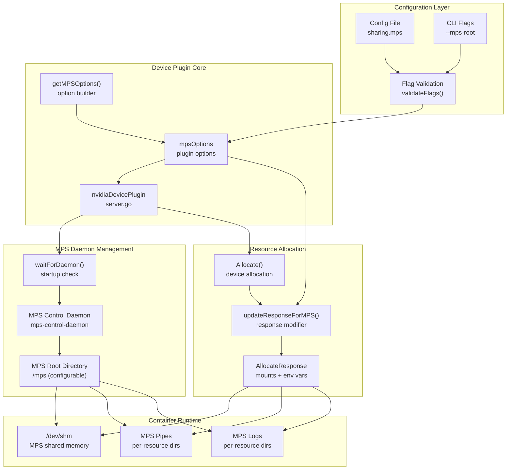
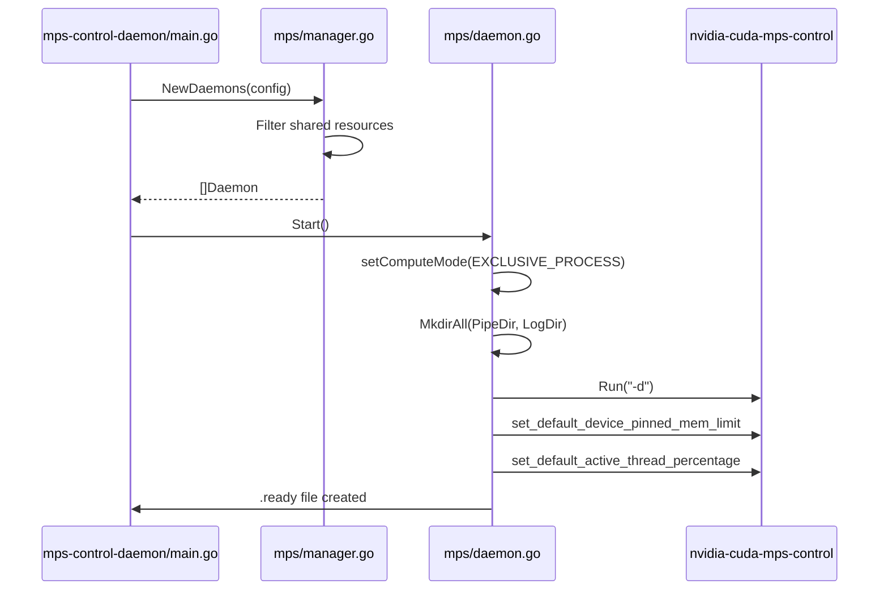
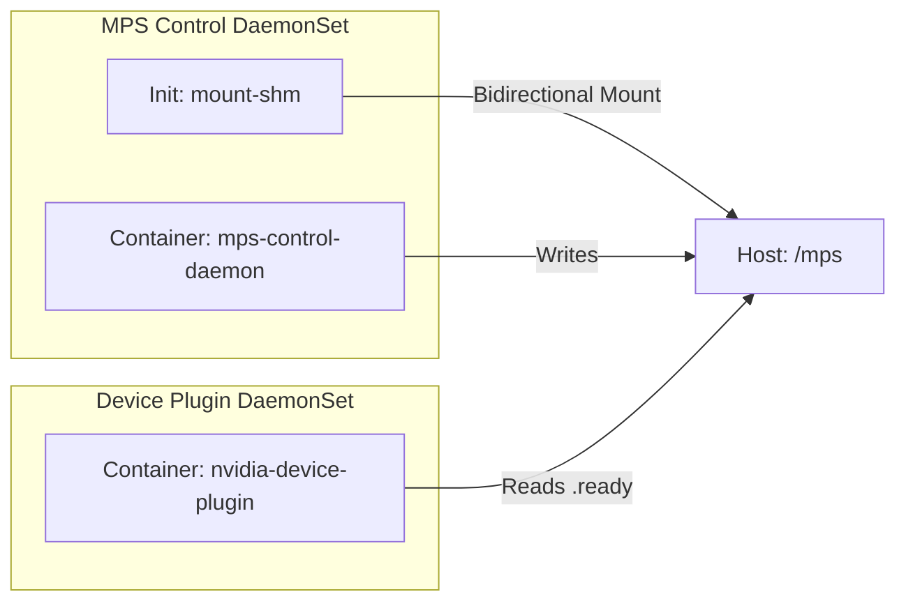

<!-- source: DeepWiki mcp.deepwiki.com · repo NVIDIA/k8s-device-plugin · page 7.2 Multi-Process Service (MPS) · fetched 2026-10-26 -->

# Multi-Process Service (MPS)

<details>
<summary>Relevant source files</summary>

The following files were used as context for generating this wiki page:

- [cmd/mps-control-daemon/main.go](cmd/mps-control-daemon/main.go)
- [cmd/mps-control-daemon/mps/daemon.go](cmd/mps-control-daemon/mps/daemon.go)
- [cmd/mps-control-daemon/mps/device.go](cmd/mps-control-daemon/mps/device.go)
- [cmd/mps-control-daemon/mps/device_test.go](cmd/mps-control-daemon/mps/device_test.go)
- [cmd/mps-control-daemon/mps/manager.go](cmd/mps-control-daemon/mps/manager.go)
- [cmd/mps-control-daemon/mps/options.go](cmd/mps-control-daemon/mps/options.go)
- [deployments/helm/nvidia-device-plugin/templates/daemonset-device-plugin.yml](deployments/helm/nvidia-device-plugin/templates/daemonset-device-plugin.yml)
- [deployments/helm/nvidia-device-plugin/templates/daemonset-gfd.yml](deployments/helm/nvidia-device-plugin/templates/daemonset-gfd.yml)
- [deployments/helm/nvidia-device-plugin/templates/daemonset-mps-control-daemon.yml](deployments/helm/nvidia-device-plugin/templates/daemonset-mps-control-daemon.yml)
- [vendor/github.com/opencontainers/selinux/LICENSE](vendor/github.com/opencontainers/selinux/LICENSE)
- [vendor/github.com/opencontainers/selinux/go-selinux/doc.go](vendor/github.com/opencontainers/selinux/go-selinux/doc.go)
- [vendor/github.com/opencontainers/selinux/go-selinux/selinux.go](vendor/github.com/opencontainers/selinux/go-selinux/selinux.go)
- [vendor/github.com/opencontainers/selinux/go-selinux/selinux_linux.go](vendor/github.com/opencontainers/selinux/go-selinux/selinux_linux.go)
- [vendor/github.com/opencontainers/selinux/go-selinux/selinux_stub.go](vendor/github.com/opencontainers/selinux/go-selinux/selinux_stub.go)
- [vendor/github.com/opencontainers/selinux/go-selinux/xattrs_linux.go](vendor/github.com/opencontainers/selinux/go-selinux/xattrs_linux.go)
- [vendor/github.com/opencontainers/selinux/pkg/pwalkdir/README.md](vendor/github.com/opencontainers/selinux/pkg/pwalkdir/README.md)
- [vendor/github.com/opencontainers/selinux/pkg/pwalkdir/pwalkdir.go](vendor/github.com/opencontainers/selinux/pkg/pwalkdir/pwalkdir.go)

</details>


## Purpose and Scope

This document describes the Multi-Process Service (MPS) support in the NVIDIA Kubernetes Device Plugin, which enables GPU sharing through space partitioning with enforced memory and compute limits. MPS is one of two GPU sharing mechanisms supported by the plugin; for information about time-slicing, see [Time-Slicing Configuration](#7.1).

**Current Status**: As of v0.15.0, MPS support is considered **experimental** and has the following limitations:
- Not supported on devices with MIG enabled [[cmd/mps-control-daemon/mps/manager.go:91-96]]()
- Requires explicit `--mps-root` configuration [[cmd/nvidia-device-plugin/main.go:207-209]]()
- Incompatible with `--mig-strategy=mixed` [[cmd/nvidia-device-plugin/main.go:203-205]]()

## MPS Overview

### Sharing Strategy Comparison

MPS differs fundamentally from time-slicing in its approach to GPU sharing:

| Aspect | Time-Slicing | MPS |
|--------|-------------|-----|
| **Isolation Method** | Time interleaving | Space partitioning |
| **Memory Management** | No limits enforced | Equal fraction per replica |
| **Compute Management** | No limits enforced | Equal fraction per replica |
| **Control Mechanism** | None (GPU scheduler) | MPS control daemon |
| **Fault Domain** | Shared (one crash affects all) | Shared (one crash affects all) |
| **MIG Support** | Yes (on mixed strategy) | No |

MPS uses a control daemon to manage access to the shared GPU, providing explicit memory and compute partitioning that is enforced per workload. If a node has 8 GPUs with 10 replicas each, MPS will limit each container to 1/10th of the GPU's memory and compute capacity.

### MPS Architecture Components



**Sources**: `[internal/plugin/server.go:69-372]()`, `[cmd/nvidia-device-plugin/main.go:187-232]()`, `[cmd/mps-control-daemon/main.go:51-86]()`

## MPS Control Daemon

The `mps-control-daemon` is a standalone process responsible for initializing the MPS environment and managing the `nvidia-cuda-mps-control` binary.

### Daemon Lifecycle



**Key Code Entities**:
- `Daemon` struct: Represents an MPS daemon associated with a specific resource type [[cmd/mps-control-daemon/mps/daemon.go:49-56]]().
- `Start()`: Configures the GPU compute mode, creates required directories, and launches the background MPS process [[cmd/mps-control-daemon/mps/daemon.go:92-145]]().
- `setComputeMode()`: Uses NVML to set GPUs to `EXCLUSIVE_PROCESS` mode, a prerequisite for MPS [[cmd/mps-control-daemon/mps/daemon.go:237-251]]().
- `EchoPipeToControl()`: Communicates with the daemon via stdin/stdout pipes to set limits [[cmd/mps-control-daemon/mps/daemon.go:210-235]]().

**Sources**: `[cmd/mps-control-daemon/mps/daemon.go:45-235]()`, `[cmd/mps-control-daemon/main.go:164-223]()`

## Configuration

### YAML Configuration Structure

MPS is configured through the `sharing.mps` section of the device plugin configuration:

```yaml
version: v1
sharing:
  mps:
    renameByDefault: <bool>
    resources:
    - name: <resource-name>
      replicas: <num-replicas>
```

**Configuration Fields**:
- `renameByDefault`: If `true`, resources are advertised as `<resource-name>.shared`.
- `replicas`: Number of shared accesses per GPU. Each replica receives a memory limit of `1/replicas` and a compute limit of `1/replicas` [[cmd/mps-control-daemon/mps/device.go:66-80]]().

**Sources**: `[api/config/v1/replicas.go:29-86]()`, `[cmd/mps-control-daemon/mps/manager.go:73-106]()`

### Command Line Flags

| Flag | Environment Variable | Required | Description |
|------|---------------------|----------|-------------|
| `--mps-root` | `$MPS_ROOT` | Yes | Path where MPS mounts and files are created |

**Sources**: `[cmd/nvidia-device-plugin/main.go:152-155]()`, `[api/config/v1/flags.go:60]()`

## Resource Partitioning and Isolation

### Memory and Compute Limits

The `mps-control-daemon` calculates limits based on the replica count defined in the configuration.

1.  **Pinned Memory Limit**: Set via `set_default_device_pinned_mem_limit`.
2.  **Active Thread Percentage**: Set via `set_default_active_thread_percentage`. This effectively limits the compute throughput for each client [[cmd/mps-control-daemon/mps/daemon.go:119-130]]().

### SELinux Isolation

On systems with SELinux enabled, the daemon automatically sets the security context for the MPS pipe directory to allow unprivileged containers to access the MPS sockets.

- **Function**: `setSELinuxContext(path, context)` [[cmd/mps-control-daemon/mps/daemon.go:147-158]]()
- **Label**: `system_u:object_r:container_file_t:s0` [[cmd/mps-control-daemon/mps/daemon.go:42]]()

**Sources**: `[cmd/mps-control-daemon/mps/daemon.go:42-158]()`

## Deployment

### DaemonSet Configuration

The MPS support is deployed using a dedicated DaemonSet for the control daemon in addition to the device plugin.



**Implementation Details**:
- **mount-shm**: An init container that prepares the shared memory mount [[deployments/helm/nvidia-device-plugin/templates/daemonset-mps-control-daemon.yml:67-75]]().
- **Health Synchronization**: The device plugin waits for the `.ready` file in the MPS root before registering with Kubelet [[cmd/mps-control-daemon/main.go:216-222]]().
- **Shared Namespace**: The control daemon may share the host PID namespace to monitor GPU processes [[deployments/helm/nvidia-device-plugin/templates/daemonset-mps-control-daemon.yml:63-65]]().

**Sources**: `[deployments/helm/nvidia-device-plugin/templates/daemonset-mps-control-daemon.yml:14-203]()`, `[cmd/mps-control-daemon/main.go:216-222]()`

### Volume Mounts

| Mount Purpose | Host Path | Container Path | Type |
|--------------|-----------|----------------|------|
| MPS Root | `${MPS_ROOT}` | `/mps` | DirectoryOrCreate |
| MPS Shared Memory | `${MPS_ROOT}/shm` | `/dev/shm` | HostPath |

**Sources**: `[deployments/helm/nvidia-device-plugin/templates/daemonset-mps-control-daemon.yml:195-203]()`

---

