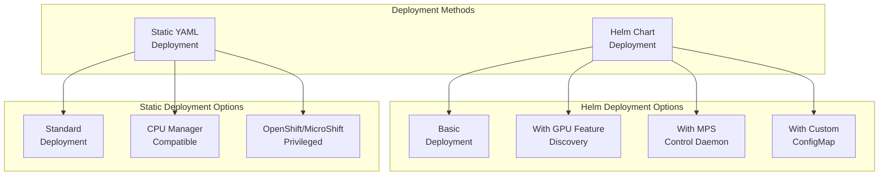
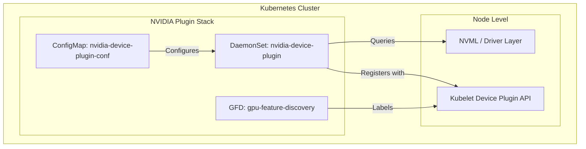

<!-- source: DeepWiki mcp.deepwiki.com · repo NVIDIA/k8s-device-plugin · page 8 Deployment · fetched 2026-10-26 -->

# Deployment

<details>
<summary>Relevant source files</summary>

The following files were used as context for generating this wiki page:

- [CHANGELOG.md](CHANGELOG.md)
- [Makefile](Makefile)
- [README.md](README.md)
- [RELEASE.md](RELEASE.md)
- [deployments/helm/nvidia-device-plugin/Chart.lock](deployments/helm/nvidia-device-plugin/Chart.lock)
- [deployments/helm/nvidia-device-plugin/Chart.yaml](deployments/helm/nvidia-device-plugin/Chart.yaml)
- [deployments/static/gpu-feature-discovery-daemonset-with-mig-mixed.yaml](deployments/static/gpu-feature-discovery-daemonset-with-mig-mixed.yaml)
- [deployments/static/gpu-feature-discovery-daemonset-with-mig-single.yaml](deployments/static/gpu-feature-discovery-daemonset-with-mig-single.yaml)
- [deployments/static/gpu-feature-discovery-daemonset.yaml](deployments/static/gpu-feature-discovery-daemonset.yaml)
- [deployments/static/gpu-feature-discovery-job.yaml.template](deployments/static/gpu-feature-discovery-job.yaml.template)
- [deployments/static/nvidia-device-plugin-compat-with-cpumanager.yml](deployments/static/nvidia-device-plugin-compat-with-cpumanager.yml)
- [deployments/static/nvidia-device-plugin-privileged-with-service-account.yml](deployments/static/nvidia-device-plugin-privileged-with-service-account.yml)
- [deployments/static/nvidia-device-plugin.yml](deployments/static/nvidia-device-plugin.yml)
- [versions.mk](versions.mk)

</details>


This document covers the deployment methods, configurations, and best practices for installing the NVIDIA Kubernetes Device Plugin in a cluster. The document focuses on the deployment mechanics, including both Helm and static YAML-based approaches, along with their specific configuration options.

## Deployment Options Overview

The NVIDIA Device Plugin can be deployed using two primary methods:

1.  **Helm-based deployment** (recommended for production):
    *   Provides advanced configuration options.
    *   Supports integration with GPU Feature Discovery.
    *   Enables dynamic configuration through ConfigMaps and node labels.
    *   Simplifies updates and maintenance.
2.  **Static YAML-based deployment**:
    *   Simple, straightforward approach for testing or basic setups.
    *   Multiple variants available for different security contexts or environments.
    *   Limited configurability compared to Helm.



Sources: [README.md:25-34](), [README.md:141-143](), [deployments/static/nvidia-device-plugin.yml:15-19]()

## Prerequisites

Before deploying the NVIDIA Device Plugin, ensure your environment meets the following requirements:

| Requirement | Details |
| :--- | :--- |
| NVIDIA Drivers | Version ~= 384.81 or newer |
| Container Runtime | `nvidia-docker` >= 2.0 OR `nvidia-container-toolkit` >= 1.7.0 (>= 1.11.0 for Tegra) |
| Runtime Configuration | `nvidia-container-runtime` configured as the default low-level runtime |
| Kubernetes | Version >= 1.10 |

The NVIDIA Container Toolkit must be properly configured for your container runtime (e.g., `containerd` or `CRI-O`) and the runtime must be restarted after configuration changes.

Sources: [README.md:68-76](), [README.md:89-99](), [deployments/helm/nvidia-device-plugin/Chart.yaml:7-7]()

## Helm-Based Deployment

For detailed information on Helm-based installation, including chart structure and NFD dependencies, see [Helm Chart Deployment](#8.1).

### Basic Installation
The Helm chart allows for a consolidated deployment of the device plugin and its supporting components. The chart is versioned alongside the plugin.

```bash
helm upgrade -i nvdp nvdp/nvidia-device-plugin \
  --namespace nvidia-device-plugin \
  --create-namespace \
  --version 0.19.0
```

### Deployment Architecture
The Helm chart manages several code entities and Kubernetes resources to enable GPU support.



Sources: [deployments/helm/nvidia-device-plugin/Chart.yaml:1-16](), [deployments/helm/nvidia-device-plugin/values.yaml:1-50](), [README.md:49-57]()

## Static YAML-Based Deployment

For details on manifest variants and manual configuration, see [Static YAML Deployment](#8.2).

Static deployments are useful for air-gapped environments or simple clusters where Helm is not available. The project provides several pre-configured manifests in `deployments/static/`.

*   **Standard**: `deployments/static/nvidia-device-plugin.yml` [deployments/static/nvidia-device-plugin.yml:1-56]()
*   **CPU Manager Compatible**: Includes specific environment variables like `PASS_DEVICE_SPECS` to support topology awareness. [deployments/static/nvidia-device-plugin-compat-with-cpumanager.yml:41-56]()
*   **Privileged/OpenShift**: Configures a dedicated `ServiceAccount` and `Namespace` for environments with strict Security Context Constraints (SCC). [deployments/static/nvidia-device-plugin-privileged-with-service-account.yml:48-140]()

## Registry and Image Options

The official images are hosted on the NVIDIA GPU Cloud (NGC) registry.

*   **Registry**: `nvcr.io/nvidia/k8s-device-plugin` [versions.mk:18-23]()
*   **Image Tag**: Matches the release version (e.g., `v0.19.0`). [versions.mk:20-20]()

### Multi-Architecture Support
As of `v0.19.0`, images are built as multi-arch manifests supporting both `amd64` and `arm64` natively. [CHANGELOG.md:10-10]()

## Post-Deployment Verification

After deployment, verify that the `nvidia.com/gpu` resource is registered with the nodes.

```bash
kubectl describe nodes | grep nvidia.com/gpu
```

A successful deployment will show the capacity and allocatable count of GPUs detected via NVML. [README.md:51-51]()

Sources: [README.md:160-170](), [CHANGELOG.md:3-10]()

---

