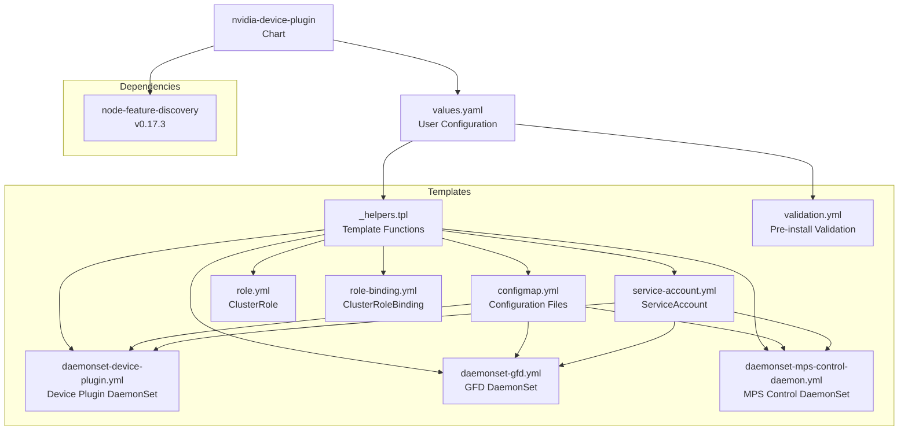
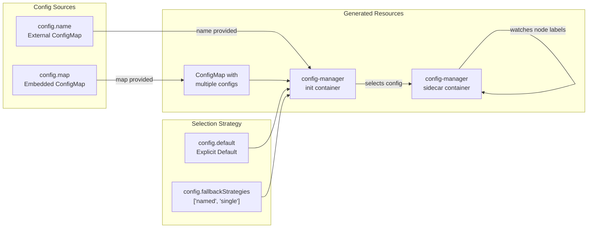
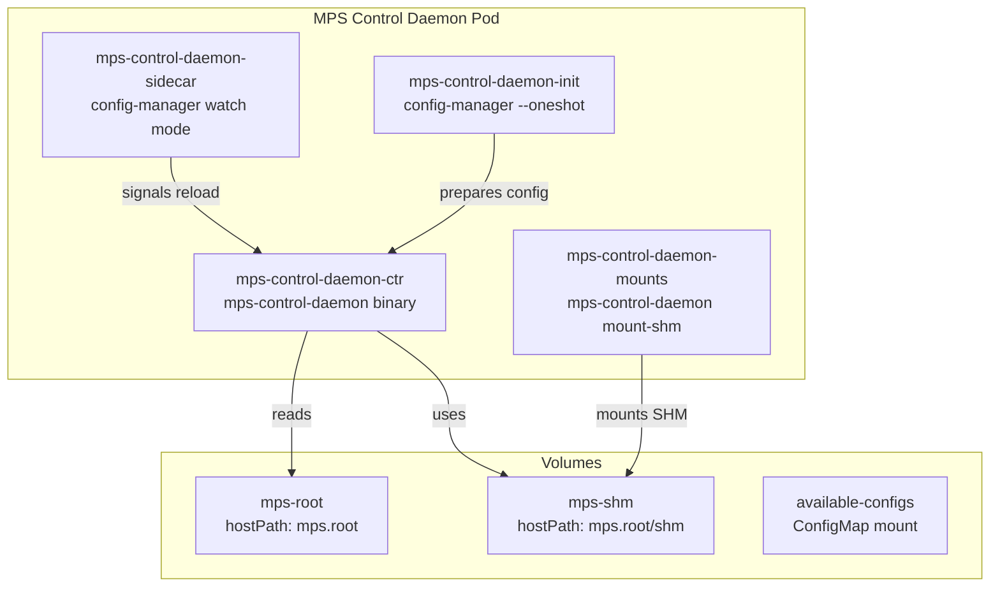

<!-- source: DeepWiki mcp.deepwiki.com · repo NVIDIA/k8s-device-plugin · page 8.1 Helm Chart Deployment · fetched 2026-10-26 -->

# Helm Chart Deployment

<details>
<summary>Relevant source files</summary>

The following files were used as context for generating this wiki page:

- [cmd/config-manager/main.go](cmd/config-manager/main.go)
- [cmd/mps-control-daemon/main.go](cmd/mps-control-daemon/main.go)
- [cmd/mps-control-daemon/mps/manager.go](cmd/mps-control-daemon/mps/manager.go)
- [cmd/mps-control-daemon/mps/options.go](cmd/mps-control-daemon/mps/options.go)
- [deployments/helm/nvidia-device-plugin/charts/node-feature-discovery-chart-0.17.3.tgz](deployments/helm/nvidia-device-plugin/charts/node-feature-discovery-chart-0.17.3.tgz)
- [deployments/helm/nvidia-device-plugin/templates/_helpers.tpl](deployments/helm/nvidia-device-plugin/templates/_helpers.tpl)
- [deployments/helm/nvidia-device-plugin/templates/configmap.yml](deployments/helm/nvidia-device-plugin/templates/configmap.yml)
- [deployments/helm/nvidia-device-plugin/templates/daemonset-device-plugin.yml](deployments/helm/nvidia-device-plugin/templates/daemonset-device-plugin.yml)
- [deployments/helm/nvidia-device-plugin/templates/daemonset-gfd.yml](deployments/helm/nvidia-device-plugin/templates/daemonset-gfd.yml)
- [deployments/helm/nvidia-device-plugin/templates/daemonset-mps-control-daemon.yml](deployments/helm/nvidia-device-plugin/templates/daemonset-mps-control-daemon.yml)
- [deployments/helm/nvidia-device-plugin/templates/role-binding.yml](deployments/helm/nvidia-device-plugin/templates/role-binding.yml)
- [deployments/helm/nvidia-device-plugin/templates/role.yml](deployments/helm/nvidia-device-plugin/templates/role.yml)
- [deployments/helm/nvidia-device-plugin/templates/service-account.yml](deployments/helm/nvidia-device-plugin/templates/service-account.yml)
- [deployments/helm/nvidia-device-plugin/templates/validation.yml](deployments/helm/nvidia-device-plugin/templates/validation.yml)
- [deployments/helm/nvidia-device-plugin/values.yaml](deployments/helm/nvidia-device-plugin/values.yaml)

</details>


## Purpose and Scope

This document describes the Helm-based deployment method for the NVIDIA Kubernetes Device Plugin, including chart structure, configuration options, DaemonSet templates, and the dynamic configuration management system. For information about static YAML deployment, see [Static YAML Deployment](#8.2). For details on the configuration schema itself, see [Configuration Schema and Options](#5.1). For information about the runtime components being deployed, see [Device Plugin Core](#3) and [GPU Feature Discovery](#4).

The Helm chart is located at `deployments/helm/nvidia-device-plugin/` and provides a declarative way to deploy the device plugin, GPU Feature Discovery (GFD), and the Multi-Process Service (MPS) control daemon as DaemonSets with integrated configuration management capabilities.

---

## Chart Structure and Dependencies

The Helm chart follows the standard Helm directory structure with templates that generate Kubernetes resources based on user-provided values.

### Chart Dependency Graph



**Sources:** [deployments/helm/nvidia-device-plugin/templates/_helpers.tpl:1-272](), [deployments/helm/nvidia-device-plugin/values.yaml:127-154]()

The chart includes a mandatory dependency on the Node Feature Discovery (NFD) chart, which provides hardware detection capabilities required for proper node labeling and scheduling.

### Key Template Helper Functions

The chart defines several critical helper functions in `_helpers.tpl` that are used throughout the templates:

| Helper Function | Purpose | Key Logic |
|----------------|---------|-----------|
| `nvidia-device-plugin.configMapName` | Determines ConfigMap name | Returns `config.name` if set, otherwise generates name from fullname [deployments/helm/nvidia-device-plugin/templates/_helpers.tpl:234-241]() |
| `nvidia-device-plugin.hasConfigMap` | Checks if ConfigMap is used | Returns true if `configMapName` is non-empty [deployments/helm/nvidia-device-plugin/templates/_helpers.tpl:201-207]() |
| `nvidia-device-plugin.hasEmbeddedConfigMap` | Checks if embedded ConfigMap | Returns true if `config.map` is non-empty [deployments/helm/nvidia-device-plugin/templates/_helpers.tpl:190-196]() |
| `nvidia-device-plugin.requiresCapSysAdmin` | Determines security capabilities | Returns true if MIG enabled or volume-mounts strategy used [deployments/helm/nvidia-device-plugin/templates/_helpers.tpl:127-135]() |
| `nvidia-device-plugin.securityContext` | Generates security context | Sets privileged or CAP_SYS_ADMIN based on configuration [deployments/helm/nvidia-device-plugin/templates/_helpers.tpl:91-105]() |

**Sources:** [deployments/helm/nvidia-device-plugin/templates/_helpers.tpl:91-241]()

---

## Values Configuration

The `values.yaml` file provides extensive configuration options organized into logical sections.

### Configuration Management Options



**Sources:** [deployments/helm/nvidia-device-plugin/values.yaml:1-29]()

### Core Configuration Schema

| Field | Type | Default | Description |
|-------|------|---------|-------------|
| `config.name` | string | `""` | Name of external ConfigMap containing configurations [deployments/helm/nvidia-device-plugin/values.yaml:22]() |
| `config.map` | object | `{}` | Map of named configurations to embed in chart [deployments/helm/nvidia-device-plugin/values.yaml:24]() |
| `config.default` | string | `""` | Default configuration name to use [deployments/helm/nvidia-device-plugin/values.yaml:26]() |
| `config.fallbackStrategies` | list | `["named", "single"]` | Ordered fallback strategies for config selection [deployments/helm/nvidia-device-plugin/values.yaml:28]() |

**Sources:** [deployments/helm/nvidia-device-plugin/values.yaml:20-28]()

Example embedded configuration:

```yaml
config:
  map:
    default: |-
      version: v1
      flags:
        migStrategy: none
    mig-single: |-
      version: v1
      flags:
        migStrategy: single
```

**Sources:** [deployments/helm/nvidia-device-plugin/values.yaml:6-15]()

---

## DaemonSet Deployment

The chart deploys three primary DaemonSets depending on enabled features: the device plugin, GFD, and the MPS control daemon.

### Device Plugin DaemonSet

The device plugin DaemonSet template conditionally includes configuration management containers. When a ConfigMap is used, it includes the `config-manager` as both an init container (for initial setup) and a sidecar (for runtime updates).

**Sources:** [deployments/helm/nvidia-device-plugin/templates/daemonset-device-plugin.yml:59-136]()

### MPS Control DaemonSet

The MPS control daemon manages Multi-Process Service for shared GPUs. It uses a specialized init container to mount shared memory.



**Sources:** [deployments/helm/nvidia-device-plugin/templates/daemonset-mps-control-daemon.yml:66-204](), [cmd/mps-control-daemon/main.go:61]()

### GPU Feature Discovery DaemonSet

GFD is deployed when `gfd.enabled: true`. It writes node labels to the NFD features directory.

**Sources:** [deployments/helm/nvidia-device-plugin/templates/daemonset-gfd.yml:15-188]()

---

## Configuration Management System

The dynamic configuration management system allows runtime configuration changes without pod restarts through the `config-manager` component.

### Config-Manager Logic

The `config-manager` watches node labels and updates a local configuration file, signaling the main process to reload.

| Entity | Code Reference | Role |
|--------|----------------|------|
| `SyncableConfig` | `[cmd/config-manager/main.go:81-86]()` | Synchronizes configuration changes across threads |
| `DefaultConfigLabel` | `[cmd/config-manager/main.go:49]()` | Default node label to watch (`nvidia.com/device-plugin.config`) |
| `ProcessToSignal` | `[cmd/config-manager/main.go:74]()` | The binary name to send SIGHUP to (e.g., `nvidia-device-plugin`) |

**Sources:** [cmd/config-manager/main.go:38-75]()

### Fallback Strategy Resolution

The `config-manager` implements a three-tier fallback system for selecting a configuration if no label is present:

| Strategy | Description | Implementation |
|----------|-------------|----------------|
| `named` | Look for config named "default" | `FallbackStrategyNamedConfig` [cmd/config-manager/main.go:54]() |
| `single` | Use single config if only one exists | `FallbackStrategySingleConfig` [cmd/config-manager/main.go:55]() |
| `empty` | Fall back to empty configuration | `FallbackStrategyEmptyConfig` [cmd/config-manager/main.go:56]() |

**Sources:** [cmd/config-manager/main.go:52-60](), [cmd/config-manager/main.go:334-392]()

---

## RBAC and Service Accounts

When configuration management or GFD is enabled, the chart creates RBAC resources to allow pods to access the Kubernetes API.

### RBAC Configuration

| Resource | Purpose |
|----------|---------|
| `ServiceAccount` | Identity for the pods [deployments/helm/nvidia-device-plugin/templates/service-account.yml:5-11]() |
| `ClusterRole` | Permissions to `get`, `list`, `watch` nodes [deployments/helm/nvidia-device-plugin/templates/role.yml:11-13]() |
| `ClusterRoleBinding` | Links the ServiceAccount to the Role [deployments/helm/nvidia-device-plugin/templates/role-binding.yml:4-18]() |

If `gfd.enabled` is true, the `ClusterRole` also includes permissions for `nodefeatures.nfd.k8s-sigs.io` [deployments/helm/nvidia-device-plugin/templates/role.yml:15-17]().

**Sources:** [deployments/helm/nvidia-device-plugin/templates/role.yml:1-22](), [deployments/helm/nvidia-device-plugin/templates/role-binding.yml:1-18]()

---

## Node Scheduling and Affinity

The chart ensures pods are scheduled only on nodes with NVIDIA GPUs.

### Node Affinity Rules

The default node affinity uses NFD labels and manual overrides:
1. `feature.node.kubernetes.io/pci-10de.present`: Discrete GPUs [deployments/helm/nvidia-device-plugin/values.yaml:70]()
2. `feature.node.kubernetes.io/cpu-model.vendor_id`: NVIDIA Tegra systems [deployments/helm/nvidia-device-plugin/values.yaml:76]()
3. `nvidia.com/gpu.present`: Manual override [deployments/helm/nvidia-device-plugin/values.yaml:82]()

**Sources:** [deployments/helm/nvidia-device-plugin/values.yaml:64-85]()

### Tolerations

The pods tolerate the following taints:
- `CriticalAddonsOnly`: Legacy support [deployments/helm/nvidia-device-plugin/values.yaml:89]()
- `nvidia.com/gpu`: Allows scheduling on GPU-tainted nodes [deployments/helm/nvidia-device-plugin/values.yaml:91]()

**Sources:** [deployments/helm/nvidia-device-plugin/values.yaml:86-93]()

---

## MPS Control Daemon Configuration

The MPS control daemon requires specific host-level access to manage shared memory and processes.

| Parameter | Default | Purpose |
|-----------|---------|---------|
| `mps.root` | `/run/nvidia/mps` | Host path for MPS pipes and SHM [deployments/helm/nvidia-device-plugin/values.yaml:160]() |
| `mps.enableHostPID` | `true` | Allows MPS to find its PID via `/proc/self` [deployments/helm/nvidia-device-plugin/values.yaml:166]() |

The `mps-control-daemon` binary supports a `mount-shm` command used in the init container to prepare the environment [cmd/mps-control-daemon/main.go:61](), [deployments/helm/nvidia-device-plugin/templates/daemonset-mps-control-daemon.yml:69]().

**Sources:** [deployments/helm/nvidia-device-plugin/values.yaml:155-171](), [deployments/helm/nvidia-device-plugin/templates/daemonset-mps-control-daemon.yml:66-75]()

---

## CDI and Device Strategies

The chart passes configuration for Container Device Interface (CDI) and device discovery directly to the plugin container via environment variables.

| Env Var | Value Source | Purpose |
|---------|--------------|---------|
| `NVIDIA_CDI_HOOK_PATH` | `cdi.nvidiaHookPath` | Path to CDI hook binary [deployments/helm/nvidia-device-plugin/templates/daemonset-device-plugin.yml:172-175]() |
| `CDI_FEATURE_FLAGS` | `cdi.featureFlags` | Enabled CDI features [deployments/helm/nvidia-device-plugin/templates/daemonset-device-plugin.yml:176-179]() |
| `DEVICE_LIST_STRATEGY` | `deviceListStrategy` | How devices are exposed (e.g., `volume-mounts`) [deployments/helm/nvidia-device-plugin/templates/daemonset-device-plugin.yml:156-159]() |

**Sources:** [deployments/helm/nvidia-device-plugin/templates/daemonset-device-plugin.yml:141-191](), [deployments/helm/nvidia-device-plugin/values.yaml:173-180]()

---

