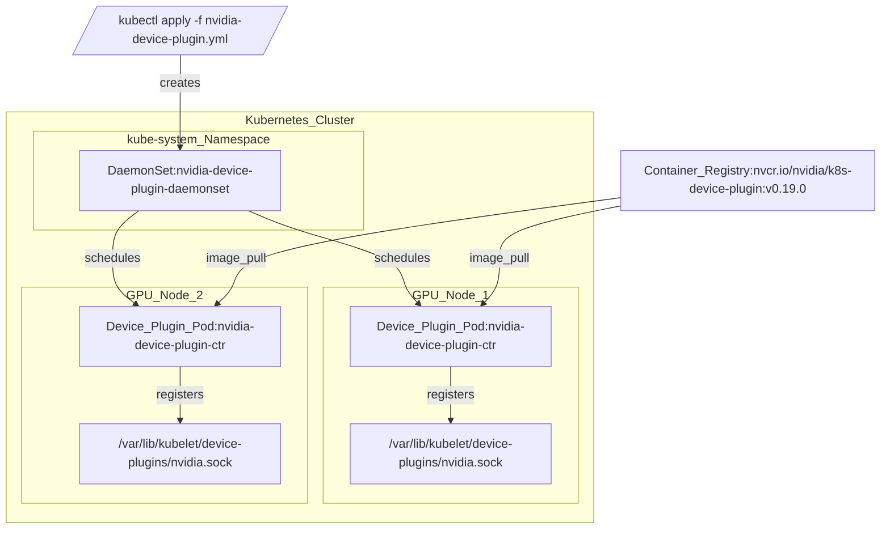
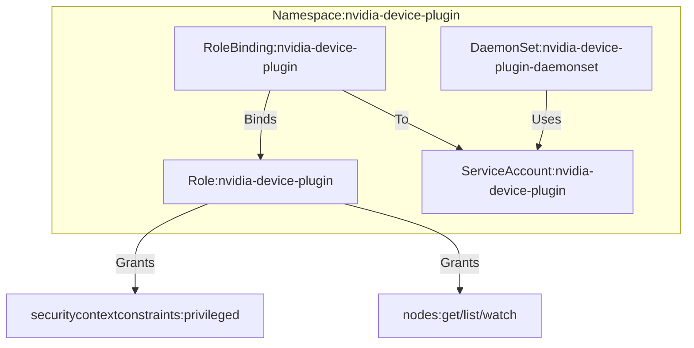

<!-- source: DeepWiki mcp.deepwiki.com · repo NVIDIA/k8s-device-plugin · page 8.2 Static YAML Deployment · fetched 2026-10-26 -->

# Static YAML Deployment

<details>
<summary>Relevant source files</summary>

The following files were used as context for generating this wiki page:

- [CHANGELOG.md](CHANGELOG.md)
- [Makefile](Makefile)
- [README.md](README.md)
- [RELEASE.md](RELEASE.md)
- [deployments/helm/nvidia-device-plugin/Chart.lock](deployments/helm/nvidia-device-plugin/Chart.lock)
- [deployments/helm/nvidia-device-plugin/Chart.yaml](deployments/helm/nvidia-device-plugin/Chart.yaml)
- [deployments/static/gpu-feature-discovery-daemonset-with-mig-mixed.yaml](deployments/static/gpu-feature-discovery-daemonset-with-mig-mixed.yaml)
- [deployments/static/gpu-feature-discovery-daemonset-with-mig-single.yaml](deployments/static/gpu-feature-discovery-daemonset-with-mig-single.yaml)
- [deployments/static/gpu-feature-discovery-daemonset.yaml](deployments/static/gpu-feature-discovery-daemonset.yaml)
- [deployments/static/gpu-feature-discovery-job.yaml.template](deployments/static/gpu-feature-discovery-job.yaml.template)
- [deployments/static/nvidia-device-plugin-compat-with-cpumanager.yml](deployments/static/nvidia-device-plugin-compat-with-cpumanager.yml)
- [deployments/static/nvidia-device-plugin-privileged-with-service-account.yml](deployments/static/nvidia-device-plugin-privileged-with-service-account.yml)
- [deployments/static/nvidia-device-plugin.yml](deployments/static/nvidia-device-plugin.yml)
- [versions.mk](versions.mk)

</details>


## Purpose and Scope

This document describes how to deploy the NVIDIA device plugin for Kubernetes using static YAML manifests. Static deployment provides a simple, declarative approach suitable for basic use cases, demonstration environments, and production deployments where Helm is not available or desired.

For production deployments with advanced configuration management, see [Helm Chart Deployment](#8.1). For information about configuration options that apply to both deployment methods, see [Configuration Schema and Options](#5.1).

## Overview

Static YAML deployment creates a DaemonSet that runs the device plugin on all GPU-enabled nodes. Unlike Helm deployment, static manifests require manual editing to change configuration and do not support features like ConfigMap-based configuration management or dynamic per-node configuration updates.

**Key Characteristics:**
- Single-command deployment using `kubectl`.
- Configuration via environment variables or manual manifest editing.
- No dependencies on Helm or other package managers.
- Suitable for basic GPU exposure and simple MIG configurations.
- Image versioning is hardcoded in the manifests (e.g., `v0.19.0`). [deployments/static/nvidia-device-plugin.yml:41]()

## Available Static Manifests

The repository provides several static YAML manifests in the `deployments/static/` directory, each designed for specific deployment scenarios:

| Manifest File | Purpose | Security Context | Namespace |
|--------------|---------|------------------|-----------|
| `nvidia-device-plugin.yml` | Basic deployment | Minimal privileges | `kube-system` |
| `nvidia-device-plugin-compat-with-cpumanager.yml` | CPUManager compatibility | Privileged | `kube-system` |
| `nvidia-device-plugin-privileged-with-service-account.yml` | OpenShift/Microshift | Privileged with RBAC | `nvidia-device-plugin` |
| `gpu-feature-discovery-daemonset.yaml` | GFD with MIG strategy `none` | Privileged | Default |
| `gpu-feature-discovery-daemonset-with-mig-single.yaml` | GFD with MIG strategy `single` | Privileged | Default |
| `gpu-feature-discovery-daemonset-with-mig-mixed.yaml` | GFD with MIG strategy `mixed` | Privileged | Default |
| `gpu-feature-discovery-job.yaml.template` | GFD as one-time Job | Privileged | Default |

**Sources:** [deployments/static/nvidia-device-plugin.yml:1-56](), [deployments/static/nvidia-device-plugin-compat-with-cpumanager.yml:1-56](), [deployments/static/nvidia-device-plugin-privileged-with-service-account.yml:1-140](), [deployments/static/gpu-feature-discovery-daemonset.yaml:1-68](), [CHANGELOG.md:141-142]()

## Static Deployment Architecture



**Deployment Flow:**
1. User applies static YAML manifest using `kubectl`.
2. Kubernetes creates `DaemonSet` in the specified namespace (default `kube-system`). [deployments/static/nvidia-device-plugin.yml:16-19]()
3. `DaemonSet` controller schedules pods on GPU nodes based on `tolerations`. [deployments/static/nvidia-device-plugin.yml:31-34]()
4. Pods pull the `k8s-device-plugin` image from the registry. [deployments/static/nvidia-device-plugin.yml:41]()
5. Device plugin containers register with Kubelet via the Unix socket mounted from the host. [deployments/static/nvidia-device-plugin.yml:49-50]()

**Sources:** [deployments/static/nvidia-device-plugin.yml:15-56](), [README.md:152-164]()

## Basic Deployment

### Prerequisites

Before deploying, ensure the following prerequisites are met on all GPU nodes:

- **NVIDIA Drivers:** Version ~= 384.81 or later. [README.md:72]()
- **NVIDIA Container Toolkit:** Version >= 1.7.0. [README.md:73]()
- **Container Runtime:** `nvidia-container-runtime` configured as default low-level runtime. [README.md:74]()
- **Kubernetes:** Version >= 1.10. [README.md:75]()

### Deployment Command

Deploy the basic device plugin using the latest stable static manifest:

```bash
kubectl create -f https://raw.githubusercontent.com/NVIDIA/k8s-device-plugin/v0.19.0/deployments/static/nvidia-device-plugin.yml
```

**Verification:**

```bash
# Check DaemonSet status
kubectl get daemonset -n kube-system nvidia-device-plugin-daemonset

# Verify GPU resources are advertised
kubectl get nodes -o json | jq '.items[].status.capacity."nvidia.com/gpu"'
```

**Sources:** [README.md:68-86](), [deployments/static/nvidia-device-plugin.yml:1-56]()

## Deployment Variant Details

### Basic Deployment (nvidia-device-plugin.yml)

The standard deployment provides minimal security privileges by dropping all capabilities and disallowing privilege escalation. [deployments/static/nvidia-device-plugin.yml:44-47]()

**Key Specifications:**

```yaml
securityContext:
  allowPrivilegeEscalation: false
  capabilities:
    drop: ["ALL"]

# Node Selection
tolerations:
- key: nvidia.com/gpu
  operator: Exists
  effect: NoSchedule

priorityClassName: "system-node-critical"
```

**Sources:** [deployments/static/nvidia-device-plugin.yml:31-47]()

### CPUManager Compatibility (nvidia-device-plugin-compat-with-cpumanager.yml)

This variant enables compatibility with Kubernetes CPUManager by passing device specifications directly to containers. [deployments/static/nvidia-device-plugin-compat-with-cpumanager.yml:44-45]()

**Key Differences:**
- **Environment Variables:** Sets `PASS_DEVICE_SPECS=true`. [deployments/static/nvidia-device-plugin-compat-with-cpumanager.yml:45]()
- **Elevated Privileges:** Requires `privileged: true` to set device node permissions. [deployments/static/nvidia-device-plugin-compat-with-cpumanager.yml:47]()

**Sources:** [deployments/static/nvidia-device-plugin-compat-with-cpumanager.yml:40-55]()

### OpenShift/Microshift with Service Account

This variant provides a complete deployment package for OpenShift and Microshift, including namespace, RBAC, and security context constraints. [deployments/static/nvidia-device-plugin-privileged-with-service-account.yml:16-46]()



**Sources:** [deployments/static/nvidia-device-plugin-privileged-with-service-account.yml:48-140]()

## GPU Feature Discovery Static Deployment

GPU Feature Discovery (GFD) is typically deployed alongside the device plugin. The repository provides specific manifests for different `MIG_STRATEGY` values.

### GFD Configuration Comparison

| Manifest | `MIG_STRATEGY` | `NVIDIA_MIG_MONITOR_DEVICES` |
|----------|----------------|------------------------------|
| `gpu-feature-discovery-daemonset.yaml` | (default) | (default) |
| `gpu-feature-discovery-daemonset-with-mig-single.yaml` | `single` | `all` |
| `gpu-feature-discovery-daemonset-with-mig-mixed.yaml` | `mixed` | `all` |

**Sources:** [deployments/static/gpu-feature-discovery-daemonset-with-mig-single.yaml:31-34](), [deployments/static/gpu-feature-discovery-daemonset-with-mig-mixed.yaml:31-34]()

### Node Affinity in GFD

GFD manifests include node affinity to ensure they only run on nodes where NVIDIA GPUs are present, as detected by Node Feature Discovery (NFD). [deployments/static/gpu-feature-discovery-daemonset-with-mig-mixed.yaml:37-58]()

```yaml
affinity:
  nodeAffinity:
    requiredDuringSchedulingIgnoredDuringExecution:
      nodeSelectorTerms:
      - matchExpressions:
        - key: feature.node.kubernetes.io/pci-10de.present
          operator: In
          values: ["true"]
```

**Sources:** [deployments/static/gpu-feature-discovery-daemonset-with-mig-mixed.yaml:37-46]()

## Configuration via Environment Variables

Static deployments are primarily configured through environment variables in the pod specification. [deployments/static/nvidia-device-plugin-compat-with-cpumanager.yml:43-45]()

| Variable | Manifest Example | Purpose |
|----------|------------------|---------|
| `PASS_DEVICE_SPECS` | `nvidia-device-plugin-compat-with-cpumanager.yml` | Pass host device paths to container. |
| `MIG_STRATEGY` | `gpu-feature-discovery-daemonset-with-mig-mixed.yaml` | Defines how MIG devices are partitioned. |
| `NVIDIA_MIG_MONITOR_DEVICES` | `gpu-feature-discovery-daemonset-with-mig-mixed.yaml` | Controls which MIG devices are monitored. |

**Sources:** [deployments/static/nvidia-device-plugin-compat-with-cpumanager.yml:44-45](), [deployments/static/gpu-feature-discovery-daemonset-with-mig-mixed.yaml:31-34]()

## Resource Requirements and Volumes

### Volume Mounts

The device plugin requires access to the Kubelet device plugin socket directory on the host to register itself. [deployments/static/nvidia-device-plugin.yml:49-55]()

| Volume Name | Host Path | Mount Path | Purpose |
|-------------|-----------|------------|---------|
| `kubelet-device-plugins-dir` | `/var/lib/kubelet/device-plugins` | `/var/lib/kubelet/device-plugins` | Registration with Kubelet |

GFD manifests additionally require access to the NFD features directory to write node labels. [deployments/static/gpu-feature-discovery-daemonset-with-mig-mixed.yaml:25-29]()

| Volume Name | Host Path | Mount Path | Purpose |
|-------------|-----------|------------|---------|
| `output-dir` | `/etc/kubernetes/node-feature-discovery/features.d` | `/etc/kubernetes/node-feature-discovery/features.d` | Writing feature labels |
| `host-sys` | `/sys` | `/sys` | GPU feature detection |

**Sources:** [deployments/static/nvidia-device-plugin.yml:48-55](), [deployments/static/gpu-feature-discovery-daemonset-with-mig-mixed.yaml:25-29](), [deployments/static/gpu-feature-discovery-daemonset-with-mig-mixed.yaml:59-67]()

### Priority and Scheduling

The plugin uses `system-node-critical` priority to ensure it is not evicted under resource pressure. [deployments/static/nvidia-device-plugin.yml:39]()

**Sources:** [deployments/static/nvidia-device-plugin.yml:35-39]()

---

