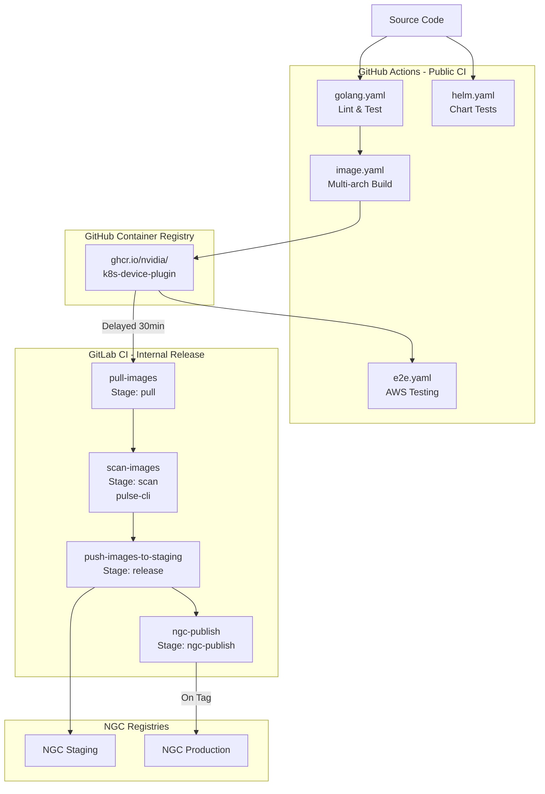
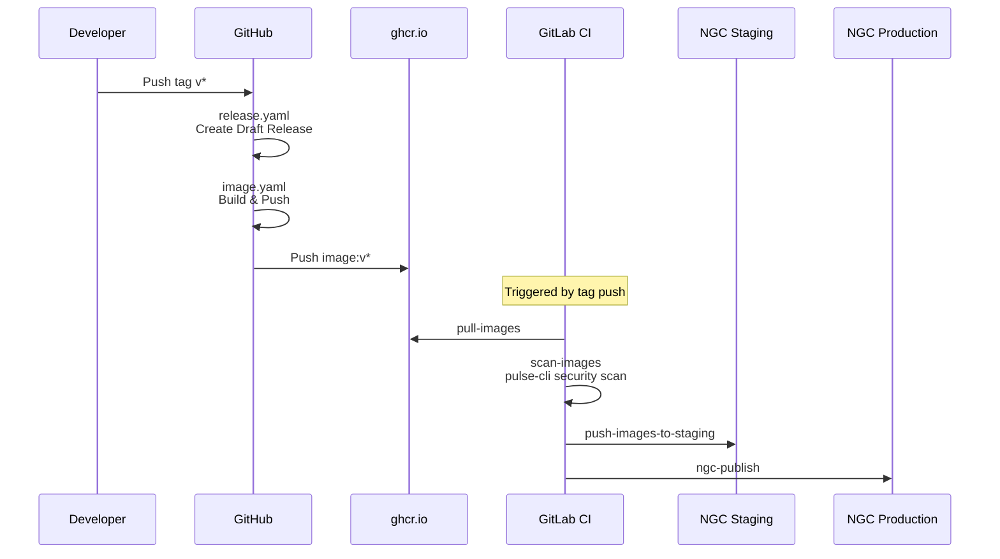
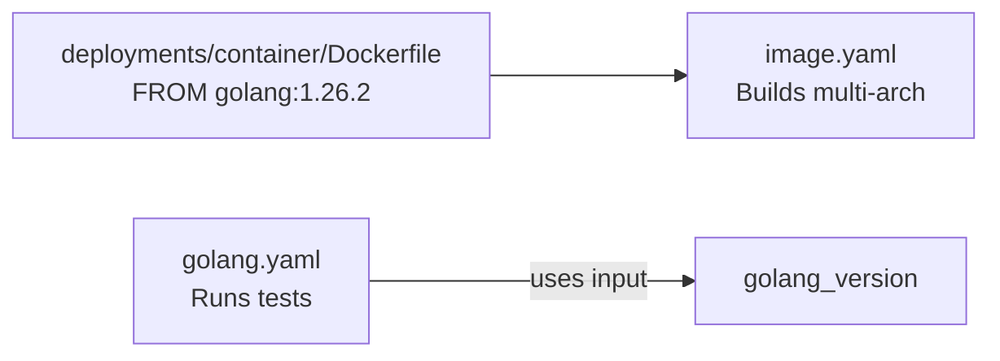

<!-- source: DeepWiki mcp.deepwiki.com · repo NVIDIA/k8s-device-plugin · page 9 Development and CI/CD · fetched 2026-10-26 -->

# Development and CI/CD

<details>
<summary>Relevant source files</summary>

The following files were used as context for generating this wiki page:

- [.github/workflows/basic-checks.yaml](.github/workflows/basic-checks.yaml)
- [.github/workflows/ci.yaml](.github/workflows/ci.yaml)
- [.github/workflows/code_scanning.yaml](.github/workflows/code_scanning.yaml)
- [.github/workflows/deploy-to-pages.yaml](.github/workflows/deploy-to-pages.yaml)
- [.github/workflows/e2e.yaml](.github/workflows/e2e.yaml)
- [.github/workflows/golang.yaml](.github/workflows/golang.yaml)
- [.github/workflows/helm.yaml](.github/workflows/helm.yaml)
- [.github/workflows/image.yaml](.github/workflows/image.yaml)
- [.github/workflows/publish-helm.yaml](.github/workflows/publish-helm.yaml)
- [.github/workflows/release.yaml](.github/workflows/release.yaml)
- [.github/workflows/variables.yaml](.github/workflows/variables.yaml)
- [.nvidia-ci.yml](.nvidia-ci.yml)
- [demo/clusters/kind/scripts/common.sh](demo/clusters/kind/scripts/common.sh)
- [deployments/container/Dockerfile](deployments/container/Dockerfile)
- [deployments/container/Makefile](deployments/container/Makefile)
- [deployments/container/multi-arch.mk](deployments/container/multi-arch.mk)
- [deployments/container/native-only.mk](deployments/container/native-only.mk)
- [tests/e2e/infra/aws.yaml](tests/e2e/infra/aws.yaml)

</details>


This page provides an overview of the development workflow, build system, testing infrastructure, and release process for the NVIDIA Kubernetes Device Plugin. The project uses a dual-pipeline approach with GitHub Actions for public continuous integration and GitLab CI for internal security scanning and release to NVIDIA GPU Cloud (NGC).

For information about deploying the device plugin in production environments, see [Deployment](#8).

## Overview

The development workflow consists of three main components:

1. **Build System** (page 9.1): Multi-stage Docker builds producing multi-architecture images.
2. **Testing Infrastructure** (page 9.2): Unit tests, E2E tests on AWS with Holodeck, and linting.
3. **Release Pipeline** (page 9.3): GitHub Actions → GitLab CI → NGC publication.

### Development Prerequisites

Before beginning development work, ensure the following are installed:

| Tool | Version | Purpose |
|------|---------|---------|
| Go | 1.26.2+ | Compilation [deployments/container/Dockerfile:15]() |
| Docker | Latest | Container builds |
| Git | Latest | Version control |
| Make | Latest | Build orchestration |

Sources: [deployments/container/Dockerfile:15](), [.github/workflows/golang.yaml:75]()

### Dual-Pipeline Architecture



**Diagram: Dual-Pipeline CI/CD Architecture**

The project uses GitHub Actions for public CI (lint, test, build, E2E) and GitLab CI for internal security scanning and NGC publishing. Images flow from `ghcr.io` staging through security scanning to NGC production.

Sources: [.github/workflows/image.yaml:49-57](), [.nvidia-ci.yml:42-46](), [.nvidia-ci.yml:110-139]()

## Build System Details

For detailed information about the build system, see [Build System](#9.1).

### Quick Build Commands

```bash
# Build binaries locally
make build

# Build container image (native architecture)
make -f deployments/container/Makefile build

# Build multi-architecture images
BUILD_MULTI_ARCH_IMAGES=true make -f deployments/container/Makefile build
```

### Build Environment Variables

| Variable | Default | Description |
|----------|---------|-------------|
| `IMAGE_NAME` | `ghcr.io/nvidia/k8s-device-plugin` | Container image name [.github/workflows/image.yaml:50]() |
| `VERSION` | From `versions.mk` | Image version tag [deployments/container/Makefile:20-28]() |
| `BUILD_MULTI_ARCH_IMAGES` | `no` | Enable multi-arch build [deployments/container/Makefile:15]() |
| `GOPROXY` | `https://proxy.golang.org,direct` | Go module proxy [deployments/container/Dockerfile:23-24]() |

Sources: [deployments/container/Makefile:15-37](), [deployments/container/Dockerfile:33-41]()

## Testing Infrastructure Details

For detailed information about the testing infrastructure, see [Testing Infrastructure](#9.2).

### Test Types

The project includes multiple test types running at different stages:

| Test Type | Command | Stage | Requirements |
|-----------|---------|-------|--------------|
| Unit Tests | `make test` | CI: `golang.yaml` | None [.github/workflows/golang.yaml:54]() |
| Helm Tests | `make test-helm` | CI: `helm.yaml` | None [.github/workflows/helm.yaml:35]() |
| E2E Tests | `make -f tests/e2e/Makefile test` | CI: `e2e.yaml` | GPU hardware [.github/workflows/e2e.yaml:68]() |
| Code Scanning | `make build` | CI: `code_scanning.yaml` | CodeQL [.github/workflows/code_scanning.yaml:49]() |

Sources: [.github/workflows/golang.yaml:44-54](), [.github/workflows/helm.yaml:25-35](), [.github/workflows/e2e.yaml:58-68]()

### E2E Test Configuration

E2E tests use Holodeck to provision AWS infrastructure with real GPU hardware:

| Parameter | Value | Source |
|-----------|-------|--------|
| Instance Type | `g4dn.xlarge` | [tests/e2e/infra/aws.yaml:12]() |
| Region | `us-west-1` | [tests/e2e/infra/aws.yaml:13]() |
| Container Runtime | `containerd` | [tests/e2e/infra/aws.yaml:18]() |
| NVIDIA Driver | Auto-installed | [tests/e2e/infra/aws.yaml:20]() |
| Kubernetes | `kubeadm` | [tests/e2e/infra/aws.yaml:26]() |

Sources: [tests/e2e/infra/aws.yaml:1-27](), [.github/workflows/e2e.yaml:50-56]()

## Release and Publishing Process Details

For detailed information about the release pipeline, see [Release and Publishing Process](#9.3).

### GitLab CI Stages

The GitLab CI pipeline (`.nvidia-ci.yml`) runs in parallel to GitHub Actions and consists of several stages:

| Stage | Job | Purpose |
|-------|-----|---------|
| `pull` | `pull-images` | Pull images from `ghcr.io` to internal registry [.nvidia-ci.yml:110]() |
| `scan` | `scan-images` | Security scan with `pulse-cli` [.nvidia-ci.yml:151]() |
| `release` | `push-images-to-staging` | Push to NGC staging registry [.nvidia-ci.yml:187]() |
| `ngc-publish` | `ngc-image-publish` | Publish to NGC production [.nvidia-ci.yml:46]() |

Sources: [.nvidia-ci.yml:42-46](), [.nvidia-ci.yml:151-186]()

### Release Workflow



**Diagram: Tag-Based Release Sequence**

Sources: [.github/workflows/release.yaml:15-44](), [.nvidia-ci.yml:110-205]()

### Helm Chart Publication

Helm charts are automatically published to GitHub Pages on new releases:

1. `release.yaml` packages charts using `hack/package-helm-charts.sh` [.github/workflows/release.yaml:37]().
2. `publish-helm.yaml` updates the Helm repository index on `gh-pages` branch using `hack/update-helm-index.sh` [.github/workflows/publish-helm.yaml:46]().
3. `deploy-to-pages.yaml` deploys the updated site to GitHub Pages [.github/workflows/deploy-to-pages.yaml:71-80]().

Sources: [.github/workflows/release.yaml:30-43](), [.github/workflows/publish-helm.yaml:24-51]()

## Development Workflow

### Golang Version Management

The Go version is maintained in the `Dockerfile` and passed to CI workflows:



**Diagram: Go Version Management**

Sources: [deployments/container/Dockerfile:15](), [.github/workflows/golang.yaml:18-23](), [.github/workflows/image.yaml:48-57]()

### Container Build Stages

The `deployments/container/Dockerfile` uses a multi-stage build:

1. `base`: Initial Go environment [deployments/container/Dockerfile:15]().
2. `devel`: Used for local development with tools installed via `make install-tools` [deployments/container/Dockerfile:18-26]().
3. `build`: Compiles binaries including `nvidia-device-plugin` and `gpu-feature-discovery` [deployments/container/Dockerfile:33-41]().
4. `application`: Final distroless image containing the production binaries [deployments/container/Dockerfile:43-70]().

Sources: [deployments/container/Dockerfile:15-72]()

---

