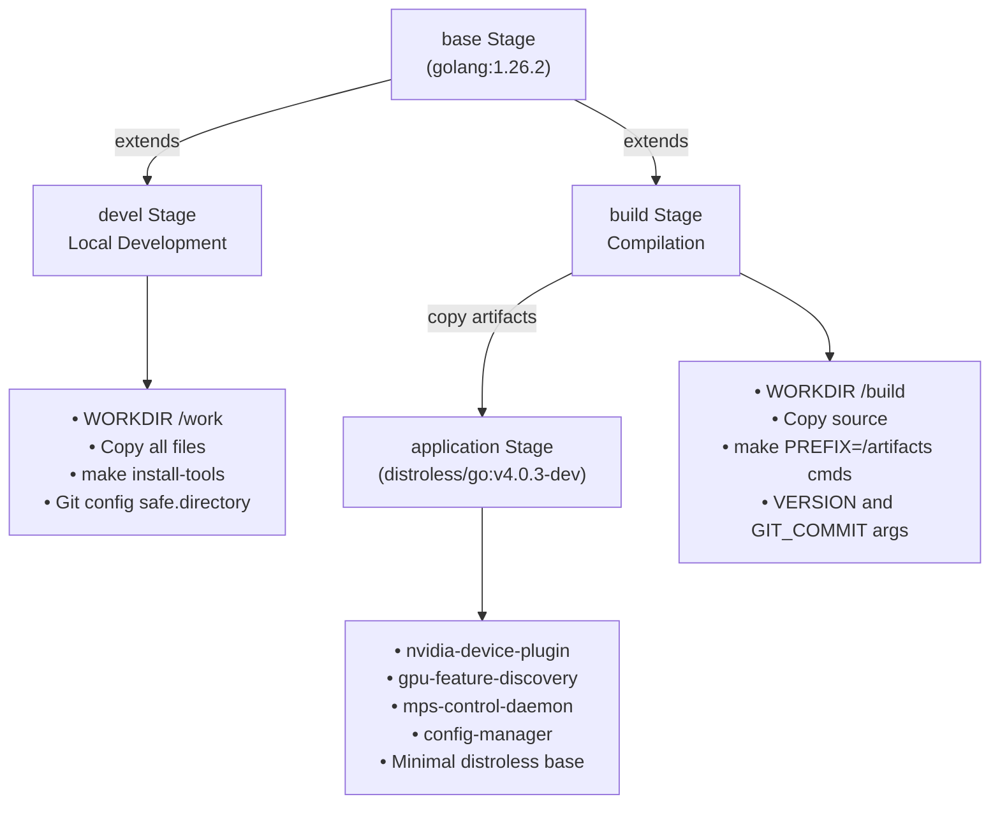
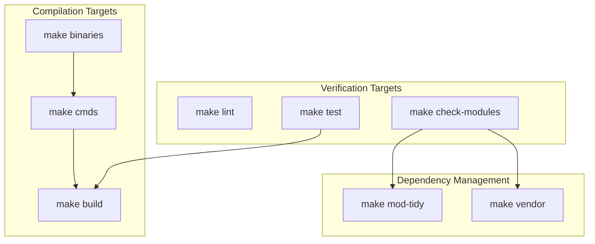

<!-- source: DeepWiki mcp.deepwiki.com · repo NVIDIA/k8s-device-plugin · page 9.1 Build System · fetched 2026-10-26 -->

# Build System

<details>
<summary>Relevant source files</summary>

The following files were used as context for generating this wiki page:

- [.github/dependabot.yml](.github/dependabot.yml)
- [.github/workflows/basic-checks.yaml](.github/workflows/basic-checks.yaml)
- [.github/workflows/ci.yaml](.github/workflows/ci.yaml)
- [.nvidia-ci.yml](.nvidia-ci.yml)
- [Makefile](Makefile)
- [README.md](README.md)
- [RELEASE.md](RELEASE.md)
- [demo/clusters/kind/scripts/build-plugin-image.sh](demo/clusters/kind/scripts/build-plugin-image.sh)
- [demo/clusters/kind/scripts/common.sh](demo/clusters/kind/scripts/common.sh)
- [deployments/container/Dockerfile](deployments/container/Dockerfile)
- [deployments/container/Makefile](deployments/container/Makefile)
- [deployments/container/multi-arch.mk](deployments/container/multi-arch.mk)
- [deployments/container/native-only.mk](deployments/container/native-only.mk)
- [deployments/devel/Makefile](deployments/devel/Makefile)
- [deployments/devel/go.mod](deployments/devel/go.mod)
- [deployments/devel/go.sum](deployments/devel/go.sum)
- [deployments/devel/tools.go](deployments/devel/tools.go)
- [deployments/helm/nvidia-device-plugin/Chart.lock](deployments/helm/nvidia-device-plugin/Chart.lock)
- [deployments/helm/nvidia-device-plugin/Chart.yaml](deployments/helm/nvidia-device-plugin/Chart.yaml)
- [deployments/static/nvidia-device-plugin-compat-with-cpumanager.yml](deployments/static/nvidia-device-plugin-compat-with-cpumanager.yml)
- [hack/golang-version.sh](hack/golang-version.sh)
- [versions.mk](versions.mk)

</details>


This page documents the build system for the NVIDIA Kubernetes Device Plugin, including the multi-stage Dockerfile architecture, build targets, multi-architecture image creation, and dependency management. The build system is designed to produce minimal, secure container images while supporting local development workflows and automated CI/CD pipelines.

## Prerequisites

The build system requires:

- Go 1.26.2 (as specified in [deployments/container/Dockerfile:15]())
- Docker or another OCI-compliant container build engine
- Git
- make
- `regctl` for image promotion and copying [Makefile:88-98]()

Sources: [deployments/container/Dockerfile:15](), [versions.mk:22](), [Makefile:88-98]()

## Multi-Stage Dockerfile Architecture

The build system uses a multi-stage Dockerfile located at [deployments/container/Dockerfile:1-73]() that optimizes for both development workflows and production images.

### Dockerfile Stages



**Stage Details:**

| Stage | Base Image | Purpose | Key Operations |
|-------|-----------|---------|----------------|
| `base` | `golang:1.26.2` | Common Go environment | Provides Go toolchain [deployments/container/Dockerfile:15]() |
| `devel` | Extends `base` | Local development | Installs dev tools via `make install-tools` [deployments/container/Dockerfile:26]() |
| `build` | Extends `base` | Binary compilation | Runs `make PREFIX=/artifacts cmds` [deployments/container/Dockerfile:41]() |
| `application` | `nvcr.io/nvidia/distroless/go:v4.0.3-dev` | Production runtime | Copies binaries from `build`, minimal footprint [deployments/container/Dockerfile:43]() |

The `devel` stage is used for local development with mounted source code, while the `build` and `application` stages create the production container image.

Sources: [deployments/container/Dockerfile:15-73]()

### Build Artifacts

The `build` stage compiles four primary binaries that are copied to the `application` stage:

- `config-manager` → `/usr/bin/config-manager` [deployments/container/Dockerfile:67]()
- `gpu-feature-discovery` → `/usr/bin/gpu-feature-discovery` [deployments/container/Dockerfile:68]()
- `mps-control-daemon` → `/usr/bin/mps-control-daemon` [deployments/container/Dockerfile:69]()
- `nvidia-device-plugin` → `/usr/bin/nvidia-device-plugin` [deployments/container/Dockerfile:70]()

The default `ENTRYPOINT` is set to `nvidia-device-plugin` [deployments/container/Dockerfile:72](), but the container can run any of the included binaries by overriding the entrypoint in a Pod specification.

Sources: [deployments/container/Dockerfile:67-72]()

### Runtime Configuration

The `application` stage sets NVIDIA-specific environment variables to ensure proper integration with the NVIDIA Container Toolkit:

```dockerfile
ENV NVIDIA_DISABLE_REQUIRE="true"
ENV NVIDIA_VISIBLE_DEVICES=all
ENV NVIDIA_DRIVER_CAPABILITIES=compute,utility
```

Sources: [deployments/container/Dockerfile:49-51]()

## Build Targets and Process

### Makefile Orchestration

The root `Makefile` defines the logic for compiling binaries, running tests, and managing dependencies.



**Key Makefile Targets:**
- `cmds`: Compiles all binaries found in the `./cmd/` directory [Makefile:60-62]().
- `build`: Runs `go build` with specific `ldflags` for versioning and dynamic linking [Makefile:56-58]().
- `test`: Runs unit tests with coverage reporting for `cmd`, `internal`, and `api` packages [Makefile:118-119]().
- `check-modules`: Verifies that `go.mod`, `go.sum`, and `vendor` are in sync with the source code [Makefile:114-115]().

Sources: [Makefile:47-127]()

### Versioning and Build Metadata

The build system injects versioning information into the binaries using Go `ldflags`. The package `github.com/NVIDIA/k8s-device-plugin/internal/info` stores the `version` and `gitCommit` variables [Makefile:45-46]().

- `CLI_VERSION`: Derived from `versions.mk` or overridden via environment variables [Makefile:40-44]().
- `GIT_COMMIT`: Captured using `git describe` [versions.mk:27]().

Sources: [Makefile:40-58](), [versions.mk:20-27]()

## Multi-Architecture and Multi-Platform Builds

The project supports `amd64` and `arm64` architectures. The build process can be performed natively or via a containerized environment.

### Containerized Builds

The `DOCKER_TARGETS` in the `Makefile` allow running any make target inside a development container. This ensures a consistent build environment regardless of the host OS [Makefile:140-151]().

```bash
# Example: Run lint inside a container
make docker-lint
```

Sources: [Makefile:140-151](), [versions.mk:24-25]()

### Image Promotion and Copying

The build system uses `regctl` to copy images between registries without requiring a local `docker pull/push` cycle. This is used for promoting images to different tags (e.g., `latest` or version-specific tags) [deployments/container/Makefile:89-98]().

Sources: [deployments/container/Makefile:89-98]()

## Dependency Management

The project uses Go modules and maintains a `vendor` directory.

- **Dependabot**: Daily updates are configured for `gomod`, `docker`, and `github-actions` ecosystems [github/dependabot.yml:5-44]().
- **Module Verification**: The `check-modules` target ensures that dependencies are not tampered with and that the `vendor` directory is up to date [Makefile:114-115]().

Sources: [.github/dependabot.yml:1-110](), [Makefile:91-115]()

## Release Process

The release process is semi-automated via scripts and GitHub Actions.

1. **Preparation**: `./hack/prepare-release.sh` updates versions across the repository [RELEASE.md:9]().
2. **Changelog**: `./hack/generate-changelog.sh` updates `CHANGELOG.md` [RELEASE.md:10]().
3. **Artifact Generation**:
    - **Container Images**: Built and pushed to registries (NGC, GHCR) [RELEASE.md:14]().
    - **Helm Charts**: Packaged via `./hack/package-helm-charts.sh` and published to GitHub Pages [RELEASE.md:27-40]().

Sources: [RELEASE.md:1-47](), [deployments/helm/nvidia-device-plugin/Chart.yaml:5-6]()

## Continuous Integration (GitLab/Internal)

For internal NVIDIA development, a `.nvidia-ci.yml` defines a multi-stage pipeline:

- **pull**: Synchronizes images from staging registries [nvidia-ci.yml:110-140]().
- **scan**: Performs security scanning using `pulse-cli` for vulnerabilities and license compliance [nvidia-ci.yml:151-186]().
- **release**: Promotes scanned images to production registries [nvidia-ci.yml:187-205]().

Sources: [.nvidia-ci.yml:42-205]()

---

