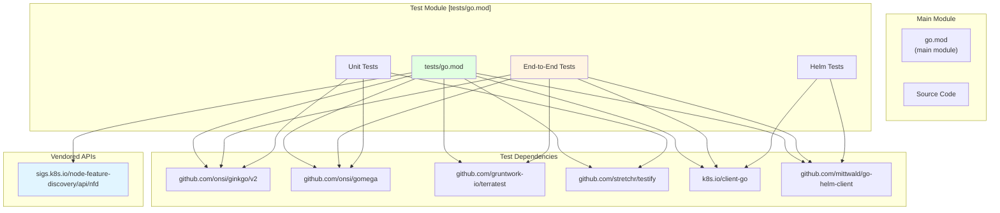
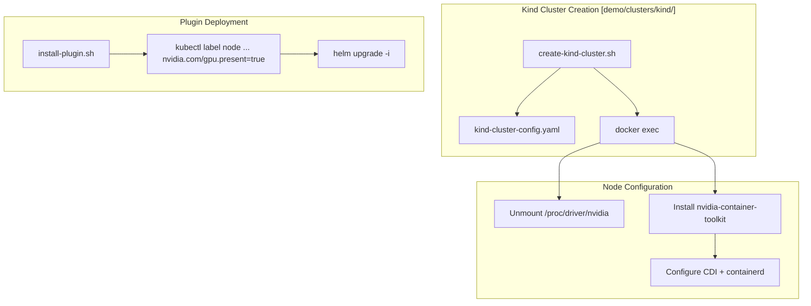
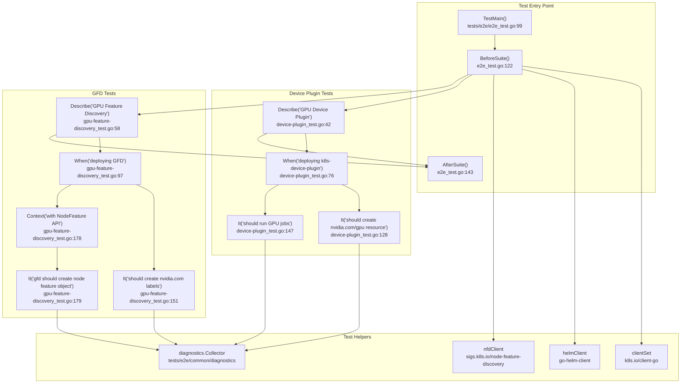
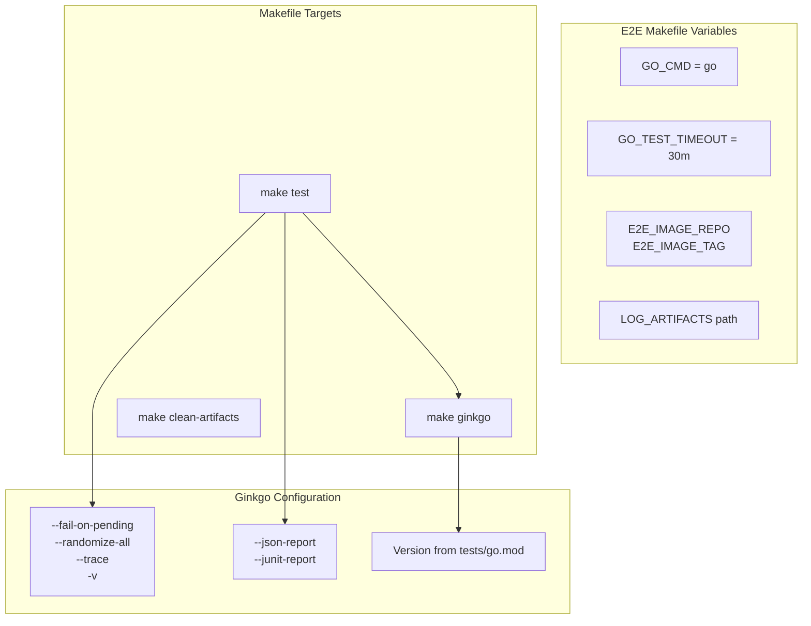

<!-- source: DeepWiki mcp.deepwiki.com · repo NVIDIA/k8s-device-plugin · page 9.2 Testing Infrastructure · fetched 2026-10-26 -->

# Testing Infrastructure

<details>
<summary>Relevant source files</summary>

The following files were used as context for generating this wiki page:

- [.gitignore](.gitignore)
- [demo/clusters/kind/build-plugin.sh](demo/clusters/kind/build-plugin.sh)
- [demo/clusters/kind/create-cluster.sh](demo/clusters/kind/create-cluster.sh)
- [demo/clusters/kind/delete-cluster.sh](demo/clusters/kind/delete-cluster.sh)
- [demo/clusters/kind/install-plugin.sh](demo/clusters/kind/install-plugin.sh)
- [demo/clusters/kind/scripts/build-kind-image.sh](demo/clusters/kind/scripts/build-kind-image.sh)
- [demo/clusters/kind/scripts/create-kind-cluster.sh](demo/clusters/kind/scripts/create-kind-cluster.sh)
- [demo/clusters/kind/scripts/delete-kind-cluster.sh](demo/clusters/kind/scripts/delete-kind-cluster.sh)
- [demo/clusters/kind/scripts/kind-cluster-config.yaml](demo/clusters/kind/scripts/kind-cluster-config.yaml)
- [demo/clusters/kind/scripts/load-plugin-image-into-kind.sh](demo/clusters/kind/scripts/load-plugin-image-into-kind.sh)
- [testdata/job-1.yaml](testdata/job-1.yaml)
- [tests/e2e/Makefile](tests/e2e/Makefile)
- [tests/e2e/device-plugin_test.go](tests/e2e/device-plugin_test.go)
- [tests/e2e/e2e_test.go](tests/e2e/e2e_test.go)
- [tests/e2e/gpu-feature-discovery_test.go](tests/e2e/gpu-feature-discovery_test.go)
- [tests/go.mod](tests/go.mod)
- [tests/go.sum](tests/go.sum)
- [tests/vendor/github.com/containerd/containerd/archive/compression/compression.go](tests/vendor/github.com/containerd/containerd/archive/compression/compression.go)
- [tests/vendor/github.com/containerd/containerd/content/content.go](tests/vendor/github.com/containerd/containerd/content/content.go)
- [tests/vendor/github.com/containerd/containerd/content/helpers.go](tests/vendor/github.com/containerd/containerd/content/helpers.go)
- [tests/vendor/github.com/onsi/ginkgo/v2/CHANGELOG.md](tests/vendor/github.com/onsi/ginkgo/v2/CHANGELOG.md)
- [tests/vendor/github.com/onsi/ginkgo/v2/README.md](tests/vendor/github.com/onsi/ginkgo/v2/README.md)
- [tests/vendor/github.com/onsi/ginkgo/v2/core_dsl.go](tests/vendor/github.com/onsi/ginkgo/v2/core_dsl.go)
- [tests/vendor/github.com/onsi/ginkgo/v2/ginkgo/command/command.go](tests/vendor/github.com/onsi/ginkgo/v2/ginkgo/command/command.go)
- [tests/vendor/github.com/onsi/ginkgo/v2/ginkgo/internal/run.go](tests/vendor/github.com/onsi/ginkgo/v2/ginkgo/internal/run.go)
- [tests/vendor/github.com/onsi/ginkgo/v2/internal/suite.go](tests/vendor/github.com/onsi/ginkgo/v2/internal/suite.go)
- [tests/vendor/github.com/onsi/ginkgo/v2/reporters/default_reporter.go](tests/vendor/github.com/onsi/ginkgo/v2/reporters/default_reporter.go)
- [tests/vendor/github.com/onsi/ginkgo/v2/types/version.go](tests/vendor/github.com/onsi/ginkgo/v2/types/version.go)
- [tests/vendor/modules.txt](tests/vendor/modules.txt)
- [tests/vendor/sigs.k8s.io/node-feature-discovery/api/nfd/v1alpha1/doc.go](tests/vendor/sigs.k8s.io/node-feature-discovery/api/nfd/v1alpha1/doc.go)
- [tests/vendor/sigs.k8s.io/node-feature-discovery/api/nfd/v1alpha1/types.go](tests/vendor/sigs.k8s.io/node-feature-discovery/api/nfd/v1alpha1/types.go)
- [tests/vendor/sigs.k8s.io/node-feature-discovery/api/nfd/v1alpha1/utils.go](tests/vendor/sigs.k8s.io/node-feature-discovery/api/nfd/v1alpha1/utils.go)
- [tests/vendor/sigs.k8s.io/node-feature-discovery/api/nfd/v1alpha1/zz_generated.deepcopy.go](tests/vendor/sigs.k8s.io/node-feature-discovery/api/nfd/v1alpha1/zz_generated.deepcopy.go)

</details>


## Purpose and Scope

This document describes the testing infrastructure for the NVIDIA Kubernetes Device Plugin. The testing system includes unit tests, end-to-end (E2E) tests using real Kubernetes clusters, Helm chart validation, and security scanning. The infrastructure uses a separate test module with dedicated dependencies and integrates with GitHub Actions for automated testing.

For information about the build system and container image creation, see [Build System](#9.1). For release processes, see [Release and Publishing Process](#9.3).

---

## Test Module Architecture

The testing infrastructure uses a dedicated Go module located in the `tests/` directory, separate from the main codebase. This provides isolation for test dependencies and prevents test-only packages from polluting the main module.



**Sources:**
- [tests/go.mod:1-19]()
- [tests/vendor/modules.txt:1-195]()

The test module declares dependencies on testing frameworks and Kubernetes APIs. Key dependencies include:

| Package | Version | Purpose |
|---------|---------|---------|
| `github.com/onsi/ginkgo/v2` | v2.28.1 | BDD testing framework |
| `github.com/onsi/gomega` | v1.39.1 | Matcher/assertion library |
| `github.com/gruntwork-io/terratest` | v0.47.2 | Infrastructure testing |
| `github.com/stretchr/testify` | v1.11.1 | Assertion toolkit |
| `k8s.io/client-go` | v0.35.2 | Kubernetes client library |
| `github.com/mittwald/go-helm-client` | v0.12.19 | Helm operations |
| `sigs.k8s.io/node-feature-discovery/api/nfd` | v0.18.3 | NFD CRD definitions |

**Sources:**
- [tests/go.mod:5-19]()
- [tests/vendor/github.com/onsi/ginkgo/v2/types/version.go:3-3]()

---

## End-to-End Testing Infrastructure

End-to-end tests validate the device plugin on real Kubernetes clusters. While production CI often uses AWS-based clusters, local development and testing frequently utilize **Kind** (Kubernetes in Docker).

### Kind Cluster Setup

The repository provides scripts to create a GPU-capable Kind cluster for local E2E testing.



**Sources:**
- [demo/clusters/kind/scripts/create-kind-cluster.sh:26-59]()
- [demo/clusters/kind/install-plugin.sh:25-32]()

The setup script `create-kind-cluster.sh` performs critical host-level adjustments:
1. **Unmounts masked paths**: Removes the masked `/proc/driver/nvidia` in the worker node container to allow MIG discovery [demo/clusters/kind/scripts/create-kind-cluster.sh:34-34]().
2. **Toolkit Installation**: Installs the `nvidia-container-toolkit` inside the Kind node [demo/clusters/kind/scripts/create-kind-cluster.sh:38-47]().
3. **CDI Configuration**: Configures the NVIDIA Container Runtime for CDI and restarts `containerd` [demo/clusters/kind/scripts/create-kind-cluster.sh:53-59]().

---

## E2E Test Suite Structure

The E2E tests are organized into focused test suites using Ginkgo's BDD framework. The entry point is `TestMain` in `tests/e2e/e2e_test.go`.

### Test Suite Organization



**Sources:**
- [tests/e2e/e2e_test.go:99-166]()
- [tests/e2e/device-plugin_test.go:42-178]()
- [tests/e2e/gpu-feature-discovery_test.go:58-214]()

### Device Plugin Test Suite

The device plugin test suite validates GPU resource allocation and job execution:

| Test Case | Function | Validation |
|-----------|----------|------------|
| Resource creation | `It("should create nvidia.com/gpu resource")` [tests/e2e/device-plugin_test.go:128]() | Verifies `nvidia.com/gpu` capacity on nodes via `MatchCapacity` [tests/e2e/device-plugin_test.go:145]() |
| GPU job execution | `It("should run GPU jobs")` [tests/e2e/device-plugin_test.go:147]() | Creates job from `testdata/job-1.yaml` [tests/e2e/device-plugin_test.go:149]() and validates completion |

**Sources:**
- [tests/e2e/device-plugin_test.go:42-178]()
- [testdata/job-1.yaml:1-26]()

### GPU Feature Discovery Test Suite

The GFD test suite validates node label generation and NodeFeature API integration. It uses regex patterns to verify label values.

**Expected Label Patterns:**
```go
var expectedLabelPatterns = k8sLabels{
	"nvidia.com/gfd.timestamp":        "[0-9]{10}",
	"nvidia.com/cuda.driver.major":    "[0-9]+",
	"nvidia.com/cuda.driver.minor":    "[0-9]+",
	"nvidia.com/gpu.sharing-strategy": "[none|mps|time-slicing]",
	"nvidia.com/mig.capable":          "[true|false]",
    // ...
}
```
**Sources:**
- [tests/e2e/gpu-feature-discovery_test.go:37-55]()

**NodeFeature API Integration:**
The suite tests if GFD creates `NodeFeature` objects when `nfd.enableNodeFeatureApi=true` is set in the Helm chart [tests/e2e/gpu-feature-discovery_test.go:182](). It verifies the object `nvidia-features-for-<node-name>` exists in the test namespace [tests/e2e/gpu-feature-discovery_test.go:91-95]().

---

## E2E Makefile and Execution

The E2E tests use a dedicated Makefile located at `tests/e2e/Makefile` to coordinate test binary installation and execution.



**Sources:**
- [tests/e2e/Makefile:1-53]()

### Makefile Targets

| Target | Command | Purpose |
|--------|---------|---------|
| `ginkgo` | `GOBIN=$(CURDIR)/bin go install github.com/onsi/ginkgo/v2/ginkgo@$(GINKGO_VERSION)` | Installs the specific version of Ginkgo CLI required by `tests/go.mod` [tests/e2e/Makefile:37-40](). |
| `test` | `$(CURDIR)/bin/ginkgo $(GINKGO_COMMON_ARGS) $(GINKGO_REPORT_ARGS) ./tests/e2e/...` | Executes all E2E tests and generates JSON/JUnit reports in the artifacts directory [tests/e2e/Makefile:51-53](). |
| `clean-artifacts` | `rm -rf $(LOG_ARTIFACTS)` | Cleans up the `e2e_logs` directory [tests/e2e/Makefile:47-49](). |

---

## Test Artifacts and Diagnostics

On test failure, the E2E suites trigger a `diagnostics.Collector` to gather logs and state from the cluster.

**Collected Resources:**
- Pods, Nodes, Namespaces, Deployments, DaemonSets [tests/e2e/device-plugin_test.go:52-59]().
- NodeFeature objects (for GFD tests) [tests/e2e/gpu-feature-discovery_test.go:74-74]().

**Diagnostics Implementation:**
```go
diagnosticsCollector, err = diagnostics.New(
    diagnostics.WithNamespace(testNamespace.Name),
    diagnostics.WithArtifactDir(LogArtifactDir),
    diagnostics.WithKubernetesClient(clientSet),
    diagnostics.WithNFDClient(nfdClient),
    diagnostics.WithObjects(collectLogsFrom...),
)
```
**Sources:**
- [tests/e2e/gpu-feature-discovery_test.go:137-143]()
- [tests/e2e/device-plugin_test.go:115-120]()

The artifacts are stored in a directory defined by `LOG_ARTIFACTS` (defaulting to `e2e_logs/`) and include:
- `report.json`: Full Ginkgo report [tests/e2e/Makefile:33-33]().
- `junit.xml`: JUnit formatted report for CI integration [tests/e2e/Makefile:33-33]().
- `helm_logs`: Detailed logs from the `go-helm-client` [tests/e2e/e2e_test.go:198-201]().

**Sources:**
- [tests/e2e/e2e_test.go:229-230]()
- [.gitignore:8-12]()

---

