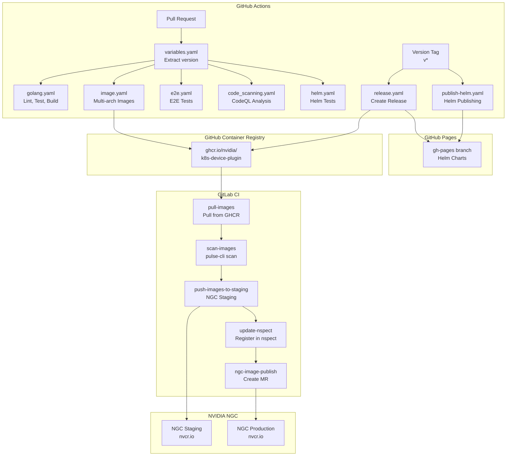
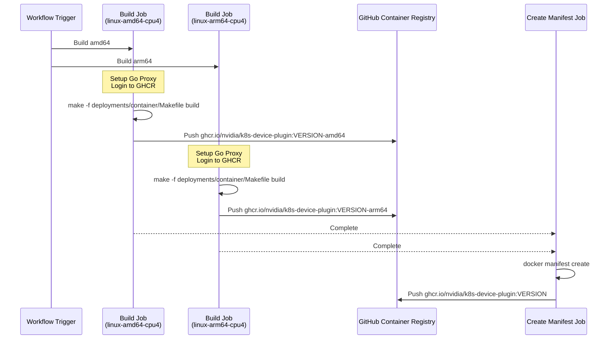
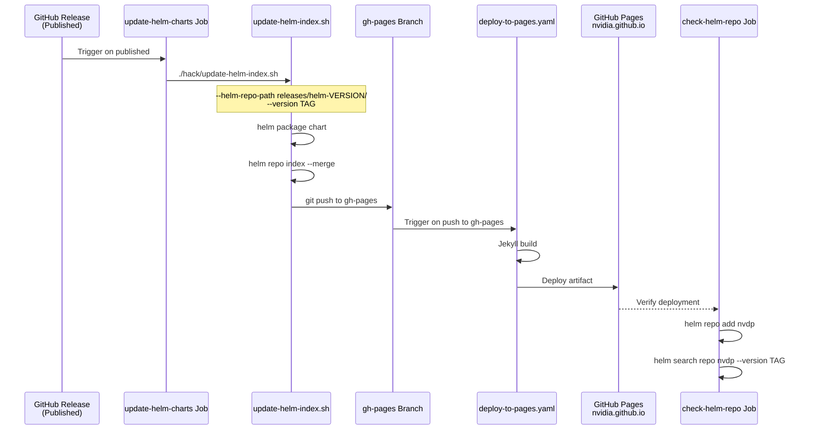

<!-- source: DeepWiki mcp.deepwiki.com · repo NVIDIA/k8s-device-plugin · page 9.3 Release and Publishing Process · fetched 2026-10-26 -->

# Release and Publishing Process

<details>
<summary>Relevant source files</summary>

The following files were used as context for generating this wiki page:

- [.github/scripts/add-labels-from-comment.js](.github/scripts/add-labels-from-comment.js)
- [.github/scripts/backport.js](.github/scripts/backport.js)
- [.github/scripts/extract-branches.js](.github/scripts/extract-branches.js)
- [.github/workflows/basic-checks.yaml](.github/workflows/basic-checks.yaml)
- [.github/workflows/cherrypick.yml](.github/workflows/cherrypick.yml)
- [.github/workflows/ci.yaml](.github/workflows/ci.yaml)
- [.github/workflows/code_scanning.yaml](.github/workflows/code_scanning.yaml)
- [.github/workflows/deploy-to-pages.yaml](.github/workflows/deploy-to-pages.yaml)
- [.github/workflows/e2e.yaml](.github/workflows/e2e.yaml)
- [.github/workflows/golang.yaml](.github/workflows/golang.yaml)
- [.github/workflows/helm.yaml](.github/workflows/helm.yaml)
- [.github/workflows/image.yaml](.github/workflows/image.yaml)
- [.github/workflows/publish-helm.yaml](.github/workflows/publish-helm.yaml)
- [.github/workflows/release.yaml](.github/workflows/release.yaml)
- [.github/workflows/variables.yaml](.github/workflows/variables.yaml)
- [.nvidia-ci.yml](.nvidia-ci.yml)
- [demo/clusters/kind/scripts/common.sh](demo/clusters/kind/scripts/common.sh)
- [deployments/container/Dockerfile](deployments/container/Dockerfile)
- [deployments/container/Makefile](deployments/container/Makefile)
- [deployments/container/multi-arch.mk](deployments/container/multi-arch.mk)
- [deployments/container/native-only.mk](deployments/container/native-only.mk)
- [hack/create-release.sh](hack/create-release.sh)
- [hack/generate-changelog.sh](hack/generate-changelog.sh)
- [hack/package-helm-charts.sh](hack/package-helm-charts.sh)
- [hack/prepare-release.sh](hack/prepare-release.sh)
- [hack/update-helm-index.sh](hack/update-helm-index.sh)
- [tests/e2e/infra/aws.yaml](tests/e2e/infra/aws.yaml)

</details>


This document describes the automated release and publishing pipeline for the NVIDIA Kubernetes Device Plugin. It covers the dual-pipeline architecture using GitHub Actions for primary CI/CD and GitLab CI for NVIDIA-internal NGC publishing, including version management, image building, security scanning, and Helm chart distribution.

For information about the build system and Dockerfile structure, see [Build System](9.1). For testing infrastructure including Holodeck-based end-to-end tests, see [Testing Infrastructure](9.2).

## Overview

The release process operates through two independent but coordinated pipelines:

1.  **GitHub Actions Pipeline**: Handles linting, testing, multi-architecture image builds, security analysis, release creation, and Helm chart publishing to GitHub Pages.
2.  **GitLab CI Pipeline**: Pulls images from GitHub Container Registry, performs internal security scanning, and publishes to NVIDIA NGC registry.

This dual-pipeline design enables open-source development on GitHub while maintaining NVIDIA's internal release and compliance processes through GitLab.



**Sources:** [.github/workflows/variables.yaml](), [.github/workflows/golang.yaml](), [.github/workflows/image.yaml](), [.github/workflows/e2e.yaml](), [.github/workflows/release.yaml](), [.github/workflows/publish-helm.yaml](), [.nvidia-ci.yml]()

## GitHub Actions Pipeline

### Workflow Orchestration

The GitHub Actions pipeline uses a reusable workflow pattern where `variables.yaml` extracts common values that other workflows consume:

| Workflow | Trigger | Purpose | Key Outputs |
| :--- | :--- | :--- | :--- |
| `variables.yaml` | `workflow_call` | Extract version and Go version | `version` (short SHA), `golang_version` |
| `golang.yaml` | PR, main push | Lint, unit test, build binaries | Build validation |
| `image.yaml` | PR, main push | Build multi-arch container images | Images in ghcr.io |
| `e2e.yaml` | PR, main push | End-to-end tests on AWS | Test results |
| `code_scanning.yaml` | PR, main push | CodeQL security analysis | Security alerts |
| `helm.yaml` | PR, main push | Helm chart tests | Chart validation |
| `release.yaml` | Tag `v*` | Create GitHub release | Release artifacts |
| `publish-helm.yaml` | Release published | Publish Helm charts | Charts in gh-pages |

**Sources:** [.github/workflows/variables.yaml](), [.github/workflows/golang.yaml](), [.github/workflows/image.yaml](), [.github/workflows/e2e.yaml](), [.github/workflows/code_scanning.yaml](), [.github/workflows/helm.yaml](), [.github/workflows/release.yaml](), [.github/workflows/publish-helm.yaml]()

### Version Management

Version information is extracted by the `variables` job in `.github/workflows/variables.yaml`:

*   **Short SHA**: Generated from `GITHUB_SHA` (first 8 characters) and used as the image tag for development builds.
*   **Golang Version**: Extracted by running `./hack/golang-version.sh`, which reads from `versions.mk`.

These outputs are consumed by other workflows as inputs [ .github/workflows/variables.yaml:29-44 ]().

### Multi-Architecture Image Build

The `image.yaml` workflow builds separate images for `amd64` and `arm64` architectures, then combines them into a multi-arch manifest:



The build process uses:

*   Native architecture runners (`linux-amd64-cpu4` and `linux-arm64-cpu4`) [ .github/workflows/image.yaml:31-31 ]().
*   NVIDIA's internal Go proxy for dependency resolution [ .github/workflows/image.yaml:45-47 ]().
*   Environment variables passed to the Makefile [ .github/workflows/image.yaml:49-54 ]():
    *   `IMAGE_NAME`: `ghcr.io/nvidia/k8s-device-plugin`
    *   `VERSION`: `${inputs.version}-${matrix.arch}`
    *   `PUSH_ON_BUILD`: `true`
    *   `GOPROXY`: Artifactory-based proxy URL
    *   `DOCKER_BUILD_PLATFORM_OPTIONS`: `--platform=linux/${matrix.arch}`

**Sources:** [.github/workflows/image.yaml:25-79](), [deployments/container/Makefile:24-81](), [deployments/container/native-only.mk:15-33]()

### End-to-End Testing

The `e2e.yaml` workflow provisions AWS-based Kubernetes clusters using Holodeck and runs comprehensive integration tests:

1.  **Cluster Provisioning**: Uses `NVIDIA/holodeck@v0.2.17` action with configuration from `tests/e2e/infra/aws.yaml` [ .github/workflows/e2e.yaml:50-56 ]().
2.  **Test Execution**: Runs `make -f tests/e2e/Makefile test` [ .github/workflows/e2e.yaml:68-68 ]() with environment:
    *   `KUBECONFIG`: Path to generated kubeconfig
    *   `E2E_IMAGE_REPO`: `ghcr.io/nvidia/k8s-device-plugin`
    *   `E2E_IMAGE_TAG`: Version to test
    *   `LOG_ARTIFACTS`: Path for test logs [ .github/workflows/e2e.yaml:59-66 ]().
3.  **Artifact Collection**: Uploads logs on failure for debugging [ .github/workflows/e2e.yaml:70-83 ]().

The workflow requires AWS credentials and SSH keys provided as secrets for cluster provisioning [ .github/workflows/e2e.yaml:26-32 ]().

**Sources:** [.github/workflows/e2e.yaml:39-88]()

### Security Analysis

Two security mechanisms are in place:

1.  **CodeQL Analysis** (`code_scanning.yaml`): Performs static analysis of Go code [ .github/workflows/code_scanning.yaml:25-54 ]().
    *   Initializes CodeQL with language set to `go` and `manual` build mode.
    *   Runs `make build` to compile code for analysis.
    *   Uploads results to GitHub Security tab.
2.  **Dependency Scanning**: Via GitHub's Dependabot (configured separately).

**Sources:** [.github/workflows/code_scanning.yaml:25-54]()

## Release Creation

When a tag matching the pattern `v*` is pushed, the `release.yaml` workflow:

1.  **Generates Helm Charts**: Runs `./hack/package-helm-charts.sh ${{ github.ref_name }}` to create packaged chart archives [ .github/workflows/release.yaml:35-37 ]().
2.  **Creates Draft Release**: Runs `./hack/create-release.sh ${{ github.ref_name }}` which uses GitHub CLI to create a draft release for the tag and attach Helm chart packages as release assets [ .github/workflows/release.yaml:39-44 ]().

The release remains in draft state until manually published, allowing for review before public release.

**Sources:** [.github/workflows/release.yaml:24-44]()

## Helm Chart Publishing

After a release is published, `publish-helm.yaml` workflow publishes Helm charts to GitHub Pages:



The process:

1.  Packages Helm chart and updates the repository index using `./hack/update-helm-index.sh` [ .github/workflows/publish-helm.yaml:40-46 ]().
2.  Commits to `gh-pages` branch under `releases/helm-${VERSION}/` [ .github/workflows/publish-helm.yaml:48-50 ]().
3.  GitHub Pages deployment workflow (`deploy-to-pages.yaml`) builds with Jekyll and deploys [ .github/workflows/deploy-to-pages.yaml:50-79 ]().
4.  Verification job confirms chart is searchable in published repository [ .github/workflows/publish-helm.yaml:56-70 ]().

**Sources:** [.github/workflows/publish-helm.yaml:24-70](), [.github/workflows/deploy-to-pages.yaml:50-79]()

## GitLab CI Pipeline for NGC Publishing

The `.nvidia-ci.yml` pipeline handles NVIDIA's internal publishing process. It is triggered by pushes to `main`, `release-*` branches, tags, or manual web triggers [ .nvidia-ci.yml:48-57 ]().

### Pipeline Stages

| Stage | Job | Purpose | Dependencies |
| :--- | :--- | :--- | :--- |
| `pull` | `pull-images` | Copy images from ghcr.io to internal registry | None |
| `scan` | `scan-images` | Security scan with pulse-cli | `pull-images` |
| `release` | `push-images-to-staging` | Copy to NGC staging registry | `scan-images` |
| `ngc-publish` | `ngc-image-publish` | Create NGC publish MR (tags only) | `update-nspect` |

**Sources:** [.nvidia-ci.yml:42-46]()

### Image Pull from GitHub Container Registry

The `pull-images` job uses the `.copy-images` template with `regctl` to copy images [ .nvidia-ci.yml:109-123 ]():

```yaml
IN_REGISTRY: ghcr.io/nvidia
IN_IMAGE_NAME: ghcr.io/nvidia/k8s-device-plugin
IN_IMAGE_TAG: ${STAGING_VERSION}

OUT_REGISTRY: ${CI_REGISTRY}
OUT_REGISTRY_USER: ${CI_REGISTRY_USER}
OUT_REGISTRY_TOKEN: ${CI_REGISTRY_PASSWORD}
OUT_IMAGE_NAME: ${CI_REGISTRY_IMAGE}/k8s-device-plugin
OUT_IMAGE_TAG: ${CI_COMMIT_SHORT_SHA}
```

The job includes a 30-minute delay when triggered from branches (not tags) to allow GitHub Actions to complete [ .nvidia-ci.yml:125-133 ]().

**Sources:** [.nvidia-ci.yml:109-139]()

### Security Scanning

The `scan-images` job runs in parallel for `linux/amd64` and `linux/arm64` platforms using NVIDIA's `pulse-cli` scanner [ .nvidia-ci.yml:151-163 ]():

1.  Pulls platform-specific image from internal registry [ .nvidia-ci.yml:169-169 ]().
2.  Saves image to tar archive [ .nvidia-ci.yml:170-170 ]().
3.  Authenticates with SSA (NVIDIA's security service) [ .nvidia-ci.yml:171-173 ]().
4.  Runs `pulse-cli` scan [ .nvidia-ci.yml:175-175 ]().

Artifacts produced include `licenses.json`, `sbom.json`, `vulns.json`, and `policy_evaluation.json` [ .nvidia-ci.yml:180-185 ]().

**Sources:** [.nvidia-ci.yml:151-185]()

### NGC Staging Push

The `push-images-to-staging` job copies images from internal registry to NGC staging [ .nvidia-ci.yml:187-204 ]():

```yaml
IN_REGISTRY: ${CI_REGISTRY}
IN_IMAGE_NAME: ${CI_REGISTRY_IMAGE}/k8s-device-plugin
IN_IMAGE_TAG: ${CI_COMMIT_SHORT_SHA}

OUT_REGISTRY: ${NGC_REGISTRY}
OUT_IMAGE_NAME: ${NGC_STAGING_REGISTRY}/k8s-device-plugin
OUT_IMAGE_TAG: ${CI_COMMIT_SHORT_SHA}
```

**Sources:** [.nvidia-ci.yml:187-204]()

## Container Registry Destinations

Images are published to multiple registries:

| Registry | URL | Purpose | Multi-arch |
| :--- | :--- | :--- | :--- |
| GitHub Container Registry | `ghcr.io/nvidia/k8s-device-plugin` | Public open-source distribution | Yes |
| NGC Staging | `${NGC_STAGING_REGISTRY}/k8s-device-plugin` | Pre-production validation | Yes |
| Internal GitLab Registry | `${CI_REGISTRY_IMAGE}/k8s-device-plugin` | Internal CI/CD buffer | Yes |

**Version Tags:**

*   **Development**: `${CI_COMMIT_SHORT_SHA}` (8-character SHA) [ .nvidia-ci.yml:40-40 ]().
*   **Release**: `v${VERSION}` (e.g., `v0.14.5`) [ .github/workflows/release.yaml:21-21 ]().
*   **Devel Branch**: `devel` tag for main branch [ .nvidia-ci.yml:35-35 ]().

**Sources:** [.nvidia-ci.yml:28-40](), [deployments/container/Makefile:24-36]()

## Release Artifacts

A complete release includes:

### GitHub Release Artifacts

*   **Helm Chart Packages**: `.tgz` files for each chart version [ .github/workflows/release.yaml:35-37 ]().
*   **Release Notes**: Generated using `./hack/create-release.sh` [ .github/workflows/release.yaml:39-44 ]().

### Helm Repository (GitHub Pages)

*   **Chart Index**: `index.yaml` at `https://nvidia.github.io/k8s-device-plugin/` [ .github/workflows/publish-helm.yaml:67-67 ]().
*   **Chart Packages**: Available via the Helm repository [ .github/workflows/publish-helm.yaml:65-70 ]().

### Container Images

*   Multi-arch manifests supporting `linux/amd64` and `linux/arm64` [ .github/workflows/image.yaml:71-79 ]().
*   Images include the core plugin binaries: `nvidia-device-plugin`, `gpu-feature-discovery`, `config-manager`, and `mps-control-daemon` [ deployments/container/Dockerfile:67-70 ]().

**Sources:** [.github/workflows/release.yaml](), [.github/workflows/publish-helm.yaml](), [.github/workflows/image.yaml](), [deployments/container/Dockerfile]()

---

