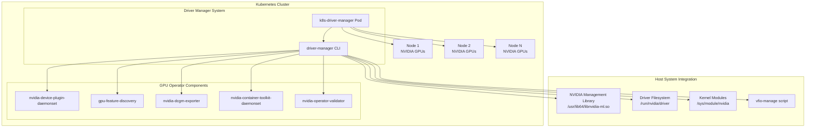
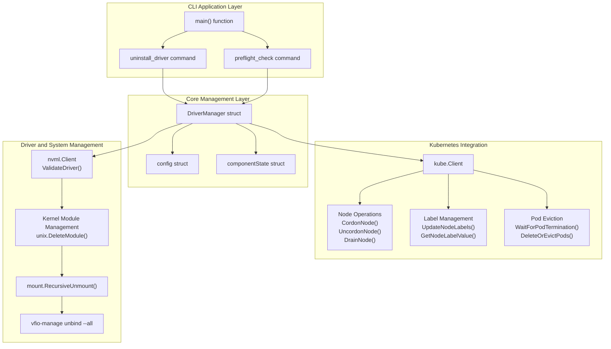
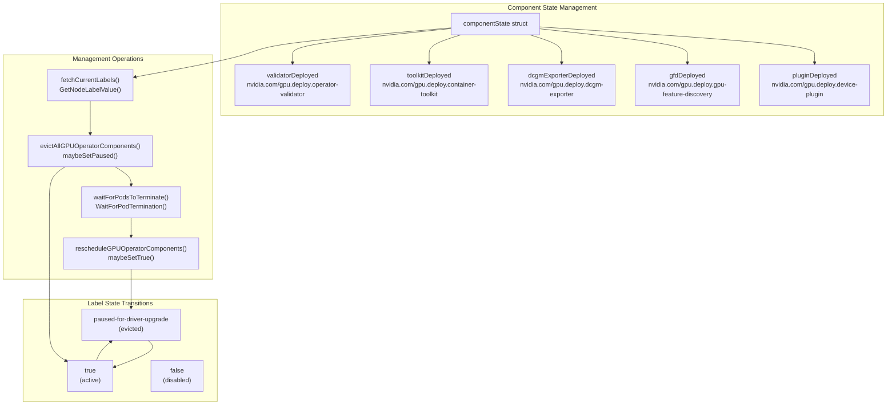
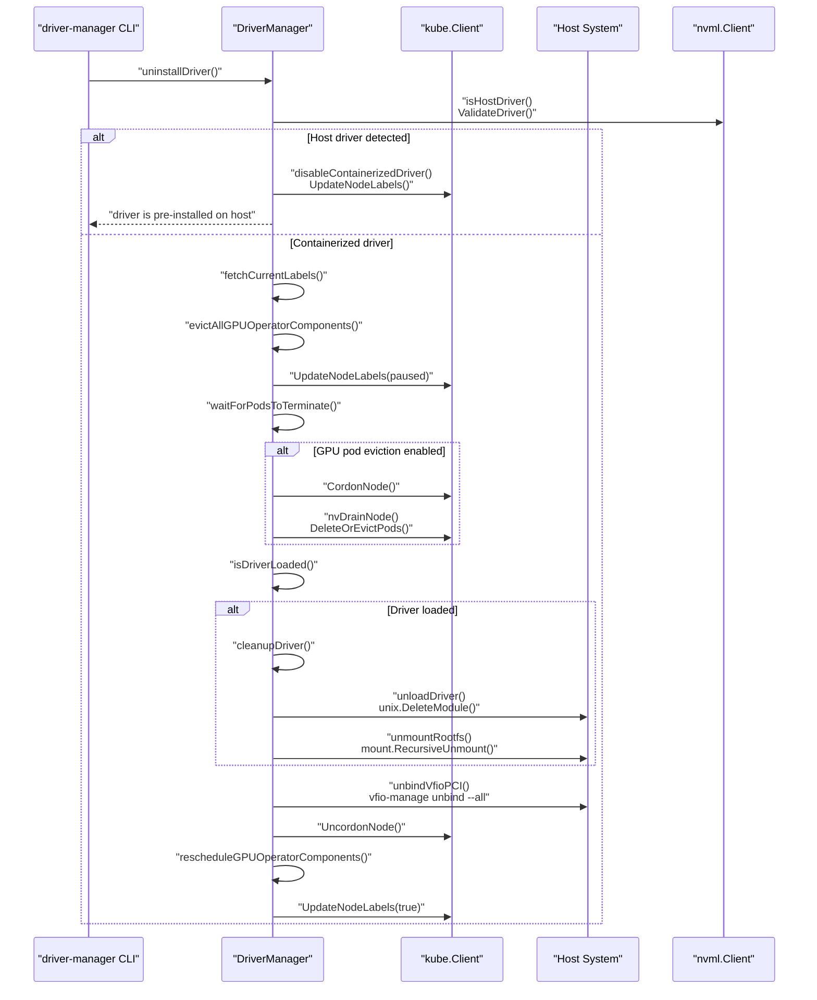

<!-- source: DeepWiki mcp.deepwiki.com · repo NVIDIA/k8s-driver-manager · page 1 Overview · fetched 2026-10-26 -->

# Overview

Relevant source files

The following files were used as context for generating this wiki page:

- [LICENSE](LICENSE)
- [README.md](README.md)
- [cmd/driver-manager/main.go](cmd/driver-manager/main.go)
- [go.mod](go.mod)

The NVIDIA k8s-driver-manager is a Kubernetes component designed to orchestrate seamless upgrades of NVIDIA GPU drivers across cluster nodes. It ensures that all prerequisites are met before driver upgrades by managing GPU operator component lifecycle, node operations, and driver module cleanup.

This document covers the overall system purpose, architecture, and key components. For detailed information about the build system and development workflow, see [Build System](#3.1). For container deployment and CI/CD processes, see [Deployment](#4).

## System Purpose and Context

The k8s-driver-manager operates as part of the broader NVIDIA GPU operator ecosystem, coordinating driver upgrades through a systematic process of component eviction, node management, and driver cleanup.

Sources: [README.md:1-12](), [cmd/driver-manager/main.go:43-65]()

## Core Application Components

The system is built around the `DriverManager` struct which coordinates operations through specialized subsystems for Kubernetes integration, driver management, and system utilities.

Sources: [cmd/driver-manager/main.go:100-108](), [cmd/driver-manager/main.go:67-98](), [cmd/driver-manager/main.go:214-242]()

## GPU Operator Component Management

The system manages multiple GPU operator components through a label-based deployment control mechanism, transitioning components between active, paused, and disabled states during driver upgrades.

Sources: [cmd/driver-manager/main.go:84-98](), [cmd/driver-manager/main.go:500-535](), [cmd/driver-manager/main.go:777-805](), [cmd/driver-manager/main.go:537-549]()

## Driver Upgrade Workflow

The system follows a structured workflow that ensures safe driver upgrades by coordinating node drainage, component eviction, driver cleanup, and component rescheduling.

Sources: [cmd/driver-manager/main.go:261-383](), [cmd/driver-manager/main.go:636-693](), [cmd/driver-manager/main.go:695-711](), [cmd/driver-manager/main.go:716-720]()

## Configuration and Environment Integration

The system provides extensive configuration options through environment variables and CLI flags, supporting various deployment scenarios including GPU Direct RDMA, custom node selectors, and different drain policies.

| Configuration Category | Key Parameters | Environment Variables |
|------------------------|----------------|----------------------|
| Node Management | `nodeName`, `drainTimeout`, `drainUseForce` | `NODE_NAME`, `DRAIN_TIMEOUT_SECONDS`, `DRAIN_USE_FORCE` |
| GPU Pod Eviction | `enableGPUPodEviction`, `nodeLabelForGPUPodEviction` | `ENABLE_GPU_POD_EVICTION`, `NODE_LABEL_FOR_GPU_POD_EVICTION` |
| Operator Integration | `operatorNamespace` | `OPERATOR_NAMESPACE` |
| GPU Direct RDMA | `gpuDirectRDMAEnabled`, `useHostMofed` | `GPU_DIRECT_RDMA_ENABLED`, `USE_HOST_MOFED` |
| Auto Drain Policy | `enableAutoDrain` | `ENABLE_AUTO_DRAIN` |

The system integrates with Kubernetes through the `kube.Client` and validates GPU environments using `nvml.Client` with configurable driver root paths and validation policies.

Sources: [cmd/driver-manager/main.go:67-81](), [cmd/driver-manager/main.go:127-212](), [cmd/driver-manager/main.go:43-65]()

---

