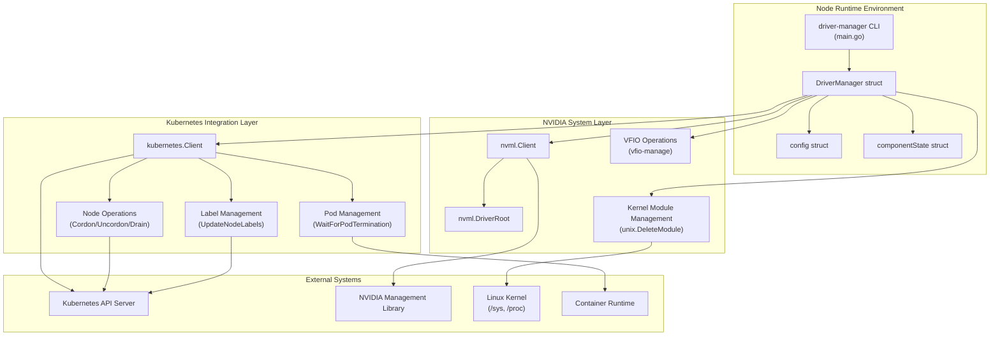
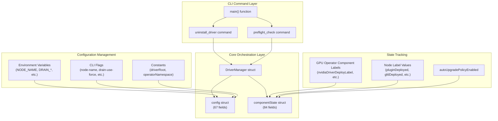
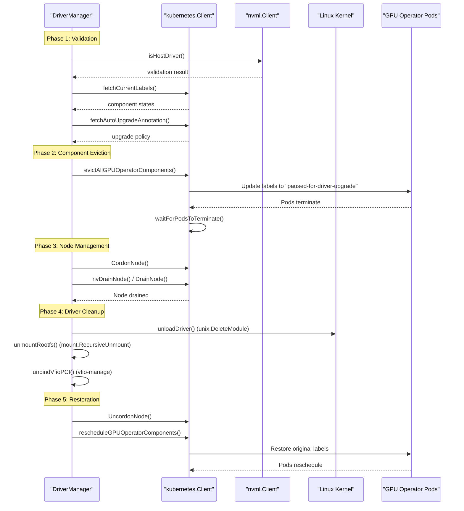
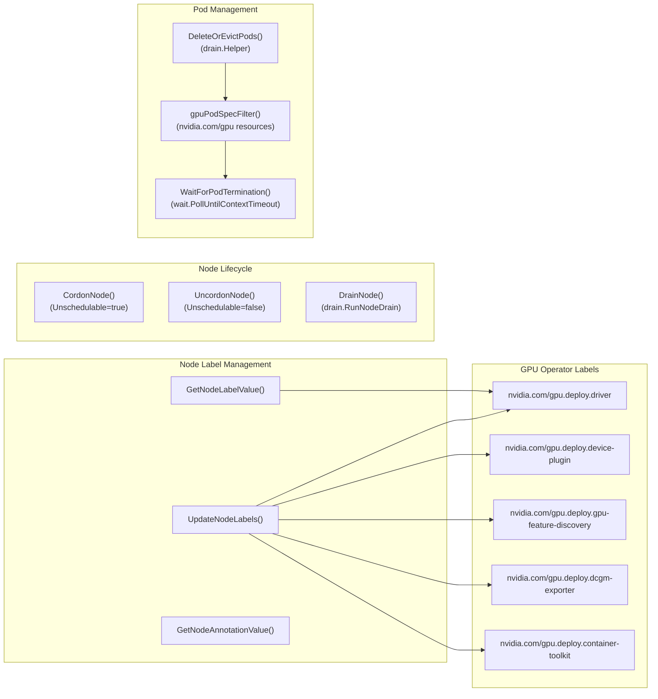

<!-- source: DeepWiki mcp.deepwiki.com · repo NVIDIA/k8s-driver-manager · page 2 Architecture · fetched 2026-10-26 -->

# Architecture

Relevant source files

The following files were used as context for generating this wiki page:

- [README.md](README.md)
- [cmd/driver-manager/main.go](cmd/driver-manager/main.go)
- [internal/kubernetes/client.go](internal/kubernetes/client.go)
- [internal/nvml/driver-root.go](internal/nvml/driver-root.go)

This document describes the overall architecture of the k8s-driver-manager system, explaining how the components work together to orchestrate NVIDIA GPU driver upgrades across Kubernetes nodes. It covers the core application structure, integration patterns with Kubernetes and NVIDIA systems, and the orchestration flow for safe driver management operations.

For information about individual components, see [Core Components](#2.1). For deployment patterns and container images, see [Deployment](#4).

## System Overview

The k8s-driver-manager functions as a Kubernetes-native orchestrator for NVIDIA GPU driver lifecycle management. The system operates as a CLI application that executes within containers on GPU-enabled nodes, coordinating between Kubernetes APIs, NVIDIA driver systems, and Linux kernel modules to ensure safe driver transitions.

**Sources:** [cmd/driver-manager/main.go:100-109](), [internal/kubernetes/client.go:44-49](), [internal/nvml/driver-root.go:24-42]()

## Core Application Structure

The application follows a layered architecture with the `DriverManager` as the central orchestrator. The CLI interface provides two primary operations through the `urfave/cli` framework.

**Sources:** [cmd/driver-manager/main.go:214-237](), [cmd/driver-manager/main.go:67-98](), [cmd/driver-manager/main.go:43-65]()

## Driver Upgrade Orchestration Flow

The `uninstallDriver()` method implements a multi-phase process that safely transitions nodes from one driver version to another while maintaining cluster stability.

**Sources:** [cmd/driver-manager/main.go:261-383](), [cmd/driver-manager/main.go:500-535](), [cmd/driver-manager/main.go:636-657]()

## Kubernetes Integration Patterns

The system integrates deeply with Kubernetes through label-based component management and pod lifecycle operations. The `Client` struct provides abstractions over core Kubernetes operations.

**Sources:** [internal/kubernetes/client.go:81-115](), [internal/kubernetes/client.go:129-171](), [internal/kubernetes/client.go:212-282](), [cmd/driver-manager/main.go:53-64]()

## NVIDIA Driver Management Integration

The system manages NVIDIA drivers through direct kernel module manipulation and NVML library integration. The `nvml` package provides abstractions for driver detection and validation.

```mermaid
graph TB
    subgraph "Driver Detection"
        DriverRoot["nvml.DriverRoot"]
        NVMLPath["GetNVMLPath()<br/>(library search paths)"]
        ValidateDriver["ValidateDriver()"]
    end
    
    subgraph "Kernel Module Management"
        ModuleCheck["isDriverLoaded()<br/>(/sys/module/nvidia/refcnt)"]
        ModuleUnload["unix.DeleteModule()<br/>(nvidia, nvidia_uvm, etc.)"]
        NouveauCheck["isNouveauLoaded()<br/>(/sys/module/nouveau/refcnt)"]
    end
    
    subgraph "Filesystem Operations"
        MountCheck["os.Stat(driverRoot)<br/>(/run/nvidia/driver)"]
        Unmount["mount.RecursiveUnmount()"]
        PIDFile["driverPIDFile cleanup<br/>(/run/nvidia/nvidia-driver.pid)"]
    end
    
    subgraph "VFIO Management"
        VFIOUnbind["unbindVfioPCI()<br/>(vfio-manage unbind --all)"]
        MellanoxCheck["mellanoxDevicesPresent()<br/>(/sys/bus/pci/devices)"]
        MOFEDWait["waitForMofedDriver()<br/>(/proc/modules, mlx5_core)"]
    end
    
    DriverRoot --> NVMLPath
    NVMLPath --> ValidateDriver
    
    ModuleCheck --> ModuleUnload
    ModuleUnload --> NouveauCheck
    
    MountCheck --> Unmount
    Unmount --> PIDFile
    
    VFIOUnbind --> MellanoxCheck
    MellanoxCheck --> MOFEDWait
```

**Sources:** [internal/nvml/driver-root.go:26-42](), [cmd/driver-manager/main.go:621-634](), [cmd/driver-manager/main.go:659-693](), [cmd/driver-manager/main.go:695-775]()

## Component State Management

The system tracks GPU operator component deployment states through Kubernetes node labels, enabling precise control over component scheduling during driver transitions.

| Component | Label Key | State Values |
|-----------|-----------|--------------|
| Device Plugin | `nvidia.com/gpu.deploy.device-plugin` | `true`, `false`, `paused-for-driver-upgrade` |
| GPU Feature Discovery | `nvidia.com/gpu.deploy.gpu-feature-discovery` | `true`, `false`, `paused-for-driver-upgrade` |
| DCGM Exporter | `nvidia.com/gpu.deploy.dcgm-exporter` | `true`, `false`, `paused-for-driver-upgrade` |
| Container Toolkit | `nvidia.com/gpu.deploy.container-toolkit` | `true`, `false`, `paused-for-driver-upgrade` |
| MIG Manager | `nvidia.com/gpu.deploy.mig-manager` | `true`, `false`, `paused-for-driver-upgrade` |
| Driver Container | `nvidia.com/gpu.deploy.driver` | `true`, `false`, `pre-installed` |

The `componentState` struct maintains current values and the `maybeSetPaused()` and `maybeSetTrue()` functions manage state transitions during the upgrade process.

**Sources:** [cmd/driver-manager/main.go:84-98](), [cmd/driver-manager/main.go:537-549](), [cmd/driver-manager/main.go:807-818](), [cmd/driver-manager/main.go:460-485]()

---

