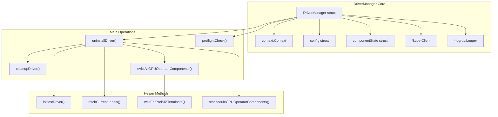
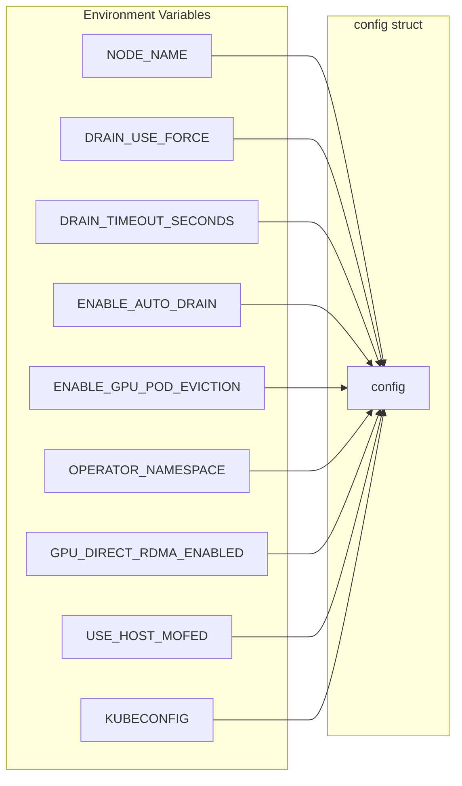
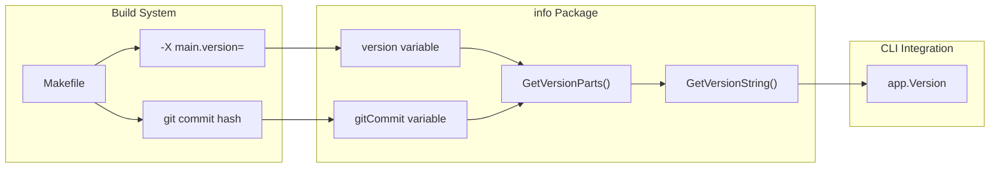
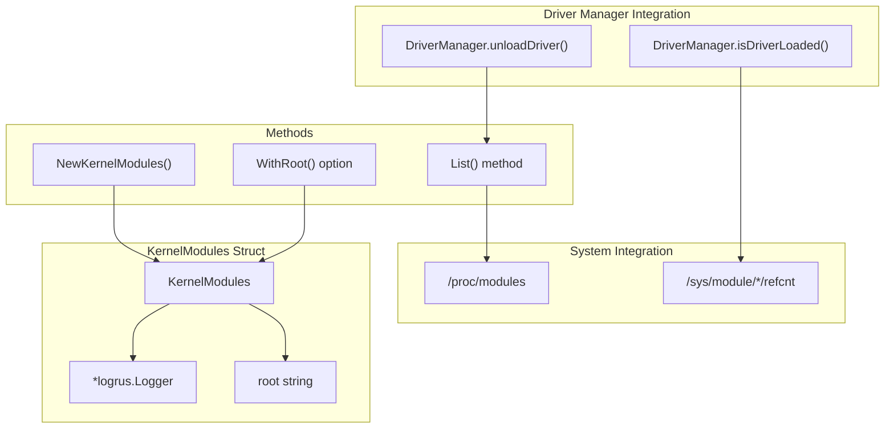

<!-- source: DeepWiki mcp.deepwiki.com · repo NVIDIA/k8s-driver-manager · page 2.1 Core Components · fetched 2026-10-26 -->

# Core Components

<details>
<summary>Relevant source files</summary>

The following files were used as context for generating this wiki page:

- [cmd/driver-manager/main.go](cmd/driver-manager/main.go)
- [internal/info/version.go](internal/info/version.go)
- [internal/linuxutils/kmod.go](internal/linuxutils/kmod.go)
- [internal/nvml/driver-root.go](internal/nvml/driver-root.go)

</details>


This document details the main application components that make up the k8s-driver-manager system, including the central `DriverManager` orchestrator, configuration management, CLI interface, and supporting utilities. For information about Kubernetes API integration, see [Kubernetes Integration](#2.2). For details about NVIDIA GPU and driver management, see [NVIDIA GPU Management](#2.3).

## Main Application Components

The k8s-driver-manager is built around three core data structures that work together to orchestrate GPU driver upgrades across Kubernetes nodes.

### DriverManager Structure

The `DriverManager` struct serves as the central orchestrator for all driver management operations. It coordinates between Kubernetes API operations, driver cleanup, and component state management.



The `DriverManager` is initialized through the `newDriverManager` function and contains all necessary dependencies for managing driver operations.

Sources: [cmd/driver-manager/main.go:100-108](), [cmd/driver-manager/main.go:244-259]()

### Configuration Management

The `config` struct centralizes all environment variable-based configuration options that control driver manager behavior.

| Configuration Field | Environment Variable | Purpose |
|---------------------|---------------------|---------|
| `nodeName` | `NODE_NAME` | Target node for operations |
| `drainUseForce` | `DRAIN_USE_FORCE` | Force node draining |
| `drainTimeout` | `DRAIN_TIMEOUT_SECONDS` | Drain operation timeout |
| `enableAutoDrain` | `ENABLE_AUTO_DRAIN` | Enable automatic node draining |
| `enableGPUPodEviction` | `ENABLE_GPU_POD_EVICTION` | Enable GPU pod eviction |
| `operatorNamespace` | `OPERATOR_NAMESPACE` | GPU operator namespace |
| `gpuDirectRDMAEnabled` | `GPU_DIRECT_RDMA_ENABLED` | Enable GPU Direct RDMA |
| `useHostMofed` | `USE_HOST_MOFED` | Use host MOFED driver |
| `kubeconfig` | `KUBECONFIG` | Kubernetes config path |



Sources: [cmd/driver-manager/main.go:68-81](), [cmd/driver-manager/main.go:127-212]()

### Component State Tracking

The `componentState` struct tracks the deployment state of all GPU operator components through Kubernetes node labels. This enables the driver manager to pause and resume components during driver upgrades.

```mermaid
graph TB
    subgraph "GPU Operator Components"
        DevicePlugin["pluginDeployed"]
        GFD["gfdDeployed"] 
        DCGM["dcgmDeployed"]
        DCGMExporter["dcgmExporterDeployed"]
        Toolkit["toolkitDeployed"]
        Validator["validatorDeployed"]
        MIGManager["migManagerDeployed"]
        NVSM["nvsmDeployed"]
        SandboxValidator["sandboxValidatorDeployed"]
        SandboxPlugin["sandboxPluginDeployed"]
        VGPUManager["vgpuDeviceManagerDeployed"]
    end
    
    subgraph "Node Labels"
        DevicePluginLabel["nvidia.com/gpu.deploy.device-plugin"]
        GFDLabel["nvidia.com/gpu.deploy.gpu-feature-discovery"]
        DCGMLabel["nvidia.com/gpu.deploy.dcgm"]
        DCGMExporterLabel["nvidia.com/gpu.deploy.dcgm-exporter"]
        ToolkitLabel["nvidia.com/gpu.deploy.container-toolkit"]
        ValidatorLabel["nvidia.com/gpu.deploy.operator-validator"]
        MIGLabel["nvidia.com/gpu.deploy.mig-manager"]
        NVSMLabel["nvidia.com/gpu.deploy.nvsm"]
        SandboxValidatorLabel["nvidia.com/gpu.deploy.sandbox-validator"]
        SandboxPluginLabel["nvidia.com/gpu.deploy.sandbox-device-plugin"]
        VGPULabel["nvidia.com/gpu.deploy.vgpu-device-manager"]
    end
    
    subgraph "componentState struct"
        ComponentState["componentState"]
    end
    
    DevicePluginLabel --> DevicePlugin
    GFDLabel --> GFD
    DCGMLabel --> DCGM
    DCGMExporterLabel --> DCGMExporter
    ToolkitLabel --> Toolkit
    ValidatorLabel --> Validator
    MIGLabel --> MIGManager
    NVSMLabel --> NVSM
    SandboxValidatorLabel --> SandboxValidator
    SandboxPluginLabel --> SandboxPlugin
    VGPULabel --> VGPUManager
    
    DevicePlugin --> ComponentState
    GFD --> ComponentState
    DCGM --> ComponentState
    DCGMExporter --> ComponentState
    Toolkit --> ComponentState
    Validator --> ComponentState
    MIGManager --> ComponentState
    NVSM --> ComponentState
    SandboxValidator --> ComponentState
    SandboxPlugin --> ComponentState
    VGPUManager --> ComponentState
```



The component state is managed through methods like `fetchCurrentLabels()`, `setComponentState()`, `maybeSetPaused()`, and `maybeSetTrue()` which handle the state transitions during driver operations.

Sources: [cmd/driver-manager/main.go:84-98](), [cmd/driver-manager/main.go:419-498](), [cmd/driver-manager/main.go:537-549](), [cmd/driver-manager/main.go:807-818]()

## CLI Interface

The application uses the `urfave/cli` framework to provide a command-line interface with two main commands for driver management operations.

```mermaid
graph TB
    subgraph "CLI Application"
        App["cli.App"]
        AppName["driver-manager"]
        AppUsage["NVIDIA Driver Manager for seamless GPU driver upgrades"]
        AppVersion["info.GetVersionString()"]
    end
    
    subgraph "CLI Commands"
        UninstallCmd["uninstall_driver"]
        PreflightCmd["preflight_check"]
    end
    
    subgraph "CLI Flags"
        NodeNameFlag["--node-name"]
        DrainForceFlag["--drain-use-force"]
        DrainTimeoutFlag["--drain-timeout-seconds"]
        AutoDrainFlag["--enable-auto-drain"]
        GPUEvictionFlag["--enable-gpu-pod-eviction"]
        OperatorNSFlag["--operator-namespace"]
        GPUDirectRDMAFlag["--gpu-direct-rdma-enabled"]
        HostMofedFlag["--use-host-mofed"]
        KubeconfigFlag["--kubeconfig"]
    end
    
    subgraph "Actions"
        UninstallAction["dm.uninstallDriver()"]
        PreflightAction["dm.preflightCheck()"]
    end
    
    App --> AppName
    App --> AppUsage
    App --> AppVersion
    App --> UninstallCmd
    App --> PreflightCmd
    App --> NodeNameFlag
    App --> DrainForceFlag
    App --> DrainTimeoutFlag
    App --> AutoDrainFlag
    App --> GPUEvictionFlag
    App --> OperatorNSFlag
    App --> GPUDirectRDMAFlag
    App --> HostMofedFlag
    App --> KubeconfigFlag
    
    UninstallCmd --> UninstallAction
    PreflightCmd --> PreflightAction
```



### CLI Commands

- **`uninstall_driver`**: Performs the complete driver uninstallation process, including component eviction, node draining, driver cleanup, and component rescheduling
- **`preflight_check`**: Validates prerequisites before driver operations (currently a placeholder for future implementation)

Sources: [cmd/driver-manager/main.go:110-242](), [cmd/driver-manager/main.go:214-237]()

## Internal Utilities

The k8s-driver-manager includes several internal utility packages that provide specialized functionality for driver management operations.

### Version Information

The `info` package provides version management functionality through build-time variable injection.



Sources: [internal/info/version.go:21-43]()

### Kernel Module Management

The `linuxutils` package provides kernel module inspection capabilities through the `KernelModules` struct.



The `KernelModules` struct provides module listing functionality and is used by the driver manager to inspect loaded NVIDIA kernel modules during cleanup operations.

Sources: [internal/linuxutils/kmod.go:34-48](), [internal/linuxutils/kmod.go:56-107]()

### NVIDIA Driver Management

The `nvml` package provides utilities for locating and validating NVIDIA driver installations through the `DriverRoot` type.

```mermaid
graph TB
    subgraph "DriverRoot Type"
        DriverRootType["DriverRoot string"]
        GetNVMLPath["GetNVMLPath()"]
        FindFile["findFile()"]
        ResolveLink["resolveLink()"]
    end
    
    subgraph "Search Paths"
        UsrLib64["/usr/lib64"]
        UsrLibX86["/usr/lib/x86_64-linux-gnu"]
        UsrLibARM["/usr/lib/aarch64-linux-gnu"]
        Lib64["/lib64"]
        LibX86["/lib/x86_64-linux-gnu"]
        LibARM["/lib/aarch64-linux-gnu"]
    end
    
    subgraph "Target Files"
        NVMLLib["libnvidia-ml.so.1"]
    end
    
    subgraph "Driver Manager Usage"
        IsHostDriver["DriverManager.isHostDriver()"]
        HostRoot["nvml.DriverRoot(\"/host\")"]
        NVMLClient["nvml.NewClient()"]
    end
    
    DriverRootType --> GetNVMLPath
    GetNVMLPath --> FindFile
    FindFile --> ResolveLink
    GetNVMLPath --> UsrLib64
    GetNVMLPath --> UsrLibX86
    GetNVMLPath --> UsrLibARM
    GetNVMLPath --> Lib64
    GetNVMLPath --> LibX86
    GetNVMLPath --> LibARM
    FindFile --> NVMLLib
    
    IsHostDriver --> HostRoot
    HostRoot --> GetNVMLPath
    GetNVMLPath --> NVMLClient
```

The `DriverRoot` type abstracts driver root filesystem operations and provides a standardized way to locate NVIDIA libraries across different system configurations.

Sources: [internal/nvml/driver-root.go:24-70](), [cmd/driver-manager/main.go:396-406]()

---

