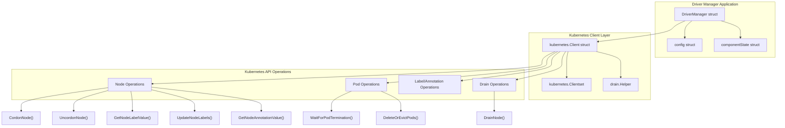
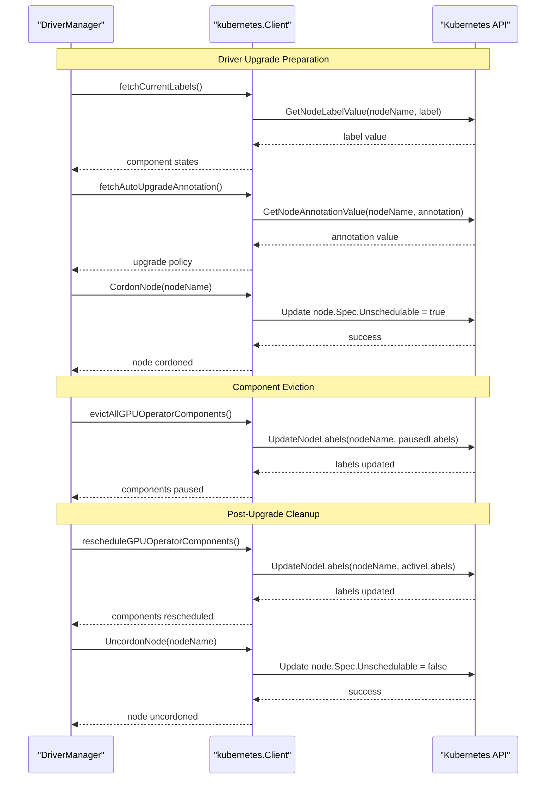
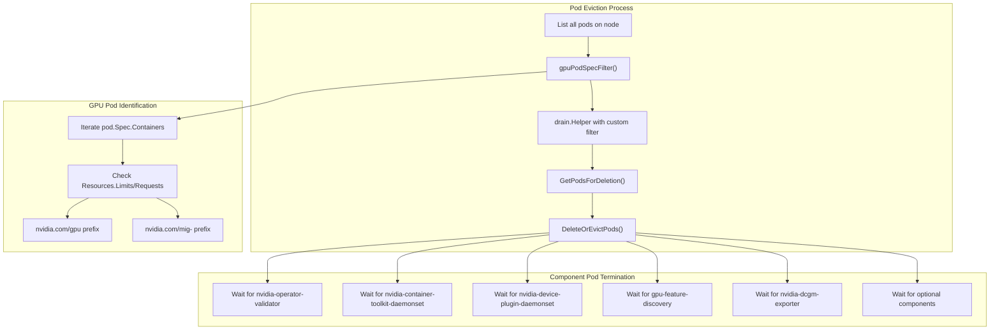
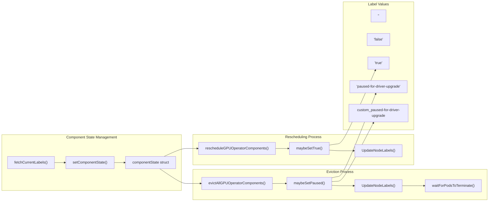

<!-- source: DeepWiki mcp.deepwiki.com · repo NVIDIA/k8s-driver-manager · page 2.2 Kubernetes Integration · fetched 2026-10-26 -->

# Kubernetes Integration

Relevant source files

The following files were used as context for generating this wiki page:

- [cmd/driver-manager/main.go](cmd/driver-manager/main.go)
- [internal/kubernetes/client.go](internal/kubernetes/client.go)

This document describes how the k8s-driver-manager integrates with Kubernetes APIs to orchestrate GPU driver upgrades across cluster nodes. It covers the client implementation, node management operations, pod eviction mechanisms, and GPU operator component orchestration through label manipulation.

For information about the core driver management components, see [Core Components](#2.1). For details about NVIDIA GPU-specific operations, see [NVIDIA GPU Management](#2.3).

## Core Integration Components

The Kubernetes integration is built around two primary components: the `DriverManager` struct that coordinates operations and the `Client` struct that provides Kubernetes API access.

The `DriverManager` struct instantiates a `Client` through the `newDriverManager` function, which creates the Kubernetes client connection using either in-cluster configuration or a specified kubeconfig file. The client provides a high-level interface for all Kubernetes operations required during driver upgrades.

**Sources:** [cmd/driver-manager/main.go:100-108](), [cmd/driver-manager/main.go:244-259](), [internal/kubernetes/client.go:44-49](), [internal/kubernetes/client.go:59-78]()

## Node Management Operations

Node management is central to the driver upgrade process, involving cordoning nodes to prevent new pod scheduling, updating labels to control GPU operator component placement, and managing node annotations for upgrade policies.

The node management workflow begins with fetching current component states through `GetNodeLabelValue` calls for each GPU operator component label. The `fetchAutoUpgradeAnnotation` method retrieves the upgrade policy from the `nvidia.com/gpu-driver-upgrade-enabled` annotation to determine whether automatic operations are permitted.

**Sources:** [cmd/driver-manager/main.go:419-458](), [cmd/driver-manager/main.go:487-498](), [internal/kubernetes/client.go:81-92](), [internal/kubernetes/client.go:117-127](), [internal/kubernetes/client.go:129-149](), [internal/kubernetes/client.go:151-171]()

## Pod Management and Eviction

Pod management focuses on safely evicting GPU workloads before driver operations begin. The system provides both targeted GPU pod eviction and full node draining capabilities.

The `DeleteOrEvictPods` method implements GPU-specific pod filtering through the `gpuPodSpecFilter` function, which identifies pods requesting NVIDIA GPU resources by examining resource requests and limits for names prefixed with `nvidia.com/gpu` or `nvidia.com/mig-`.

The `WaitForPodTermination` method monitors pod termination for each GPU operator component using label selectors and field selectors to match pods on the specific node. The system waits up to 5 minutes (defined by `defaultGracePeriod`) for each component to terminate.

**Sources:** [internal/kubernetes/client.go:211-282](), [internal/kubernetes/client.go:284-301](), [internal/kubernetes/client.go:173-190](), [cmd/driver-manager/main.go:551-618](), [cmd/driver-manager/main.go:48-49]()

## GPU Operator Component Orchestration

The driver manager orchestrates GPU operator components through a sophisticated label-based system that controls pod scheduling across the cluster. Each component is managed through specific node labels with the `nvidia.com/` prefix.

| Component | Label | Purpose |
|-----------|--------|---------|
| Driver | `nvidia.com/gpu.deploy.driver` | Controls driver container deployment |
| Device Plugin | `nvidia.com/gpu.deploy.device-plugin` | Manages device plugin scheduling |
| Container Toolkit | `nvidia.com/gpu.deploy.container-toolkit` | Controls toolkit daemon scheduling |
| GPU Feature Discovery | `nvidia.com/gpu.deploy.gpu-feature-discovery` | Manages GFD pod placement |
| DCGM Exporter | `nvidia.com/gpu.deploy.dcgm-exporter` | Controls monitoring component |
| MIG Manager | `nvidia.com/gpu.deploy.mig-manager` | Manages Multi-Instance GPU configuration |
| Validator | `nvidia.com/gpu.deploy.operator-validator` | Controls validation pod scheduling |

The `maybeSetPaused` function transforms component label values to prevent pod scheduling by appending `paused-for-driver-upgrade` or replacing `true` with the paused string. The `maybeSetTrue` function reverses this process, using regular expressions to remove paused markers and restore original values.

**Sources:** [cmd/driver-manager/main.go:53-65](), [cmd/driver-manager/main.go:460-485](), [cmd/driver-manager/main.go:500-535](), [cmd/driver-manager/main.go:537-549](), [cmd/driver-manager/main.go:777-804](), [cmd/driver-manager/main.go:807-818]()

## Client Implementation Details

The `Client` struct provides a comprehensive wrapper around the Kubernetes client-go library, implementing context-aware operations with proper error handling and logging.

The client initialization supports both in-cluster and external kubeconfig authentication through `clientcmd.BuildConfigFromFlags`. The `DrainOptions` struct encapsulates drain operation parameters including force deletion, empty directory handling, timeout configuration, and pod selector filtering.

| Method | Purpose | Key Parameters |
|---------|----------|----------------|
| `GetNodeLabelValue` | Retrieves node label values | `nodeName`, `label` |
| `UpdateNodeLabels` | Updates multiple node labels | `nodeName`, `nodeLabels map[string]string` |
| `GetNodeAnnotationValue` | Retrieves node annotation values | `nodeName`, `annotation` |
| `CordonNode` / `UncordonNode` | Controls node schedulability | `nodeName` |
| `DrainNode` | Performs full node drainage | `nodeName`, `DrainOptions` |
| `DeleteOrEvictPods` | Evicts GPU-specific pods | `nodeName`, `DrainOptions` |
| `WaitForPodTermination` | Monitors pod termination | `selectorMap`, `namespace`, `nodeName`, `timeout` |

The drain functionality integrates with kubectl's drain package, utilizing the `drain.Helper` struct with custom pod filters for GPU-specific eviction logic. The `gpuPodSpecFilter` examines container resource specifications to identify pods requiring GPU resources.

**Sources:** [internal/kubernetes/client.go:51-57](), [internal/kubernetes/client.go:59-78](), [internal/kubernetes/client.go:94-115](), [internal/kubernetes/client.go:192-209](), [internal/kubernetes/client.go:37-41]()

---

