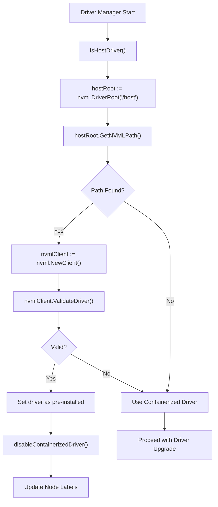
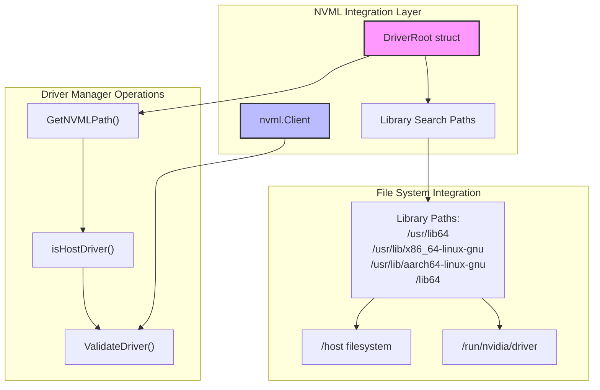
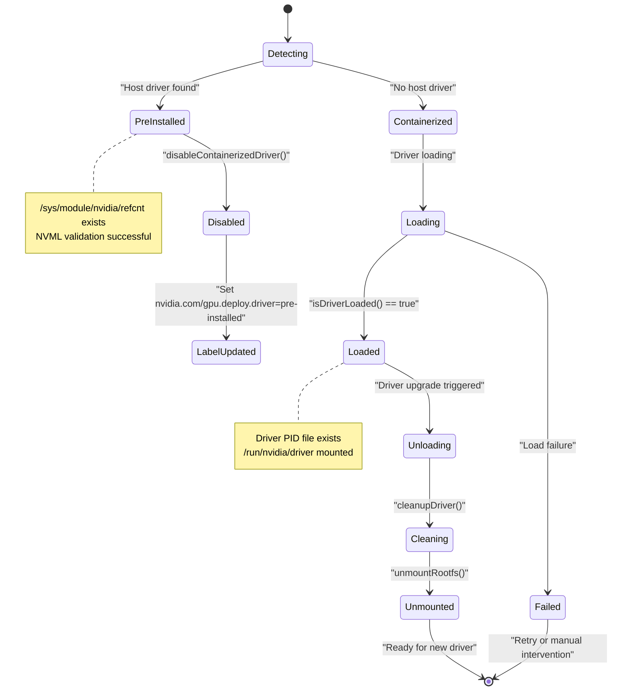
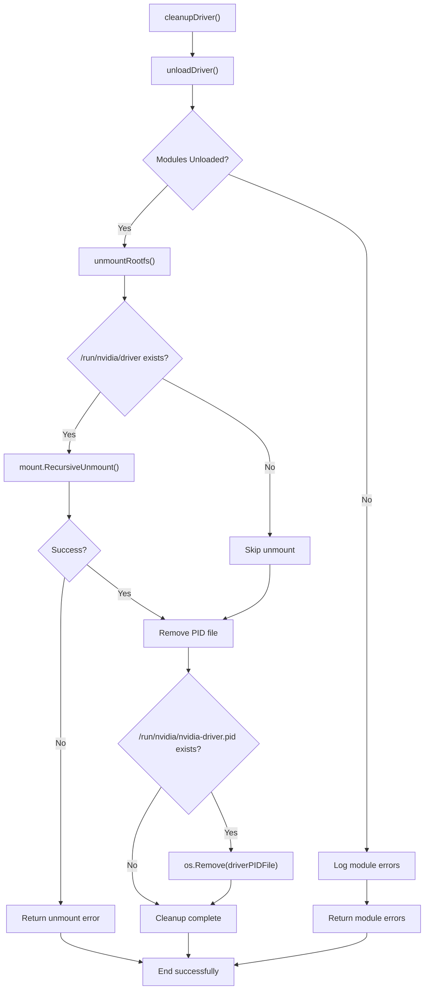
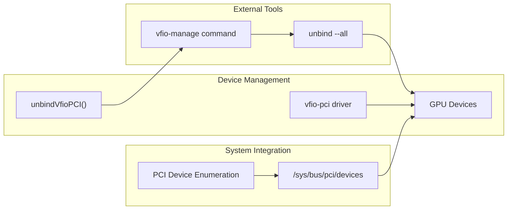
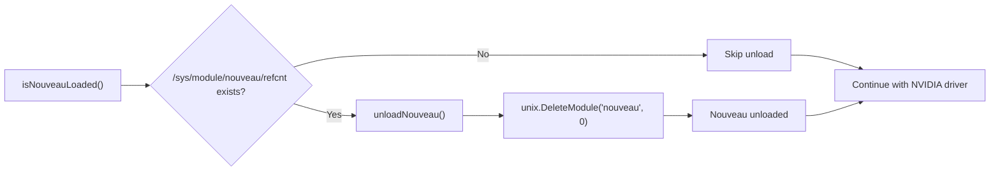

<!-- source: DeepWiki mcp.deepwiki.com · repo NVIDIA/k8s-driver-manager · page 2.3 NVIDIA GPU Management · fetched 2026-10-26 -->

# NVIDIA GPU Management

<details>
<summary>Relevant source files</summary>

The following files were used as context for generating this wiki page:

- [cmd/driver-manager/main.go](cmd/driver-manager/main.go)
- [internal/linuxutils/kmod.go](internal/linuxutils/kmod.go)
- [internal/nvml/driver-root.go](internal/nvml/driver-root.go)

</details>


This document covers how the k8s-driver-manager handles NVIDIA GPU drivers, kernel modules, and GPU resources through NVML integration. It details the driver lifecycle management, kernel module operations, and system-level GPU resource management that enables seamless driver upgrades in Kubernetes environments.

For information about Kubernetes integration and node management, see [Kubernetes Integration](#2.2). For details about the overall system architecture, see [Architecture](#2).

## Driver Detection and Validation

The driver manager implements sophisticated logic to detect and validate NVIDIA driver installations across different deployment scenarios. The system distinguishes between pre-installed host drivers and containerized drivers managed by the GPU Operator.



The `DriverManager.isHostDriver()` method performs driver detection by examining the host filesystem for NVML libraries and validating driver functionality. When a pre-installed driver is detected, the system automatically disables containerized driver deployment.

**Sources:** [cmd/driver-manager/main.go:396-406](), [cmd/driver-manager/main.go:408-417](), [internal/nvml/driver-root.go:26-42]()

## NVML Integration Architecture

The system integrates with NVIDIA's Management Library (NVML) through a modular architecture that abstracts driver discovery and validation operations.



The `DriverRoot` type provides filesystem abstraction for driver discovery, searching multiple standard library paths across different Linux distributions. The `GetNVMLPath()` method implements a comprehensive search strategy for locating the NVML library.

**Sources:** [internal/nvml/driver-root.go:24-42](), [internal/nvml/driver-root.go:47-59](), [cmd/driver-manager/main.go:398-405]()

## Kernel Module Management

The driver manager maintains detailed control over NVIDIA kernel modules, implementing ordered loading and unloading sequences to prevent dependency conflicts and ensure clean driver transitions.

| Module | Purpose | Unload Order |
|--------|---------|--------------|
| `nvidia_modeset` | Display management | 1 |
| `nvidia_uvm` | Unified Virtual Memory | 2 |
| `nvidia_peermem` | Peer-to-peer memory access | 3 |
| `nvidia_fs` | GPU filesystem support | 4 |
| `nvidia_vgpu_vfio` | Virtual GPU VFIO support | 5 |
| `gdrdrv` | GPUDirect RDMA driver | 6 |
| `nvidia` | Core NVIDIA driver | 7 |

```mermaid
sequenceDiagram
    participant DM as "DriverManager"
    participant KM as "KernelModules"
    participant Sys as "/sys/module"
    participant Proc as "/proc/modules"
    
    DM->>DM: "unloadDriver()"
    DM->>Sys: "Check /sys/module/{module}/refcnt"
    Sys-->>DM: "Module status"
    
    loop For each module
        DM->>+Sys: "unix.DeleteModule(module, 0)"
        alt Module in use
            Sys-->>-DM: "Error: Module in use"
            DM->>KM: "List('nvidia')"
            KM->>Proc: "Read /proc/modules"
            Proc-->>KM: "Module details"
            KM-->>DM: "Display module usage"
        else Module unloaded
            Sys-->>-DM: "Success"
        end
    end
```

The `unloadDriver()` method implements a systematic approach to kernel module management, checking module reference counts and handling dependencies. The `KernelModules` utility provides detailed module introspection capabilities.

**Sources:** [cmd/driver-manager/main.go:659-693](), [cmd/driver-manager/main.go:662-670](), [internal/linuxutils/kmod.go:56-107]()

## Driver Installation States

The driver manager tracks multiple installation states and deployment configurations through Kubernetes node labels and filesystem markers.



The system uses filesystem indicators like `/sys/module/nvidia/refcnt` and `/run/nvidia/nvidia-driver.pid` to determine driver states, combined with NVML validation for comprehensive status assessment.

**Sources:** [cmd/driver-manager/main.go:621-624](), [cmd/driver-manager/main.go:649-656](), [cmd/driver-manager/main.go:44-45]()

## Cleanup and Uninstallation Process

The driver cleanup process follows a structured sequence to ensure complete driver removal and system stability during upgrades.



The cleanup process handles filesystem unmounting, PID file management, and error recovery. The `unmountRootfs()` method performs recursive unmounting to handle complex mount hierarchies.

**Sources:** [cmd/driver-manager/main.go:636-657](), [cmd/driver-manager/main.go:695-711](), [cmd/driver-manager/main.go:649-656]()

## VFIO and Device Management

The driver manager integrates with VFIO (Virtual Function I/O) infrastructure for device management, particularly important for virtualization and device passthrough scenarios.



The `unbindVfioPCI()` method ensures clean device state transitions by unbinding all devices from the VFIO-PCI driver, preventing conflicts during driver upgrades.

**Sources:** [cmd/driver-manager/main.go:716-720](), [cmd/driver-manager/main.go:713-720]()

## Nouveau Driver Management

The system includes handling for the open-source Nouveau driver, which must be unloaded before NVIDIA proprietary drivers can be installed.



The Nouveau driver detection and unloading ensures compatibility with NVIDIA proprietary drivers by checking for kernel module presence and performing clean removal when necessary.

**Sources:** [cmd/driver-manager/main.go:626-628](), [cmd/driver-manager/main.go:631-634](), [cmd/driver-manager/main.go:374-379]()

---

