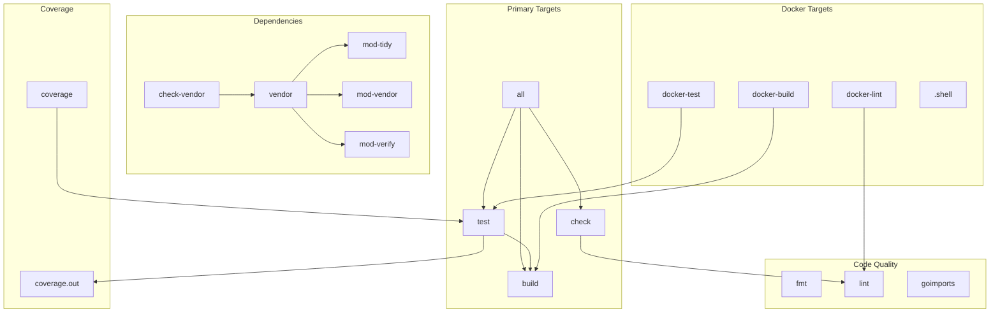
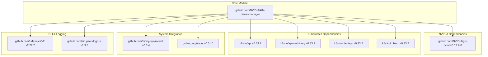
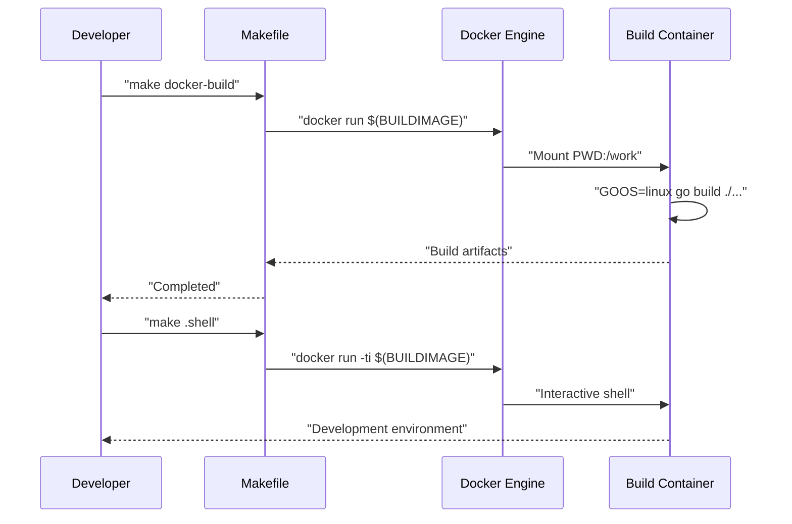
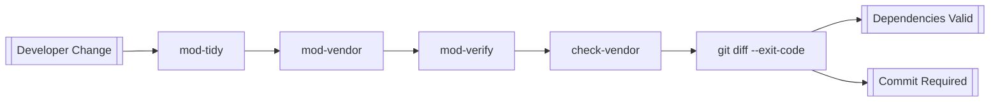

<!-- source: DeepWiki mcp.deepwiki.com · repo NVIDIA/k8s-driver-manager · page 3 Development · fetched 2026-10-26 -->

# Development

<details>
<summary>Relevant source files</summary>

The following files were used as context for generating this wiki page:

- [Makefile](Makefile)
- [go.mod](go.mod)
- [go.sum](go.sum)

</details>


This page provides guidance for developers working on the k8s-driver-manager codebase, covering development workflows, build processes, and code organization. It serves as the entry point for understanding how to build, test, and modify the project.

For detailed information about specific development aspects, see:
- Build system configuration and targets: [Build System](#3.1)
- Development environment setup and tooling: [Development Environment](#3.2) 
- Testing strategies and code quality tools: [Testing and Quality](#3.3)

## Development Workflow Overview

The k8s-driver-manager project follows a Make-based development workflow with Docker containerization support. The primary development entry points are defined in the root `Makefile`, which orchestrates building, testing, and code quality checks.

### Make Target Architecture



**Sources:** [Makefile:28-42](), [Makefile:64-87]()

### Go Module Dependencies

The project uses Go modules for dependency management with a focus on Kubernetes and NVIDIA GPU integration:



**Sources:** [go.mod:1-15](), [go.mod:5-14]()

## Development Environment Configuration

The project provides a containerized development environment using Docker. The `BUILDIMAGE` environment variable controls which image is used for development tasks.

### Docker-based Development Workflow  



**Sources:** [Makefile:64-87](), [Makefile:77-87]()

## Code Organization and Build Process

The codebase follows Go module conventions with the main module located at `github.com/NVIDIA/k8s-driver-manager`. The build process uses standard Go tooling enhanced with Make targets for automation.

### Build Configuration

| Target | Purpose | Implementation |
|--------|---------|---------------|  
| `build` | Compile Go packages | `GOOS=$(GOOS) go build ./...` |
| `test` | Run unit tests with coverage | `go test -coverprofile=$(COVERAGE_FILE).with-mocks` |
| `lint` | Static analysis | `golangci-lint run ./...` |
| `fmt` | Code formatting | `gofmt -s -l -w` on all Go files |
| `goimports` | Import organization | `goimports -local $(MODULE) -w` |

**Sources:** [Makefile:38-54]()

### Dependency Management Process

The project maintains strict dependency management through automated Make targets:



The `vendor` target orchestrates the complete dependency update process, while `check-vendor` validates that vendored dependencies match the committed state.

**Sources:** [Makefile:89-113]()

## Code Quality Standards

The development process enforces code quality through multiple automated checks:

- **Formatting**: `gofmt` ensures consistent code style across all Go files
- **Import Management**: `goimports` with local module preference organizes imports  
- **Static Analysis**: `golangci-lint` performs comprehensive linting
- **Test Coverage**: Coverage reports generated with mock exclusion via `grep -v "_mock.go"`

**Sources:** [Makefile:44-62]()

## Interactive Development

For interactive development sessions, the `.shell` target provides access to the containerized build environment:

```bash
make .shell
```

This launches an interactive container with the project directory mounted at `/work`, providing access to all development tools and dependencies in a consistent environment.

**Sources:** [Makefile:77-87]()

---

