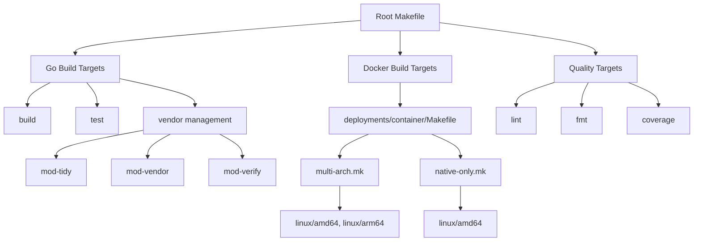
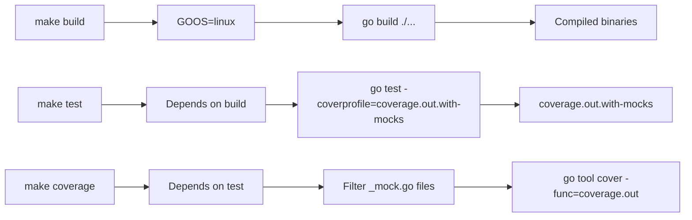
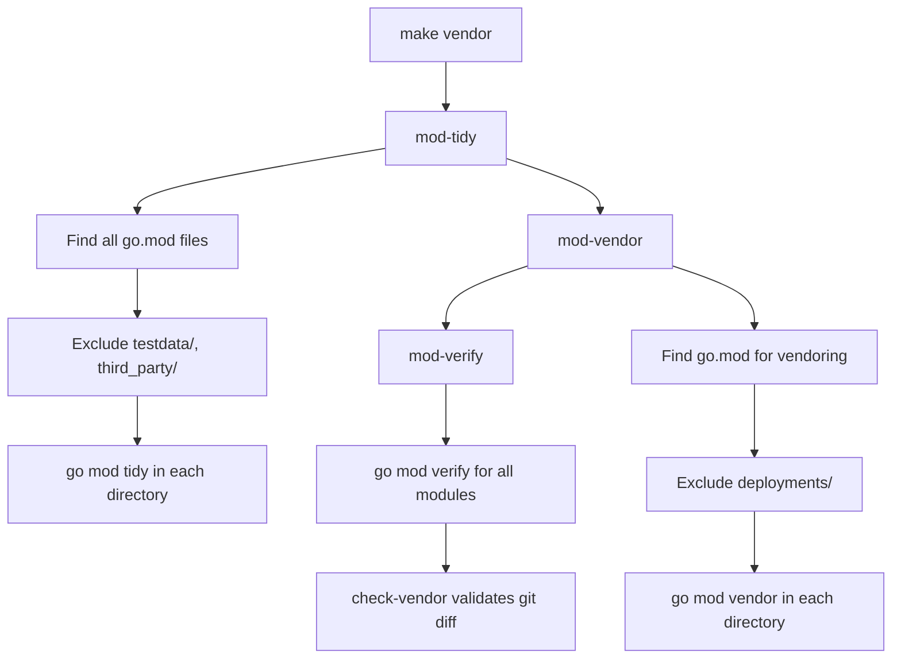
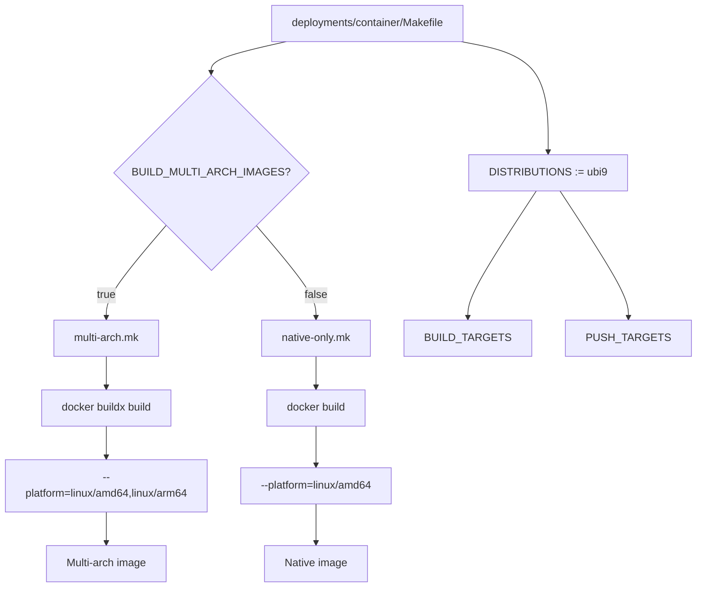
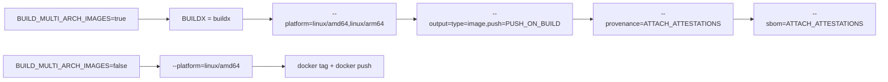
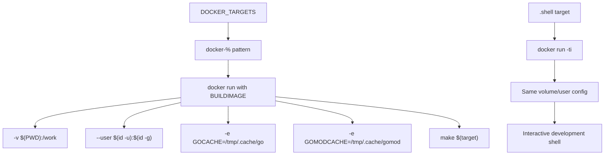
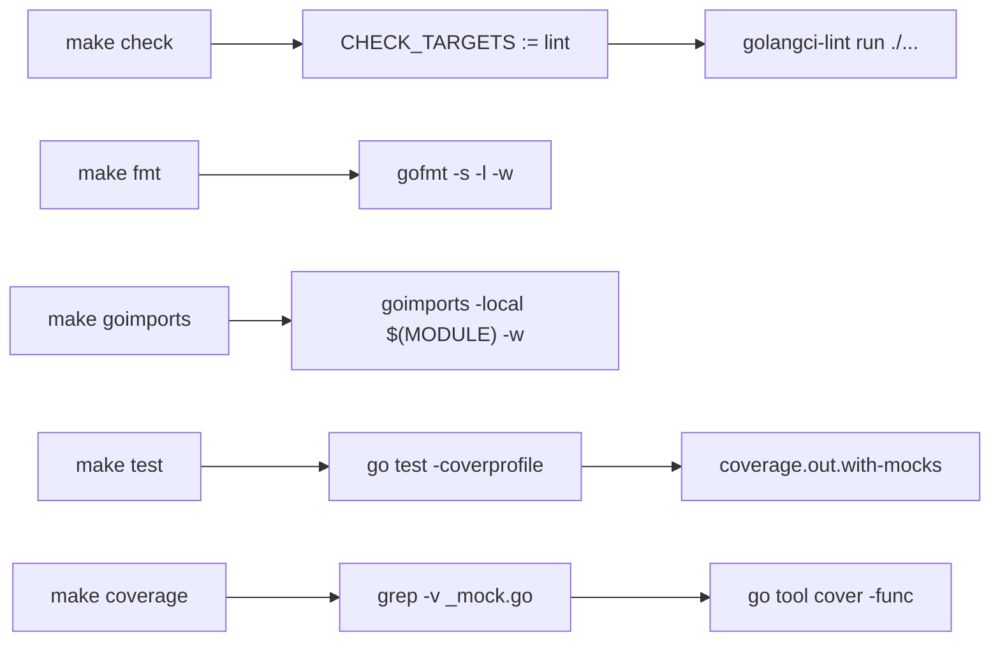

<!-- source: DeepWiki mcp.deepwiki.com · repo NVIDIA/k8s-driver-manager · page 3.1 Build System · fetched 2026-10-26 -->

# Build System

<details>
<summary>Relevant source files</summary>

The following files were used as context for generating this wiki page:

- [Makefile](Makefile)
- [deployments/container/Makefile](deployments/container/Makefile)
- [deployments/container/multi-arch.mk](deployments/container/multi-arch.mk)
- [deployments/container/native-only.mk](deployments/container/native-only.mk)

</details>


## Purpose and Scope

This document describes the Make-based build system used by the k8s-driver-manager project. The build system provides targets for compiling Go code, running tests, performing quality checks, building container images, and managing dependencies. It supports both local development and containerized builds with multi-architecture support.

For information about development environment setup, see [Development Environment](#3.2). For CI/CD pipeline integration, see [CI/CD Pipelines](#4.2).

## Build System Architecture

The build system consists of a hierarchical Makefile structure that coordinates Go compilation, testing, quality assurance, and container image building.

### Build System Component Flow



**Sources:** [Makefile:19-114](), [deployments/container/Makefile:22-83](), [deployments/container/multi-arch.mk:15-25](), [deployments/container/native-only.mk:15-20]()

## Core Makefile Targets

The root Makefile defines the primary build targets used for development and CI operations.

### Primary Build Targets

| Target | Purpose | Command |
|--------|---------|---------|
| `build` | Compile Go binaries | `GOOS=$(GOOS) go build ./...` |
| `test` | Run tests with coverage | `go test -coverprofile=$(COVERAGE_FILE).with-mocks $(MODULE)/...` |
| `lint` | Static code analysis | `golangci-lint run ./...` |
| `fmt` | Format Go source code | `gofmt -s -l -w` on all Go files |
| `vendor` | Manage Go module dependencies | Executes `mod-tidy`, `mod-vendor`, `mod-verify` |
| `check` | Run all quality checks | Executes all `CHECK_TARGETS` |
| `all` | Full build and test cycle | Executes `check`, `test`, `build` |

### Make Configuration Variables

The build system uses several configurable variables:

```makefile
DOCKER   ?= docker
GO       ?= go
GOOS     ?= linux
MODULE   := github.com/NVIDIA/k8s-driver-manager
REGISTRY ?= nvidia
IMAGE_NAME = $(REGISTRY)/k8s-driver-manager
```

**Sources:** [Makefile:15-26](), [Makefile:36-63]()

## Go Build Process

The Go build process handles compilation, testing, and dependency management for the k8s-driver-manager application.

### Go Build Target Flow



### Dependency Management Workflow

The `vendor` target orchestrates Go module management through three sequential operations:



**Sources:** [Makefile:89-114]()

## Container Build System

The container build system is implemented through a separate Makefile hierarchy in the `deployments/container/` directory, supporting both single-architecture and multi-architecture builds.

### Container Build Architecture



### Container Build Targets

The container build system defines distribution-specific targets:

| Target Pattern | Purpose | Example |
|----------------|---------|---------|
| `build-<dist>` | Build container for distribution | `build-ubi9` |
| `push-<dist>` | Push container to registry | `push-ubi9` |
| `<dist>` | Shorthand for `build-<dist>` | `ubi9` |

### Docker Build Command Structure

The container build process uses a standardized Docker build command with configurable options:

```bash
DOCKER_BUILDKIT=1 $(DOCKER) $(BUILDX) build --pull \
    $(DOCKER_BUILD_OPTIONS) \
    $(DOCKER_BUILD_PLATFORM_OPTIONS) \
    --tag $(IMAGE) \
    --build-arg GOLANG_VERSION="$(GOLANG_VERSION)" \
    --build-arg VERSION="$(VERSION)" \
    --build-arg GIT_COMMIT="$(GIT_COMMIT)" \
    --build-arg CVE_UPDATES="$(CVE_UPDATES)" \
    --file $(DOCKERFILE) \
    $(CURDIR)
```

**Sources:** [deployments/container/Makefile:59-70](), [deployments/container/multi-arch.mk:17-18](), [deployments/container/native-only.mk:15]()

## Multi-Architecture Build Support

The build system provides comprehensive multi-architecture support through Docker Buildx when `BUILD_MULTI_ARCH_IMAGES=true`.

### Multi-Architecture Configuration



### Multi-Architecture vs Native-Only Build Differences

| Aspect | Multi-Architecture | Native-Only |
|--------|-------------------|-------------|
| Docker Command | `docker buildx build` | `docker build` |
| Platform Support | `linux/amd64,linux/arm64` | `linux/amd64` |
| Build Options | `--output=type=image,push=$(PUSH_ON_BUILD)` | Standard Docker build |
| Push Method | Built-in push or `regctl image copy` | `docker tag` + `docker push` |
| Attestations | Configurable SBOM/Provenance | Not supported |

**Sources:** [deployments/container/multi-arch.mk:17-25](), [deployments/container/native-only.mk:15-20]()

## Containerized Development

The build system supports containerized development through Docker-based execution of build targets.

### Docker Build Environment



### Docker Target Pattern

All primary Makefile targets have corresponding Docker variants following the pattern:

- `docker-build` → runs `make build` in container
- `docker-test` → runs `make test` in container  
- `docker-lint` → runs `make lint` in container

The `.shell` target provides an interactive development environment using the same containerized setup.

**Sources:** [Makefile:64-87]()

## Build Quality Integration

The build system integrates multiple quality assurance tools and processes.

### Quality Check Pipeline



### Vendor Validation

The `check-vendor` target ensures dependency consistency by validating that vendored dependencies match the current module state:

```bash
check-vendor: vendor
    git diff --exit-code HEAD -- go.mod go.sum vendor
```

This prevents issues where local changes to dependencies are not properly committed to version control.

**Sources:** [Makefile:44-63](), [Makefile:112-114]()

---

