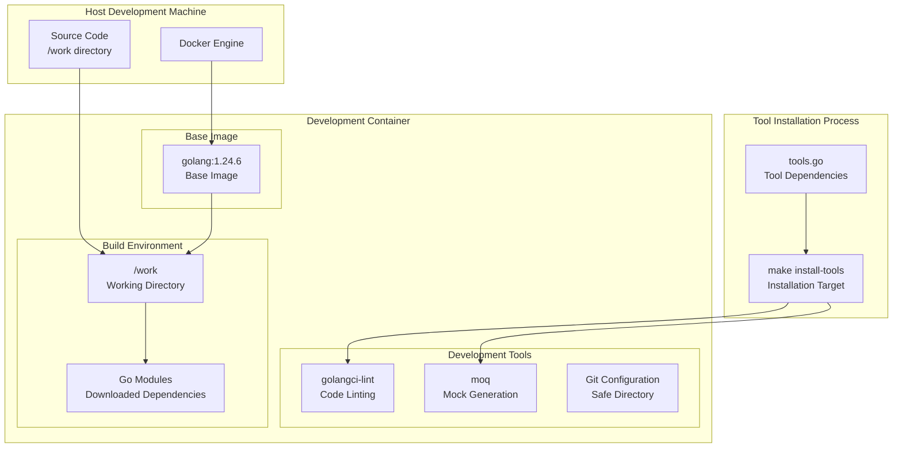
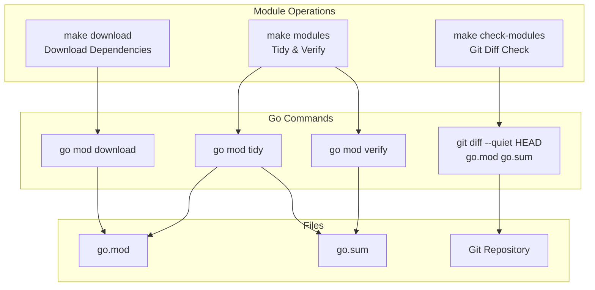
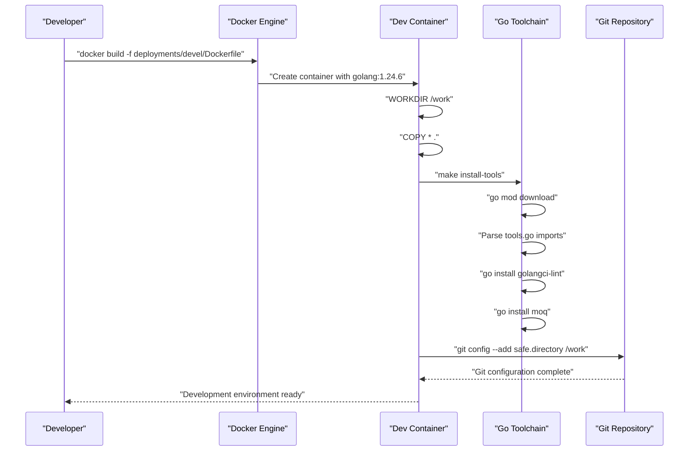

<!-- source: DeepWiki mcp.deepwiki.com · repo NVIDIA/k8s-driver-manager · page 3.2 Development Environment · fetched 2026-10-26 -->

# Development Environment

<details>
<summary>Relevant source files</summary>

The following files were used as context for generating this wiki page:

- [deployments/devel/Dockerfile](deployments/devel/Dockerfile)
- [deployments/devel/Makefile](deployments/devel/Makefile)
- [deployments/devel/go.mod](deployments/devel/go.mod)
- [deployments/devel/tools.go](deployments/devel/tools.go)

</details>


This document describes the Docker-based development environment for k8s-driver-manager, including containerized tooling, dependency management, and the development workflow setup.

For information about the main build system and production builds, see [Build System](#3.1). For testing and quality assurance tooling, see [Testing and Quality](#3.3).

## Development Container Overview

The k8s-driver-manager project provides a standardized development environment through a Docker container that includes all necessary development tools and dependencies. This approach ensures consistent tooling across different developer machines and CI environments.



**Development Container Architecture**

The development container is built from the `golang:1.24.6` base image and automatically installs all required development tools through the `make install-tools` target.

Sources: [deployments/devel/Dockerfile:17](), [deployments/devel/Dockerfile:22](), [deployments/devel/Dockerfile:26]()

## Tool Management System

The development environment uses Go's build tags pattern to manage development tool dependencies. This ensures tools are version-controlled and consistently installed across all development environments.

```mermaid
graph LR
    subgraph "Tool Definition"
        ToolsGo["tools.go<br/>Build Tags: tools"]
        BuildTag["//go:build tools"]
        
        subgraph "Tool Imports"
            GolangciImport["github.com/golangci/golangci-lint/cmd/golangci-lint"]
            MoqImport["github.com/matryer/moq"]
        end
    end
    
    subgraph "Dependency Management"
        GoMod["go.mod<br/>Tool Dependencies"]
        GoSum["go.sum<br/>Dependency Hashes"]
    end
    
    subgraph "Installation Process"
        MakeTarget["make install-tools"]
        GoInstall["go install %<br/>Tool Installation"]
        AwkParsing["awk -F'\"' '{print $2}'<br/>Import Path Extraction"]
    end
    
    BuildTag --> ToolsGo
    ToolsGo --> GolangciImport
    ToolsGo --> MoqImport
    
    GolangciImport --> GoMod
    MoqImport --> GoMod
    GoMod --> GoSum
    
    MakeTarget --> AwkParsing
    AwkParsing --> GoInstall
    
    GoInstall --> GolangciImport
    GoInstall --> MoqImport
```

**Tool Dependency Management Flow**

The `tools.go` file uses Go build tags to define development tool dependencies without including them in the main application binary. The `make install-tools` target parses these imports and installs the tools using `go install`.

| Tool | Purpose | Import Path |
|------|---------|-------------|
| `golangci-lint` | Code linting and static analysis | `github.com/golangci/golangci-lint/cmd/golangci-lint` |
| `moq` | Interface mock generation | `github.com/matryer/moq` |

Sources: [deployments/devel/tools.go:1-2](), [deployments/devel/tools.go:24-25](), [deployments/devel/Makefile:19-21]()

## Development Workflow Components

The development environment provides several Make targets that facilitate common development tasks within the containerized environment.

### Module Management



**Module Management Targets**

- `download`: Downloads all Go module dependencies specified in `go.mod`
- `modules`: Tidies dependencies and verifies module checksums
- `check-modules`: Ensures module files are synchronized with Git

Sources: [deployments/devel/Makefile:15-17](), [deployments/devel/Makefile:38-43]()

### Container Image Building

The development environment includes targets for building the development container image with proper Docker configuration.

| Variable | Default | Purpose |
|----------|---------|---------|
| `DOCKER` | `docker` | Docker command to use for builds |
| `DOCKERFILE_DEVEL` | `deployments/devel/Dockerfile` | Development Dockerfile path |
| `DOCKERFILE_CONTEXT` | `deployments/devel` | Build context directory |
| `BUILDIMAGE` | From `versions.mk` | Development image tag |

Sources: [deployments/devel/Makefile:24](), [deployments/devel/Makefile:27-28](), [deployments/devel/Makefile:31-36]()

## Environment Setup Process

The development environment setup follows a specific sequence to ensure all dependencies and tools are properly configured.



**Development Environment Initialization**

The container setup process automatically downloads dependencies, installs development tools, and configures Git to work within the containerized environment.

### Git Configuration

The development container automatically configures Git to recognize the `/work` directory as a safe directory, allowing Git operations to function properly within the container environment.

```bash
git config --file=/.gitconfig --add safe.directory /work
```

This configuration is necessary because the container may run with different user permissions than the host system, and Git's security features require explicit permission to operate in such directories.

Sources: [deployments/devel/Dockerfile:24-26]()

### Tool Dependencies

The development environment manages a comprehensive set of static analysis and development tools through its dependency system:

| Category | Tools | Purpose |
|----------|-------|---------|
| **Primary Tools** | `golangci-lint`, `moq` | Code linting and mock generation |
| **Linters** | `errcheck`, `gosec`, `govet` | Error handling and security analysis |
| **Formatters** | `gofmt`, `goimports`, `gofumpt` | Code formatting and import management |
| **Analysis** | `go-critic`, `revive`, `staticcheck` | Advanced static analysis |

The complete tool dependency tree is managed through the `go.mod` file in the development module, ensuring reproducible tool versions across all development environments.

Sources: [deployments/devel/go.mod:7-10](), [deployments/devel/go.mod:12-197]()

---

