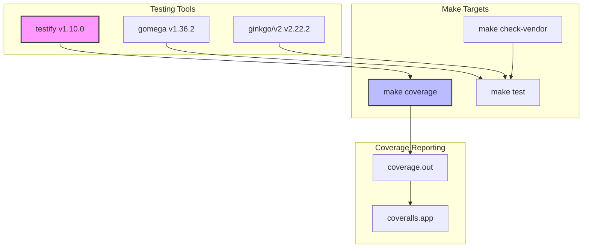
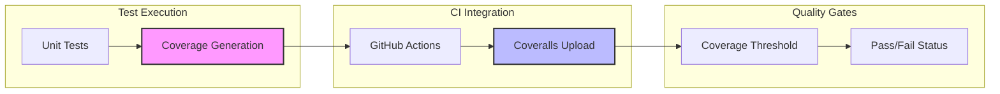
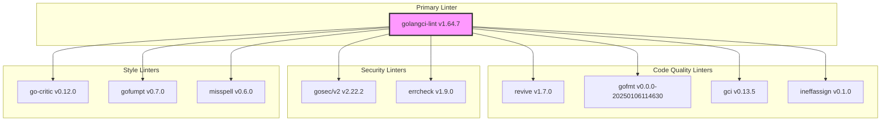
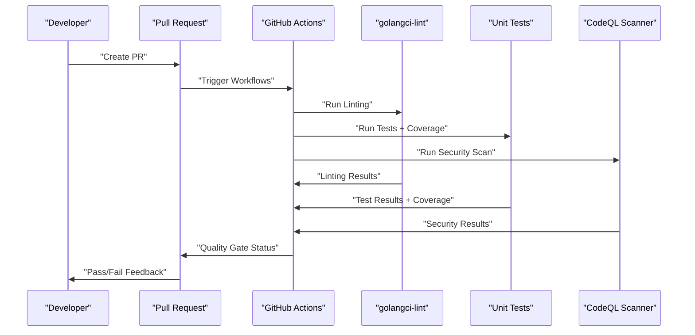
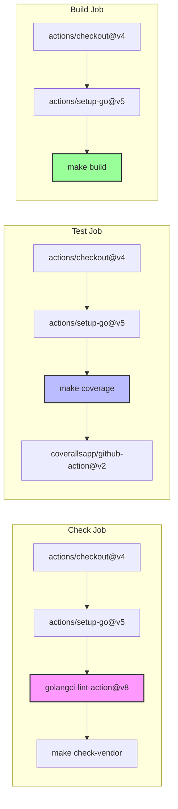
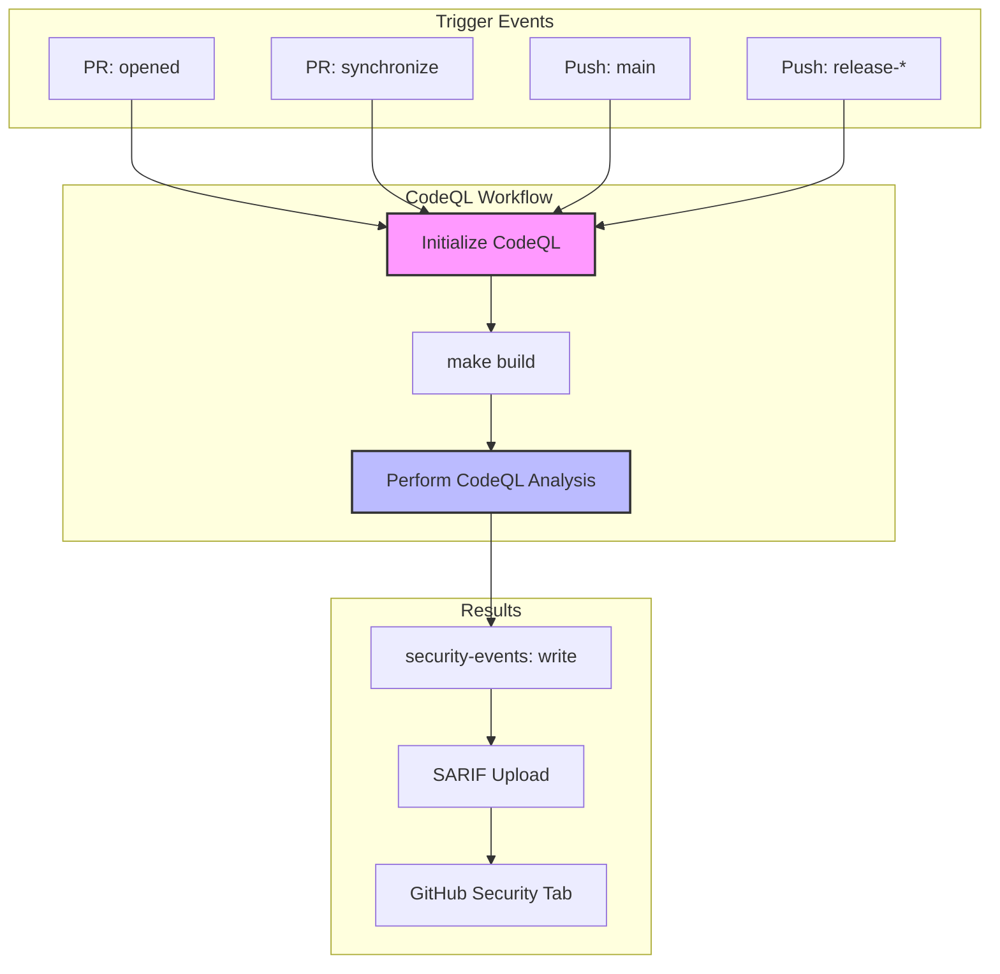
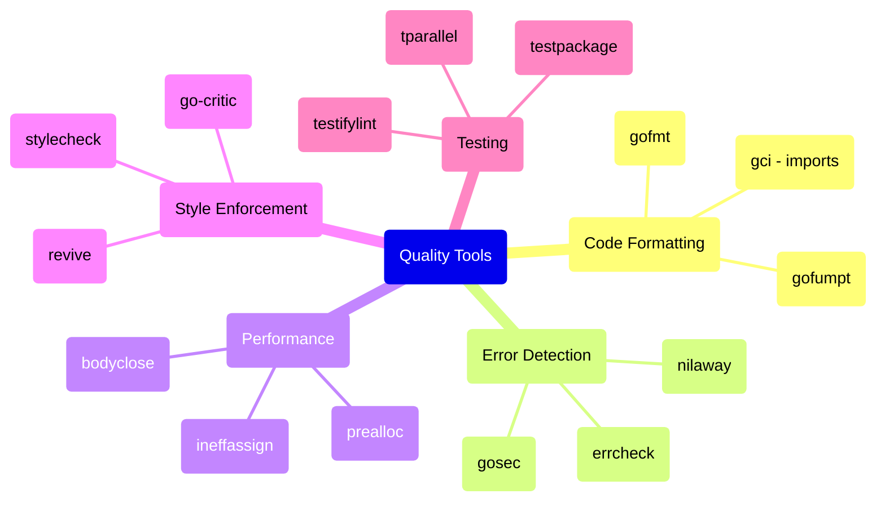

<!-- source: DeepWiki mcp.deepwiki.com · repo NVIDIA/k8s-driver-manager · page 3.3 Testing and Quality · fetched 2026-10-26 -->

# Testing and Quality

Relevant source files

The following files were used as context for generating this wiki page:

- [.github/workflows/code_scanning.yaml](.github/workflows/code_scanning.yaml)
- [.github/workflows/golang.yaml](.github/workflows/golang.yaml)
- [deployments/devel/go.sum](deployments/devel/go.sum)

This document describes the testing strategy, code quality tools, and static analysis integration used in the k8s-driver-manager project. It covers unit testing frameworks, linting configurations, CI/CD quality gates, and security scanning processes that ensure code reliability and maintainability.

For information about the build system and development workflow, see [Build System](#3.1). For CI/CD pipeline details, see [CI/CD Pipelines](#4.2).

## Testing Strategy

The project employs a comprehensive testing approach combining unit tests, coverage reporting, and automated quality checks through CI/CD pipelines.

### Unit Testing Framework

**Testing Framework Integration**
The project uses multiple complementary testing frameworks:
- `testify` for assertion-based unit tests
- `gomega` for matcher-based assertions  
- `ginkgo/v2` for BDD-style test organization

**Sources:** [deployments/devel/go.sum:538-539](), [.github/workflows/golang.yaml:75-76]()

### Coverage and Quality Metrics

The `make coverage` target generates test coverage reports that are automatically uploaded to Coveralls during CI runs, providing visibility into code coverage metrics and trends.

**Sources:** [.github/workflows/golang.yaml:75-82]()

## Static Analysis and Linting

The project uses an extensive suite of linting tools orchestrated through `golangci-lint` to enforce code quality and consistency.

### Linter Configuration

**Comprehensive Linting Suite**
The project includes over 50 specialized linters covering:
- **Code formatting**: `gofmt`, `gofumpt`, `gci` for import organization
- **Security**: `gosec` for vulnerability detection, `errcheck` for error handling
- **Performance**: `ineffassign`, `prealloc` for optimization opportunities
- **Style**: `revive`, `go-critic` for coding standards

**Sources:** [deployments/devel/go.sum:232-248](), [.github/workflows/golang.yaml:45-50]()

### Advanced Analysis Tools

| Tool Category | Tool Name | Version | Purpose |
|---------------|-----------|---------|---------|
| Cyclomatic Complexity | `gocyclo` | v0.6.0 | Function complexity analysis |
| Dead Code Detection | `ineffassign` | v0.1.0 | Unused variable detection |
| Import Organization | `gci` | v0.13.5 | Import statement formatting |
| Interface Bloat | `interfacebloat` | v1.1.0 | Interface size validation |
| Test Helpers | `testify` | v1.10.0 | Assertion and mocking |
| Vulnerability Scanning | `gosec` | v2.22.2 | Security issue detection |

**Sources:** [deployments/devel/go.sum:153-154](), [deployments/devel/go.sum:279-280](), [deployments/devel/go.sum:128-129]()

## CI/CD Quality Integration

Quality checks are integrated into the CI/CD pipeline through GitHub Actions workflows that run on every pull request and main branch update.

### Quality Gate Workflow

**Automated Quality Enforcement**
Three parallel workflows validate code quality:
1. **Golang Workflow** - Linting, testing, and coverage reporting
2. **CodeQL Workflow** - Security vulnerability scanning  
3. **Module Validation** - Dependency and vendor directory checks

**Sources:** [.github/workflows/golang.yaml:27-103](), [.github/workflows/code_scanning.yaml:27-53]()

### Build and Test Integration

The CI pipeline runs three parallel jobs ensuring code quality through linting, test coverage validation, and successful compilation before allowing merge.

**Sources:** [.github/workflows/golang.yaml:28-56](), [.github/workflows/golang.yaml:57-83](), [.github/workflows/golang.yaml:84-103]()

## Security Scanning

Security analysis is performed through CodeQL integration, providing automated vulnerability detection and security issue reporting.

### CodeQL Analysis Pipeline

**CodeQL Configuration**
- **Language**: Go with manual build mode
- **Trigger**: Pull requests and main/release branch pushes
- **Timeout**: 360 minutes for comprehensive analysis
- **Permissions**: `security-events: write` for result upload

**Sources:** [.github/workflows/code_scanning.yaml:15-53]()

## Development Quality Tools

The project leverages specialized development tools to maintain code quality during active development.

### Linter Categories and Tools

**Specialized Analysis Tools**
The development environment includes highly specialized linters for specific Go patterns:
- `nilaway` for nil pointer analysis
- `bodyclose` for HTTP response body closure
- `tparallel` for parallel test validation
- `contextcheck` for context.Context usage

**Sources:** [deployments/devel/go.sum:78-80](), [deployments/devel/go.sum:550-551](), [deployments/devel/go.sum:398-399](), [deployments/devel/go.sum:334-335]()

---

