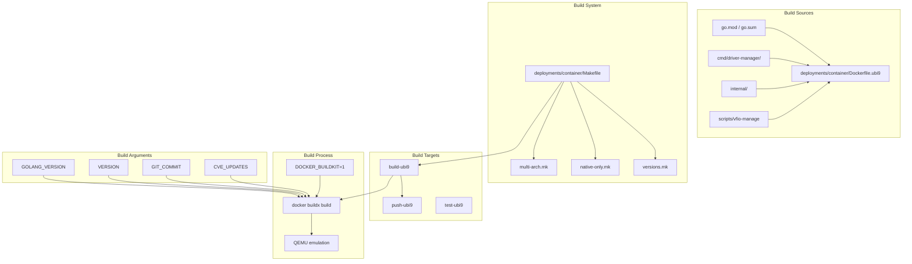
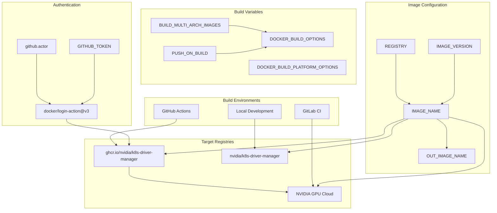

<!-- source: DeepWiki mcp.deepwiki.com · repo NVIDIA/k8s-driver-manager · page 4 Deployment · fetched 2026-10-26 -->

# Deployment

<details>
<summary>Relevant source files</summary>

The following files were used as context for generating this wiki page:

- [.github/workflows/image.yaml](.github/workflows/image.yaml)
- [deployments/container/Dockerfile.ubi9](deployments/container/Dockerfile.ubi9)
- [deployments/container/Makefile](deployments/container/Makefile)

</details>


This section covers the deployment aspects of the k8s-driver-manager, including container image building, registry management, and deployment strategies. It focuses on the technical implementation details of how the driver manager is packaged and distributed for Kubernetes environments.

For information about the CI/CD pipelines that orchestrate these deployments, see [CI/CD Pipelines](#4.2). For details about container image variants and multi-architecture builds, see [Container Images](#4.1). For dependency management in the deployment process, see [Dependency Management](#4.3).

## Container Build Architecture

The k8s-driver-manager uses a sophisticated container build system centered around Make-based automation and Docker Buildx for multi-architecture support. The build process is defined in the container deployment directory and integrates with multiple CI/CD systems.



**Sources:** [deployments/container/Makefile:1-83](), [deployments/container/Dockerfile.ubi9:1-73]()

## Registry and Distribution Strategy

The deployment process involves multiple container registries and distribution channels, each serving different purposes in the development and release lifecycle.



**Sources:** [.github/workflows/image.yaml:46-62](), [deployments/container/Makefile:25-36]()

## Multi-Architecture Build Process

The system supports building for multiple CPU architectures through Docker Buildx and QEMU emulation. The build process automatically detects the target architecture and configures the appropriate build parameters.

| Component | Configuration | Purpose |
|-----------|--------------|---------|
| `BUILD_MULTI_ARCH_IMAGES` | `true`/`false` | Controls whether to build for multiple architectures |
| `DOCKER_BUILDKIT` | `1` | Enables BuildKit for advanced build features |
| `BUILDX` | Conditional on multi-arch | Uses `docker buildx` when multi-arch is enabled |
| `QEMU` | `tonistiigi/binfmt:master` | Provides cross-platform emulation |

The Dockerfile implements architecture detection logic:

```dockerfile
arch="$(uname -m)"; \
case "${arch##*-}" in \
    x86_64 | amd64) ARCH='amd64' ;; \
    ppc64el | ppc64le) ARCH='ppc64le' ;; \
    aarch64 | arm64) ARCH='arm64' ;; \
    *) echo "unsupported architecture" ; exit 1 ;; \
esac;
```

**Sources:** [deployments/container/Dockerfile.ubi9:30-35](), [deployments/container/Makefile:15-20](), [.github/workflows/image.yaml:38-44]()

## Container Image Structure

The k8s-driver-manager uses a multi-stage Docker build with specific base images for different purposes:

| Stage | Base Image | Purpose |
|-------|------------|---------|
| `build` | `nvcr.io/nvidia/cuda:13.0.0-base-ubi9` | Compilation environment with CUDA and build tools |
| `runtime` | `nvcr.io/nvidia/distroless/cc:v3.1.11-dev` | Minimal runtime with only required libraries |

The final image includes:
- `driver-manager` binary built from `cmd/driver-manager/`
- `vfio-manage` script from `scripts/vfio-manage`
- Default entrypoint: `driver-manager preflight_check`

Build arguments control versioning and metadata:
- `VERSION`: Software version for labeling
- `GIT_COMMIT`: Git commit hash for traceability  
- `VERSION_PKG`: Go package path for version injection
- `GOLANG_VERSION`: Go compiler version

**Sources:** [deployments/container/Dockerfile.ubi9:15-72]()

## Deployment Targets and Distribution

The deployment system defines several make targets for different distribution scenarios:

| Target | Distribution | Purpose |
|--------|-------------|---------|
| `build-ubi9` | Red Hat UBI9 | Primary production build |
| `push-ubi9` | Registry push | Upload to configured registry |
| `test-ubi9` | Testing | Validation of built images |

The default push target is `ubi9`, indicating this is the primary supported distribution. The build process supports conditional behavior based on the `BUILD_MULTI_ARCH_IMAGES` flag, including different Makefile configurations through `native-only.mk` and `multi-arch.mk`.

Version management is handled through `versions.mk` with automated commit functionality for version bumps using the pattern "Bump to version $(VERSION)".

**Sources:** [deployments/container/Makefile:39-83]()

---

