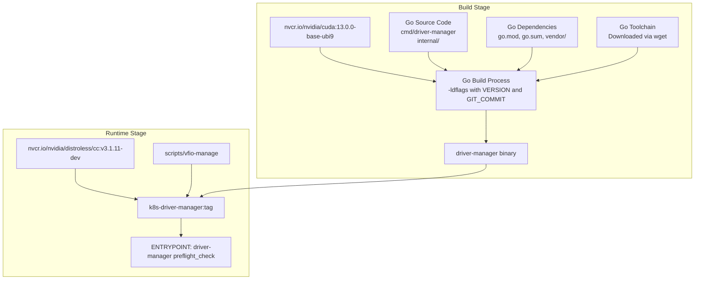
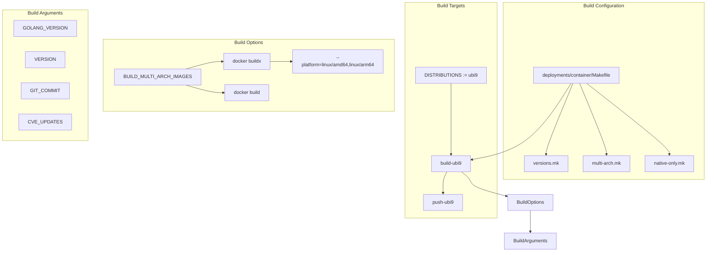
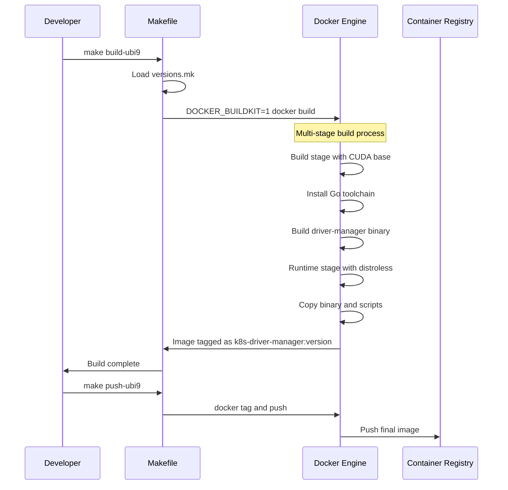
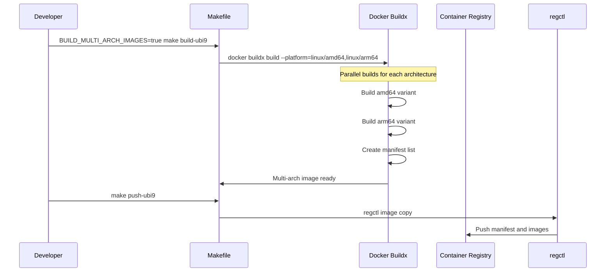

<!-- source: DeepWiki mcp.deepwiki.com · repo NVIDIA/k8s-driver-manager · page 4.1 Container Images · fetched 2026-10-26 -->

# Container Images

<details>
<summary>Relevant source files</summary>

The following files were used as context for generating this wiki page:

- [deployments/container/Dockerfile.ubi9](deployments/container/Dockerfile.ubi9)
- [deployments/container/Makefile](deployments/container/Makefile)
- [deployments/container/multi-arch.mk](deployments/container/multi-arch.mk)
- [deployments/container/native-only.mk](deployments/container/native-only.mk)

</details>


This page documents the container image build process for the k8s-driver-manager, including the multi-stage build architecture, multi-architecture support, and the Make-based build system. This covers how the driver-manager application is packaged into container images for deployment on Kubernetes clusters.

For information about the CI/CD pipelines that orchestrate these builds, see [CI/CD Pipelines](#4.2). For deployment configurations that use these images, see the main [Deployment](#4) section.

## Build Architecture Overview

The k8s-driver-manager uses a multi-stage Docker build process to create optimized container images. The build system supports both single-architecture and multi-architecture image creation.

### Multi-Stage Build Process



The build process uses `nvcr.io/nvidia/cuda:13.0.0-base-ubi9` as the build base image and `nvcr.io/nvidia/distroless/cc:v3.1.11-dev` as the minimal runtime image. The final image contains the `driver-manager` binary and the `vfio-manage` script.

Sources: [deployments/container/Dockerfile.ubi9:15-72]()

### Build System Components



The build system uses Make targets to orchestrate Docker builds. The `BUILD_MULTI_ARCH_IMAGES` variable controls whether single-architecture or multi-architecture builds are performed.

Sources: [deployments/container/Makefile:15-70](), [deployments/container/multi-arch.mk:15-24](), [deployments/container/native-only.mk:15-19]()

## Multi-Architecture Support

The build system supports creating images for multiple CPU architectures through Docker Buildx.

### Architecture Detection and Go Installation

The Dockerfile includes architecture detection logic for downloading the appropriate Go toolchain:

| Architecture Input | Detected ARCH | Go Binary |
|-------------------|---------------|-----------|
| `x86_64`, `amd64` | `amd64` | `go${VERSION}.linux-amd64.tar.gz` |
| `ppc64el`, `ppc64le` | `ppc64le` | `go${VERSION}.linux-ppc64le.tar.gz` |
| `aarch64`, `arm64` | `arm64` | `go${VERSION}.linux-arm64.tar.gz` |

Sources: [deployments/container/Dockerfile.ubi9:28-38]()

### Build Configuration Modes

The system supports two build modes controlled by the `BUILD_MULTI_ARCH_IMAGES` variable:

#### Multi-Architecture Mode

When `BUILD_MULTI_ARCH_IMAGES=true`:
- Uses `docker buildx build` with platform options
- Targets: `--platform=linux/amd64,linux/arm64`
- Supports pushing during build: `--output=type=image,push=$(PUSH_ON_BUILD)`
- Uses `regctl` for image copying between registries

Sources: [deployments/container/multi-arch.mk:15-24]()

#### Native-Only Mode  

When `BUILD_MULTI_ARCH_IMAGES=false`:
- Uses standard `docker build`
- Platform: `--platform=linux/amd64`
- Uses `docker tag` and `docker push` for publishing

Sources: [deployments/container/native-only.mk:15-19]()

## Image Configuration

### Base Images and Dependencies

The container build process uses specific base images for different stages:

| Stage | Base Image | Purpose |
|-------|------------|---------|
| Build | `nvcr.io/nvidia/cuda:13.0.0-base-ubi9` | Provides CUDA environment and build tools |
| Runtime | `nvcr.io/nvidia/distroless/cc:v3.1.11-dev` | Minimal runtime with C library dependencies |

### Build Arguments and Labels

The image accepts several build arguments for customization:

| Build Argument | Purpose | Example |
|----------------|---------|---------|
| `GOLANG_VERSION` | Go version for building | `1.21.3` |
| `VERSION` | Application version | `v0.6.8` |
| `GIT_COMMIT` | Git commit hash | `abc123def` |
| `CVE_UPDATES` | Security updates | `true` |
| `TARGETARCH` | Target architecture | `amd64` |

The final image includes metadata labels:

```dockerfile
LABEL io.k8s.display-name="NVIDIA Driver Upgrade Manager for Kubernetes"
LABEL name="NVIDIA Driver Upgrade Manager for Kubernetes"  
LABEL vendor="NVIDIA"
LABEL version="${VERSION}"
```

Sources: [deployments/container/Dockerfile.ubi9:44-68]()

## Build Process Flow

### Standard Build Process



### Multi-Architecture Build Process

For multi-architecture builds, the process uses Docker Buildx:



Sources: [deployments/container/Makefile:57-70](), [deployments/container/multi-arch.mk:21-24]()

## Image Naming and Versioning

### Default Image Configuration

The build system uses the following defaults:

| Variable | Default Value | Purpose |
|----------|---------------|---------|
| `REGISTRY` | `nvidia` | Default registry prefix |
| `IMAGE_NAME` | `$(REGISTRY)/k8s-driver-manager` | Full image name |
| `IMAGE_VERSION` | `$(VERSION)` | Version from versions.mk |
| `IMAGE` | `$(IMAGE_NAME):$(IMAGE_VERSION)` | Complete image reference |

### Output Image Customization

The system supports customizing the output image name and version:

| Variable | Purpose |
|----------|---------|
| `OUT_IMAGE_NAME` | Override output image name |
| `OUT_IMAGE_VERSION` | Override output version |
| `OUT_IMAGE` | Final output image reference |

This allows building with one name/version and pushing with different credentials or to different registries.

Sources: [deployments/container/Makefile:25-36]()

---

